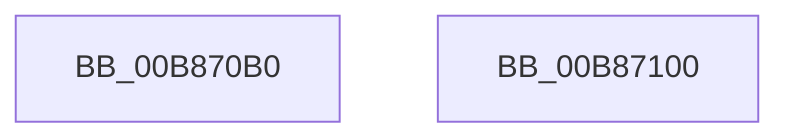

# KdpCheckLowMemory

- RVA: `0x00B870B0`–`0x00B87101` (길이 `81` bytes)
- VA: `0x0000000140B870B0`
- 실행 섹션: `PAGEKD`
- PDB 이름 있음: `예`; PDB Function 태그: `아니요`
- unwind 정보 RVA: `0x00064C80`
- 디코드: `21`개 명령, `81/81` bytes 표시
- 미해석 바이트: `0` (있으면 어셈블리에 `.byte`로 보존)

> 이 문서는 커널 이미지의 기계어와 PDB 기호를 분석해 생성했습니다. 4번과 5번은 함수 원형과 자료형을 바이너리 사용 방식에서 추정한 C 해석이며 원본 소스 복구 결과는 아닙니다.

## 1. Dependencies

- 직접 호출 지점: **2**; 고유 호출 대상: **2**
- 직접 호출자로 확인된 함수: **1**
- RIP 상대 이미지 참조: **2**

### Outgoing calls
- `0x00B870D3` → [KdpSysCheckLowMemory](KdpSysCheckLowMemory_function_00B884F0.md) (function, `0x00B884F0`)
- `0x00B870EE` → `kdcom.dll!KdSendPacket` (import, 간접 대상; import `kdcom.dll!KdSendPacket`)

### Direct callers
- [KdpSendWaitContinue](KdpSendWaitContinue_function_00B8A32C.md) at `0x00B8A466`

### Static image references
- `0x00B870DE` → RVA `0x00F475E0` (`.data`; read)
- `0x00B870EE` → RVA `0x001516C0` (`kdcom.dll!KdSendPacket (IAT)`; read)

## 2. Other-region calls and transfers

- 다른 실행 섹션으로 향하는 call: **0**
- 별도 외부 분기/꼬리 이동을 확인하지 못했습니다.

## 3. Assembly (complete function range)

```asm
00B870B0  40 53                           push rbx
00B870B2  48 83 EC 30                     sub rsp, 0x30
00B870B6  B8 38 00 00 00                  mov eax, 0x38
00B870BB  0F 57 C0                        xorps xmm0, xmm0
00B870BE  0F 11 44 24 20                  movups xmmword ptr [rsp + 0x20], xmm0
00B870C3  48 8B D9                        mov rbx, rcx
00B870C6  48 89 4C 24 28                  mov qword ptr [rsp + 0x28], rcx
00B870CB  66 89 44 24 20                  mov word ptr [rsp + 0x20], ax
00B870D0  8D 48 CC                        lea ecx, [rax - 0x34]
00B870D3  E8 18 14 00 00                  call 0x140b884f0
00B870D8  45 33 C0                        xor r8d, r8d
00B870DB  89 43 08                        mov dword ptr [rbx + 8], eax
00B870DE  4C 8D 0D FB 04 3C 00            lea r9, [rip + 0x3c04fb]
00B870E5  48 8D 54 24 20                  lea rdx, [rsp + 0x20]
00B870EA  41 8D 48 02                     lea ecx, [r8 + 2]
00B870EE  48 FF 15 CB A5 5C FF            call qword ptr [rip - 0xa35a35]
00B870F5  0F 1F 44 00 00                  nop dword ptr [rax + rax]
00B870FA  48 83 C4 30                     add rsp, 0x30
00B870FE  5B                              pop rbx
00B870FF  C3                              ret
00B87100  CC                              int3
```

## 4. C-style interpretation (structured pseudocode)

```c
__int64 __fastcall KdpCheckLowMemory(__int64 a1, __int64 a2, int a3)
{
    __int64 result;
    __int64 v_rsp;
    unsigned __int64 v_stack_m10;
    unsigned __int64 v_stack_m18;

    v_rsp = (v_rsp) - (48);
    v_stack_m18 = v_xmm0;
    v_stack_m10 = a1;
    v_stack_m18 = 56;
    result = KdpSysCheckLowMemory(56 - 52, a2, a3, a4);
    a3 = 0;
    *(unsigned int *)(a1 + 8) = (unsigned int)(result);
    result = kdcom_dll_KdSendPacket(a3 + 2, v_stack_m18, a3, v_rip + 3933435);
    v_rsp = (v_rsp) + (48);
    return result;
}
```

## 5. (Beta) C Style

```c
int64_t KdpCheckLowMemory(void *Arg1, int64_t Arg2, int32_t Arg3)
{
    uint8_t *arg1 = (uint8_t *)Arg1;

    int64_t result;
    int64_t local_rsp;
    uint64_t v_stack_m10;
    uint64_t v_stack_m18;

    local_rsp = (local_rsp) - (48);
    v_stack_m18 = v_xmm0;
    v_stack_m10 = Arg1;
    v_stack_m18 = 56;
    result = KdpSysCheckLowMemory(56 - 52, Arg2, Arg3, a4);
    Arg3 = 0;
    *(uint32_t *)(arg1 + 0x8) = (uint32_t)(result);
    result = kernel_indirect_call(Arg3 + 2, v_stack_m18, Arg3, v_rip + 3933435);
    local_rsp = (local_rsp) + (48);
    return result;
}
```

### 관측된 메모리 오프셋

구조체 형식이 확인되지 않은 접근은 인자 기준의 오프셋으로만 기록했습니다.

| 기준 인자 | 오프셋 표현 | 폭 (bit) | 접근 |
|---|---:|---:|---|
| `Arg1` | `+ 0x8` | `32` | `W` |

## 6. Execution-region graph

[열기: 2D/3D 그래프와 함수 탐색 컨트롤 패널](../../../control-panel.html?section=pagekd&rva=0x00B870B0&view=graph)

- 2D 그래프는 위에서 아래로 흐르고, 3D 그래프는 빈 공간을 드래그해 회전합니다. Shift+드래그는 이동, 휠은 확대·축소, 함수 노드 선택은 대상 보고서 이동입니다.

### Static fallback


