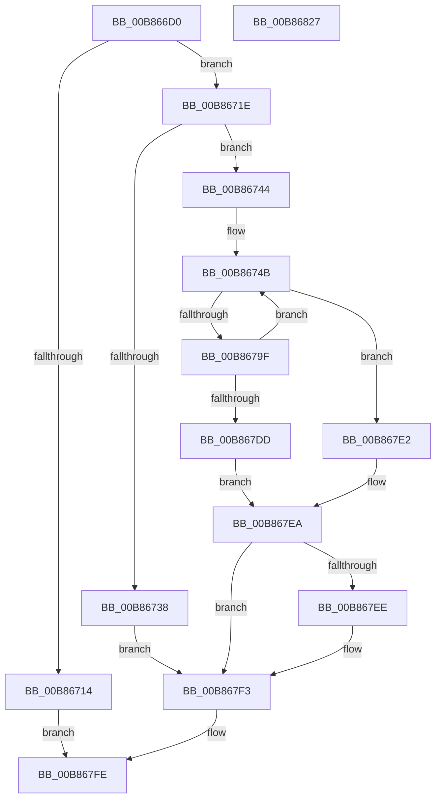

# KdpCloseRemoteFile

- RVA: `0x00B866D0`–`0x00B86828` (길이 `344` bytes)
- VA: `0x0000000140B866D0`
- 실행 섹션: `PAGEKD`
- PDB 이름 있음: `예`; PDB Function 태그: `아니요`
- unwind 정보 RVA: `0x000C9894`
- 디코드: `86`개 명령, `344/344` bytes 표시
- 미해석 바이트: `0` (있으면 어셈블리에 `.byte`로 보존)

> 이 문서는 커널 이미지의 기계어와 PDB 기호를 분석해 생성했습니다. 4번과 5번은 함수 원형과 자료형을 바이너리 사용 방식에서 추정한 C 해석이며 원본 소스 복구 결과는 아닙니다.

## 1. Dependencies

- 직접 호출 지점: **6**; 고유 호출 대상: **6**
- 직접 호출자로 확인된 함수: **1**
- RIP 상대 이미지 참조: **7**

### Outgoing calls
- `0x00B8670A` → [memset](../../text/6C/memset_function_006C6C40.md) (function, `0x006C6C40`)
- `0x00B86722` → [KdEnterDebugger](KdEnterDebugger_function_00B8A96C.md) (function, `0x00B8A96C`)
- `0x00B8678A` → `kdcom.dll!KdSendPacket` (import, 간접 대상; import `kdcom.dll!KdSendPacket`)
- `0x00B867C9` → `kdcom.dll!KdReceivePacket` (import, 간접 대상; import `kdcom.dll!KdReceivePacket`)
- `0x00B867F6` → [KdExitDebugger](KdExitDebugger_function_00B85008.md) (function, `0x00B85008`)
- `0x00B86805` → [_security_check_cookie](../../text/6A/_security_check_cookie_function_006AC640.md) (function, `0x006AC640`)

### Direct callers
- [KdpPullRemoteFile](KdpPullRemoteFile_function_00B86B48.md) at `0x00B86CC0`

### Static image references
- `0x00B866EF` → RVA `0x00E0A740` (`.data`; read)
- `0x00B86727` → RVA `0x00F55BE0` (`.data`; read)
- `0x00B86744` → RVA `0x00F475E0` (`.data`; read)
- `0x00B8678A` → RVA `0x001516C0` (`kdcom.dll!KdSendPacket (IAT)`; read)
- `0x00B86796` → RVA `0x00F475DC` (`.data`; read)
- `0x00B867B1` → RVA `0x00E12710` (`.data`; read)
- `0x00B867C9` → RVA `0x001516B0` (`kdcom.dll!KdReceivePacket (IAT)`; read)

## 2. Other-region calls and transfers

- 다른 실행 섹션으로 향하는 call: **2**
  - `0x00B8670A` → [memset](../../text/6C/memset_function_006C6C40.md) (`PAGEKD` → `.text`)
  - `0x00B86805` → [_security_check_cookie](../../text/6A/_security_check_cookie_function_006AC640.md) (`PAGEKD` → `.text`)
- 별도 외부 분기/꼬리 이동을 확인하지 못했습니다.

## 3. Assembly (complete function range)

```asm
00B866D0  48 8B C4                        mov rax, rsp
00B866D3  48 89 58 10                     mov qword ptr [rax + 0x10], rbx
00B866D7  48 89 78 18                     mov qword ptr [rax + 0x18], rdi
00B866DB  4C 89 68 20                     mov qword ptr [rax + 0x20], r13
00B866DF  55                              push rbp
00B866E0  41 56                           push r14
00B866E2  41 57                           push r15
00B866E4  48 8D 68 A1                     lea rbp, [rax - 0x5f]
00B866E8  48 81 EC B0 00 00 00            sub rsp, 0xb0
00B866EF  48 8B 05 4A 40 28 00            mov rax, qword ptr [rip + 0x28404a]
00B866F6  48 33 C4                        xor rax, rsp
00B866F9  48 89 45 37                     mov qword ptr [rbp + 0x37], rax
00B866FD  33 D2                           xor edx, edx
00B866FF  8D 59 FF                        lea ebx, [rcx - 1]
00B86702  48 8D 4D F7                     lea rcx, [rbp - 9]
00B86706  44 8D 42 40                     lea r8d, [rdx + 0x40]
00B8670A  E8 31 05 B4 FF                  call 0x1406c6c40
00B8670F  83 FB 10                        cmp ebx, 0x10
00B86712  72 0A                           jb 0x140b8671e
00B86714  B8 0D 00 00 C0                  mov eax, 0xc000000d
00B86719  E9 E0 00 00 00                  jmp 0x140b867fe
00B8671E  33 D2                           xor edx, edx
00B86720  33 C9                           xor ecx, ecx
00B86722  E8 45 42 00 00                  call 0x140b8a96c
00B86727  4C 8D 35 B2 F4 3C 00            lea r14, [rip + 0x3cf4b2]
00B8672E  40 8A F8                        mov dil, al
00B86731  49 83 3C DE 00                  cmp qword ptr [r14 + rbx*8], 0
00B86736  75 0C                           jne 0x140b86744
00B86738  C7 45 FB 0D 00 00 C0            mov dword ptr [rbp - 5], 0xc000000d
00B8673F  E9 AF 00 00 00                  jmp 0x140b867f3
00B86744  4C 8D 2D 95 0E 3C 00            lea r13, [rip + 0x3c0e95]
00B8674B  49 8B 04 DE                     mov rax, qword ptr [r14 + rbx*8]
00B8674F  48 8D 55 CF                     lea rdx, [rbp - 0x31]
00B86753  83 65 D3 00                     and dword ptr [rbp - 0x2d], 0
00B86757  45 33 C0                        xor r8d, r8d
00B8675A  83 65 C7 00                     and dword ptr [rbp - 0x39], 0
00B8675E  0F 57 C0                        xorps xmm0, xmm0
00B86761  83 65 FB 00                     and dword ptr [rbp - 5], 0
00B86765  4D 8B CD                        mov r9, r13
00B86768  48 89 45 FF                     mov qword ptr [rbp - 1], rax
00B8676C  48 8D 45 F7                     lea rax, [rbp - 9]
00B86770  41 8D 48 0B                     lea ecx, [r8 + 0xb]
00B86774  C7 45 F7 33 34 00 00            mov dword ptr [rbp - 9], 0x3433
00B8677B  0F 11 45 DF                     movups xmmword ptr [rbp - 0x21], xmm0
00B8677F  C7 45 CF 40 00 40 00            mov dword ptr [rbp - 0x31], 0x400040
00B86786  48 89 45 D7                     mov qword ptr [rbp - 0x29], rax
00B8678A  48 FF 15 2F AF 5C FF            call qword ptr [rip - 0xa350d1]
00B86791  0F 1F 44 00 00                  nop dword ptr [rax + rax]
00B86796  80 3D 3F 0E 3C 00 00            cmp byte ptr [rip + 0x3c0e3f], 0
00B8679D  75 43                           jne 0x140b867e2
00B8679F  B8 00 30 00 00                  mov eax, 0x3000
00B867A4  4C 89 6C 24 20                  mov qword ptr [rsp + 0x20], r13
00B867A9  66 89 45 E1                     mov word ptr [rbp - 0x1f], ax
00B867AD  4C 8D 4D C7                     lea r9, [rbp - 0x39]
00B867B1  48 8D 05 58 BF 28 00            lea rax, [rip + 0x28bf58]
00B867B8  B9 0B 00 00 00                  mov ecx, 0xb
00B867BD  4C 8D 45 DF                     lea r8, [rbp - 0x21]
00B867C1  48 89 45 E7                     mov qword ptr [rbp - 0x19], rax
00B867C5  48 8D 55 CF                     lea rdx, [rbp - 0x31]
00B867C9  48 FF 15 E0 AE 5C FF            call qword ptr [rip - 0xa35120]
00B867D0  0F 1F 44 00 00                  nop dword ptr [rax + rax]
00B867D5  85 C0                           test eax, eax
00B867D7  0F 85 6E FF FF FF               jne 0x140b8674b
00B867DD  8B 45 FB                        mov eax, dword ptr [rbp - 5]
00B867E0  EB 08                           jmp 0x140b867ea
00B867E2  B8 54 03 00 C0                  mov eax, 0xc0000354
00B867E7  89 45 FB                        mov dword ptr [rbp - 5], eax
00B867EA  85 C0                           test eax, eax
00B867EC  78 05                           js 0x140b867f3
00B867EE  49 83 24 DE 00                  and qword ptr [r14 + rbx*8], 0
00B867F3  40 8A CF                        mov cl, dil
00B867F6  E8 0D E8 FF FF                  call 0x140b85008
00B867FB  8B 45 FB                        mov eax, dword ptr [rbp - 5]
00B867FE  48 8B 4D 37                     mov rcx, qword ptr [rbp + 0x37]
00B86802  48 33 CC                        xor rcx, rsp
00B86805  E8 36 5E B2 FF                  call 0x1406ac640
00B8680A  4C 8D 9C 24 B0 00 00 00         lea r11, [rsp + 0xb0]
00B86812  49 8B 5B 28                     mov rbx, qword ptr [r11 + 0x28]
00B86816  49 8B 7B 30                     mov rdi, qword ptr [r11 + 0x30]
00B8681A  4D 8B 6B 38                     mov r13, qword ptr [r11 + 0x38]
00B8681E  49 8B E3                        mov rsp, r11
00B86821  41 5F                           pop r15
00B86823  41 5E                           pop r14
00B86825  5D                              pop rbp
00B86826  C3                              ret
00B86827  CC                              int3
```

## 4. C-style interpretation (structured pseudocode)

```c
__int64 __fastcall KdpCloseRemoteFile(__int64 a1, int a2)
{
    __int64 result;
    __int64 v_rsp;
    unsigned __int64 v_stack_m18;
    unsigned __int64 v_stack_mA8;

    *(unsigned __int64 *)(v_rsp + 16) = v_rbx;
    *(unsigned __int64 *)(v_rsp + 24) = v_rdi;
    *(unsigned __int64 *)(v_rsp + 32) = v_r13;
    v_rsp = (v_rsp) - (176);
    result = (*(unsigned __int64 *)(v_rip + 2637898)) ^ (v_rsp);
    *(unsigned __int64 *)(v_rsp - 95 + 55) = result;
    a2 = 0;
    result = memset(v_rsp - 95 - 9, a2, a2 + 64, a4);
    if (((unsigned int)(a1 - 1)) < 16) goto loc_00B8671E;
    goto loc_00B867FE;
loc_00B8671E:
    a2 = 0;
    a1 = 0;
    result = KdEnterDebugger(a1, a2, a2 + 64, a4);
    if ((*(unsigned __int64 *)(v_rip + 3994802 + a1 - 1 * 8)) != 0) goto loc_00B86744;
    *(unsigned int *)(v_rsp - 95 - 5) = 0xC000000DULL;
    goto loc_00B867F3;
loc_00B86744:
loc_00B8674B:
    a3 = 0;
    *(unsigned __int64 *)(v_rsp - 95 - 1) = *(unsigned __int64 *)(v_rip + 3994802 + a1 - 1 * 8);
    *(unsigned int *)(v_rsp - 95 - 9) = 0x3433ULL;
    *(unsigned __int64 *)(v_rsp - 95 - 33) = v_xmm0;
    *(unsigned int *)(v_rsp - 95 - 49) = 0x400040ULL;
    *(unsigned __int64 *)(v_rsp - 95 - 41) = v_rsp - 95 - 9;
    result = kdcom_dll_KdSendPacket(a3 + 11, v_rsp - 95 - 49, a3, v_rip + 3935893);
    if ((*(unsigned __int8 *)(v_rip + 3935807)) != 0) goto loc_00B867E2;
    v_stack_mA8 = v_rip + 3935893;
    *(unsigned __int16 *)(v_rsp - 95 - 31) = (unsigned __int16)((unsigned int)(0x3000ULL));
    *(unsigned __int64 *)(v_rsp - 95 - 25) = v_rip + 2670424;
    result = kdcom_dll_KdReceivePacket(11, v_rsp - 95 - 49, v_rsp - 95 - 33, v_rsp - 95 - 57);
    if ((unsigned int)(result) != 0) goto loc_00B8674B;
    goto loc_00B867EA;
loc_00B867E2:
    *(unsigned int *)(v_rsp - 95 - 5) = (unsigned int)((unsigned int)(0xC0000354ULL));
loc_00B867EA:
    if (!(sign_flag)) {
    }
    result = KdExitDebugger((unsigned __int8)((unsigned __int8)(result)), v_rsp - 95 - 49, v_rsp - 95 - 33, v_rsp - 95 - 57);
loc_00B867FE:
    a1 = (*(unsigned __int64 *)(v_rsp - 95 + 55)) ^ (v_rsp);
    result = _security_check_cookie(a1, v_rsp - 95 - 49, v_rsp - 95 - 33, v_rsp - 95 - 57);
    return result;
}
```

## 5. (Beta) C Style

```c
int64_t KdpCloseRemoteFile(void *Arg1, int32_t Arg2)
{
    uint8_t *arg1 = (uint8_t *)Arg1;

    int64_t result;
    int64_t local_rsp;
    uint64_t v_stack_m18;
    uint64_t v_stack_mA8;

    *(uint64_t *)(local_rsp + 0x10) = local_rbx;
    *(uint64_t *)(local_rsp + 0x18) = local_rdi;
    *(uint64_t *)(local_rsp + 0x20) = local_r13;
    local_rsp = (local_rsp) - (176);
    result = (*(uint64_t *)(v_rip + 0x28404A)) ^ (local_rsp);
    *(uint64_t *)(local_rsp - 0x5F + 0x37) = result;
    Arg2 = 0;
    result = memset(local_rsp - 95 - 9, Arg2, Arg2 + 64, a4);
    if (((uint32_t)(Arg1 - 1)) < 16) goto loc_00B8671E;
    goto loc_00B867FE;
loc_00B8671E:
    Arg2 = 0;
    Arg1 = 0;
    result = KdEnterDebugger(Arg1, Arg2, Arg2 + 64, a4);
    if ((*(uint64_t *)(v_rip + 0x3CF4B2 + arg1 - 0x1 * 8)) != 0) goto loc_00B86744;
    *(uint32_t *)(local_rsp - 0x5F - 0x5) = 0xC000000DULL;
    goto loc_00B867F3;
loc_00B86744:
loc_00B8674B:
    a3 = 0;
    *(uint64_t *)(local_rsp - 0x5F - 0x1) = *(uint64_t *)(v_rip + 0x3CF4B2 + arg1 - 0x1 * 8);
    *(uint32_t *)(local_rsp - 0x5F - 0x9) = 0x3433ULL;
    *(uint64_t *)(local_rsp - 0x5F - 0x21) = v_xmm0;
    *(uint32_t *)(local_rsp - 0x5F - 0x31) = 0x400040ULL;
    *(uint64_t *)(local_rsp - 0x5F - 0x29) = local_rsp - 95 - 9;
    result = kernel_indirect_call(a3 + 11, local_rsp - 95 - 49, a3, v_rip + 3935893);
    if ((*(uint8_t *)(v_rip + 0x3C0E3F)) != 0) goto loc_00B867E2;
    v_stack_mA8 = v_rip + 3935893;
    *(uint16_t *)(local_rsp - 0x5F - 0x1F) = (uint16_t)((uint32_t)(0x3000ULL));
    *(uint64_t *)(local_rsp - 0x5F - 0x19) = v_rip + 2670424;
    result = kernel_indirect_call(11, local_rsp - 95 - 49, local_rsp - 95 - 33, local_rsp - 95 - 57);
    if ((uint32_t)(result) != 0) goto loc_00B8674B;
    goto loc_00B867EA;
loc_00B867E2:
    *(uint32_t *)(local_rsp - 0x5F - 0x5) = (uint32_t)((uint32_t)(0xC0000354ULL));
loc_00B867EA:
    if (!(sign_flag)) {
    }
    result = KdExitDebugger((uint8_t)((uint8_t)(result)), local_rsp - 95 - 49, local_rsp - 95 - 33, local_rsp - 95 - 57);
loc_00B867FE:
    Arg1 = (*(uint64_t *)(local_rsp - 0x5F + 0x37)) ^ (local_rsp);
    result = _security_check_cookie(Arg1, local_rsp - 95 - 49, local_rsp - 95 - 33, local_rsp - 95 - 57);
    return result;
}
```

### 관측된 메모리 오프셋

구조체 형식이 확인되지 않은 접근은 인자 기준의 오프셋으로만 기록했습니다.

| 기준 인자 | 오프셋 표현 | 폭 (bit) | 접근 |
|---|---:|---:|---|
| `Arg1` | `- 0x1` | `32` | `R` |

## 6. Execution-region graph

[열기: 2D/3D 그래프와 함수 탐색 컨트롤 패널](../../../control-panel.html?section=pagekd&rva=0x00B866D0&view=graph)

- 2D 그래프는 위에서 아래로 흐르고, 3D 그래프는 빈 공간을 드래그해 회전합니다. Shift+드래그는 이동, 휠은 확대·축소, 함수 노드 선택은 대상 보고서 이동입니다.

### Static fallback


