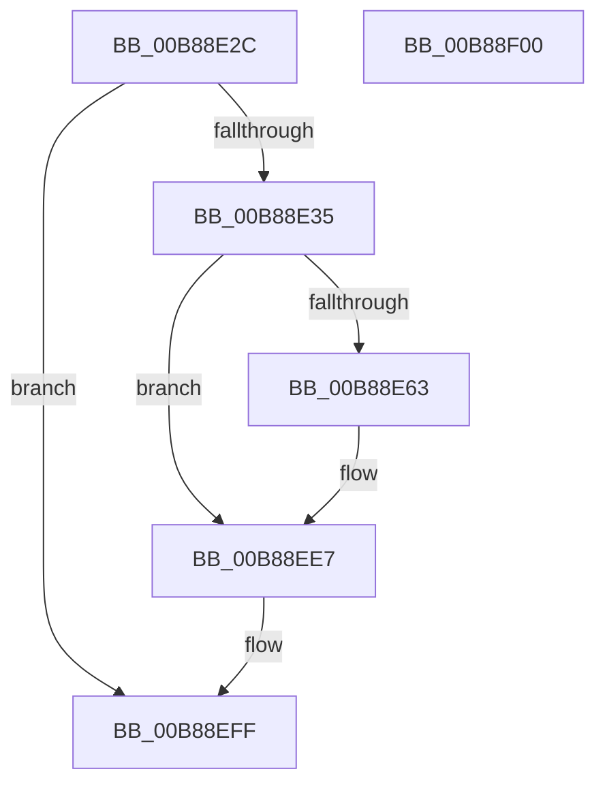

# KdpCommandString

- RVA: `0x00B88E2C`–`0x00B88F01` (길이 `213` bytes)
- VA: `0x0000000140B88E2C`
- 실행 섹션: `PAGEKD`
- PDB 이름 있음: `예`; PDB Function 태그: `아니요`
- unwind 정보 RVA: `0x000BDCB4`
- 디코드: `51`개 명령, `213/213` bytes 표시
- 미해석 바이트: `0` (있으면 어셈블리에 `.byte`로 보존)

> 이 문서는 커널 이미지의 기계어와 PDB 기호를 분석해 생성했습니다. 4번과 5번은 함수 원형과 자료형을 바이너리 사용 방식에서 추정한 C 해석이며 원본 소스 복구 결과는 아닙니다.

## 1. Dependencies

- 직접 호출 지점: **7**; 고유 호출 대상: **6**
- 직접 호출자로 확인된 함수: **1**
- RIP 상대 이미지 참조: **1**

### Outgoing calls
- `0x00B88E6D` → [KdEnterDebugger](KdEnterDebugger_function_00B8A96C.md) (function, `0x00B8A96C`)
- `0x00B88E88` → [KiSaveProcessorControlState](../../text/6B/KiSaveProcessorControlState_function_006B0EF0.md) (function, `0x006B0EF0`)
- `0x00B88EA1` → [KdpCopyContext](KdpCopyContext_function_00B851E8.md) (function, `0x00B851E8`)
- `0x00B88EB3` → [KdpReportCommandStringStateChange](KdpReportCommandStringStateChange_function_00B87AAC.md) (function, `0x00B87AAC`)
- `0x00B88ECE` → [KdpCopyContext](KdpCopyContext_function_00B851E8.md) (function, `0x00B851E8`)
- `0x00B88EDA` → [KiRestoreProcessorControlState](../../text/6B/KiRestoreProcessorControlState_function_006B0E20.md) (function, `0x006B0E20`)
- `0x00B88EE2` → [KdExitDebugger](KdExitDebugger_function_00B85008.md) (function, `0x00B85008`)

### Direct callers
- [KdpTrap](KdpTrap_function_00B852B8.md) at `0x00B8535D`

### Static image references
- `0x00B88E4D` → RVA `0x00F475DC` (`.data`; read)

## 2. Other-region calls and transfers

- 다른 실행 섹션으로 향하는 call: **2**
  - `0x00B88E88` → [KiSaveProcessorControlState](../../text/6B/KiSaveProcessorControlState_function_006B0EF0.md) (`PAGEKD` → `.text`)
  - `0x00B88EDA` → [KiRestoreProcessorControlState](../../text/6B/KiRestoreProcessorControlState_function_006B0E20.md) (`PAGEKD` → `.text`)
- 별도 외부 분기/꼬리 이동을 확인하지 못했습니다.

## 3. Assembly (complete function range)

```asm
00B88E2C  45 84 C0                        test r8b, r8b
00B88E2F  0F 85 CA 00 00 00               jne 0x140b88eff
00B88E35  48 89 5C 24 08                  mov qword ptr [rsp + 8], rbx
00B88E3A  48 89 6C 24 10                  mov qword ptr [rsp + 0x10], rbp
00B88E3F  48 89 74 24 18                  mov qword ptr [rsp + 0x18], rsi
00B88E44  57                              push rdi
00B88E45  41 56                           push r14
00B88E47  41 57                           push r15
00B88E49  48 83 EC 20                     sub rsp, 0x20
00B88E4D  44 38 05 88 E7 3B 00            cmp byte ptr [rip + 0x3be788], r8b
00B88E54  4D 8B F1                        mov r14, r9
00B88E57  48 8B DA                        mov rbx, rdx
00B88E5A  4C 8B F9                        mov r15, rcx
00B88E5D  0F 85 84 00 00 00               jne 0x140b88ee7
00B88E63  48 8B 54 24 68                  mov rdx, qword ptr [rsp + 0x68]
00B88E68  48 8B 4C 24 60                  mov rcx, qword ptr [rsp + 0x60]
00B88E6D  E8 FA 1A 00 00                  call 0x140b8a96c
00B88E72  65 48 8B 3C 25 20 00 00 00      mov rdi, qword ptr gs:[0x20]
00B88E7B  40 8A E8                        mov bpl, al
00B88E7E  48 8D B7 00 01 00 00            lea rsi, [rdi + 0x100]
00B88E85  48 8B CE                        mov rcx, rsi
00B88E88  E8 63 80 B2 FF                  call 0x1406b0ef0
00B88E8D  41 8B 56 30                     mov edx, dword ptr [r14 + 0x30]
00B88E91  4D 8B C6                        mov r8, r14
00B88E94  23 97 C8 8F 00 00               and edx, dword ptr [rdi + 0x8fc8]
00B88E9A  48 8B 8F C0 8F 00 00            mov rcx, qword ptr [rdi + 0x8fc0]
00B88EA1  E8 42 C3 FF FF                  call 0x140b851e8
00B88EA6  4C 8B 87 C0 8F 00 00            mov r8, qword ptr [rdi + 0x8fc0]
00B88EAD  48 8B D3                        mov rdx, rbx
00B88EB0  49 8B CF                        mov rcx, r15
00B88EB3  E8 F4 EB FF FF                  call 0x140b87aac
00B88EB8  41 8B 5E 30                     mov ebx, dword ptr [r14 + 0x30]
00B88EBC  49 8B CE                        mov rcx, r14
00B88EBF  4C 8B 87 C0 8F 00 00            mov r8, qword ptr [rdi + 0x8fc0]
00B88EC6  8B D3                           mov edx, ebx
00B88EC8  23 97 C8 8F 00 00               and edx, dword ptr [rdi + 0x8fc8]
00B88ECE  E8 15 C3 FF FF                  call 0x140b851e8
00B88ED3  48 8B CE                        mov rcx, rsi
00B88ED6  41 89 5E 30                     mov dword ptr [r14 + 0x30], ebx
00B88EDA  E8 41 7F B2 FF                  call 0x1406b0e20
00B88EDF  40 8A CD                        mov cl, bpl
00B88EE2  E8 21 C1 FF FF                  call 0x140b85008
00B88EE7  48 8B 5C 24 40                  mov rbx, qword ptr [rsp + 0x40]
00B88EEC  48 8B 6C 24 48                  mov rbp, qword ptr [rsp + 0x48]
00B88EF1  48 8B 74 24 50                  mov rsi, qword ptr [rsp + 0x50]
00B88EF6  48 83 C4 20                     add rsp, 0x20
00B88EFA  41 5F                           pop r15
00B88EFC  41 5E                           pop r14
00B88EFE  5F                              pop rdi
00B88EFF  C3                              ret
00B88F00  CC                              int3
```

## 4. C-style interpretation (structured pseudocode)

```c
__int64 __fastcall KdpCommandString(__int64 a1, __int64 a2, unsigned __int8 a3, __int64 a4, __int64 a5, __int64 a6)
{
    __int64 result;
    __int64 v_rbp;
    __int64 v_rbx;
    __int64 v_rdi;
    __int64 v_rsi;
    __int64 v_rsp;
    unsigned __int64 v_stack_p10;
    unsigned __int64 v_stack_p18;
    unsigned __int64 v_stack_p8;

    if (a3 != 0) goto loc_00B88EFF;
    v_stack_p8 = v_rbx;
    v_stack_p10 = v_rbp;
    v_stack_p18 = v_rsi;
    v_rsp = (v_rsp) - (32);
    v_rbx = a2;
    if ((*(unsigned __int8 *)(v_rip + 3925896)) == a3) {
        a2 = a6;
        a1 = a5;
        result = KdEnterDebugger(a1, a2, a3, a4);
        v_rdi = *(unsigned __int64 *)(gs_base + (0 + 32));
        v_rbp = (unsigned __int8)(result);
        v_rsi = v_rdi + 256;
        a1 = v_rsi;
        result = KiSaveProcessorControlState(a1, a2, a3, a4);
        a2 = *(unsigned int *)(a4 + 48);
        a3 = a4;
        a2 = (unsigned int)((a2) & (*(unsigned int *)(v_rdi + 36808)));
        a1 = *(unsigned __int64 *)(v_rdi + 36800);
        result = KdpCopyContext(a1, a2, a3, a4);
        a3 = *(unsigned __int64 *)(v_rdi + 36800);
        a2 = a2;
        a1 = a1;
        result = KdpReportCommandStringStateChange(a1, a2, a3, a4);
        v_rbx = *(unsigned int *)(a4 + 48);
        a1 = a4;
        a3 = *(unsigned __int64 *)(v_rdi + 36800);
        a2 = (unsigned int)(v_rbx);
        a2 = (unsigned int)((a2) & (*(unsigned int *)(v_rdi + 36808)));
        result = KdpCopyContext(a1, a2, a3, a4);
        a1 = v_rsi;
        *(unsigned int *)(a4 + 48) = (unsigned int)(v_rbx);
        result = KiRestoreProcessorControlState(a1, a2, a3, a4);
        a1 = (unsigned __int8)(v_rbp);
        result = KdExitDebugger(a1, a2, a3, a4);
    }
    v_rsp = (v_rsp) + (32);
loc_00B88EFF:
    return result;
}
```

## 5. (Beta) C Style

```c
int64_t KdpCommandString(int64_t Arg1, int64_t Arg2, uint8_t Arg3, void *Arg4, int64_t Arg5, int64_t Arg6)
{
    uint8_t *arg4 = (uint8_t *)Arg4;

    int64_t result;
    int64_t local_rbp;
    int64_t local_rbx;
    int64_t local_rdi;
    int64_t local_rsi;
    int64_t local_rsp;
    uint64_t v_stack_p10;
    uint64_t v_stack_p18;
    uint64_t v_stack_p8;

    if (Arg3 != 0) goto loc_00B88EFF;
    v_stack_p8 = local_rbx;
    v_stack_p10 = local_rbp;
    v_stack_p18 = local_rsi;
    local_rsp = (local_rsp) - (32);
    local_rbx = Arg2;
    if ((*(uint8_t *)(v_rip + 0x3BE788)) == Arg3) {
        Arg2 = Arg6;
        Arg1 = Arg5;
        result = KdEnterDebugger(Arg1, Arg2, Arg3, Arg4);
        local_rdi = *(uint64_t *)(gs_base + (0 + 0x20));
        local_rbp = (uint8_t)(result);
        local_rsi = local_rdi + 256;
        Arg1 = local_rsi;
        result = KiSaveProcessorControlState(Arg1, Arg2, Arg3, Arg4);
        Arg2 = *(uint32_t *)(arg4 + 0x30);
        Arg3 = Arg4;
        Arg2 = (uint32_t)((Arg2) & (*(uint32_t *)(local_rdi + 0x8FC8)));
        Arg1 = *(uint64_t *)(local_rdi + 0x8FC0);
        result = KdpCopyContext(Arg1, Arg2, Arg3, Arg4);
        Arg3 = *(uint64_t *)(local_rdi + 0x8FC0);
        Arg2 = Arg2;
        Arg1 = Arg1;
        result = KdpReportCommandStringStateChange(Arg1, Arg2, Arg3, Arg4);
        local_rbx = *(uint32_t *)(arg4 + 0x30);
        Arg1 = Arg4;
        Arg3 = *(uint64_t *)(local_rdi + 0x8FC0);
        Arg2 = (uint32_t)(local_rbx);
        Arg2 = (uint32_t)((Arg2) & (*(uint32_t *)(local_rdi + 0x8FC8)));
        result = KdpCopyContext(Arg1, Arg2, Arg3, Arg4);
        Arg1 = local_rsi;
        *(uint32_t *)(arg4 + 0x30) = (uint32_t)(local_rbx);
        result = KiRestoreProcessorControlState(Arg1, Arg2, Arg3, Arg4);
        Arg1 = (uint8_t)(local_rbp);
        result = KdExitDebugger(Arg1, Arg2, Arg3, Arg4);
    }
    local_rsp = (local_rsp) + (32);
loc_00B88EFF:
    return result;
}
```

### 관측된 메모리 오프셋

구조체 형식이 확인되지 않은 접근은 인자 기준의 오프셋으로만 기록했습니다.

| 기준 인자 | 오프셋 표현 | 폭 (bit) | 접근 |
|---|---:|---:|---|
| `Arg4` | `+ 0x30` | `32` | `R` |
| `Arg4` | `+ 0x30` | `32` | `W` |

## 6. Execution-region graph

[열기: 2D/3D 그래프와 함수 탐색 컨트롤 패널](../../../control-panel.html?section=pagekd&rva=0x00B88E2C&view=graph)

- 2D 그래프는 위에서 아래로 흐르고, 3D 그래프는 빈 공간을 드래그해 회전합니다. Shift+드래그는 이동, 휠은 확대·축소, 함수 노드 선택은 대상 보고서 이동입니다.

### Static fallback


