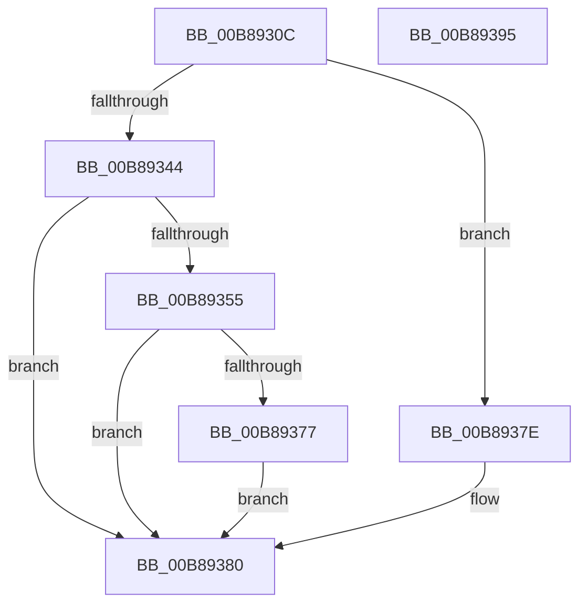

# KdpCopyCodeStream

- RVA: `0x00B8930C`–`0x00B89396` (길이 `138` bytes)
- VA: `0x0000000140B8930C`
- 실행 섹션: `PAGEKD`
- PDB 이름 있음: `예`; PDB Function 태그: `아니요`
- unwind 정보 RVA: `0x00066400`
- 디코드: `42`개 명령, `138/138` bytes 표시
- 미해석 바이트: `0` (있으면 어셈블리에 `.byte`로 보존)

> 이 문서는 커널 이미지의 기계어와 PDB 기호를 분석해 생성했습니다. 4번과 5번은 함수 원형과 자료형을 바이너리 사용 방식에서 추정한 C 해석이며 원본 소스 복구 결과는 아닙니다.

## 1. Dependencies

- 직접 호출 지점: **2**; 고유 호출 대상: **1**
- 직접 호출자로 확인된 함수: **6**
- RIP 상대 이미지 참조: **1**

### Outgoing calls
- `0x00B8933B` → [KdpCopyMemoryChunks](KdpCopyMemoryChunks_function_00B8AACC.md) (function, `0x00B8AACC`)
- `0x00B8936E` → [KdpCopyMemoryChunks](KdpCopyMemoryChunks_function_00B8AACC.md) (function, `0x00B8AACC`)

### Direct callers
- [KdpAddBreakpoint](KdpAddBreakpoint_function_00B897E8.md) at `0x00B898EA`
- [KdpInsertBreakpoint](KdpInsertBreakpoint_function_00B899F0.md) at `0x00B89A26`
- [KdpLowRestoreBreakpoint](KdpLowRestoreBreakpoint_function_00B89A54.md) at `0x00B89ABF`
- [KdpLowWriteContent](KdpLowWriteContent_function_00B89B0C.md) at `0x00B89B7C`
- [KdpRemoveBreakpoint](KdpRemoveBreakpoint_function_00B89BDC.md) at `0x00B89C13`
- [KdpSetOwedBreakpoints](KdpSetOwedBreakpoints_function_00B8A7DC.md) at `0x00B8A904`

### Static image references
- `0x00B89346` → RVA `0x00F55BC0` (`.data`; write)

## 2. Other-region calls and transfers

- 다른 실행 섹션으로 향하는 call: **0**
- 별도 외부 분기/꼬리 이동을 확인하지 못했습니다.

## 3. Assembly (complete function range)

```asm
00B8930C  48 8B C4                        mov rax, rsp
00B8930F  48 89 58 08                     mov qword ptr [rax + 8], rbx
00B89313  48 89 68 10                     mov qword ptr [rax + 0x10], rbp
00B89317  48 89 70 18                     mov qword ptr [rax + 0x18], rsi
00B8931B  57                              push rdi
00B8931C  48 83 EC 30                     sub rsp, 0x30
00B89320  48 83 60 F0 00                  and qword ptr [rax - 0x10], 0
00B89325  41 8B D9                        mov ebx, r9d
00B89328  0F BA EB 07                     bts ebx, 7
00B8932C  45 8B C8                        mov r9d, r8d
00B8932F  89 58 E8                        mov dword ptr [rax - 0x18], ebx
00B89332  41 8B F8                        mov edi, r8d
00B89335  48 8B F2                        mov rsi, rdx
00B89338  48 8B E9                        mov rbp, rcx
00B8933B  E8 8C 17 00 00                  call 0x140b8aacc
00B89340  85 C0                           test eax, eax
00B89342  79 3A                           jns 0x140b8937e
00B89344  8B CB                           mov ecx, ebx
00B89346  C6 05 73 C8 3C 00 01            mov byte ptr [rip + 0x3cc873], 1
00B8934D  83 E1 05                        and ecx, 5
00B89350  80 F9 05                        cmp cl, 5
00B89353  75 2B                           jne 0x140b89380
00B89355  48 83 64 24 28 00               and qword ptr [rsp + 0x28], 0
00B8935B  83 CB 40                        or ebx, 0x40
00B8935E  44 8B CF                        mov r9d, edi
00B89361  89 5C 24 20                     mov dword ptr [rsp + 0x20], ebx
00B89365  44 8B C7                        mov r8d, edi
00B89368  48 8B D6                        mov rdx, rsi
00B8936B  48 8B CD                        mov rcx, rbp
00B8936E  E8 59 17 00 00                  call 0x140b8aacc
00B89373  85 C0                           test eax, eax
00B89375  78 09                           js 0x140b89380
00B89377  B8 03 01 00 00                  mov eax, 0x103
00B8937C  EB 02                           jmp 0x140b89380
00B8937E  33 C0                           xor eax, eax
00B89380  48 8B 5C 24 40                  mov rbx, qword ptr [rsp + 0x40]
00B89385  48 8B 6C 24 48                  mov rbp, qword ptr [rsp + 0x48]
00B8938A  48 8B 74 24 50                  mov rsi, qword ptr [rsp + 0x50]
00B8938F  48 83 C4 30                     add rsp, 0x30
00B89393  5F                              pop rdi
00B89394  C3                              ret
00B89395  CC                              int3
```

## 4. C-style interpretation (structured pseudocode)

```c
__int64 __fastcall KdpCopyCodeStream(__int64 a1, __int64 a2, int a3, int a4)
{
    __int64 result;
    __int64 v_rbx;
    __int64 v_rsp;
    unsigned __int64 v_stack_m10;
    unsigned int v_stack_m18;
    unsigned __int64 v_stack_p10;
    unsigned __int64 v_stack_p18;
    unsigned __int64 v_stack_p8;

    *(unsigned __int64 *)(v_rsp + 8) = v_rbx;
    *(unsigned __int64 *)(v_rsp + 16) = v_rbp;
    *(unsigned __int64 *)(v_rsp + 24) = v_rsi;
    v_rsp = (v_rsp) - (48);
    *(unsigned int *)(v_rsp - 24) = (unsigned int)((unsigned int)(a4));
    result = KdpCopyMemoryChunks(a1, a2, a3, (unsigned int)(a3));
    if (!sign_flag) goto loc_00B8937E;
    *(unsigned __int8 *)(v_rip + 3983475) = 1;
    a1 = (unsigned int)(((unsigned int)((unsigned int)((unsigned int)(a4)))) & (5));
    if (((unsigned __int8)(a1)) != 5) goto loc_00B89380;
    v_rbx = (unsigned int)(((unsigned int)(a4)) | (64));
    v_stack_m18 = (unsigned int)(v_rbx);
    result = KdpCopyMemoryChunks(a1, a2, (unsigned int)((unsigned int)((unsigned int)(a3))), (unsigned int)((unsigned int)((unsigned int)(a3))));
    if (sign_flag) goto loc_00B89380;
    goto loc_00B89380;
loc_00B8937E:
    result = 0;
loc_00B89380:
    v_rsp = (v_rsp) + (48);
    return result;
}
```

## 5. (Beta) C Style

```c
int64_t KdpCopyCodeStream(int64_t Arg1, int64_t Arg2, int32_t Arg3, int32_t Arg4)
{
    int64_t result;
    int64_t local_rbx;
    int64_t local_rsp;
    uint64_t v_stack_m10;
    uint32_t v_stack_m18;
    uint64_t v_stack_p10;
    uint64_t v_stack_p18;
    uint64_t v_stack_p8;

    *(uint64_t *)(local_rsp + 0x8) = local_rbx;
    *(uint64_t *)(local_rsp + 0x10) = local_rbp;
    *(uint64_t *)(local_rsp + 0x18) = local_rsi;
    local_rsp = (local_rsp) - (48);
    *(uint32_t *)(local_rsp - 0x18) = (uint32_t)((uint32_t)(Arg4));
    result = KdpCopyMemoryChunks(Arg1, Arg2, Arg3, (uint32_t)(Arg3));
    if (!sign_flag) goto loc_00B8937E;
    *(uint8_t *)(v_rip + 0x3CC873) = 1;
    Arg1 = (uint32_t)(((uint32_t)((uint32_t)((uint32_t)(Arg4)))) & (5));
    if (((uint8_t)(Arg1)) != 5) goto loc_00B89380;
    local_rbx = (uint32_t)(((uint32_t)(Arg4)) | (64));
    v_stack_m18 = (uint32_t)(local_rbx);
    result = KdpCopyMemoryChunks(Arg1, Arg2, (uint32_t)((uint32_t)((uint32_t)(Arg3))), (uint32_t)((uint32_t)((uint32_t)(Arg3))));
    if (sign_flag) goto loc_00B89380;
    goto loc_00B89380;
loc_00B8937E:
    result = 0;
loc_00B89380:
    local_rsp = (local_rsp) + (48);
    return result;
}
```

## 6. Execution-region graph

[열기: 2D/3D 그래프와 함수 탐색 컨트롤 패널](../../../control-panel.html?section=pagekd&rva=0x00B8930C&view=graph)

- 2D 그래프는 위에서 아래로 흐르고, 3D 그래프는 빈 공간을 드래그해 회전합니다. Shift+드래그는 이동, 휠은 확대·축소, 함수 노드 선택은 대상 보고서 이동입니다.

### Static fallback


