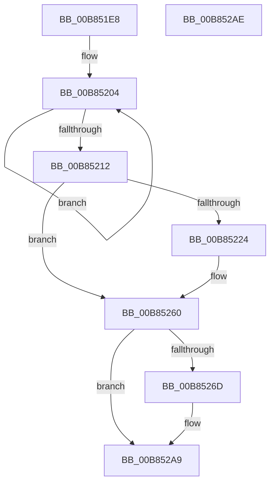

# KdpCopyContext

- RVA: `0x00B851E8`–`0x00B852AF` (길이 `199` bytes)
- VA: `0x0000000140B851E8`
- 실행 섹션: `PAGEKD`
- PDB 이름 있음: `예`; PDB Function 태그: `아니요`
- unwind 정보 RVA: `0x0005C788`
- 디코드: `48`개 명령, `199/199` bytes 표시
- 미해석 바이트: `0` (있으면 어셈블리에 `.byte`로 보존)

> 이 문서는 커널 이미지의 기계어와 PDB 기호를 분석해 생성했습니다. 4번과 5번은 함수 원형과 자료형을 바이너리 사용 방식에서 추정한 C 해석이며 원본 소스 복구 결과는 아닙니다.

## 1. Dependencies

- 직접 호출 지점: **2**; 고유 호출 대상: **1**
- 직접 호출자로 확인된 함수: **6**
- RIP 상대 이미지 참조: **0**

### Outgoing calls
- `0x00B8525B` → [KdpQuickMoveMemory](KdpQuickMoveMemory_function_00B85490.md) (function, `0x00B85490`)
- `0x00B852A4` → [KdpQuickMoveMemory](KdpQuickMoveMemory_function_00B85490.md) (function, `0x00B85490`)

### Direct callers
- [KdpReport](../../text/4D/KdpReport_function_004DF360.md) at `0x004DF404`
- [KdpReport](../../text/4D/KdpReport_function_004DF360.md) at `0x004DF442`
- [KdpSetContextEx](../../text/5B/KdpSetContextEx_function_005B0D64.md) at `0x005B0E41`
- [KdpGetContext](KdpGetContext_function_00B872F8.md) at `0x00B873B6`
- [KdpSetContext](KdpSetContext_function_00B88424.md) at `0x00B884B0`
- [KdpCommandString](KdpCommandString_function_00B88E2C.md) at `0x00B88EA1`
- [KdpCommandString](KdpCommandString_function_00B88E2C.md) at `0x00B88ECE`
- [KdpSymbol](KdpSymbol_function_00B89220.md) at `0x00B8929E`
- [KdpSymbol](KdpSymbol_function_00B89220.md) at `0x00B892CD`

### Static image references
- 디코드된 RIP-relative 메모리 참조가 없습니다.

## 2. Other-region calls and transfers

- 다른 실행 섹션으로 향하는 call: **0**
- 별도 외부 분기/꼬리 이동을 확인하지 못했습니다.

## 3. Assembly (complete function range)

```asm
00B851E8  48 83 EC 28                     sub rsp, 0x28
00B851EC  4C 8B D1                        mov r10, rcx
00B851EF  44 8B CA                        mov r9d, edx
00B851F2  49 8B C8                        mov rcx, r8
00B851F5  49 8B D2                        mov rdx, r10
00B851F8  4D 8B D8                        mov r11, r8
00B851FB  48 2B D1                        sub rdx, rcx
00B851FE  41 B8 D0 04 00 00               mov r8d, 0x4d0
00B85204  8A 01                           mov al, byte ptr [rcx]
00B85206  88 04 0A                        mov byte ptr [rdx + rcx], al
00B85209  48 FF C1                        inc rcx
00B8520C  41 83 C0 FF                     add r8d, -1
00B85210  75 F2                           jne 0x140b85204
00B85212  B9 40 00 10 00                  mov ecx, 0x100040
00B85217  45 89 4A 30                     mov dword ptr [r10 + 0x30], r9d
00B8521B  41 8B C1                        mov eax, r9d
00B8521E  23 C1                           and eax, ecx
00B85220  3B C1                           cmp eax, ecx
00B85222  75 3C                           jne 0x140b85260
00B85224  41 8B 82 E4 04 00 00            mov eax, dword ptr [r10 + 0x4e4]
00B8522B  45 8B 83 E4 04 00 00            mov r8d, dword ptr [r11 + 0x4e4]
00B85232  41 3B C0                        cmp eax, r8d
00B85235  49 63 93 E0 04 00 00            movsxd rdx, dword ptr [r11 + 0x4e0]
00B8523C  49 63 8A E0 04 00 00            movsxd rcx, dword ptr [r10 + 0x4e0]
00B85243  44 0F 46 C0                     cmovbe r8d, eax
00B85247  48 81 C2 D0 04 00 00            add rdx, 0x4d0
00B8524E  48 81 C1 D0 04 00 00            add rcx, 0x4d0
00B85255  49 03 D3                        add rdx, r11
00B85258  49 03 CA                        add rcx, r10
00B8525B  E8 30 02 00 00                  call 0x140b85490
00B85260  B8 80 00 10 00                  mov eax, 0x100080
00B85265  44 23 C8                        and r9d, eax
00B85268  44 3B C8                        cmp r9d, eax
00B8526B  75 3C                           jne 0x140b852a9
00B8526D  41 8B 82 EC 04 00 00            mov eax, dword ptr [r10 + 0x4ec]
00B85274  45 8B 83 EC 04 00 00            mov r8d, dword ptr [r11 + 0x4ec]
00B8527B  41 3B C0                        cmp eax, r8d
00B8527E  49 63 93 E8 04 00 00            movsxd rdx, dword ptr [r11 + 0x4e8]
00B85285  49 63 8A E8 04 00 00            movsxd rcx, dword ptr [r10 + 0x4e8]
00B8528C  44 0F 46 C0                     cmovbe r8d, eax
00B85290  48 81 C2 D0 04 00 00            add rdx, 0x4d0
00B85297  48 81 C1 D0 04 00 00            add rcx, 0x4d0
00B8529E  49 03 D3                        add rdx, r11
00B852A1  49 03 CA                        add rcx, r10
00B852A4  E8 E7 01 00 00                  call 0x140b85490
00B852A9  48 83 C4 28                     add rsp, 0x28
00B852AD  C3                              ret
00B852AE  CC                              int3
```

## 4. C-style interpretation (structured pseudocode)

```c
__int64 __fastcall KdpCopyContext(__int64 a1, int a2, __int64 a3)
{
    __int64 result;
    __int64 v_rsp;

    v_rsp = (v_rsp) - (40);
    a2 = (a1) - (a3);
loc_00B85204:
    *(unsigned __int8 *)(a2 + a3 * 1) = (unsigned __int8)(*(unsigned __int8 *)(a3));
    a1 = (a3) + 1;
    a3 = (unsigned int)(((unsigned int)(0x4D0ULL)) + (-1));
    if (condition_is_not_equal) goto loc_00B85204;
    *(unsigned int *)(a1 + 48) = (unsigned int)((unsigned int)(a2));
    result = (unsigned int)(((unsigned int)((unsigned int)((unsigned int)(a2)))) & ((unsigned int)((unsigned int)(0x100040ULL))));
    if (((unsigned int)(result)) == ((unsigned int)((unsigned int)(0x100040ULL)))) {
        result = *(unsigned int *)(a1 + 1252);
        a3 = *(unsigned int *)(a3 + 1252);
        a2 = (int)(*(unsigned int *)(a3 + 1248));
        a1 = (int)(*(unsigned int *)(a1 + 1248));
        if (((unsigned int)(result)) <= ((unsigned int)(a3))) { a3 = (unsigned int)(result); }
        a2 = (a2) + (0x4D0ULL);
        a1 = (a1) + (0x4D0ULL);
        a2 = (a2) + (a3);
        a1 = (a1) + (a1);
        result = KdpQuickMoveMemory(a1, a2, a3, (unsigned int)(a2));
    }
    a4 = (unsigned int)(((unsigned int)(a2)) & ((unsigned int)((unsigned int)(0x100080ULL))));
    result = (unsigned int)(0x100080ULL);
    if (((unsigned int)(a4)) == ((unsigned int)((unsigned int)(0x100080ULL)))) {
        result = *(unsigned int *)(a1 + 1260);
        a3 = *(unsigned int *)(a3 + 1260);
        a2 = (int)(*(unsigned int *)(a3 + 1256));
        a1 = (int)(*(unsigned int *)(a1 + 1256));
        if (((unsigned int)(result)) <= ((unsigned int)(a3))) { a3 = (unsigned int)(result); }
        a2 = (a2) + (0x4D0ULL);
        a1 = (a1) + (0x4D0ULL);
        a2 = (a2) + (a3);
        a1 = (a1) + (a1);
        result = KdpQuickMoveMemory(a1, a2, a3, a4);
    }
    v_rsp = (v_rsp) + (40);
    return result;
}
```

## 5. (Beta) C Style

```c
int64_t KdpCopyContext(void *Arg1, int32_t Arg2, void *Arg3)
{
    uint8_t *arg1 = (uint8_t *)Arg1;
    uint8_t *arg3 = (uint8_t *)Arg3;

    int64_t result;
    int64_t local_rsp;

    local_rsp = (local_rsp) - (40);
    Arg2 = (Arg1) - (Arg3);
loc_00B85204:
    *(uint8_t *)(Arg2 + arg3 * 1) = (uint8_t)(*(uint8_t *)(arg3));
    Arg1 = (Arg3) + 1;
    Arg3 = (uint32_t)(((uint32_t)(0x4D0ULL)) + (-1));
    if (condition_is_not_equal) goto loc_00B85204;
    *(uint32_t *)(arg1 + 0x30) = (uint32_t)((uint32_t)(Arg2));
    result = (uint32_t)(((uint32_t)((uint32_t)((uint32_t)(Arg2)))) & ((uint32_t)((uint32_t)(0x100040ULL))));
    if (((uint32_t)(result)) == ((uint32_t)((uint32_t)(0x100040ULL)))) {
        result = *(uint32_t *)(arg1 + 0x4E4);
        Arg3 = *(uint32_t *)(arg3 + 0x4E4);
        Arg2 = (int32_t)(*(uint32_t *)(arg3 + 0x4E0));
        Arg1 = (int32_t)(*(uint32_t *)(arg1 + 0x4E0));
        if (((uint32_t)(result)) <= ((uint32_t)(Arg3))) { Arg3 = (uint32_t)(result); }
        Arg2 = (Arg2) + (0x4D0ULL);
        Arg1 = (Arg1) + (0x4D0ULL);
        Arg2 = (Arg2) + (Arg3);
        Arg1 = (Arg1) + (Arg1);
        result = KdpQuickMoveMemory(Arg1, Arg2, Arg3, (uint32_t)(Arg2));
    }
    a4 = (uint32_t)(((uint32_t)(Arg2)) & ((uint32_t)((uint32_t)(0x100080ULL))));
    result = (uint32_t)(0x100080ULL);
    if (((uint32_t)(a4)) == ((uint32_t)((uint32_t)(0x100080ULL)))) {
        result = *(uint32_t *)(arg1 + 0x4EC);
        Arg3 = *(uint32_t *)(arg3 + 0x4EC);
        Arg2 = (int32_t)(*(uint32_t *)(arg3 + 0x4E8));
        Arg1 = (int32_t)(*(uint32_t *)(arg1 + 0x4E8));
        if (((uint32_t)(result)) <= ((uint32_t)(Arg3))) { Arg3 = (uint32_t)(result); }
        Arg2 = (Arg2) + (0x4D0ULL);
        Arg1 = (Arg1) + (0x4D0ULL);
        Arg2 = (Arg2) + (Arg3);
        Arg1 = (Arg1) + (Arg1);
        result = KdpQuickMoveMemory(Arg1, Arg2, Arg3, a4);
    }
    local_rsp = (local_rsp) + (40);
    return result;
}
```

### 관측된 메모리 오프셋

구조체 형식이 확인되지 않은 접근은 인자 기준의 오프셋으로만 기록했습니다.

| 기준 인자 | 오프셋 표현 | 폭 (bit) | 접근 |
|---|---:|---:|---|
| `Arg1` | `+ 0x0 + rcx*1` | `8` | `W` |
| `Arg1` | `+ 0x30` | `32` | `W` |
| `Arg1` | `+ 0x4E0` | `32` | `R` |
| `Arg1` | `+ 0x4E4` | `32` | `R` |
| `Arg3` | `+ 0x4E0` | `32` | `R` |
| `Arg3` | `+ 0x4E4` | `32` | `R` |

## 6. Execution-region graph

[열기: 2D/3D 그래프와 함수 탐색 컨트롤 패널](../../../control-panel.html?section=pagekd&rva=0x00B851E8&view=graph)

- 2D 그래프는 위에서 아래로 흐르고, 3D 그래프는 빈 공간을 드래그해 회전합니다. Shift+드래그는 이동, 휠은 확대·축소, 함수 노드 선택은 대상 보고서 이동입니다.

### Static fallback


