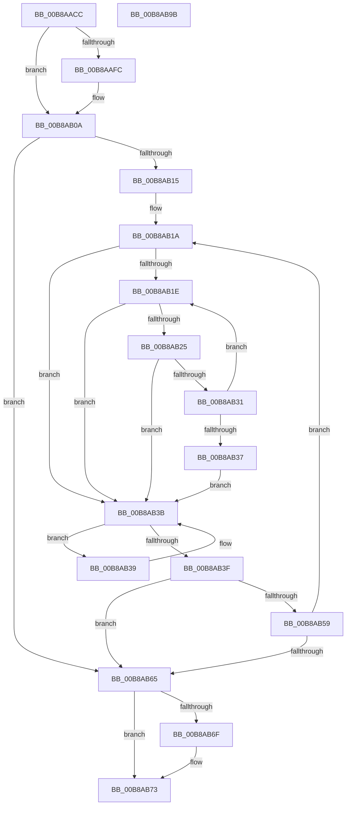

# KdpCopyMemoryChunks

- RVA: `0x00B8AACC`–`0x00B8AB9C` (길이 `208` bytes)
- VA: `0x0000000140B8AACC`
- 실행 섹션: `PAGEKD`
- PDB 이름 있음: `예`; PDB Function 태그: `아니요`
- unwind 정보 RVA: `0x000847EC`
- 디코드: `70`개 명령, `208/208` bytes 표시
- 미해석 바이트: `0` (있으면 어셈블리에 `.byte`로 보존)

> 이 문서는 커널 이미지의 기계어와 PDB 기호를 분석해 생성했습니다. 4번과 5번은 함수 원형과 자료형을 바이너리 사용 방식에서 추정한 C 해석이며 원본 소스 복구 결과는 아닙니다.

## 1. Dependencies

- 직접 호출 지점: **1**; 고유 호출 대상: **1**
- 직접 호출자로 확인된 함수: **18**
- RIP 상대 이미지 참조: **0**

### Outgoing calls
- `0x00B8AB50` → [MmDbgCopyMemory](../../text/68/MmDbgCopyMemory_function_006861E8.md) (function, `0x006861E8`)

### Direct callers
- [KdpSetCommonState](../../text/4E/KdpSetCommonState_function_004E0298.md) at `0x004E0343`
- [KdpSetCommonState](../../text/4E/KdpSetCommonState_function_004E0298.md) at `0x004E0384`
- [KdSystemDebugControl](../../page/74/KdSystemDebugControl_function_00744700.md) at `0x0074495C`
- [KdpCreateRemoteFile](KdpCreateRemoteFile_function_00B86920.md) at `0x00B86A32`
- [KdpFillMemory](KdpFillMemory_function_00B87108.md) at `0x00B871A7`
- [KdpReadPhysicalMemory](KdpReadPhysicalMemory_function_00B877D8.md) at `0x00B878B1`
- [KdpReadVirtualMemory](KdpReadVirtualMemory_function_00B879E8.md) at `0x00B87A58`
- [KdpReportCommandStringStateChange](KdpReportCommandStringStateChange_function_00B87AAC.md) at `0x00B87B6D`
- [KdpReportCommandStringStateChange](KdpReportCommandStringStateChange_function_00B87AAC.md) at `0x00B87BCD`
- [KdpReportLoadSymbolsStateChange](KdpReportLoadSymbolsStateChange_function_00B87C44.md) at `0x00B87D04`
- [KdpRestoreBreakPointEx](KdpRestoreBreakPointEx_function_00B87D80.md) at `0x00B87DF8`
- [KdpWriteBreakPointEx](KdpWriteBreakPointEx_function_00B886D4.md) at `0x00B88771`
- [KdpWriteBreakPointEx](KdpWriteBreakPointEx_function_00B886D4.md) at `0x00B88809`
- [KdpWritePhysicalMemory](KdpWritePhysicalMemory_function_00B88B00.md) at `0x00B88B6A`
- [KdpWriteVirtualMemory](KdpWriteVirtualMemory_function_00B88BA0.md) at `0x00B88BD1`
- [KdLogDbgPrint](KdLogDbgPrint_function_00B88C20.md) at `0x00B88D45`
- [KdLogDbgPrint](KdLogDbgPrint_function_00B88C20.md) at `0x00B88D6C`
- [KdLogDbgPrint](KdLogDbgPrint_function_00B88C20.md) at `0x00B88DBA`
- [KdpCopyCodeStream](KdpCopyCodeStream_function_00B8930C.md) at `0x00B8933B`
- [KdpCopyCodeStream](KdpCopyCodeStream_function_00B8930C.md) at `0x00B8936E`
- [KdpSysReadControlSpace](KdpSysReadControlSpace_function_00B89658.md) at `0x00B8970F`
- [KdpSysWriteControlSpace](KdpSysWriteControlSpace_function_00B89740.md) at `0x00B897B8`
- [KdpPrintString](KdpPrintString_function_00B89CE8.md) at `0x00B89D3F`
- [KdpPromptString](KdpPromptString_function_00B89DE0.md) at `0x00B89E3F`
- [KdpPromptString](KdpPromptString_function_00B89DE0.md) at `0x00B89F2B`

### Static image references
- 디코드된 RIP-relative 메모리 참조가 없습니다.

## 2. Other-region calls and transfers

- 다른 실행 섹션으로 향하는 call: **1**
  - `0x00B8AB50` → [MmDbgCopyMemory](../../text/68/MmDbgCopyMemory_function_006861E8.md) (`PAGEKD` → `.text`)
- 별도 외부 분기/꼬리 이동을 확인하지 못했습니다.

## 3. Assembly (complete function range)

```asm
00B8AACC  48 8B C4                        mov rax, rsp
00B8AACF  48 89 58 08                     mov qword ptr [rax + 8], rbx
00B8AAD3  48 89 68 10                     mov qword ptr [rax + 0x10], rbp
00B8AAD7  48 89 70 18                     mov qword ptr [rax + 0x18], rsi
00B8AADB  48 89 78 20                     mov qword ptr [rax + 0x20], rdi
00B8AADF  41 54                           push r12
00B8AAE1  41 56                           push r14
00B8AAE3  41 57                           push r15
00B8AAE5  48 83 EC 30                     sub rsp, 0x30
00B8AAE9  BD 08 00 00 00                  mov ebp, 8
00B8AAEE  41 8B F0                        mov esi, r8d
00B8AAF1  4C 8B FA                        mov r15, rdx
00B8AAF4  4C 8B F1                        mov r14, rcx
00B8AAF7  44 3B CD                        cmp r9d, ebp
00B8AAFA  77 0E                           ja 0x140b8ab0a
00B8AAFC  45 85 C9                        test r9d, r9d
00B8AAFF  41 8B E9                        mov ebp, r9d
00B8AB02  B8 04 00 00 00                  mov eax, 4
00B8AB07  0F 44 E8                        cmove ebp, eax
00B8AB0A  8B FE                           mov edi, esi
00B8AB0C  BB 01 00 00 00                  mov ebx, 1
00B8AB11  85 F6                           test esi, esi
00B8AB13  74 50                           je 0x140b8ab65
00B8AB15  44 8B 64 24 70                  mov r12d, dword ptr [rsp + 0x70]
00B8AB1A  3B DD                           cmp ebx, ebp
00B8AB1C  73 1D                           jae 0x140b8ab3b
00B8AB1E  8D 14 1B                        lea edx, [rbx + rbx]
00B8AB21  3B D7                           cmp edx, edi
00B8AB23  77 16                           ja 0x140b8ab3b
00B8AB25  8D 0C 5D FF FF FF FF            lea ecx, [rbx*2 - 1]
00B8AB2C  49 85 CE                        test r14, rcx
00B8AB2F  75 0A                           jne 0x140b8ab3b
00B8AB31  8B DA                           mov ebx, edx
00B8AB33  3B D5                           cmp edx, ebp
00B8AB35  72 E7                           jb 0x140b8ab1e
00B8AB37  EB 02                           jmp 0x140b8ab3b
00B8AB39  D1 EB                           shr ebx, 1
00B8AB3B  3B DF                           cmp ebx, edi
00B8AB3D  77 FA                           ja 0x140b8ab39
00B8AB3F  44 8B CB                        mov r9d, ebx
00B8AB42  44 89 64 24 20                  mov dword ptr [rsp + 0x20], r12d
00B8AB47  44 8B C3                        mov r8d, ebx
00B8AB4A  49 8B D7                        mov rdx, r15
00B8AB4D  49 8B CE                        mov rcx, r14
00B8AB50  E8 93 B6 AF FF                  call 0x1406861e8
00B8AB55  85 C0                           test eax, eax
00B8AB57  78 0C                           js 0x140b8ab65
00B8AB59  8B C3                           mov eax, ebx
00B8AB5B  4C 03 F0                        add r14, rax
00B8AB5E  4C 03 F8                        add r15, rax
00B8AB61  2B FB                           sub edi, ebx
00B8AB63  75 B5                           jne 0x140b8ab1a
00B8AB65  48 8B 44 24 78                  mov rax, qword ptr [rsp + 0x78]
00B8AB6A  48 85 C0                        test rax, rax
00B8AB6D  74 04                           je 0x140b8ab73
00B8AB6F  2B F7                           sub esi, edi
00B8AB71  89 30                           mov dword ptr [rax], esi
00B8AB73  48 8B 5C 24 50                  mov rbx, qword ptr [rsp + 0x50]
00B8AB78  F7 DF                           neg edi
00B8AB7A  48 8B 6C 24 58                  mov rbp, qword ptr [rsp + 0x58]
00B8AB7F  48 8B 74 24 60                  mov rsi, qword ptr [rsp + 0x60]
00B8AB84  1B C0                           sbb eax, eax
00B8AB86  48 8B 7C 24 68                  mov rdi, qword ptr [rsp + 0x68]
00B8AB8B  25 01 00 00 C0                  and eax, 0xc0000001
00B8AB90  48 83 C4 30                     add rsp, 0x30
00B8AB94  41 5F                           pop r15
00B8AB96  41 5E                           pop r14
00B8AB98  41 5C                           pop r12
00B8AB9A  C3                              ret
00B8AB9B  CC                              int3
```

## 4. C-style interpretation (structured pseudocode)

```c
__int64 __fastcall KdpCopyMemoryChunks(__int64 a1, __int64 a2, int a3, int a4, unsigned int a5, __int64 a6)
{
    __int64 result;
    __int64 v_r14;
    __int64 v_r15;
    __int64 v_rbp;
    __int64 v_rbx;
    __int64 v_rdi;
    __int64 v_rsi;
    __int64 v_rsp;
    unsigned int v_stack_m28;
    unsigned __int64 v_stack_p10;
    unsigned __int64 v_stack_p18;
    unsigned __int64 v_stack_p20;
    unsigned __int64 v_stack_p8;

    *(unsigned __int64 *)(v_rsp + 8) = v_rbx;
    *(unsigned __int64 *)(v_rsp + 16) = v_rbp;
    *(unsigned __int64 *)(v_rsp + 24) = v_rsi;
    *(unsigned __int64 *)(v_rsp + 32) = v_rdi;
    v_rsp = (v_rsp) - (48);
    result = v_rsp;
    v_rbp = 8;
    if (a4 <= 8) {
        v_rbp = a4;
        result = 4;
        if (a4 == 0) { v_rbp = (unsigned int)(result); }
    }
    if ((unsigned int)((unsigned int)(a3)) == 0) goto loc_00B8AB65;
loc_00B8AB1A:
    if (1 >= ((unsigned int)(v_rbp))) goto loc_00B8AB3B;
loc_00B8AB1E:
    if (((unsigned int)(1 + 1 * 1)) > ((unsigned int)((unsigned int)((unsigned int)((unsigned int)(a3)))))) goto loc_00B8AB3B;
    if (((a1) & (1 * 2 - 1)) != 0) goto loc_00B8AB3B;
    if (((unsigned int)(1 + 1 * 1)) < ((unsigned int)(v_rbp))) goto loc_00B8AB1E;
    goto loc_00B8AB3B;
loc_00B8AB39:
    v_rbx = (unsigned int)(((unsigned int)((unsigned int)(1 + 1 * 1))) >> (1));
loc_00B8AB3B:
    if (((unsigned int)(v_rbx)) > ((unsigned int)((unsigned int)((unsigned int)((unsigned int)(a3)))))) goto loc_00B8AB39;
    v_stack_m28 = (unsigned int)((unsigned int)(a5));
    result = MmDbgCopyMemory(a1, a2, (unsigned int)((unsigned int)(v_rbx)), (unsigned int)((unsigned int)(v_rbx)));
    if (sign_flag) goto loc_00B8AB65;
    v_r14 = (a1) + ((unsigned int)((unsigned int)(v_rbx)));
    v_r15 = (a2) + ((unsigned int)((unsigned int)(v_rbx)));
    v_rdi = (unsigned int)(((unsigned int)((unsigned int)((unsigned int)(a3)))) - ((unsigned int)(v_rbx)));
    if (condition_is_not_equal) goto loc_00B8AB1A;
loc_00B8AB65:
    v_rsi = (unsigned int)(a3);
    if (a6 != 0) {
        v_rsi = (unsigned int)(((unsigned int)(a3)) - ((unsigned int)(v_rdi)));
        *(unsigned int *)(a6) = (unsigned int)(v_rsi);
    }
    v_rdi = (unsigned int)(-(v_rdi));
    result = (unsigned int)((a6) & (0xC0000001ULL));
    v_rsp = (v_rsp) + (48);
    return result;
}
```

## 5. (Beta) C Style

```c
int64_t KdpCopyMemoryChunks(int64_t Arg1, int64_t Arg2, int32_t Arg3, int32_t Arg4, uint32_t Arg5, int64_t Arg6)
{
    int64_t result;
    int64_t local_r14;
    int64_t local_r15;
    int64_t local_rbp;
    int64_t local_rbx;
    int64_t local_rdi;
    int64_t local_rsi;
    int64_t local_rsp;
    uint32_t v_stack_m28;
    uint64_t v_stack_p10;
    uint64_t v_stack_p18;
    uint64_t v_stack_p20;
    uint64_t v_stack_p8;

    *(uint64_t *)(local_rsp + 0x8) = local_rbx;
    *(uint64_t *)(local_rsp + 0x10) = local_rbp;
    *(uint64_t *)(local_rsp + 0x18) = local_rsi;
    *(uint64_t *)(local_rsp + 0x20) = local_rdi;
    local_rsp = (local_rsp) - (48);
    result = local_rsp;
    local_rbp = 8;
    if (Arg4 <= 8) {
        local_rbp = Arg4;
        result = 4;
        if (Arg4 == 0) { local_rbp = (uint32_t)(result); }
    }
    if ((uint32_t)((uint32_t)(Arg3)) == 0) goto loc_00B8AB65;
loc_00B8AB1A:
    if (1 >= ((uint32_t)(local_rbp))) goto loc_00B8AB3B;
loc_00B8AB1E:
    if (((uint32_t)(1 + 1 * 1)) > ((uint32_t)((uint32_t)((uint32_t)((uint32_t)(Arg3)))))) goto loc_00B8AB3B;
    if (((Arg1) & (1 * 2 - 1)) != 0) goto loc_00B8AB3B;
    if (((uint32_t)(1 + 1 * 1)) < ((uint32_t)(local_rbp))) goto loc_00B8AB1E;
    goto loc_00B8AB3B;
loc_00B8AB39:
    local_rbx = (uint32_t)(((uint32_t)((uint32_t)(1 + 1 * 1))) >> (1));
loc_00B8AB3B:
    if (((uint32_t)(local_rbx)) > ((uint32_t)((uint32_t)((uint32_t)((uint32_t)(Arg3)))))) goto loc_00B8AB39;
    v_stack_m28 = (uint32_t)((uint32_t)(Arg5));
    result = MmDbgCopyMemory(Arg1, Arg2, (uint32_t)((uint32_t)(local_rbx)), (uint32_t)((uint32_t)(local_rbx)));
    if (sign_flag) goto loc_00B8AB65;
    local_r14 = (Arg1) + ((uint32_t)((uint32_t)(local_rbx)));
    local_r15 = (Arg2) + ((uint32_t)((uint32_t)(local_rbx)));
    local_rdi = (uint32_t)(((uint32_t)((uint32_t)((uint32_t)(Arg3)))) - ((uint32_t)(local_rbx)));
    if (condition_is_not_equal) goto loc_00B8AB1A;
loc_00B8AB65:
    local_rsi = (uint32_t)(Arg3);
    if (Arg6 != 0) {
        local_rsi = (uint32_t)(((uint32_t)(Arg3)) - ((uint32_t)(local_rdi)));
        *(uint32_t *)(Arg6) = (uint32_t)(local_rsi);
    }
    local_rdi = (uint32_t)(-(local_rdi));
    result = (uint32_t)((Arg6) & (0xC0000001ULL));
    local_rsp = (local_rsp) + (48);
    return result;
}
```

## 6. Execution-region graph

[열기: 2D/3D 그래프와 함수 탐색 컨트롤 패널](../../../control-panel.html?section=pagekd&rva=0x00B8AACC&view=graph)

- 2D 그래프는 위에서 아래로 흐르고, 3D 그래프는 빈 공간을 드래그해 회전합니다. Shift+드래그는 이동, 휠은 확대·축소, 함수 노드 선택은 대상 보고서 이동입니다.

### Static fallback


