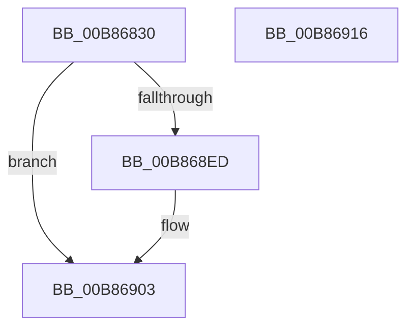

# KdpCreateFileCallback

- RVA: `0x00B86830`–`0x00B86917` (길이 `231` bytes)
- VA: `0x0000000140B86830`
- 실행 섹션: `PAGEKD`
- PDB 이름 있음: `예`; PDB Function 태그: `아니요`
- unwind 정보 RVA: `0x000C9880`
- 디코드: `55`개 명령, `231/231` bytes 표시
- 미해석 바이트: `0` (있으면 어셈블리에 `.byte`로 보존)

> 이 문서는 커널 이미지의 기계어와 PDB 기호를 분석해 생성했습니다. 4번과 5번은 함수 원형과 자료형을 바이너리 사용 방식에서 추정한 C 해석이며 원본 소스 복구 결과는 아닙니다.

## 1. Dependencies

- 직접 호출 지점: **3**; 고유 호출 대상: **2**
- 직접 호출자로 확인된 함수: **0**
- RIP 상대 이미지 참조: **3**

### Outgoing calls
- `0x00B868C5` → [ZwCreateFile](../../text/6A/ZwCreateFile_function_006ADB70.md) (function, `0x006ADB70`)
- `0x00B868E4` → [DbgPrintEx](../../text/35/DbgPrintEx_function_00359290.md) (function, `0x00359290`)
- `0x00B868FE` → [DbgPrintEx](../../text/35/DbgPrintEx_function_00359290.md) (function, `0x00359290`)

### Direct callers
- 이 함수 시작 RVA로 연결되는 직접 call은 확인되지 않았습니다. 간접 호출은 완전히 역산할 수 없습니다.

### Static image references
- `0x00B86842` → RVA `0x00EEFB6C` (`.data`; read)
- `0x00B868D3` → RVA `0x00B8ACC0` (` ?? ::DFIOBLLK::`string'`; read)
- `0x00B868F0` → RVA `0x00B8AD00` (` ?? ::DFIOBLLK::`string'`; read)

## 2. Other-region calls and transfers

- 다른 실행 섹션으로 향하는 call: **3**
  - `0x00B868C5` → [ZwCreateFile](../../text/6A/ZwCreateFile_function_006ADB70.md) (`PAGEKD` → `.text`)
  - `0x00B868E4` → [DbgPrintEx](../../text/35/DbgPrintEx_function_00359290.md) (`PAGEKD` → `.text`)
  - `0x00B868FE` → [DbgPrintEx](../../text/35/DbgPrintEx_function_00359290.md) (`PAGEKD` → `.text`)
- 별도 외부 분기/꼬리 이동을 확인하지 못했습니다.

## 3. Assembly (complete function range)

```asm
00B86830  48 89 5C 24 10                  mov qword ptr [rsp + 0x10], rbx
00B86835  55                              push rbp
00B86836  48 8D 6C 24 A9                  lea rbp, [rsp - 0x57]
00B8683B  48 81 EC A0 00 00 00            sub rsp, 0xa0
00B86842  8B 05 24 93 36 00               mov eax, dword ptr [rip + 0x369324]
00B86848  4C 8B C9                        mov r9, rcx
00B8684B  83 65 43 00                     and dword ptr [rbp + 0x43], 0
00B8684F  0F 57 C0                        xorps xmm0, xmm0
00B86852  48 83 65 2F 00                  and qword ptr [rbp + 0x2f], 0
00B86857  48 89 55 37                     mov qword ptr [rbp + 0x37], rdx
00B8685B  48 C7 45 27 30 00 00 00         mov qword ptr [rbp + 0x27], 0x30
00B86863  83 65 2B 00                     and dword ptr [rbp + 0x2b], 0
00B86867  F7 D8                           neg eax
00B86869  4C 89 45 67                     mov qword ptr [rbp + 0x67], r8
00B8686D  41 8B 41 04                     mov eax, dword ptr [r9 + 4]
00B86871  4C 8D 45 27                     lea r8, [rbp + 0x27]
00B86875  1B D2                           sbb edx, edx
00B86877  C7 45 3F 40 02 00 00            mov dword ptr [rbp + 0x3f], 0x240
00B8687E  83 64 24 50 00                  and dword ptr [rsp + 0x50], 0
00B86883  81 E2 00 00 08 00               and edx, 0x80000
00B86889  48 83 64 24 48 00               and qword ptr [rsp + 0x48], 0
00B8688F  0B 51 08                        or edx, dword ptr [rcx + 8]
00B86892  48 83 C1 10                     add rcx, 0x10
00B86896  89 54 24 40                     mov dword ptr [rsp + 0x40], edx
00B8689A  BA 16 01 12 00                  mov edx, 0x120116
00B8689F  89 44 24 38                     mov dword ptr [rsp + 0x38], eax
00B868A3  41 8B 01                        mov eax, dword ptr [r9]
00B868A6  4C 8D 4D 17                     lea r9, [rbp + 0x17]
00B868AA  83 64 24 30 00                  and dword ptr [rsp + 0x30], 0
00B868AF  89 44 24 28                     mov dword ptr [rsp + 0x28], eax
00B868B3  48 8D 45 67                     lea rax, [rbp + 0x67]
00B868B7  48 89 44 24 20                  mov qword ptr [rsp + 0x20], rax
00B868BC  0F 11 45 17                     movups xmmword ptr [rbp + 0x17], xmm0
00B868C0  F3 0F 7F 45 47                  movdqu xmmword ptr [rbp + 0x47], xmm0
00B868C5  E8 A6 72 B2 FF                  call 0x1406adb70
00B868CA  65 4C 8B 0C 25 88 01 00 00      mov r9, qword ptr gs:[0x188]
00B868D3  4C 8D 05 E6 43 00 00            lea r8, [rip + 0x43e6]
00B868DA  33 D2                           xor edx, edx
00B868DC  89 44 24 20                     mov dword ptr [rsp + 0x20], eax
00B868E0  33 C9                           xor ecx, ecx
00B868E2  8B D8                           mov ebx, eax
00B868E4  E8 A7 29 7D FF                  call 0x140359290
00B868E9  85 DB                           test ebx, ebx
00B868EB  79 16                           jns 0x140b86903
00B868ED  44 8B CB                        mov r9d, ebx
00B868F0  4C 8D 05 09 44 00 00            lea r8, [rip + 0x4409]
00B868F7  BA 02 00 00 00                  mov edx, 2
00B868FC  33 C9                           xor ecx, ecx
00B868FE  E8 8D 29 7D FF                  call 0x140359290
00B86903  8B C3                           mov eax, ebx
00B86905  48 8B 9C 24 B8 00 00 00         mov rbx, qword ptr [rsp + 0xb8]
00B8690D  48 81 C4 A0 00 00 00            add rsp, 0xa0
00B86914  5D                              pop rbp
00B86915  C3                              ret
00B86916  CC                              int3
```

## 4. C-style interpretation (structured pseudocode)

```c
__int64 __fastcall KdpCreateFileCallback(__int64 a1, __int64 a2, __int64 a3)
{
    __int64 result;
    __int64 v_rsp;
    unsigned __int64 v_stack_m18;
    unsigned int v_stack_m1C;
    unsigned int v_stack_m20;
    unsigned __int64 v_stack_m28;
    unsigned __int64 v_stack_m30;
    unsigned int v_stack_m34;
    unsigned __int64 v_stack_m38;
    unsigned __int64 v_stack_m48;
    unsigned int v_stack_m58;
    unsigned __int64 v_stack_m5F;
    unsigned __int64 v_stack_m60;
    unsigned int v_stack_m68;
    unsigned int v_stack_m70;
    unsigned int v_stack_m78;
    unsigned int v_stack_m80;
    unsigned __int64 v_stack_m88;
    unsigned __int64 v_stack_p10;
    unsigned __int64 v_stack_p8;

    v_stack_p10 = v_rbx;
    v_rsp = (v_rsp) - (160);
    v_stack_m28 = a2;
    v_stack_m38 = 48;
    result = (unsigned int)(-((unsigned int)(*(unsigned int *)(v_rip + 3576612))));
    v_stack_p8 = a3;
    v_stack_m20 = 576;
    a2 = (unsigned int)((a2) & (0x80000ULL));
    a2 = (unsigned int)((a2) | (*(unsigned int *)(a1 + 8)));
    a1 = (a1) + (16);
    v_stack_m68 = (unsigned int)(a2);
    v_stack_m70 = (unsigned int)((unsigned int)(*(unsigned int *)(a1 + 4)));
    v_stack_m80 = (unsigned int)((unsigned int)(*(unsigned int *)(a1)));
    v_stack_m88 = v_stack_p8;
    v_stack_m48 = v_xmm0;
    v_stack_m18 = v_xmm0;
    result = ZwCreateFile(a1, (unsigned int)(0x120116ULL), v_stack_m38, v_stack_m48);
    a2 = 0;
    v_stack_m88 = (unsigned int)(result);
    a1 = 0;
    result = DbgPrintEx(a1, a2, v_rip + 17382, *(unsigned __int64 *)(gs_base + (0 + 392)));
    if (sign_flag) {
        a4 = (unsigned int)((unsigned int)((unsigned int)(result)));
        a3 = v_rip + 17417;
        a2 = 2;
        a1 = 0;
        result = DbgPrintEx(a1, a2, a3, a4);
    }
    v_rsp = (v_rsp) + (160);
    return (unsigned int)((unsigned int)((unsigned int)((unsigned int)(result))));
}
```

## 5. (Beta) C Style

```c
int64_t KdpCreateFileCallback(void *Arg1, int64_t Arg2, int64_t Arg3)
{
    uint8_t *arg1 = (uint8_t *)Arg1;

    int64_t result;
    int64_t local_rsp;
    uint64_t v_stack_m18;
    uint32_t v_stack_m1C;
    uint32_t v_stack_m20;
    uint64_t v_stack_m28;
    uint64_t v_stack_m30;
    uint32_t v_stack_m34;
    uint64_t v_stack_m38;
    uint64_t v_stack_m48;
    uint32_t v_stack_m58;
    uint64_t v_stack_m5F;
    uint64_t v_stack_m60;
    uint32_t v_stack_m68;
    uint32_t v_stack_m70;
    uint32_t v_stack_m78;
    uint32_t v_stack_m80;
    uint64_t v_stack_m88;
    uint64_t v_stack_p10;
    uint64_t v_stack_p8;

    v_stack_p10 = local_rbx;
    local_rsp = (local_rsp) - (160);
    v_stack_m28 = Arg2;
    v_stack_m38 = 48;
    result = (uint32_t)(-((uint32_t)(*(uint32_t *)(v_rip + 0x369324))));
    v_stack_p8 = Arg3;
    v_stack_m20 = 576;
    Arg2 = (uint32_t)((Arg2) & (0x80000ULL));
    Arg2 = (uint32_t)((Arg2) | (*(uint32_t *)(arg1 + 0x8)));
    Arg1 = (Arg1) + (16);
    v_stack_m68 = (uint32_t)(Arg2);
    v_stack_m70 = (uint32_t)((uint32_t)(*(uint32_t *)(arg1 + 0x4)));
    v_stack_m80 = (uint32_t)((uint32_t)(*(uint32_t *)(arg1)));
    v_stack_m88 = v_stack_p8;
    v_stack_m48 = v_xmm0;
    v_stack_m18 = v_xmm0;
    result = ZwCreateFile(Arg1, (uint32_t)(0x120116ULL), v_stack_m38, v_stack_m48);
    Arg2 = 0;
    v_stack_m88 = (uint32_t)(result);
    Arg1 = 0;
    result = DbgPrintEx(Arg1, Arg2, v_rip + 17382, *(uint64_t *)(gs_base + (0 + 0x188)));
    if (sign_flag) {
        a4 = (uint32_t)((uint32_t)((uint32_t)(result)));
        Arg3 = v_rip + 17417;
        Arg2 = 2;
        Arg1 = 0;
        result = DbgPrintEx(Arg1, Arg2, Arg3, a4);
    }
    local_rsp = (local_rsp) + (160);
    return (uint32_t)((uint32_t)((uint32_t)((uint32_t)(result))));
}
```

### 관측된 메모리 오프셋

구조체 형식이 확인되지 않은 접근은 인자 기준의 오프셋으로만 기록했습니다.

| 기준 인자 | 오프셋 표현 | 폭 (bit) | 접근 |
|---|---:|---:|---|
| `Arg1` | `+ 0x0` | `32` | `R` |
| `Arg1` | `+ 0x4` | `32` | `R` |
| `Arg1` | `+ 0x8` | `32` | `R` |

## 6. Execution-region graph

[열기: 2D/3D 그래프와 함수 탐색 컨트롤 패널](../../../control-panel.html?section=pagekd&rva=0x00B86830&view=graph)

- 2D 그래프는 위에서 아래로 흐르고, 3D 그래프는 빈 공간을 드래그해 회전합니다. Shift+드래그는 이동, 휠은 확대·축소, 함수 노드 선택은 대상 보고서 이동입니다.

### Static fallback


