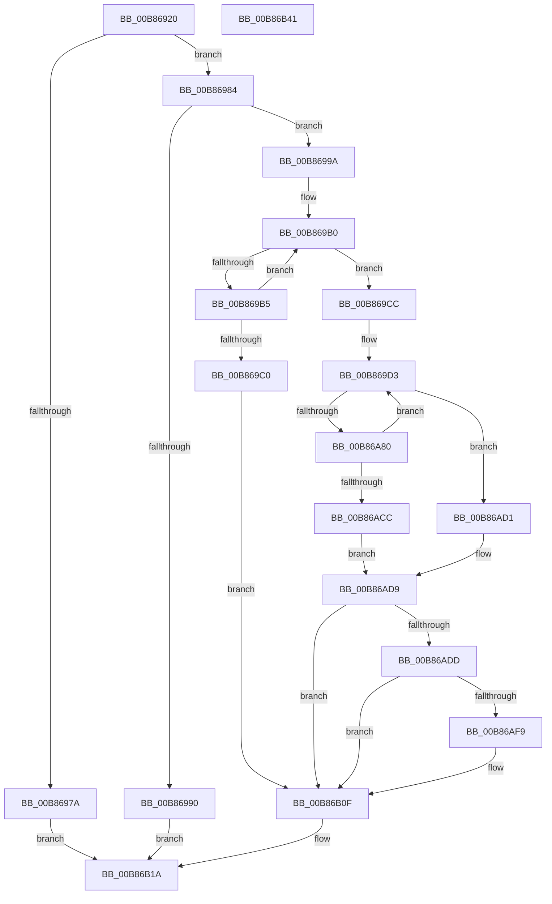

# KdpCreateRemoteFile

- RVA: `0x00B86920`–`0x00B86B42` (길이 `546` bytes)
- VA: `0x0000000140B86920`
- 실행 섹션: `PAGEKD`
- PDB 이름 있음: `예`; PDB Function 태그: `아니요`
- unwind 정보 RVA: `0x000C98BC`
- 디코드: `133`개 명령, `546/546` bytes 표시
- 미해석 바이트: `0` (있으면 어셈블리에 `.byte`로 보존)

> 이 문서는 커널 이미지의 기계어와 PDB 기호를 분석해 생성했습니다. 4번과 5번은 함수 원형과 자료형을 바이너리 사용 방식에서 추정한 C 해석이며 원본 소스 복구 결과는 아닙니다.

## 1. Dependencies

- 직접 호출 지점: **7**; 고유 호출 대상: **7**
- 직접 호출자로 확인된 함수: **1**
- RIP 상대 이미지 참조: **8**

### Outgoing calls
- `0x00B86962` → [memset](../../text/6C/memset_function_006C6C40.md) (function, `0x006C6C40`)
- `0x00B8699E` → [KdEnterDebugger](KdEnterDebugger_function_00B8A96C.md) (function, `0x00B8A96C`)
- `0x00B86A32` → [KdpCopyMemoryChunks](KdpCopyMemoryChunks_function_00B8AACC.md) (function, `0x00B8AACC`)
- `0x00B86A6B` → `kdcom.dll!KdSendPacket` (import, 간접 대상; import `kdcom.dll!KdSendPacket`)
- `0x00B86AB1` → `kdcom.dll!KdReceivePacket` (import, 간접 대상; import `kdcom.dll!KdReceivePacket`)
- `0x00B86B12` → [KdExitDebugger](KdExitDebugger_function_00B85008.md) (function, `0x00B85008`)
- `0x00B86B21` → [_security_check_cookie](../../text/6A/_security_check_cookie_function_006AC640.md) (function, `0x006AC640`)

### Direct callers
- [KdpPullRemoteFile](KdpPullRemoteFile_function_00B86B48.md) at `0x00B86BD4`

### Static image references
- `0x00B8693C` → RVA `0x00E0A740` (`.data`; read)
- `0x00B86967` → RVA `0x00E0AA48` (`.data`; read)
- `0x00B86987` → RVA `0x00F475DC` (`.data`; read)
- `0x00B869A6` → RVA `0x00F55BE0` (`.data`; read)
- `0x00B869CC` → RVA `0x00E12710` (`.data`; read)
- `0x00B86A3B` → RVA `0x00F475E0` (`.data`; read)
- `0x00B86A6B` → RVA `0x001516C0` (`kdcom.dll!KdSendPacket (IAT)`; read)
- `0x00B86AB1` → RVA `0x001516B0` (`kdcom.dll!KdReceivePacket (IAT)`; read)

## 2. Other-region calls and transfers

- 다른 실행 섹션으로 향하는 call: **2**
  - `0x00B86962` → [memset](../../text/6C/memset_function_006C6C40.md) (`PAGEKD` → `.text`)
  - `0x00B86B21` → [_security_check_cookie](../../text/6A/_security_check_cookie_function_006AC640.md) (`PAGEKD` → `.text`)
- 별도 외부 분기/꼬리 이동을 확인하지 못했습니다.

## 3. Assembly (complete function range)

```asm
00B86920  48 89 5C 24 20                  mov qword ptr [rsp + 0x20], rbx
00B86925  55                              push rbp
00B86926  56                              push rsi
00B86927  57                              push rdi
00B86928  41 54                           push r12
00B8692A  41 55                           push r13
00B8692C  41 56                           push r14
00B8692E  41 57                           push r15
00B86930  48 8D 6C 24 F9                  lea rbp, [rsp - 7]
00B86935  48 81 EC B0 00 00 00            sub rsp, 0xb0
00B8693C  48 8B 05 FD 3D 28 00            mov rax, qword ptr [rip + 0x283dfd]
00B86943  48 33 C4                        xor rax, rsp
00B86946  48 89 45 F7                     mov qword ptr [rbp - 9], rax
00B8694A  4D 8B F0                        mov r14, r8
00B8694D  48 8B FA                        mov rdi, rdx
00B86950  4C 8B F9                        mov r15, rcx
00B86953  41 BD 40 00 00 00               mov r13d, 0x40
00B86959  45 8B C5                        mov r8d, r13d
00B8695C  48 8D 4D B7                     lea rcx, [rbp - 0x49]
00B86960  33 D2                           xor edx, edx
00B86962  E8 D9 02 B4 FF                  call 0x1406c6c40
00B86967  44 8B 05 DA 40 28 00            mov r8d, dword ptr [rip + 0x2840da]
00B8696E  41 0F B7 06                     movzx eax, word ptr [r14]
00B86972  4D 2B C5                        sub r8, r13
00B86975  49 3B C0                        cmp rax, r8
00B86978  76 0A                           jbe 0x140b86984
00B8697A  B8 0D 00 00 C0                  mov eax, 0xc000000d
00B8697F  E9 96 01 00 00                  jmp 0x140b86b1a
00B86984  45 33 E4                        xor r12d, r12d
00B86987  44 38 25 4E 0C 3C 00            cmp byte ptr [rip + 0x3c0c4e], r12b
00B8698E  74 0A                           je 0x140b8699a
00B86990  B8 54 03 00 C0                  mov eax, 0xc0000354
00B86995  E9 80 01 00 00                  jmp 0x140b86b1a
00B8699A  33 D2                           xor edx, edx
00B8699C  33 C9                           xor ecx, ecx
00B8699E  E8 C9 3F 00 00                  call 0x140b8a96c
00B869A3  40 8A F0                        mov sil, al
00B869A6  48 8D 0D 33 F2 3C 00            lea rcx, [rip + 0x3cf233]
00B869AD  41 8B DC                        mov ebx, r12d
00B869B0  4C 39 21                        cmp qword ptr [rcx], r12
00B869B3  74 17                           je 0x140b869cc
00B869B5  FF C3                           inc ebx
00B869B7  48 83 C1 08                     add rcx, 8
00B869BB  83 FB 10                        cmp ebx, 0x10
00B869BE  72 F0                           jb 0x140b869b0
00B869C0  C7 45 BB 17 00 00 C0            mov dword ptr [rbp - 0x45], 0xc0000017
00B869C7  E9 43 01 00 00                  jmp 0x140b86b0f
00B869CC  48 8D 0D 3D BD 28 00            lea rcx, [rip + 0x28bd3d]
00B869D3  45 0F B7 06                     movzx r8d, word ptr [r14]
00B869D7  48 8D 45 B7                     lea rax, [rbp - 0x49]
00B869DB  48 89 45 A7                     mov qword ptr [rbp - 0x59], rax
00B869DF  0F 57 C0                        xorps xmm0, xmm0
00B869E2  48 8D 45 87                     lea rax, [rbp - 0x79]
00B869E6  48 C7 45 9F 40 00 40 00         mov qword ptr [rbp - 0x61], 0x400040
00B869EE  48 8B D1                        mov rdx, rcx
00B869F1  48 89 44 24 28                  mov qword ptr [rsp + 0x28], rax
00B869F6  49 8B 4E 08                     mov rcx, qword ptr [r14 + 8]
00B869FA  45 33 C9                        xor r9d, r9d
00B869FD  C7 44 24 20 04 00 00 00         mov dword ptr [rsp + 0x20], 4
00B86A05  0F 11 45 8F                     movups xmmword ptr [rbp - 0x71], xmm0
00B86A09  44 89 65 87                     mov dword ptr [rbp - 0x79], r12d
00B86A0D  48 C7 45 B7 30 34 00 00         mov qword ptr [rbp - 0x49], 0x3430
00B86A15  C7 45 BF 89 00 12 00            mov dword ptr [rbp - 0x41], 0x120089
00B86A1C  C7 45 C3 80 00 00 00            mov dword ptr [rbp - 0x3d], 0x80
00B86A23  C7 45 C7 01 00 00 00            mov dword ptr [rbp - 0x39], 1
00B86A2A  48 C7 45 CB 01 00 00 00         mov qword ptr [rbp - 0x35], 1
00B86A32  E8 95 40 00 00                  call 0x140b8aacc
00B86A37  0F B7 45 87                     movzx eax, word ptr [rbp - 0x79]
00B86A3B  4C 8D 0D 9E 0B 3C 00            lea r9, [rip + 0x3c0b9e]
00B86A42  66 83 C0 02                     add ax, 2
00B86A46  4C 8D 45 8F                     lea r8, [rbp - 0x71]
00B86A4A  0F B7 C8                        movzx ecx, ax
00B86A4D  48 8D 55 9F                     lea rdx, [rbp - 0x61]
00B86A51  48 8D 05 B8 BC 28 00            lea rax, [rip + 0x28bcb8]
00B86A58  66 89 4D 8F                     mov word ptr [rbp - 0x71], cx
00B86A5C  48 89 45 97                     mov qword ptr [rbp - 0x69], rax
00B86A60  66 44 89 64 01 FE               mov word ptr [rcx + rax - 2], r12w
00B86A66  B9 0B 00 00 00                  mov ecx, 0xb
00B86A6B  48 FF 15 4E AC 5C FF            call qword ptr [rip - 0xa353b2]
00B86A72  0F 1F 44 00 00                  nop dword ptr [rax + rax]
00B86A77  44 38 25 5E 0B 3C 00            cmp byte ptr [rip + 0x3c0b5e], r12b
00B86A7E  75 51                           jne 0x140b86ad1
00B86A80  B8 00 30 00 00                  mov eax, 0x3000
00B86A85  4C 8D 4D 87                     lea r9, [rbp - 0x79]
00B86A89  66 89 45 91                     mov word ptr [rbp - 0x6f], ax
00B86A8D  4C 8D 45 8F                     lea r8, [rbp - 0x71]
00B86A91  48 8D 05 78 BC 28 00            lea rax, [rip + 0x28bc78]
00B86A98  B9 0B 00 00 00                  mov ecx, 0xb
00B86A9D  48 89 45 97                     mov qword ptr [rbp - 0x69], rax
00B86AA1  48 8D 55 9F                     lea rdx, [rbp - 0x61]
00B86AA5  48 8D 05 34 0B 3C 00            lea rax, [rip + 0x3c0b34]
00B86AAC  48 89 44 24 20                  mov qword ptr [rsp + 0x20], rax
00B86AB1  48 FF 15 F8 AB 5C FF            call qword ptr [rip - 0xa35408]
00B86AB8  0F 1F 44 00 00                  nop dword ptr [rax + rax]
00B86ABD  48 8D 0D 4C BC 28 00            lea rcx, [rip + 0x28bc4c]
00B86AC4  85 C0                           test eax, eax
00B86AC6  0F 85 07 FF FF FF               jne 0x140b869d3
00B86ACC  8B 45 BB                        mov eax, dword ptr [rbp - 0x45]
00B86ACF  EB 08                           jmp 0x140b86ad9
00B86AD1  B8 54 03 00 C0                  mov eax, 0xc0000354
00B86AD6  89 45 BB                        mov dword ptr [rbp - 0x45], eax
00B86AD9  85 C0                           test eax, eax
00B86ADB  78 32                           js 0x140b86b0f
00B86ADD  48 8B 45 D7                     mov rax, qword ptr [rbp - 0x29]
00B86AE1  48 8D 15 F8 F0 3C 00            lea rdx, [rip + 0x3cf0f8]
00B86AE8  8B CB                           mov ecx, ebx
00B86AEA  48 89 04 CA                     mov qword ptr [rdx + rcx*8], rax
00B86AEE  8D 4B 01                        lea ecx, [rbx + 1]
00B86AF1  49 89 0F                        mov qword ptr [r15], rcx
00B86AF4  48 85 FF                        test rdi, rdi
00B86AF7  74 16                           je 0x140b86b0f
00B86AF9  48 8B 45 DF                     mov rax, qword ptr [rbp - 0x21]
00B86AFD  B9 00 10 00 00                  mov ecx, 0x1000
00B86B02  48 3D 00 00 00 10               cmp rax, 0x10000000
00B86B08  48 0F 43 C1                     cmovae rax, rcx
00B86B0C  48 89 07                        mov qword ptr [rdi], rax
00B86B0F  40 8A CE                        mov cl, sil
00B86B12  E8 F1 E4 FF FF                  call 0x140b85008
00B86B17  8B 45 BB                        mov eax, dword ptr [rbp - 0x45]
00B86B1A  48 8B 4D F7                     mov rcx, qword ptr [rbp - 9]
00B86B1E  48 33 CC                        xor rcx, rsp
00B86B21  E8 1A 5B B2 FF                  call 0x1406ac640
00B86B26  48 8B 9C 24 08 01 00 00         mov rbx, qword ptr [rsp + 0x108]
00B86B2E  48 81 C4 B0 00 00 00            add rsp, 0xb0
00B86B35  41 5F                           pop r15
00B86B37  41 5E                           pop r14
00B86B39  41 5D                           pop r13
00B86B3B  41 5C                           pop r12
00B86B3D  5F                              pop rdi
00B86B3E  5E                              pop rsi
00B86B3F  5D                              pop rbp
00B86B40  C3                              ret
00B86B41  CC                              int3
```

## 4. C-style interpretation (structured pseudocode)

```c
__int64 __fastcall KdpCreateRemoteFile(__int64 a1, __int64 a2, __int64 a3, int a4)
{
    __int64 result;
    __int64 v_r12;
    __int64 v_rbx;
    __int64 v_rsp;
    unsigned __int64 v_stack_m3F;
    unsigned __int64 v_stack_m48;
    unsigned __int64 v_stack_m60;
    unsigned __int64 v_stack_m68;
    unsigned __int64 v_stack_m74;
    unsigned int v_stack_m78;
    unsigned int v_stack_m7C;
    unsigned int v_stack_m80;
    unsigned int v_stack_m84;
    unsigned __int64 v_stack_m88;
    unsigned __int64 v_stack_m98;
    unsigned __int64 v_stack_mA0;
    unsigned __int64 v_stack_mA8;
    unsigned __int16 v_stack_mAE;
    unsigned __int64 v_stack_mB0;
    unsigned __int64 v_stack_mB8;
    unsigned __int64 v_stack_mC0;
    unsigned int v_stack_mC8;
    unsigned __int64 v_stack_p20;

    v_stack_p20 = v_rbx;
    v_rsp = (v_rsp) - (176);
    result = (*(unsigned __int64 *)(v_rip + 2637309)) ^ (v_rsp);
    v_stack_m48 = result;
    a2 = 0;
    result = memset(v_stack_m88, a2, 64, a4);
    a3 = ((unsigned int)(*(unsigned int *)(v_rip + 2638042))) - (64);
    if ((*(unsigned __int16 *)(a3)) <= a3) goto loc_00B86984;
    goto loc_00B86B1A;
loc_00B86984:
    v_r12 = 0;
    if ((*(unsigned __int8 *)(v_rip + 3935310)) == 0) goto loc_00B8699A;
    goto loc_00B86B1A;
loc_00B8699A:
    a2 = 0;
    a1 = 0;
    result = KdEnterDebugger(a1, a2, a3, a4);
loc_00B869B0:
    if ((*(unsigned __int64 *)(v_rip + 3994163)) == 0) goto loc_00B869CC;
    v_rbx = (unsigned int)((0) + 1);
    a1 = (v_rip + 3994163) + (8);
    if (((unsigned int)(v_rbx)) < 16) goto loc_00B869B0;
    v_stack_m84 = 0xC0000017ULL;
    goto loc_00B86B0F;
loc_00B869CC:
loc_00B869D3:
    v_stack_m98 = v_stack_m88;
    v_stack_mA0 = 0x400040ULL;
    v_stack_mC0 = v_stack_mB8;
    a4 = 0;
    v_stack_mC8 = 4;
    v_stack_mB0 = v_xmm0;
    v_stack_mB8 = 0;
    v_stack_m88 = 0x3430ULL;
    v_stack_m80 = 0x120089ULL;
    v_stack_m7C = 128;
    v_stack_m78 = 1;
    v_stack_m74 = 1;
    result = KdpCopyMemoryChunks(*(unsigned __int64 *)(a3 + 8), v_rip + 2669885, *(unsigned __int16 *)(a3), a4);
    result = (unsigned __int16)((v_stack_mB8) + (2));
    v_stack_mB0 = (unsigned __int16)((unsigned __int16)(result));
    v_stack_mA8 = v_rip + 2669752;
    *(unsigned __int16 *)((unsigned __int16)(result) + v_rip + 2669752 * 1 - 2) = 0;
    result = kdcom_dll_KdSendPacket(11, v_stack_mA0, v_stack_mB0, v_rip + 3935134);
    if ((*(unsigned __int8 *)(v_rip + 3935070)) != 0) goto loc_00B86AD1;
    v_stack_mAE = (unsigned __int16)((unsigned int)(0x3000ULL));
    v_stack_mA8 = v_rip + 2669688;
    v_stack_mC8 = v_rip + 3935028;
    result = kdcom_dll_KdReceivePacket(11, v_stack_mA0, v_stack_mB0, v_stack_mB8);
    if ((unsigned int)(result) != 0) goto loc_00B869D3;
    goto loc_00B86AD9;
loc_00B86AD1:
    v_stack_m84 = (unsigned int)((unsigned int)(0xC0000354ULL));
loc_00B86AD9:
    if (sign_flag) goto loc_00B86B0F;
    *(unsigned __int64 *)(v_rip + 3993848 + (unsigned int)((unsigned int)(v_rbx)) * 8) = v_stack_m68;
    *(unsigned __int64 *)(a1) = v_rbx + 1;
    result = v_stack_m68;
    if (0 != 0) {
        result = v_stack_m60;
        a1 = 0x1000ULL;
        if (result >= 0x10000000ULL) { result = a1; }
        *(unsigned __int64 *)(a2) = result;
    }
    result = KdExitDebugger((unsigned __int8)((unsigned __int8)(result)), v_rip + 3993848, v_stack_mB0, v_stack_mB8);
loc_00B86B1A:
    a1 = (v_stack_m48) ^ (v_rsp);
    result = _security_check_cookie(a1, v_rip + 3993848, v_stack_mB0, v_stack_mB8);
    v_rsp = (v_rsp) + (176);
    return result;
}
```

## 5. (Beta) C Style

```c
int64_t KdpCreateRemoteFile(void *Arg1, int64_t Arg2, void *Arg3, int32_t Arg4)
{
    uint8_t *arg1 = (uint8_t *)Arg1;
    uint8_t *arg3 = (uint8_t *)Arg3;

    int64_t result;
    int64_t local_r12;
    int64_t local_rbx;
    int64_t local_rsp;
    uint64_t v_stack_m3F;
    uint64_t v_stack_m48;
    uint64_t v_stack_m60;
    uint64_t v_stack_m68;
    uint64_t v_stack_m74;
    uint32_t v_stack_m78;
    uint32_t v_stack_m7C;
    uint32_t v_stack_m80;
    uint32_t v_stack_m84;
    uint64_t v_stack_m88;
    uint64_t v_stack_m98;
    uint64_t v_stack_mA0;
    uint64_t v_stack_mA8;
    uint16_t v_stack_mAE;
    uint64_t v_stack_mB0;
    uint64_t v_stack_mB8;
    uint64_t v_stack_mC0;
    uint32_t v_stack_mC8;
    uint64_t v_stack_p20;

    v_stack_p20 = local_rbx;
    local_rsp = (local_rsp) - (176);
    result = (*(uint64_t *)(v_rip + 0x283DFD)) ^ (local_rsp);
    v_stack_m48 = result;
    Arg2 = 0;
    result = memset(v_stack_m88, Arg2, 64, Arg4);
    Arg3 = ((uint32_t)(*(uint32_t *)(v_rip + 0x2840DA))) - (64);
    if ((*(uint16_t *)(arg3)) <= Arg3) goto loc_00B86984;
    goto loc_00B86B1A;
loc_00B86984:
    local_r12 = 0;
    if ((*(uint8_t *)(v_rip + 0x3C0C4E)) == 0) goto loc_00B8699A;
    goto loc_00B86B1A;
loc_00B8699A:
    Arg2 = 0;
    Arg1 = 0;
    result = KdEnterDebugger(Arg1, Arg2, Arg3, Arg4);
loc_00B869B0:
    if ((*(uint64_t *)(v_rip + 0x3CF233)) == 0) goto loc_00B869CC;
    local_rbx = (uint32_t)((0) + 1);
    Arg1 = (v_rip + 3994163) + (8);
    if (((uint32_t)(local_rbx)) < 16) goto loc_00B869B0;
    v_stack_m84 = 0xC0000017ULL;
    goto loc_00B86B0F;
loc_00B869CC:
loc_00B869D3:
    v_stack_m98 = v_stack_m88;
    v_stack_mA0 = 0x400040ULL;
    v_stack_mC0 = v_stack_mB8;
    Arg4 = 0;
    v_stack_mC8 = 4;
    v_stack_mB0 = v_xmm0;
    v_stack_mB8 = 0;
    v_stack_m88 = 0x3430ULL;
    v_stack_m80 = 0x120089ULL;
    v_stack_m7C = 128;
    v_stack_m78 = 1;
    v_stack_m74 = 1;
    result = KdpCopyMemoryChunks(*(uint64_t *)(arg3 + 0x8), v_rip + 2669885, *(uint16_t *)(arg3), Arg4);
    result = (uint16_t)((v_stack_mB8) + (2));
    v_stack_mB0 = (uint16_t)((uint16_t)(result));
    v_stack_mA8 = v_rip + 2669752;
    *(uint16_t *)((uint16_t)(result) + v_rip + 0x28BCB8 * 1 - 0x2) = 0;
    result = kernel_indirect_call(11, v_stack_mA0, v_stack_mB0, v_rip + 3935134);
    if ((*(uint8_t *)(v_rip + 0x3C0B5E)) != 0) goto loc_00B86AD1;
    v_stack_mAE = (uint16_t)((uint32_t)(0x3000ULL));
    v_stack_mA8 = v_rip + 2669688;
    v_stack_mC8 = v_rip + 3935028;
    result = kernel_indirect_call(11, v_stack_mA0, v_stack_mB0, v_stack_mB8);
    if ((uint32_t)(result) != 0) goto loc_00B869D3;
    goto loc_00B86AD9;
loc_00B86AD1:
    v_stack_m84 = (uint32_t)((uint32_t)(0xC0000354ULL));
loc_00B86AD9:
    if (sign_flag) goto loc_00B86B0F;
    *(uint64_t *)(v_rip + 0x3CF0F8 + (uint32_t)((uint32_t)(local_rbx)) * 8) = v_stack_m68;
    *(uint64_t *)(arg1) = local_rbx + 1;
    result = v_stack_m68;
    if (0 != 0) {
        result = v_stack_m60;
        Arg1 = 0x1000ULL;
        if (result >= 0x10000000ULL) { result = Arg1; }
        *(uint64_t *)(Arg2) = result;
    }
    result = KdExitDebugger((uint8_t)((uint8_t)(result)), v_rip + 3993848, v_stack_mB0, v_stack_mB8);
loc_00B86B1A:
    Arg1 = (v_stack_m48) ^ (local_rsp);
    result = _security_check_cookie(Arg1, v_rip + 3993848, v_stack_mB0, v_stack_mB8);
    local_rsp = (local_rsp) + (176);
    return result;
}
```

### 관측된 메모리 오프셋

구조체 형식이 확인되지 않은 접근은 인자 기준의 오프셋으로만 기록했습니다.

| 기준 인자 | 오프셋 표현 | 폭 (bit) | 접근 |
|---|---:|---:|---|
| `Arg1` | `+ 0x0` | `64` | `W` |
| `Arg3` | `+ 0x0` | `16` | `R` |
| `Arg3` | `+ 0x8` | `64` | `R` |

## 6. Execution-region graph

[열기: 2D/3D 그래프와 함수 탐색 컨트롤 패널](../../../control-panel.html?section=pagekd&rva=0x00B86920&view=graph)

- 2D 그래프는 위에서 아래로 흐르고, 3D 그래프는 빈 공간을 드래그해 회전합니다. Shift+드래그는 이동, 휠은 확대·축소, 함수 노드 선택은 대상 보고서 이동입니다.

### Static fallback


