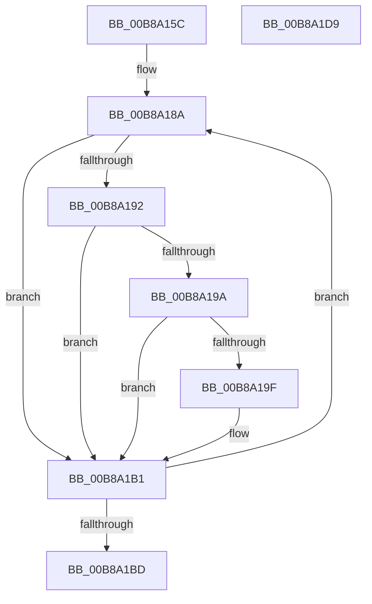

# KdpDeleteBreakpointRange

- RVA: `0x00B8A15C`–`0x00B8A1DA` (길이 `126` bytes)
- VA: `0x0000000140B8A15C`
- 실행 섹션: `PAGEKD`
- PDB 이름 있음: `예`; PDB Function 태그: `아니요`
- unwind 정보 RVA: `0x00060300`
- 디코드: `40`개 명령, `126/126` bytes 표시
- 미해석 바이트: `0` (있으면 어셈블리에 `.byte`로 보존)

> 이 문서는 커널 이미지의 기계어와 PDB 기호를 분석해 생성했습니다. 4번과 5번은 함수 원형과 자료형을 바이너리 사용 방식에서 추정한 C 해석이며 원본 소스 복구 결과는 아닙니다.

## 1. Dependencies

- 직접 호출 지점: **1**; 고유 호출 대상: **1**
- 직접 호출자로 확인된 함수: **1**
- RIP 상대 이미지 참조: **1**

### Outgoing calls
- `0x00B8A1A2` → [KdpDeleteBreakpoint](KdpDeleteBreakpoint_function_00B89988.md) (function, `0x00B89988`)

### Direct callers
- [KdpSetCommonState](../../text/4E/KdpSetCommonState_function_004E0298.md) at `0x004E035D`

### Static image references
- `0x00B8A177` → RVA `0x00F49640` (`.data`; read)

## 2. Other-region calls and transfers

- 다른 실행 섹션으로 향하는 call: **0**
- 별도 외부 분기/꼬리 이동을 확인하지 못했습니다.

## 3. Assembly (complete function range)

```asm
00B8A15C  48 89 5C 24 08                  mov qword ptr [rsp + 8], rbx
00B8A161  48 89 6C 24 10                  mov qword ptr [rsp + 0x10], rbp
00B8A166  48 89 74 24 18                  mov qword ptr [rsp + 0x18], rsi
00B8A16B  57                              push rdi
00B8A16C  41 56                           push r14
00B8A16E  41 57                           push r15
00B8A170  48 83 EC 20                     sub rsp, 0x20
00B8A174  40 32 F6                        xor sil, sil
00B8A177  48 8D 1D C2 F4 3B 00            lea rbx, [rip + 0x3bf4c2]
00B8A17E  33 FF                           xor edi, edi
00B8A180  48 8B EA                        mov rbp, rdx
00B8A183  4C 8B F1                        mov r14, rcx
00B8A186  44 8D 7F 01                     lea r15d, [rdi + 1]
00B8A18A  8B 43 20                        mov eax, dword ptr [rbx + 0x20]
00B8A18D  41 84 C7                        test r15b, al
00B8A190  74 1F                           je 0x140b8a1b1
00B8A192  48 8B 03                        mov rax, qword ptr [rbx]
00B8A195  49 3B C6                        cmp rax, r14
00B8A198  72 17                           jb 0x140b8a1b1
00B8A19A  48 3B C5                        cmp rax, rbp
00B8A19D  77 12                           ja 0x140b8a1b1
00B8A19F  8D 4F 01                        lea ecx, [rdi + 1]
00B8A1A2  E8 E1 F7 FF FF                  call 0x140b89988
00B8A1A7  84 C0                           test al, al
00B8A1A9  40 0F B6 F6                     movzx esi, sil
00B8A1AD  41 0F 45 F7                     cmovne esi, r15d
00B8A1B1  41 03 FF                        add edi, r15d
00B8A1B4  48 83 C3 28                     add rbx, 0x28
00B8A1B8  83 FF 20                        cmp edi, 0x20
00B8A1BB  72 CD                           jb 0x140b8a18a
00B8A1BD  48 8B 5C 24 40                  mov rbx, qword ptr [rsp + 0x40]
00B8A1C2  40 8A C6                        mov al, sil
00B8A1C5  48 8B 74 24 50                  mov rsi, qword ptr [rsp + 0x50]
00B8A1CA  48 8B 6C 24 48                  mov rbp, qword ptr [rsp + 0x48]
00B8A1CF  48 83 C4 20                     add rsp, 0x20
00B8A1D3  41 5F                           pop r15
00B8A1D5  41 5E                           pop r14
00B8A1D7  5F                              pop rdi
00B8A1D8  C3                              ret
00B8A1D9  CC                              int3
```

## 4. C-style interpretation (structured pseudocode)

```c
__int64 __fastcall KdpDeleteBreakpointRange(__int64 a1, __int64 a2)
{
    __int64 result;
    __int64 v_rbx;
    __int64 v_rdi;
    __int64 v_rsi;
    __int64 v_rsp;
    unsigned __int64 v_stack_p10;
    unsigned __int64 v_stack_p18;
    unsigned __int64 v_stack_p8;

    v_stack_p8 = v_rbx;
    v_stack_p10 = v_rbp;
    v_stack_p18 = v_rsi;
    v_rsp = (v_rsp) - (32);
    v_rsi = 0;
    v_rdi = 0;
loc_00B8A18A:
    if ((((unsigned __int8)(v_rdi + 1)) & ((unsigned __int8)((unsigned int)(*(unsigned int *)(v_rip + 3929282 + 32))))) == 0) goto loc_00B8A1B1;
    if ((*(unsigned __int64 *)(v_rip + 3929282)) < a1) goto loc_00B8A1B1;
    result = *(unsigned __int64 *)(v_rip + 3929282);
    if ((*(unsigned __int64 *)(v_rip + 3929282)) <= a2) {
        a1 = v_rdi + 1;
        result = KdpDeleteBreakpoint(a1, a2, a3, a4);
        v_rsi = 0;
        if ((unsigned __int8)(result) != 0) { v_rsi = (unsigned int)(v_rdi + 1); }
    }
    v_rdi = (unsigned int)((v_rdi) + ((unsigned int)(v_rdi + 1)));
    v_rbx = (v_rip + 3929282) + (40);
    if (((unsigned int)(v_rdi)) < 32) goto loc_00B8A18A;
    v_rsp = (v_rsp) + (32);
    return (unsigned __int8)(v_rsi);
}
```

## 5. (Beta) C Style

```c
int64_t KdpDeleteBreakpointRange(int64_t Arg1, int64_t Arg2)
{
    int64_t result;
    int64_t local_rbx;
    int64_t local_rdi;
    int64_t local_rsi;
    int64_t local_rsp;
    uint64_t v_stack_p10;
    uint64_t v_stack_p18;
    uint64_t v_stack_p8;

    v_stack_p8 = local_rbx;
    v_stack_p10 = local_rbp;
    v_stack_p18 = local_rsi;
    local_rsp = (local_rsp) - (32);
    local_rsi = 0;
    local_rdi = 0;
loc_00B8A18A:
    if ((((uint8_t)(local_rdi + 1)) & ((uint8_t)((uint32_t)(*(uint32_t *)(v_rip + 0x3BF4C2 + 0x20))))) == 0) goto loc_00B8A1B1;
    if ((*(uint64_t *)(v_rip + 0x3BF4C2)) < Arg1) goto loc_00B8A1B1;
    result = *(uint64_t *)(v_rip + 0x3BF4C2);
    if ((*(uint64_t *)(v_rip + 0x3BF4C2)) <= Arg2) {
        Arg1 = local_rdi + 1;
        result = KdpDeleteBreakpoint(Arg1, Arg2, a3, a4);
        local_rsi = 0;
        if ((uint8_t)(result) != 0) { local_rsi = (uint32_t)(local_rdi + 1); }
    }
    local_rdi = (uint32_t)((local_rdi) + ((uint32_t)(local_rdi + 1)));
    local_rbx = (v_rip + 3929282) + (40);
    if (((uint32_t)(local_rdi)) < 32) goto loc_00B8A18A;
    local_rsp = (local_rsp) + (32);
    return (uint8_t)(local_rsi);
}
```

## 6. Execution-region graph

[열기: 2D/3D 그래프와 함수 탐색 컨트롤 패널](../../../control-panel.html?section=pagekd&rva=0x00B8A15C&view=graph)

- 2D 그래프는 위에서 아래로 흐르고, 3D 그래프는 빈 공간을 드래그해 회전합니다. Shift+드래그는 이동, 휠은 확대·축소, 함수 노드 선택은 대상 보고서 이동입니다.

### Static fallback


