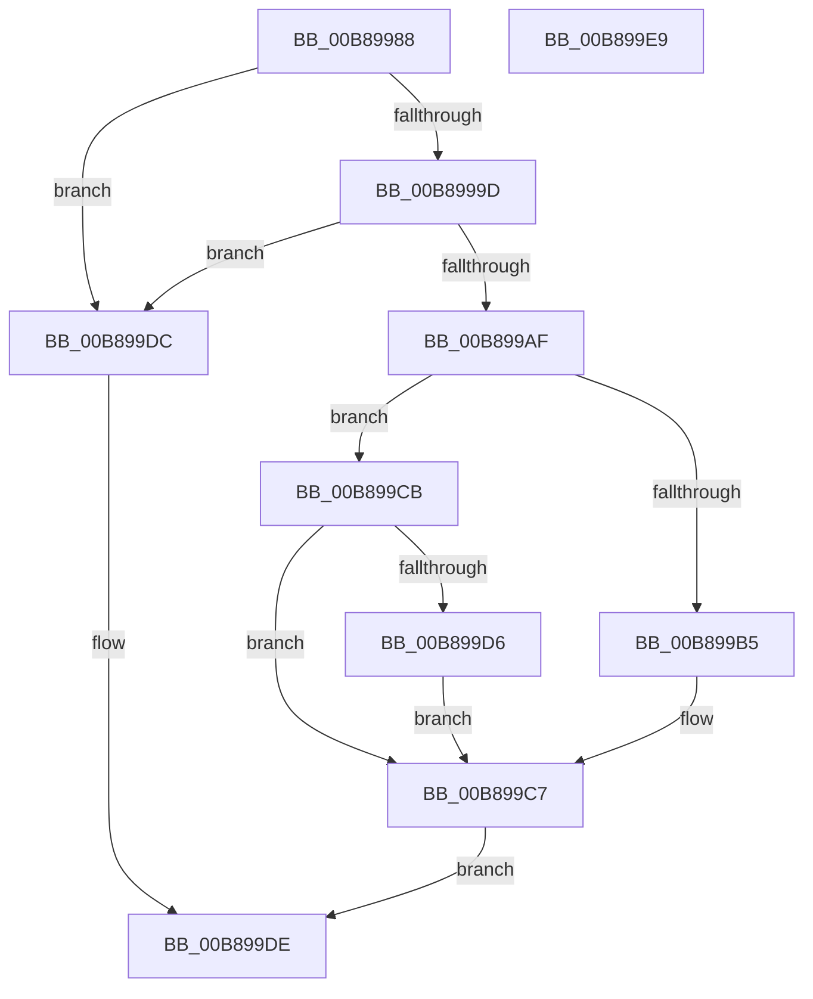

# KdpDeleteBreakpoint

- RVA: `0x00B89988`–`0x00B899EA` (길이 `98` bytes)
- VA: `0x0000000140B89988`
- 실행 섹션: `PAGEKD`
- PDB 이름 있음: `예`; PDB Function 태그: `아니요`
- unwind 정보 RVA: `0x0005CAAC`
- 디코드: `33`개 명령, `98/98` bytes 표시
- 미해석 바이트: `0` (있으면 어셈블리에 `.byte`로 보존)

> 이 문서는 커널 이미지의 기계어와 PDB 기호를 분석해 생성했습니다. 4번과 5번은 함수 원형과 자료형을 바이너리 사용 방식에서 추정한 C 해석이며 원본 소스 복구 결과는 아닙니다.

## 1. Dependencies

- 직접 호출 지점: **1**; 고유 호출 대상: **1**
- 직접 호출자로 확인된 함수: **4**
- RIP 상대 이미지 참조: **3**

### Outgoing calls
- `0x00B899CD` → [KdpLowWriteContent](KdpLowWriteContent_function_00B89B0C.md) (function, `0x00B89B0C`)

### Direct callers
- [KdpRestoreBreakPointEx](KdpRestoreBreakPointEx_function_00B87D80.md) at `0x00B87E20`
- [KdpRestoreBreakpoint](KdpRestoreBreakpoint_function_00B87E90.md) at `0x00B87EB3`
- [KdpWriteBreakPointEx](KdpWriteBreakPointEx_function_00B886D4.md) at `0x00B88796`
- [KdpDeleteBreakpointRange](KdpDeleteBreakpointRange_function_00B8A15C.md) at `0x00B8A1A2`

### Static image references
- `0x00B899A1` → RVA `0x00F49660` (`.data`; read)
- `0x00B899B9` → RVA `0x00F49620` (`.data`; read)
- `0x00B899C1` → RVA `0x00F49620` (`.data`; write)

## 2. Other-region calls and transfers

- 다른 실행 섹션으로 향하는 call: **0**
- 별도 외부 분기/꼬리 이동을 확인하지 못했습니다.

## 3. Assembly (complete function range)

```asm
00B89988  48 89 5C 24 08                  mov qword ptr [rsp + 8], rbx
00B8998D  57                              push rdi
00B8998E  48 83 EC 20                     sub rsp, 0x20
00B89992  8D 41 FF                        lea eax, [rcx - 1]
00B89995  8D 51 FF                        lea edx, [rcx - 1]
00B89998  83 F8 1F                        cmp eax, 0x1f
00B8999B  77 3F                           ja 0x140b899dc
00B8999D  48 8D 1C 92                     lea rbx, [rdx + rdx*4]
00B899A1  48 8D 3D B8 FC 3B 00            lea rdi, [rip + 0x3bfcb8]
00B899A8  8B 04 DF                        mov eax, dword ptr [rdi + rbx*8]
00B899AB  85 C0                           test eax, eax
00B899AD  74 2D                           je 0x140b899dc
00B899AF  24 0C                           and al, 0xc
00B899B1  3C 04                           cmp al, 4
00B899B3  75 16                           jne 0x140b899cb
00B899B5  83 24 DF 00                     and dword ptr [rdi + rbx*8], 0
00B899B9  8B 0D 61 FC 3B 00               mov ecx, dword ptr [rip + 0x3bfc61]
00B899BF  FF C1                           inc ecx
00B899C1  89 0D 59 FC 3B 00               mov dword ptr [rip + 0x3bfc59], ecx
00B899C7  B0 01                           mov al, 1
00B899C9  EB 13                           jmp 0x140b899de
00B899CB  8B CA                           mov ecx, edx
00B899CD  E8 3A 01 00 00                  call 0x140b89b0c
00B899D2  84 C0                           test al, al
00B899D4  74 F1                           je 0x140b899c7
00B899D6  83 24 DF 00                     and dword ptr [rdi + rbx*8], 0
00B899DA  EB EB                           jmp 0x140b899c7
00B899DC  32 C0                           xor al, al
00B899DE  48 8B 5C 24 30                  mov rbx, qword ptr [rsp + 0x30]
00B899E3  48 83 C4 20                     add rsp, 0x20
00B899E7  5F                              pop rdi
00B899E8  C3                              ret
00B899E9  CC                              int3
```

## 4. C-style interpretation (structured pseudocode)

```c
__int64 __fastcall KdpDeleteBreakpoint(__int64 a1)
{
    __int64 result;
    __int64 v_rsp;
    unsigned __int64 v_stack_p8;

    v_stack_p8 = v_rbx;
    v_rsp = (v_rsp) - (32);
    if (((unsigned int)(a1 - 1)) > 31) goto loc_00B899DC;
    if ((unsigned int)((unsigned int)(*(unsigned int *)(v_rip + 3931320 + a1 - 1 + a1 - 1 * 4 * 8))) == 0) goto loc_00B899DC;
    result = (unsigned __int8)(((unsigned int)(*(unsigned int *)(v_rip + 3931320 + a1 - 1 + a1 - 1 * 4 * 8))) & (12));
    if (((unsigned __int8)(result)) != 4) goto loc_00B899CB;
    a1 = (unsigned int)(((unsigned int)(*(unsigned int *)(v_rip + 3931233))) + 1);
    *(unsigned int *)(v_rip + 3931225) = (unsigned int)(a1);
loc_00B899C7:
    goto loc_00B899DE;
loc_00B899CB:
    result = KdpLowWriteContent((unsigned int)((unsigned int)(a1 - 1)), a1 - 1, a3, a4);
    if ((unsigned __int8)(result) == 0) goto loc_00B899C7;
    goto loc_00B899C7;
loc_00B899DC:
    result = 0;
loc_00B899DE:
    v_rsp = (v_rsp) + (32);
    return result;
}
```

## 5. (Beta) C Style

```c
int64_t KdpDeleteBreakpoint(void *Arg1)
{
    uint8_t *arg1 = (uint8_t *)Arg1;

    int64_t result;
    int64_t local_rsp;
    uint64_t v_stack_p8;

    v_stack_p8 = local_rbx;
    local_rsp = (local_rsp) - (32);
    if (((uint32_t)(Arg1 - 1)) > 31) goto loc_00B899DC;
    if ((uint32_t)((uint32_t)(*(uint32_t *)(v_rip + 0x3BFCB8 + arg1 - 0x1 + arg1 - 0x1 * 4 * 8))) == 0) goto loc_00B899DC;
    result = (uint8_t)(((uint32_t)(*(uint32_t *)(v_rip + 0x3BFCB8 + arg1 - 0x1 + arg1 - 0x1 * 4 * 8))) & (12));
    if (((uint8_t)(result)) != 4) goto loc_00B899CB;
    Arg1 = (uint32_t)(((uint32_t)(*(uint32_t *)(v_rip + 0x3BFC61))) + 1);
    *(uint32_t *)(v_rip + 0x3BFC59) = (uint32_t)(Arg1);
loc_00B899C7:
    goto loc_00B899DE;
loc_00B899CB:
    result = KdpLowWriteContent((uint32_t)((uint32_t)(Arg1 - 1)), Arg1 - 1, a3, a4);
    if ((uint8_t)(result) == 0) goto loc_00B899C7;
    goto loc_00B899C7;
loc_00B899DC:
    result = 0;
loc_00B899DE:
    local_rsp = (local_rsp) + (32);
    return result;
}
```

### 관측된 메모리 오프셋

구조체 형식이 확인되지 않은 접근은 인자 기준의 오프셋으로만 기록했습니다.

| 기준 인자 | 오프셋 표현 | 폭 (bit) | 접근 |
|---|---:|---:|---|
| `Arg1` | `- 0x1` | `32` | `R` |
| `Arg1` | `+ 0x0 + rdx*4` | `64` | `R` |

## 6. Execution-region graph

[열기: 2D/3D 그래프와 함수 탐색 컨트롤 패널](../../../control-panel.html?section=pagekd&rva=0x00B89988&view=graph)

- 2D 그래프는 위에서 아래로 흐르고, 3D 그래프는 빈 공간을 드래그해 회전합니다. Shift+드래그는 이동, 휠은 확대·축소, 함수 노드 선택은 대상 보고서 이동입니다.

### Static fallback


