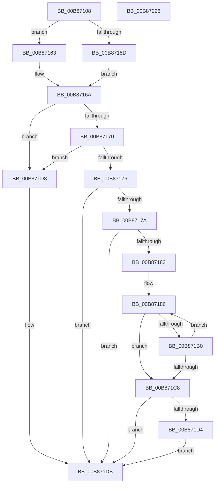

# KdpFillMemory

- RVA: `0x00B87108`–`0x00B87227` (길이 `287` bytes)
- VA: `0x0000000140B87108`
- 실행 섹션: `PAGEKD`
- PDB 이름 있음: `예`; PDB Function 태그: `아니요`
- unwind 정보 RVA: `0x000AFBC4`
- 디코드: `88`개 명령, `287/287` bytes 표시
- 미해석 바이트: `0` (있으면 어셈블리에 `.byte`로 보존)

> 이 문서는 커널 이미지의 기계어와 PDB 기호를 분석해 생성했습니다. 4번과 5번은 함수 원형과 자료형을 바이너리 사용 방식에서 추정한 C 해석이며 원본 소스 복구 결과는 아닙니다.

## 1. Dependencies

- 직접 호출 지점: **2**; 고유 호출 대상: **2**
- 직접 호출자로 확인된 함수: **1**
- RIP 상대 이미지 참조: **2**

### Outgoing calls
- `0x00B871A7` → [KdpCopyMemoryChunks](KdpCopyMemoryChunks_function_00B8AACC.md) (function, `0x00B8AACC`)
- `0x00B87202` → `kdcom.dll!KdSendPacket` (import, 간접 대상; import `kdcom.dll!KdSendPacket`)

### Direct callers
- [KdpSendWaitContinue](KdpSendWaitContinue_function_00B8A32C.md) at `0x00B8A64F`

### Static image references
- `0x00B871DE` → RVA `0x00F475E0` (`.data`; read)
- `0x00B87202` → RVA `0x001516C0` (`kdcom.dll!KdSendPacket (IAT)`; read)

## 2. Other-region calls and transfers

- 다른 실행 섹션으로 향하는 call: **0**
- 별도 외부 분기/꼬리 이동을 확인하지 못했습니다.

## 3. Assembly (complete function range)

```asm
00B87108  48 89 5C 24 10                  mov qword ptr [rsp + 0x10], rbx
00B8710D  48 89 4C 24 08                  mov qword ptr [rsp + 8], rcx
00B87112  55                              push rbp
00B87113  56                              push rsi
00B87114  57                              push rdi
00B87115  41 54                           push r12
00B87117  41 55                           push r13
00B87119  41 56                           push r14
00B8711B  41 57                           push r15
00B8711D  48 83 EC 40                     sub rsp, 0x40
00B87121  4C 8B 6A 08                     mov r13, qword ptr [rdx + 8]
00B87125  33 C0                           xor eax, eax
00B87127  44 8B 71 18                     mov r14d, dword ptr [rcx + 0x18]
00B8712B  48 8B D9                        mov rbx, rcx
00B8712E  0F B7 49 1E                     movzx ecx, word ptr [rcx + 0x1e]
00B87132  4C 8B C2                        mov r8, rdx
00B87135  33 FF                           xor edi, edi
00B87137  0F 57 C0                        xorps xmm0, xmm0
00B8713A  0F 11 44 24 30                  movups xmmword ptr [rsp + 0x30], xmm0
00B8713F  0F B7 53 1C                     movzx edx, word ptr [rbx + 0x1c]
00B87143  44 8D 78 05                     lea r15d, [rax + 5]
00B87147  4E 8D 24 29                     lea r12, [rcx + r13]
00B8714B  49 8B F5                        mov rsi, r13
00B8714E  44 8D 48 01                     lea r9d, [rax + 1]
00B87152  41 BA 0D 00 00 C0               mov r10d, 0xc000000d
00B87158  F6 C2 02                        test dl, 2
00B8715B  74 06                           je 0x140b87163
00B8715D  44 8D 78 07                     lea r15d, [rax + 7]
00B87161  EB 07                           jmp 0x140b8716a
00B87163  41 84 D1                        test r9b, dl
00B87166  41 0F 44 C2                     cmove eax, r10d
00B8716A  66 41 3B C9                     cmp cx, r9w
00B8716E  72 68                           jb 0x140b871d8
00B87170  66 41 39 08                     cmp word ptr [r8], cx
00B87174  72 62                           jb 0x140b871d8
00B87176  85 C0                           test eax, eax
00B87178  78 61                           js 0x140b871db
00B8717A  48 8B 6B 10                     mov rbp, qword ptr [rbx + 0x10]
00B8717E  45 85 F6                        test r14d, r14d
00B87181  74 58                           je 0x140b871db
00B87183  49 8B D9                        mov rbx, r9
00B87186  48 8D 84 24 90 00 00 00         lea rax, [rsp + 0x90]
00B8718E  45 33 C9                        xor r9d, r9d
00B87191  48 89 44 24 28                  mov qword ptr [rsp + 0x28], rax
00B87196  44 8B C3                        mov r8d, ebx
00B87199  48 8B D6                        mov rdx, rsi
00B8719C  44 89 7C 24 20                  mov dword ptr [rsp + 0x20], r15d
00B871A1  48 8B CD                        mov rcx, rbp
00B871A4  41 FF CE                        dec r14d
00B871A7  E8 20 39 00 00                  call 0x140b8aacc
00B871AC  85 C0                           test eax, eax
00B871AE  78 18                           js 0x140b871c8
00B871B0  48 8D 4E 01                     lea rcx, [rsi + 1]
00B871B4  48 03 EB                        add rbp, rbx
00B871B7  03 FB                           add edi, ebx
00B871B9  49 8B F5                        mov rsi, r13
00B871BC  49 3B CC                        cmp rcx, r12
00B871BF  48 0F 45 F1                     cmovne rsi, rcx
00B871C3  45 85 F6                        test r14d, r14d
00B871C6  75 BE                           jne 0x140b87186
00B871C8  48 8B 9C 24 80 00 00 00         mov rbx, qword ptr [rsp + 0x80]
00B871D0  85 FF                           test edi, edi
00B871D2  74 07                           je 0x140b871db
00B871D4  33 C0                           xor eax, eax
00B871D6  EB 03                           jmp 0x140b871db
00B871D8  41 8B C2                        mov eax, r10d
00B871DB  89 43 08                        mov dword ptr [rbx + 8], eax
00B871DE  4C 8D 0D FB 03 3C 00            lea r9, [rip + 0x3c03fb]
00B871E5  B8 38 00 00 00                  mov eax, 0x38
00B871EA  89 7B 18                        mov dword ptr [rbx + 0x18], edi
00B871ED  45 33 C0                        xor r8d, r8d
00B871F0  66 89 44 24 30                  mov word ptr [rsp + 0x30], ax
00B871F5  48 8D 54 24 30                  lea rdx, [rsp + 0x30]
00B871FA  48 89 5C 24 38                  mov qword ptr [rsp + 0x38], rbx
00B871FF  8D 48 CA                        lea ecx, [rax - 0x36]
00B87202  48 FF 15 B7 A4 5C FF            call qword ptr [rip - 0xa35b49]
00B87209  0F 1F 44 00 00                  nop dword ptr [rax + rax]
00B8720E  48 8B 9C 24 88 00 00 00         mov rbx, qword ptr [rsp + 0x88]
00B87216  48 83 C4 40                     add rsp, 0x40
00B8721A  41 5F                           pop r15
00B8721C  41 5E                           pop r14
00B8721E  41 5D                           pop r13
00B87220  41 5C                           pop r12
00B87222  5F                              pop rdi
00B87223  5E                              pop rsi
00B87224  5D                              pop rbp
00B87225  C3                              ret
00B87226  CC                              int3
```

## 4. C-style interpretation (structured pseudocode)

```c
__int64 __fastcall KdpFillMemory(__int64 a1, __int64 a2)
{
    __int64 result;
    __int64 v_r14;
    __int64 v_rbp;
    __int64 v_rdi;
    __int64 v_rsi;
    __int64 v_rsp;
    unsigned __int64 v_stack_m40;
    unsigned __int64 v_stack_m48;
    unsigned __int64 v_stack_m50;
    unsigned int v_stack_m58;
    unsigned __int64 v_stack_p10;
    unsigned __int64 v_stack_p18;
    unsigned __int64 v_stack_p8;

    v_stack_p10 = v_rbx;
    v_stack_p8 = a1;
    v_rsp = (v_rsp) - (64);
    result = 0;
    v_rdi = 0;
    v_stack_m48 = v_xmm0;
    if ((((unsigned __int8)(*(unsigned __int16 *)(a1 + 28))) & (2)) == 0) goto loc_00B87163;
    goto loc_00B8716A;
loc_00B87163:
    if ((((unsigned __int8)(result + 1)) & ((unsigned __int8)(*(unsigned __int16 *)(a1 + 28)))) == 0) { result = (unsigned int)((unsigned int)(0xC000000DULL)); }
loc_00B8716A:
    if (((unsigned __int16)(*(unsigned __int16 *)(a1 + 30))) < ((unsigned __int16)(result + 1))) goto loc_00B871D8;
    if ((*(unsigned __int16 *)(a2)) < ((unsigned __int16)(*(unsigned __int16 *)(a1 + 30)))) goto loc_00B871D8;
    if (sign_flag) goto loc_00B871DB;
    if ((unsigned int)((unsigned int)(*(unsigned int *)(a1 + 24))) == 0) goto loc_00B871DB;
loc_00B87186:
    a4 = 0;
    v_stack_m50 = v_stack_p18;
    v_stack_m58 = (unsigned int)(result + 7);
    v_r14 = (unsigned int)(((unsigned int)(*(unsigned int *)(a1 + 24))) - 1);
    result = KdpCopyMemoryChunks(*(unsigned __int64 *)(a1 + 16), *(unsigned __int64 *)(a2 + 8), (unsigned int)((unsigned int)(result + 1)), a4);
    if (sign_flag) goto loc_00B871C8;
    v_rbp = (*(unsigned __int64 *)(a1 + 16)) + (result + 1);
    v_rdi = (unsigned int)((v_rdi) + ((unsigned int)(result + 1)));
    v_rsi = *(unsigned __int64 *)(a2 + 8);
    if ((*(unsigned __int64 *)(a2 + 8) + 1) != (*(unsigned __int16 *)(a1 + 30) + *(unsigned __int64 *)(a2 + 8) * 1)) { v_rsi = *(unsigned __int64 *)(a2 + 8) + 1; }
    if ((unsigned int)(v_r14) != 0) goto loc_00B87186;
loc_00B871C8:
    if ((unsigned int)(v_rdi) == 0) goto loc_00B871DB;
    result = 0;
    goto loc_00B871DB;
loc_00B871D8:
loc_00B871DB:
    *(unsigned int *)(v_stack_p8 + 8) = (unsigned int)((unsigned int)((unsigned int)((unsigned int)(0xC000000DULL))));
    *(unsigned int *)(v_stack_p8 + 24) = (unsigned int)(v_rdi);
    a3 = 0;
    v_stack_m48 = 56;
    v_stack_m40 = v_stack_p8;
    result = kdcom_dll_KdSendPacket(56 - 54, v_stack_m48, a3, v_rip + 3933179);
    v_rsp = (v_rsp) + (64);
    return result;
}
```

## 5. (Beta) C Style

```c
int64_t KdpFillMemory(void *Arg1, void *Arg2)
{
    uint8_t *arg1 = (uint8_t *)Arg1;
    uint8_t *arg2 = (uint8_t *)Arg2;

    int64_t result;
    int64_t local_r14;
    int64_t local_rbp;
    int64_t local_rdi;
    int64_t local_rsi;
    int64_t local_rsp;
    uint64_t v_stack_m40;
    uint64_t v_stack_m48;
    uint64_t v_stack_m50;
    uint32_t v_stack_m58;
    uint64_t v_stack_p10;
    uint64_t v_stack_p18;
    uint64_t v_stack_p8;

    v_stack_p10 = local_rbx;
    v_stack_p8 = Arg1;
    local_rsp = (local_rsp) - (64);
    result = 0;
    local_rdi = 0;
    v_stack_m48 = v_xmm0;
    if ((((uint8_t)(*(uint16_t *)(arg1 + 0x1C))) & (2)) == 0) goto loc_00B87163;
    goto loc_00B8716A;
loc_00B87163:
    if ((((uint8_t)(result + 1)) & ((uint8_t)(*(uint16_t *)(arg1 + 0x1C)))) == 0) { result = (uint32_t)((uint32_t)(0xC000000DULL)); }
loc_00B8716A:
    if (((uint16_t)(*(uint16_t *)(arg1 + 0x1E))) < ((uint16_t)(result + 1))) goto loc_00B871D8;
    if ((*(uint16_t *)(arg2)) < ((uint16_t)(*(uint16_t *)(arg1 + 0x1E)))) goto loc_00B871D8;
    if (sign_flag) goto loc_00B871DB;
    if ((uint32_t)((uint32_t)(*(uint32_t *)(arg1 + 0x18))) == 0) goto loc_00B871DB;
loc_00B87186:
    a4 = 0;
    v_stack_m50 = v_stack_p18;
    v_stack_m58 = (uint32_t)(result + 7);
    local_r14 = (uint32_t)(((uint32_t)(*(uint32_t *)(arg1 + 0x18))) - 1);
    result = KdpCopyMemoryChunks(*(uint64_t *)(arg1 + 0x10), *(uint64_t *)(arg2 + 0x8), (uint32_t)((uint32_t)(result + 1)), a4);
    if (sign_flag) goto loc_00B871C8;
    local_rbp = (*(uint64_t *)(arg1 + 0x10)) + (result + 1);
    local_rdi = (uint32_t)((local_rdi) + ((uint32_t)(result + 1)));
    local_rsi = *(uint64_t *)(arg2 + 0x8);
    if ((*(uint64_t *)(arg2 + 0x8) + 1) != (*(uint16_t *)(arg1 + 0x1E) + *(uint64_t *)(arg2 + 0x8) * 1)) { local_rsi = *(uint64_t *)(arg2 + 0x8) + 1; }
    if ((uint32_t)(local_r14) != 0) goto loc_00B87186;
loc_00B871C8:
    if ((uint32_t)(local_rdi) == 0) goto loc_00B871DB;
    result = 0;
    goto loc_00B871DB;
loc_00B871D8:
loc_00B871DB:
    *(uint32_t *)(v_stack_p8 + 0x8) = (uint32_t)((uint32_t)((uint32_t)((uint32_t)(0xC000000DULL))));
    *(uint32_t *)(v_stack_p8 + 0x18) = (uint32_t)(local_rdi);
    a3 = 0;
    v_stack_m48 = 56;
    v_stack_m40 = v_stack_p8;
    result = kernel_indirect_call(56 - 54, v_stack_m48, a3, v_rip + 3933179);
    local_rsp = (local_rsp) + (64);
    return result;
}
```

### 관측된 메모리 오프셋

구조체 형식이 확인되지 않은 접근은 인자 기준의 오프셋으로만 기록했습니다.

| 기준 인자 | 오프셋 표현 | 폭 (bit) | 접근 |
|---|---:|---:|---|
| `Arg1` | `+ 0x10` | `64` | `R` |
| `Arg1` | `+ 0x18` | `32` | `R` |
| `Arg1` | `+ 0x1C` | `16` | `R` |
| `Arg1` | `+ 0x1E` | `16` | `R` |
| `Arg2` | `+ 0x0` | `16` | `R` |
| `Arg2` | `+ 0x8` | `64` | `R` |

## 6. Execution-region graph

[열기: 2D/3D 그래프와 함수 탐색 컨트롤 패널](../../../control-panel.html?section=pagekd&rva=0x00B87108&view=graph)

- 2D 그래프는 위에서 아래로 흐르고, 3D 그래프는 빈 공간을 드래그해 회전합니다. Shift+드래그는 이동, 휠은 확대·축소, 함수 노드 선택은 대상 보고서 이동입니다.

### Static fallback


