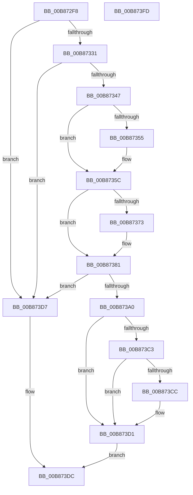

# KdpGetContext

- RVA: `0x00B872F8`–`0x00B873FE` (길이 `262` bytes)
- VA: `0x0000000140B872F8`
- 실행 섹션: `PAGEKD`
- PDB 이름 있음: `예`; PDB Function 태그: `아니요`
- unwind 정보 RVA: `0x00075C18`
- 디코드: `71`개 명령, `262/262` bytes 표시
- 미해석 바이트: `0` (있으면 어셈블리에 `.byte`로 보존)

> 이 문서는 커널 이미지의 기계어와 PDB 기호를 분석해 생성했습니다. 4번과 5번은 함수 원형과 자료형을 바이너리 사용 방식에서 추정한 C 해석이며 원본 소스 복구 결과는 아닙니다.

## 1. Dependencies

- 직접 호출 지점: **2**; 고유 호출 대상: **2**
- 직접 호출자로 확인된 함수: **2**
- RIP 상대 이미지 참조: **1**

### Outgoing calls
- `0x00B873A7` → [KdpInitializeExtendedContext](KdpInitializeExtendedContext_function_00B8939C.md) (function, `0x00B8939C`)
- `0x00B873B6` → [KdpCopyContext](KdpCopyContext_function_00B851E8.md) (function, `0x00B851E8`)

### Direct callers
- [KdpGetContextEx](../../text/5B/KdpGetContextEx_function_005B0C80.md) at `0x005B0CB6`
- [KdpGetContextOrig](KdpGetContextOrig_function_00B87404.md) at `0x00B8742B`

### Static image references
- `0x00B87331` → RVA `0x00FC8C40` (`ALMOSTRO`; read)

## 2. Other-region calls and transfers

- 다른 실행 섹션으로 향하는 call: **0**
- 별도 외부 분기/꼬리 이동을 확인하지 못했습니다.

## 3. Assembly (complete function range)

```asm
00B872F8  48 89 5C 24 08                  mov qword ptr [rsp + 8], rbx
00B872FD  48 89 6C 24 10                  mov qword ptr [rsp + 0x10], rbp
00B87302  48 89 74 24 18                  mov qword ptr [rsp + 0x18], rsi
00B87307  57                              push rdi
00B87308  41 54                           push r12
00B8730A  41 55                           push r13
00B8730C  41 56                           push r14
00B8730E  41 57                           push r15
00B87310  48 83 EC 20                     sub rsp, 0x20
00B87314  49 8B E8                        mov rbp, r8
00B87317  B8 00 08 00 00                  mov eax, 0x800
00B8731C  44 0F B7 41 06                  movzx r8d, word ptr [rcx + 6]
00B87321  4C 8B FA                        mov r15, rdx
00B87324  4C 8B E9                        mov r13, rcx
00B87327  66 44 3B C0                     cmp r8w, ax
00B8732B  0F 83 A6 00 00 00               jae 0x140b873d7
00B87331  4C 8D 0D 08 19 44 00            lea r9, [rip + 0x441908]
00B87338  33 FF                           xor edi, edi
00B8733A  4F 8B 0C C1                     mov r9, qword ptr [r9 + r8*8]
00B8733E  4D 85 C9                        test r9, r9
00B87341  0F 84 90 00 00 00               je 0x140b873d7
00B87347  65 8B 04 25 A4 01 00 00         mov eax, dword ptr gs:[0x1a4]
00B8734F  66 44 3B C0                     cmp r8w, ax
00B87353  74 07                           je 0x140b8735c
00B87355  49 8B A9 C0 8F 00 00            mov rbp, qword ptr [r9 + 0x8fc0]
00B8735C  44 8B 75 30                     mov r14d, dword ptr [rbp + 0x30]
00B87360  B9 40 00 10 00                  mov ecx, 0x100040
00B87365  41 8B F6                        mov esi, r14d
00B87368  B8 F0 04 00 00                  mov eax, 0x4f0
00B8736D  23 F1                           and esi, ecx
00B8736F  3B F1                           cmp esi, ecx
00B87371  75 0E                           jne 0x140b87381
00B87373  A1 E8 03 00 00 80 F7 FF FF      movabs eax, dword ptr [0xfffff780000003e8]
00B8737C  05 20 03 00 00                  add eax, 0x320
00B87381  B9 80 00 10 00                  mov ecx, 0x100080
00B87386  8D 58 20                        lea ebx, [rax + 0x20]
00B87389  45 8B E6                        mov r12d, r14d
00B8738C  44 23 E1                        and r12d, ecx
00B8738F  44 3B E1                        cmp r12d, ecx
00B87392  0F 45 D8                        cmovne ebx, eax
00B87395  0F B7 42 02                     movzx eax, word ptr [rdx + 2]
00B87399  83 C3 0F                        add ebx, 0xf
00B8739C  3B D8                           cmp ebx, eax
00B8739E  77 37                           ja 0x140b873d7
00B873A0  49 8B 4F 08                     mov rcx, qword ptr [r15 + 8]
00B873A4  41 8B D6                        mov edx, r14d
00B873A7  E8 F0 1F 00 00                  call 0x140b8939c
00B873AC  49 8B 4F 08                     mov rcx, qword ptr [r15 + 8]
00B873B0  4C 8B C5                        mov r8, rbp
00B873B3  41 8B D6                        mov edx, r14d
00B873B6  E8 2D DE FF FF                  call 0x140b851e8
00B873BB  81 FE 40 00 10 00               cmp esi, 0x100040
00B873C1  74 0E                           je 0x140b873d1
00B873C3  41 81 FC 80 00 10 00            cmp r12d, 0x100080
00B873CA  74 05                           je 0x140b873d1
00B873CC  BB D0 04 00 00                  mov ebx, 0x4d0
00B873D1  66 41 89 1F                     mov word ptr [r15], bx
00B873D5  EB 05                           jmp 0x140b873dc
00B873D7  BF 01 00 00 C0                  mov edi, 0xc0000001
00B873DC  41 89 7D 08                     mov dword ptr [r13 + 8], edi
00B873E0  48 8B 5C 24 50                  mov rbx, qword ptr [rsp + 0x50]
00B873E5  48 8B 6C 24 58                  mov rbp, qword ptr [rsp + 0x58]
00B873EA  48 8B 74 24 60                  mov rsi, qword ptr [rsp + 0x60]
00B873EF  48 83 C4 20                     add rsp, 0x20
00B873F3  41 5F                           pop r15
00B873F5  41 5E                           pop r14
00B873F7  41 5D                           pop r13
00B873F9  41 5C                           pop r12
00B873FB  5F                              pop rdi
00B873FC  C3                              ret
00B873FD  CC                              int3
```

## 4. C-style interpretation (structured pseudocode)

```c
__int64 __fastcall KdpGetContext(__int64 a1, __int64 a2, __int64 a3)
{
    __int64 result;
    __int64 v_r12;
    __int64 v_rbp;
    __int64 v_rbx;
    __int64 v_rdi;
    __int64 v_rsi;
    __int64 v_rsp;
    unsigned __int64 v_stack_p10;
    unsigned __int64 v_stack_p18;
    unsigned __int64 v_stack_p8;

    v_stack_p8 = v_rbx;
    v_stack_p10 = v_rbp;
    v_stack_p18 = v_rsi;
    v_rsp = (v_rsp) - (32);
    if (((unsigned __int16)(*(unsigned __int16 *)(a1 + 6))) >= ((unsigned __int16)((unsigned int)(0x800ULL)))) goto loc_00B873D7;
    v_rdi = 0;
    if (*(unsigned __int64 *)(v_rip + 4462856 + *(unsigned __int16 *)(a1 + 6) * 8) == 0) goto loc_00B873D7;
    v_rbp = a3;
    if (((unsigned __int16)(*(unsigned __int16 *)(a1 + 6))) != ((unsigned __int16)((unsigned int)(*(unsigned int *)(gs_base + (0 + 420)))))) {
        v_rbp = *(unsigned __int64 *)(*(unsigned __int64 *)(v_rip + 4462856 + *(unsigned __int16 *)(a1 + 6) * 8) + 36800);
    }
    v_rsi = (unsigned int)(((unsigned int)((unsigned int)((unsigned int)(*(unsigned int *)(v_rbp + 48))))) & ((unsigned int)((unsigned int)(0x100040ULL))));
    result = (unsigned int)(0x4F0ULL);
    if (((unsigned int)(v_rsi)) == ((unsigned int)((unsigned int)(0x100040ULL)))) {
        result = (unsigned int)(((unsigned int)(0x4F0ULL)) + (800));
    }
    v_r12 = (unsigned int)(((unsigned int)((unsigned int)((unsigned int)(*(unsigned int *)(v_rbp + 48))))) & ((unsigned int)((unsigned int)(0x100080ULL))));
    v_rbx = result + 32;
    if (((unsigned int)(v_r12)) != ((unsigned int)((unsigned int)(0x100080ULL)))) { v_rbx = (unsigned int)(result); }
    v_rbx = (unsigned int)((v_rbx) + (15));
    if (((unsigned int)(v_rbx)) > ((unsigned int)(*(unsigned __int16 *)(a2 + 2)))) goto loc_00B873D7;
    result = KdpInitializeExtendedContext(*(unsigned __int64 *)(a2 + 8), (unsigned int)((unsigned int)((unsigned int)(*(unsigned int *)(v_rbp + 48)))), *(unsigned __int16 *)(a1 + 6), *(unsigned __int64 *)(v_rip + 4462856 + *(unsigned __int16 *)(a1 + 6) * 8));
    result = KdpCopyContext(*(unsigned __int64 *)(a2 + 8), (unsigned int)((unsigned int)((unsigned int)(*(unsigned int *)(v_rbp + 48)))), v_rbp, *(unsigned __int64 *)(v_rip + 4462856 + *(unsigned __int16 *)(a1 + 6) * 8));
    if (((unsigned int)(v_rsi)) == 0x100040ULL) goto loc_00B873D1;
    if (((unsigned int)(v_r12)) != 0x100080ULL) {
        v_rbx = 0x4D0ULL;
    }
    *(unsigned __int16 *)(a2) = (unsigned __int16)(v_rbx);
    goto loc_00B873DC;
loc_00B873D7:
loc_00B873DC:
    *(unsigned int *)(a1 + 8) = (unsigned int)((unsigned int)(0xC0000001ULL));
    v_rsp = (v_rsp) + (32);
    return result;
}
```

## 5. (Beta) C Style

```c
int64_t KdpGetContext(void *Arg1, void *Arg2, int64_t Arg3)
{
    uint8_t *arg1 = (uint8_t *)Arg1;
    uint8_t *arg2 = (uint8_t *)Arg2;

    int64_t result;
    int64_t local_r12;
    int64_t local_rbp;
    int64_t local_rbx;
    int64_t local_rdi;
    int64_t local_rsi;
    int64_t local_rsp;
    uint64_t v_stack_p10;
    uint64_t v_stack_p18;
    uint64_t v_stack_p8;

    v_stack_p8 = local_rbx;
    v_stack_p10 = local_rbp;
    v_stack_p18 = local_rsi;
    local_rsp = (local_rsp) - (32);
    if (((uint16_t)(*(uint16_t *)(arg1 + 0x6))) >= ((uint16_t)((uint32_t)(0x800ULL)))) goto loc_00B873D7;
    local_rdi = 0;
    if (*(uint64_t *)(v_rip + 0x441908 + *(uint16_t *)(arg1 + 0x6) * 8) == 0) goto loc_00B873D7;
    local_rbp = Arg3;
    if (((uint16_t)(*(uint16_t *)(arg1 + 0x6))) != ((uint16_t)((uint32_t)(*(uint32_t *)(gs_base + (0 + 0x1A4)))))) {
        local_rbp = *(uint64_t *)(*(uint64_t *)(v_rip + 0x441908 + *(uint16_t *)(arg1 + 0x6) * 8) + 0x8FC0);
    }
    local_rsi = (uint32_t)(((uint32_t)((uint32_t)((uint32_t)(*(uint32_t *)(local_rbp + 0x30))))) & ((uint32_t)((uint32_t)(0x100040ULL))));
    result = (uint32_t)(0x4F0ULL);
    if (((uint32_t)(local_rsi)) == ((uint32_t)((uint32_t)(0x100040ULL)))) {
        result = (uint32_t)(((uint32_t)(0x4F0ULL)) + (800));
    }
    local_r12 = (uint32_t)(((uint32_t)((uint32_t)((uint32_t)(*(uint32_t *)(local_rbp + 0x30))))) & ((uint32_t)((uint32_t)(0x100080ULL))));
    local_rbx = result + 32;
    if (((uint32_t)(local_r12)) != ((uint32_t)((uint32_t)(0x100080ULL)))) { local_rbx = (uint32_t)(result); }
    local_rbx = (uint32_t)((local_rbx) + (15));
    if (((uint32_t)(local_rbx)) > ((uint32_t)(*(uint16_t *)(arg2 + 0x2)))) goto loc_00B873D7;
    result = KdpInitializeExtendedContext(*(uint64_t *)(arg2 + 0x8), (uint32_t)((uint32_t)((uint32_t)(*(uint32_t *)(local_rbp + 0x30)))), *(uint16_t *)(arg1 + 0x6), *(uint64_t *)(v_rip + 0x441908 + *(uint16_t *)(arg1 + 0x6) * 8));
    result = KdpCopyContext(*(uint64_t *)(arg2 + 0x8), (uint32_t)((uint32_t)((uint32_t)(*(uint32_t *)(local_rbp + 0x30)))), local_rbp, *(uint64_t *)(v_rip + 0x441908 + *(uint16_t *)(arg1 + 0x6) * 8));
    if (((uint32_t)(local_rsi)) == 0x100040ULL) goto loc_00B873D1;
    if (((uint32_t)(local_r12)) != 0x100080ULL) {
        local_rbx = 0x4D0ULL;
    }
    *(uint16_t *)(arg2) = (uint16_t)(local_rbx);
    goto loc_00B873DC;
loc_00B873D7:
loc_00B873DC:
    *(uint32_t *)(arg1 + 0x8) = (uint32_t)((uint32_t)(0xC0000001ULL));
    local_rsp = (local_rsp) + (32);
    return result;
}
```

### 관측된 메모리 오프셋

구조체 형식이 확인되지 않은 접근은 인자 기준의 오프셋으로만 기록했습니다.

| 기준 인자 | 오프셋 표현 | 폭 (bit) | 접근 |
|---|---:|---:|---|
| `Arg1` | `+ 0x6` | `16` | `R` |
| `Arg1` | `+ 0x8` | `32` | `W` |
| `Arg2` | `+ 0x0` | `16` | `W` |
| `Arg2` | `+ 0x2` | `16` | `R` |
| `Arg2` | `+ 0x8` | `64` | `R` |

## 6. Execution-region graph

[열기: 2D/3D 그래프와 함수 탐색 컨트롤 패널](../../../control-panel.html?section=pagekd&rva=0x00B872F8&view=graph)

- 2D 그래프는 위에서 아래로 흐르고, 3D 그래프는 빈 공간을 드래그해 회전합니다. Shift+드래그는 이동, 휠은 확대·축소, 함수 노드 선택은 대상 보고서 이동입니다.

### Static fallback


