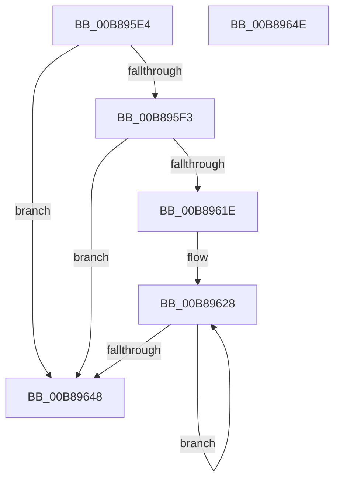

# KdpGetStateChange

- RVA: `0x00B895E4`–`0x00B8964F` (길이 `107` bytes)
- VA: `0x0000000140B895E4`
- 실행 섹션: `PAGEKD`
- PDB 이름 있음: `예`; PDB Function 태그: `아니요`
- unwind 정보 RVA: `0x0005CF00`
- 디코드: `29`개 명령, `107/107` bytes 표시
- 미해석 바이트: `0` (있으면 어셈블리에 `.byte`로 보존)

> 이 문서는 커널 이미지의 기계어와 PDB 기호를 분석해 생성했습니다. 4번과 5번은 함수 원형과 자료형을 바이너리 사용 방식에서 추정한 C 해석이며 원본 소스 복구 결과는 아닙니다.

## 1. Dependencies

- 직접 호출 지점: **1**; 고유 호출 대상: **1**
- 직접 호출자로 확인된 함수: **1**
- RIP 상대 이미지 참조: **1**

### Outgoing calls
- `0x00B89615` → [KeQueryActiveProcessorCountEx](../../text/24/KeQueryActiveProcessorCountEx_function_00249EF0.md) (function, `0x00249EF0`)

### Direct callers
- [KdpSendWaitContinue](KdpSendWaitContinue_function_00B8A32C.md) at `0x00B8A6D4`

### Static image references
- `0x00B8961E` → RVA `0x00FC8C40` (`ALMOSTRO`; read)

## 2. Other-region calls and transfers

- 다른 실행 섹션으로 향하는 call: **1**
  - `0x00B89615` → [KeQueryActiveProcessorCountEx](../../text/24/KeQueryActiveProcessorCountEx_function_00249EF0.md) (`PAGEKD` → `.text`)
- 별도 외부 분기/꼬리 이동을 확인하지 못했습니다.

## 3. Assembly (complete function range)

```asm
00B895E4  40 53                           push rbx
00B895E6  48 83 EC 20                     sub rsp, 0x20
00B895EA  83 79 10 00                     cmp dword ptr [rcx + 0x10], 0
00B895EE  48 8B D9                        mov rbx, rcx
00B895F1  7C 55                           jl 0x140b89648
00B895F3  44 8B 4A 44                     mov r9d, dword ptr [rdx + 0x44]
00B895F7  45 8B C1                        mov r8d, r9d
00B895FA  41 0F BA F0 08                  btr r8d, 8
00B895FF  41 0F BA E9 08                  bts r9d, 8
00B89604  83 79 14 00                     cmp dword ptr [rcx + 0x14], 0
00B89608  B9 FF FF 00 00                  mov ecx, 0xffff
00B8960D  45 0F 44 C8                     cmove r9d, r8d
00B89611  44 89 4A 44                     mov dword ptr [rdx + 0x44], r9d
00B89615  E8 D6 08 6C FF                  call 0x140249ef0
00B8961A  85 C0                           test eax, eax
00B8961C  74 2A                           je 0x140b89648
00B8961E  48 8D 15 1B F6 43 00            lea rdx, [rip + 0x43f61b]
00B89625  44 8B C0                        mov r8d, eax
00B89628  48 8B 0A                        mov rcx, qword ptr [rdx]
00B8962B  48 8D 52 08                     lea rdx, [rdx + 8]
00B8962F  48 83 A1 40 01 00 00 00         and qword ptr [rcx + 0x140], 0
00B89637  48 8B 43 18                     mov rax, qword ptr [rbx + 0x18]
00B8963B  48 89 81 48 01 00 00            mov qword ptr [rcx + 0x148], rax
00B89642  49 83 E8 01                     sub r8, 1
00B89646  75 E0                           jne 0x140b89628
00B89648  48 83 C4 20                     add rsp, 0x20
00B8964C  5B                              pop rbx
00B8964D  C3                              ret
00B8964E  CC                              int3
```

## 4. C-style interpretation (structured pseudocode)

```c
__int64 __fastcall KdpGetStateChange(__int64 a1, __int64 a2)
{
    __int64 result;
    __int64 v_rsp;

    v_rsp = (v_rsp) - (32);
    if ((*(unsigned int *)(a1 + 16)) < 0) goto loc_00B89648;
    a4 = (unsigned int)(*(unsigned int *)(a2 + 68));
    if ((*(unsigned int *)(a1 + 20)) == 0) { a4 = (unsigned int)((unsigned int)((unsigned int)((unsigned int)(*(unsigned int *)(a2 + 68))))); }
    *(unsigned int *)(a2 + 68) = (unsigned int)(a4);
    result = KeQueryActiveProcessorCountEx((unsigned int)(0xFFFFULL), a2, (unsigned int)((unsigned int)((unsigned int)(*(unsigned int *)(a2 + 68)))), a4);
    if ((unsigned int)(result) == 0) goto loc_00B89648;
loc_00B89628:
    *(unsigned __int64 *)(*(unsigned __int64 *)(v_rip + 4453915) + 328) = *(unsigned __int64 *)(a1 + 24);
    a3 = ((unsigned int)((unsigned int)(result))) - (1);
    if (condition_is_not_equal) goto loc_00B89628;
loc_00B89648:
    v_rsp = (v_rsp) + (32);
    return *(unsigned __int64 *)(a1 + 24);
}
```

## 5. (Beta) C Style

```c
int64_t KdpGetStateChange(void *Arg1, void *Arg2)
{
    uint8_t *arg1 = (uint8_t *)Arg1;
    uint8_t *arg2 = (uint8_t *)Arg2;

    int64_t result;
    int64_t local_rsp;

    local_rsp = (local_rsp) - (32);
    if ((*(uint32_t *)(arg1 + 0x10)) < 0) goto loc_00B89648;
    a4 = (uint32_t)(*(uint32_t *)(arg2 + 0x44));
    if ((*(uint32_t *)(arg1 + 0x14)) == 0) { a4 = (uint32_t)((uint32_t)((uint32_t)((uint32_t)(*(uint32_t *)(arg2 + 0x44))))); }
    *(uint32_t *)(arg2 + 0x44) = (uint32_t)(a4);
    result = KeQueryActiveProcessorCountEx((uint32_t)(0xFFFFULL), Arg2, (uint32_t)((uint32_t)((uint32_t)(*(uint32_t *)(arg2 + 0x44)))), a4);
    if ((uint32_t)(result) == 0) goto loc_00B89648;
loc_00B89628:
    *(uint64_t *)(*(uint64_t *)(v_rip + 0x43F61B) + 0x148) = *(uint64_t *)(arg1 + 0x18);
    a3 = ((uint32_t)((uint32_t)(result))) - (1);
    if (condition_is_not_equal) goto loc_00B89628;
loc_00B89648:
    local_rsp = (local_rsp) + (32);
    return *(uint64_t *)(arg1 + 0x18);
}
```

### 관측된 메모리 오프셋

구조체 형식이 확인되지 않은 접근은 인자 기준의 오프셋으로만 기록했습니다.

| 기준 인자 | 오프셋 표현 | 폭 (bit) | 접근 |
|---|---:|---:|---|
| `Arg1` | `+ 0x10` | `32` | `R` |
| `Arg1` | `+ 0x14` | `32` | `R` |
| `Arg1` | `+ 0x18` | `64` | `R` |
| `Arg2` | `+ 0x44` | `32` | `R` |
| `Arg2` | `+ 0x44` | `32` | `W` |

## 6. Execution-region graph

[열기: 2D/3D 그래프와 함수 탐색 컨트롤 패널](../../../control-panel.html?section=pagekd&rva=0x00B895E4&view=graph)

- 2D 그래프는 위에서 아래로 흐르고, 3D 그래프는 빈 공간을 드래그해 회전합니다. Shift+드래그는 이동, 휠은 확대·축소, 함수 노드 선택은 대상 보고서 이동입니다.

### Static fallback


