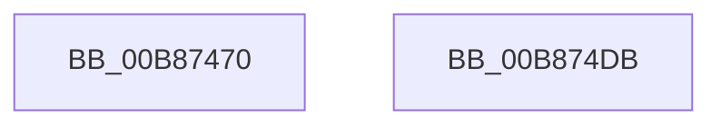

# KdpGetVersion

- RVA: `0x00B87470`–`0x00B874DC` (길이 `108` bytes)
- VA: `0x0000000140B87470`
- 실행 섹션: `PAGEKD`
- PDB 이름 있음: `예`; PDB Function 태그: `아니요`
- unwind 정보 RVA: `0x0005D2F4`
- 디코드: `23`개 명령, `108/108` bytes 표시
- 미해석 바이트: `0` (있으면 어셈블리에 `.byte`로 보존)

> 이 문서는 커널 이미지의 기계어와 PDB 기호를 분석해 생성했습니다. 4번과 5번은 함수 원형과 자료형을 바이너리 사용 방식에서 추정한 C 해석이며 원본 소스 복구 결과는 아닙니다.

## 1. Dependencies

- 직접 호출 지점: **1**; 고유 호출 대상: **1**
- 직접 호출자로 확인된 함수: **1**
- RIP 상대 이미지 참조: **5**

### Outgoing calls
- `0x00B874CA` → `kdcom.dll!KdSendPacket` (import, 간접 대상; import `kdcom.dll!KdSendPacket`)

### Direct callers
- [KdpSendWaitContinue](KdpSendWaitContinue_function_00B8A32C.md) at `0x00B8A5F2`

### Static image references
- `0x00B87474` → RVA `0x00E0AA30` (`.data`; read)
- `0x00B8747F` → RVA `0x00F475E0` (`.data`; read)
- `0x00B8749E` → RVA `0x00E0AA20` (`.data`; read)
- `0x00B874B6` → RVA `0x00E0AA40` (`.data`; read)
- `0x00B874CA` → RVA `0x001516C0` (`kdcom.dll!KdSendPacket (IAT)`; read)

## 2. Other-region calls and transfers

- 다른 실행 섹션으로 향하는 call: **0**
- 별도 외부 분기/꼬리 이동을 확인하지 못했습니다.

## 3. Assembly (complete function range)

```asm
00B87470  48 83 EC 38                     sub rsp, 0x38
00B87474  0F 10 0D B5 35 28 00            movups xmm1, xmmword ptr [rip + 0x2835b5]
00B8747B  83 61 08 00                     and dword ptr [rcx + 8], 0
00B8747F  4C 8D 0D 5A 01 3C 00            lea r9, [rip + 0x3c015a]
00B87486  0F 57 C0                        xorps xmm0, xmm0
00B87489  C7 01 46 31 00 00               mov dword ptr [rcx], 0x3146
00B8748F  0F 11 44 24 20                  movups xmmword ptr [rsp + 0x20], xmm0
00B87494  B8 38 00 00 00                  mov eax, 0x38
00B87499  48 89 4C 24 28                  mov qword ptr [rsp + 0x28], rcx
00B8749E  0F 10 05 7B 35 28 00            movups xmm0, xmmword ptr [rip + 0x28357b]
00B874A5  45 33 C0                        xor r8d, r8d
00B874A8  66 89 44 24 20                  mov word ptr [rsp + 0x20], ax
00B874AD  48 8D 54 24 20                  lea rdx, [rsp + 0x20]
00B874B2  0F 11 41 10                     movups xmmword ptr [rcx + 0x10], xmm0
00B874B6  F2 0F 10 05 82 35 28 00         movsd xmm0, qword ptr [rip + 0x283582]
00B874BE  0F 11 49 20                     movups xmmword ptr [rcx + 0x20], xmm1
00B874C2  F2 0F 11 41 30                  movsd qword ptr [rcx + 0x30], xmm0
00B874C7  8D 48 CA                        lea ecx, [rax - 0x36]
00B874CA  48 FF 15 EF A1 5C FF            call qword ptr [rip - 0xa35e11]
00B874D1  0F 1F 44 00 00                  nop dword ptr [rax + rax]
00B874D6  48 83 C4 38                     add rsp, 0x38
00B874DA  C3                              ret
00B874DB  CC                              int3
```

## 4. C-style interpretation (structured pseudocode)

```c
__int64 __fastcall KdpGetVersion(__int64 a1, __int64 a2, int a3)
{
    __int64 result;
    __int64 v_rsp;
    unsigned __int64 v_stack_m10;
    unsigned __int64 v_stack_m18;

    v_rsp = (v_rsp) - (56);
    *(unsigned int *)(a1) = 0x3146ULL;
    v_stack_m18 = v_xmm0;
    v_stack_m10 = a1;
    a3 = 0;
    v_stack_m18 = 56;
    *(unsigned __int64 *)(a1 + 16) = v_xmm0;
    *(unsigned __int64 *)(a1 + 32) = v_xmm1;
    *(unsigned __int64 *)(a1 + 48) = v_xmm0;
    result = kdcom_dll_KdSendPacket(56 - 54, v_stack_m18, a3, v_rip + 3932506);
    v_rsp = (v_rsp) + (56);
    return result;
}
```

## 5. (Beta) C Style

```c
int64_t KdpGetVersion(void *Arg1, int64_t Arg2, int32_t Arg3)
{
    uint8_t *arg1 = (uint8_t *)Arg1;

    int64_t result;
    int64_t local_rsp;
    uint64_t v_stack_m10;
    uint64_t v_stack_m18;

    local_rsp = (local_rsp) - (56);
    *(uint32_t *)(arg1) = 0x3146ULL;
    v_stack_m18 = v_xmm0;
    v_stack_m10 = Arg1;
    Arg3 = 0;
    v_stack_m18 = 56;
    *(uint64_t *)(arg1 + 0x10) = v_xmm0;
    *(uint64_t *)(arg1 + 0x20) = v_xmm1;
    *(uint64_t *)(arg1 + 0x30) = v_xmm0;
    result = kernel_indirect_call(56 - 54, v_stack_m18, Arg3, v_rip + 3932506);
    local_rsp = (local_rsp) + (56);
    return result;
}
```

### 관측된 메모리 오프셋

구조체 형식이 확인되지 않은 접근은 인자 기준의 오프셋으로만 기록했습니다.

| 기준 인자 | 오프셋 표현 | 폭 (bit) | 접근 |
|---|---:|---:|---|
| `Arg1` | `+ 0x0` | `32` | `W` |
| `Arg1` | `+ 0x8` | `32` | `R/W` |
| `Arg1` | `+ 0x10` | `128` | `R` |
| `Arg1` | `+ 0x20` | `128` | `R` |
| `Arg1` | `+ 0x30` | `64` | `W` |

## 6. Execution-region graph

[열기: 2D/3D 그래프와 함수 탐색 컨트롤 패널](../../../control-panel.html?section=pagekd&rva=0x00B87470&view=graph)

- 2D 그래프는 위에서 아래로 흐르고, 3D 그래프는 빈 공간을 드래그해 회전합니다. Shift+드래그는 이동, 휠은 확대·축소, 함수 노드 선택은 대상 보고서 이동입니다.

### Static fallback


