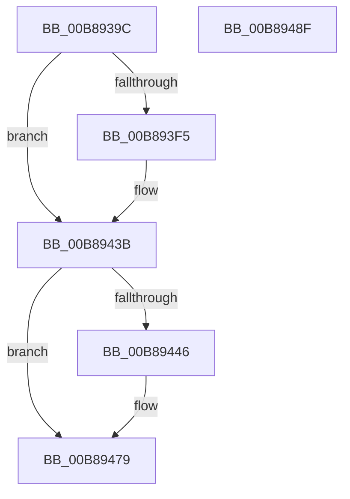

# KdpInitializeExtendedContext

- RVA: `0x00B8939C`–`0x00B89490` (길이 `244` bytes)
- VA: `0x0000000140B8939C`
- 실행 섹션: `PAGEKD`
- PDB 이름 있음: `예`; PDB Function 태그: `아니요`
- unwind 정보 RVA: `0x0006F978`
- 디코드: `64`개 명령, `244/244` bytes 표시
- 미해석 바이트: `0` (있으면 어셈블리에 `.byte`로 보존)

> 이 문서는 커널 이미지의 기계어와 PDB 기호를 분석해 생성했습니다. 4번과 5번은 함수 원형과 자료형을 바이너리 사용 방식에서 추정한 C 해석이며 원본 소스 복구 결과는 아닙니다.

## 1. Dependencies

- 직접 호출 지점: **1**; 고유 호출 대상: **1**
- 직접 호출자로 확인된 함수: **1**
- RIP 상대 이미지 참조: **0**

### Outgoing calls
- `0x00B89406` → [memset](../../text/6C/memset_function_006C6C40.md) (function, `0x006C6C40`)

### Direct callers
- [KdpGetContext](KdpGetContext_function_00B872F8.md) at `0x00B873A7`

### Static image references
- 디코드된 RIP-relative 메모리 참조가 없습니다.

## 2. Other-region calls and transfers

- 다른 실행 섹션으로 향하는 call: **1**
  - `0x00B89406` → [memset](../../text/6C/memset_function_006C6C40.md) (`PAGEKD` → `.text`)
- 별도 외부 분기/꼬리 이동을 확인하지 못했습니다.

## 3. Assembly (complete function range)

```asm
00B8939C  48 89 5C 24 08                  mov qword ptr [rsp + 8], rbx
00B893A1  48 89 74 24 10                  mov qword ptr [rsp + 0x10], rsi
00B893A6  48 89 7C 24 18                  mov qword ptr [rsp + 0x18], rdi
00B893AB  41 56                           push r14
00B893AD  48 83 EC 20                     sub rsp, 0x20
00B893B1  89 51 30                        mov dword ptr [rcx + 0x30], edx
00B893B4  4C 8D B1 D0 04 00 00            lea r14, [rcx + 0x4d0]
00B893BB  41 8B C6                        mov eax, r14d
00B893BE  8B F2                           mov esi, edx
00B893C0  2B C1                           sub eax, ecx
00B893C2  48 8B F9                        mov rdi, rcx
00B893C5  89 81 DC 04 00 00               mov dword ptr [rcx + 0x4dc], eax
00B893CB  44 8B C0                        mov r8d, eax
00B893CE  83 C0 20                        add eax, 0x20
00B893D1  41 F7 D8                        neg r8d
00B893D4  89 81 D4 04 00 00               mov dword ptr [rcx + 0x4d4], eax
00B893DA  8B C2                           mov eax, edx
00B893DC  BA 40 00 10 00                  mov edx, 0x100040
00B893E1  44 89 81 D8 04 00 00            mov dword ptr [rcx + 0x4d8], r8d
00B893E8  23 C2                           and eax, edx
00B893EA  45 89 06                        mov dword ptr [r14], r8d
00B893ED  49 8D 4E 20                     lea rcx, [r14 + 0x20]
00B893F1  3B C2                           cmp eax, edx
00B893F3  75 46                           jne 0x140b8943b
00B893F5  33 D2                           xor edx, edx
00B893F7  49 8D 5E 5F                     lea rbx, [r14 + 0x5f]
00B893FB  48 83 E3 C0                     and rbx, 0xffffffffffffffc0
00B893FF  48 8B CB                        mov rcx, rbx
00B89402  44 8D 42 40                     lea r8d, [rdx + 0x40]
00B89406  E8 35 D8 B3 FF                  call 0x1406c6c40
00B8940B  8B D3                           mov edx, ebx
00B8940D  41 2B D6                        sub edx, r14d
00B89410  89 97 E0 04 00 00               mov dword ptr [rdi + 0x4e0], edx
00B89416  A1 E8 03 00 00 80 F7 FF FF      movabs eax, dword ptr [0xfffff780000003e8]
00B8941F  8D 88 00 FE FF FF               lea ecx, [rax - 0x200]
00B89425  8B C1                           mov eax, ecx
00B89427  89 8F E4 04 00 00               mov dword ptr [rdi + 0x4e4], ecx
00B8942D  41 2B 06                        sub eax, dword ptr [r14]
00B89430  03 C2                           add eax, edx
00B89432  89 87 D4 04 00 00               mov dword ptr [rdi + 0x4d4], eax
00B89438  48 03 CB                        add rcx, rbx
00B8943B  B8 80 00 10 00                  mov eax, 0x100080
00B89440  23 F0                           and esi, eax
00B89442  3B F0                           cmp esi, eax
00B89444  75 33                           jne 0x140b89479
00B89446  48 8D 41 07                     lea rax, [rcx + 7]
00B8944A  0F 57 C0                        xorps xmm0, xmm0
00B8944D  48 83 E0 F8                     and rax, 0xfffffffffffffff8
00B89451  33 C9                           xor ecx, ecx
00B89453  0F 11 00                        movups xmmword ptr [rax], xmm0
00B89456  48 89 48 10                     mov qword ptr [rax + 0x10], rcx
00B8945A  41 2B C6                        sub eax, r14d
00B8945D  89 87 E8 04 00 00               mov dword ptr [rdi + 0x4e8], eax
00B89463  41 2B 06                        sub eax, dword ptr [r14]
00B89466  83 C0 18                        add eax, 0x18
00B89469  C7 87 EC 04 00 00 18 00 00 00   mov dword ptr [rdi + 0x4ec], 0x18
00B89473  89 87 D4 04 00 00               mov dword ptr [rdi + 0x4d4], eax
00B89479  48 8B 5C 24 30                  mov rbx, qword ptr [rsp + 0x30]
00B8947E  48 8B 74 24 38                  mov rsi, qword ptr [rsp + 0x38]
00B89483  48 8B 7C 24 40                  mov rdi, qword ptr [rsp + 0x40]
00B89488  48 83 C4 20                     add rsp, 0x20
00B8948C  41 5E                           pop r14
00B8948E  C3                              ret
00B8948F  CC                              int3
```

## 4. C-style interpretation (structured pseudocode)

```c
__int64 __fastcall KdpInitializeExtendedContext(__int64 a1, int a2)
{
    __int64 result;
    __int64 v_rbx;
    __int64 v_rsi;
    __int64 v_rsp;
    unsigned __int64 v_stack_p10;
    unsigned __int64 v_stack_p18;
    unsigned __int64 v_stack_p8;

    v_stack_p8 = v_rbx;
    v_stack_p10 = v_rsi;
    v_stack_p18 = v_rdi;
    v_rsp = (v_rsp) - (32);
    *(unsigned int *)(a1 + 48) = a2;
    result = (unsigned int)(((unsigned int)((unsigned int)(a1 + 1232))) - ((unsigned int)(a1)));
    *(unsigned int *)(a1 + 1244) = (unsigned int)(result);
    result = (unsigned int)((result) + (32));
    a3 = (unsigned int)(-((unsigned int)((unsigned int)(result))));
    *(unsigned int *)(a1 + 1236) = (unsigned int)(result);
    *(unsigned int *)(a1 + 1240) = (unsigned int)(a3);
    result = (unsigned int)(((unsigned int)(a2)) & ((unsigned int)((unsigned int)(0x100040ULL))));
    *(unsigned int *)(a1 + 1232) = (unsigned int)(a3);
    if (((unsigned int)(result)) == ((unsigned int)((unsigned int)(0x100040ULL)))) {
        a2 = 0;
        v_rbx = a1 + 1232 + 95;
        v_rbx = (v_rbx) & (-64);
        a1 = v_rbx;
        a3 = a2 + 64;
        result = memset(a1, a2, a3, a4);
        a2 = (unsigned int)(v_rbx);
        a2 = (unsigned int)((a2) - ((unsigned int)(a1 + 1232)));
        *(unsigned int *)(a1 + 1248) = a2;
        a1 = result - 512;
        result = (unsigned int)(a1);
        *(unsigned int *)(a1 + 1252) = (unsigned int)(a1);
        result = (unsigned int)((result) - (*(unsigned int *)(a1 + 1232)));
        result = (unsigned int)((result) + (a2));
        *(unsigned int *)(a1 + 1236) = (unsigned int)(result);
        a1 = (a1) + (v_rbx);
    }
    v_rsi = (unsigned int)(((unsigned int)(a2)) & ((unsigned int)((unsigned int)(0x100080ULL))));
    result = (unsigned int)(0x100080ULL);
    if (((unsigned int)(v_rsi)) == ((unsigned int)((unsigned int)(0x100080ULL)))) {
        result = a1 + 7;
        result = (result) & (-8);
        a1 = 0;
        *(unsigned __int64 *)(result) = v_xmm0;
        *(unsigned __int64 *)(result + 16) = 0;
        result = (unsigned int)((result) - ((unsigned int)(a1 + 1232)));
        *(unsigned int *)(a1 + 1256) = (unsigned int)(result);
        result = (unsigned int)((result) - (*(unsigned int *)(a1 + 1232)));
        result = (unsigned int)((result) + (24));
        *(unsigned int *)(a1 + 1260) = 24;
        *(unsigned int *)(a1 + 1236) = (unsigned int)(result);
    }
    v_rsp = (v_rsp) + (32);
    return result;
}
```

## 5. (Beta) C Style

```c
int64_t KdpInitializeExtendedContext(void *Arg1, int32_t Arg2)
{
    uint8_t *arg1 = (uint8_t *)Arg1;

    int64_t result;
    int64_t local_rbx;
    int64_t local_rsi;
    int64_t local_rsp;
    uint64_t v_stack_p10;
    uint64_t v_stack_p18;
    uint64_t v_stack_p8;

    v_stack_p8 = local_rbx;
    v_stack_p10 = local_rsi;
    v_stack_p18 = local_rdi;
    local_rsp = (local_rsp) - (32);
    *(uint32_t *)(arg1 + 0x30) = Arg2;
    result = (uint32_t)(((uint32_t)((uint32_t)(Arg1 + 1232))) - ((uint32_t)(Arg1)));
    *(uint32_t *)(arg1 + 0x4DC) = (uint32_t)(result);
    result = (uint32_t)((result) + (32));
    a3 = (uint32_t)(-((uint32_t)((uint32_t)(result))));
    *(uint32_t *)(arg1 + 0x4D4) = (uint32_t)(result);
    *(uint32_t *)(arg1 + 0x4D8) = (uint32_t)(a3);
    result = (uint32_t)(((uint32_t)(Arg2)) & ((uint32_t)((uint32_t)(0x100040ULL))));
    *(uint32_t *)(arg1 + 0x4D0) = (uint32_t)(a3);
    if (((uint32_t)(result)) == ((uint32_t)((uint32_t)(0x100040ULL)))) {
        Arg2 = 0;
        local_rbx = Arg1 + 1232 + 95;
        local_rbx = (local_rbx) & (-64);
        Arg1 = local_rbx;
        a3 = Arg2 + 64;
        result = memset(Arg1, Arg2, a3, a4);
        Arg2 = (uint32_t)(local_rbx);
        Arg2 = (uint32_t)((Arg2) - ((uint32_t)(Arg1 + 1232)));
        *(uint32_t *)(arg1 + 0x4E0) = Arg2;
        Arg1 = result - 512;
        result = (uint32_t)(Arg1);
        *(uint32_t *)(arg1 + 0x4E4) = (uint32_t)(Arg1);
        result = (uint32_t)((result) - (*(uint32_t *)(arg1 + 0x4D0)));
        result = (uint32_t)((result) + (Arg2));
        *(uint32_t *)(arg1 + 0x4D4) = (uint32_t)(result);
        Arg1 = (Arg1) + (local_rbx);
    }
    local_rsi = (uint32_t)(((uint32_t)(Arg2)) & ((uint32_t)((uint32_t)(0x100080ULL))));
    result = (uint32_t)(0x100080ULL);
    if (((uint32_t)(local_rsi)) == ((uint32_t)((uint32_t)(0x100080ULL)))) {
        result = Arg1 + 7;
        result = (result) & (-8);
        Arg1 = 0;
        *(uint64_t *)(result) = v_xmm0;
        *(uint64_t *)(result + 0x10) = 0;
        result = (uint32_t)((result) - ((uint32_t)(Arg1 + 1232)));
        *(uint32_t *)(arg1 + 0x4E8) = (uint32_t)(result);
        result = (uint32_t)((result) - (*(uint32_t *)(arg1 + 0x4D0)));
        result = (uint32_t)((result) + (24));
        *(uint32_t *)(arg1 + 0x4EC) = 24;
        *(uint32_t *)(arg1 + 0x4D4) = (uint32_t)(result);
    }
    local_rsp = (local_rsp) + (32);
    return result;
}
```

### 관측된 메모리 오프셋

구조체 형식이 확인되지 않은 접근은 인자 기준의 오프셋으로만 기록했습니다.

| 기준 인자 | 오프셋 표현 | 폭 (bit) | 접근 |
|---|---:|---:|---|
| `Arg1` | `+ 0x0` | `32` | `R` |
| `Arg1` | `+ 0x0` | `32` | `W` |
| `Arg1` | `+ 0x20` | `64` | `R` |
| `Arg1` | `+ 0x30` | `32` | `W` |
| `Arg1` | `+ 0x5F` | `64` | `R` |
| `Arg1` | `+ 0x4D0` | `64` | `R` |
| `Arg1` | `+ 0x4D4` | `32` | `W` |
| `Arg1` | `+ 0x4D8` | `32` | `W` |
| `Arg1` | `+ 0x4DC` | `32` | `W` |
| `Arg1` | `+ 0x4E0` | `32` | `W` |
| `Arg1` | `+ 0x4E4` | `32` | `W` |
| `Arg1` | `+ 0x4E8` | `32` | `W` |
| `Arg1` | `+ 0x4EC` | `32` | `W` |

## 6. Execution-region graph

[열기: 2D/3D 그래프와 함수 탐색 컨트롤 패널](../../../control-panel.html?section=pagekd&rva=0x00B8939C&view=graph)

- 2D 그래프는 위에서 아래로 흐르고, 3D 그래프는 빈 공간을 드래그해 회전합니다. Shift+드래그는 이동, 휠은 확대·축소, 함수 노드 선택은 대상 보고서 이동입니다.

### Static fallback


