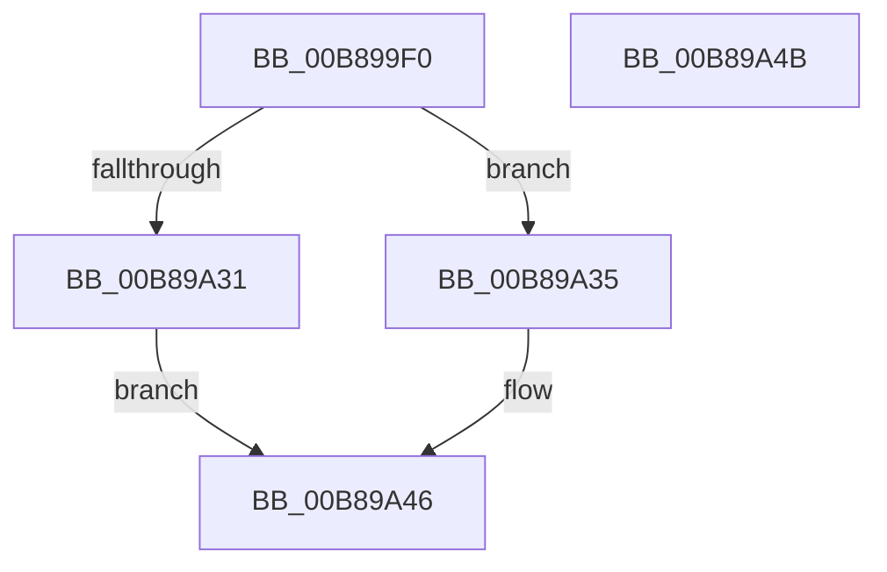

# KdpInsertBreakpoint

- RVA: `0x00B899F0`–`0x00B89A4C` (길이 `92` bytes)
- VA: `0x0000000140B899F0`
- 실행 섹션: `PAGEKD`
- PDB 이름 있음: `예`; PDB Function 태그: `아니요`
- unwind 정보 RVA: `0x0005C788`
- 디코드: `27`개 명령, `92/92` bytes 표시
- 미해석 바이트: `0` (있으면 어셈블리에 `.byte`로 보존)

> 이 문서는 커널 이미지의 기계어와 PDB 기호를 분석해 생성했습니다. 4번과 5번은 함수 원형과 자료형을 바이너리 사용 방식에서 추정한 C 해석이며 원본 소스 복구 결과는 아닙니다.

## 1. Dependencies

- 직접 호출 지점: **2**; 고유 호출 대상: **2**
- 직접 호출자로 확인된 함수: **3**
- RIP 상대 이미지 참조: **0**

### Outgoing calls
- `0x00B89A08` → [KdpWriteInstructionBuffer](../../text/5B/KdpWriteInstructionBuffer_function_005B1424.md) (function, `0x005B1424`)
- `0x00B89A26` → [KdpCopyCodeStream](KdpCopyCodeStream_function_00B8930C.md) (function, `0x00B8930C`)

### Direct callers
- [KdpAddBreakpoint](KdpAddBreakpoint_function_00B897E8.md) at `0x00B8994E`
- [KdpLowRestoreBreakpoint](KdpLowRestoreBreakpoint_function_00B89A54.md) at `0x00B89AD8`
- [KdpSetOwedBreakpoints](KdpSetOwedBreakpoints_function_00B8A7DC.md) at `0x00B8A925`

### Static image references
- 디코드된 RIP-relative 메모리 참조가 없습니다.

## 2. Other-region calls and transfers

- 다른 실행 섹션으로 향하는 call: **1**
  - `0x00B89A08` → [KdpWriteInstructionBuffer](../../text/5B/KdpWriteInstructionBuffer_function_005B1424.md) (`PAGEKD` → `.text`)
- 별도 외부 분기/꼬리 이동을 확인하지 못했습니다.

## 3. Assembly (complete function range)

```asm
00B899F0  48 83 EC 28                     sub rsp, 0x28
00B899F4  48 8B 01                        mov rax, qword ptr [rcx]
00B899F7  4C 8B DA                        mov r11, rdx
00B899FA  48 8B 51 10                     mov rdx, qword ptr [rcx + 0x10]
00B899FE  4C 8B D1                        mov r10, rcx
00B89A01  44 8A 41 24                     mov r8b, byte ptr [rcx + 0x24]
00B89A05  49 8B CB                        mov rcx, r11
00B89A08  E8 17 7A A2 FF                  call 0x1405b1424
00B89A0D  41 0F B6 4A 25                  movzx ecx, byte ptr [r10 + 0x25]
00B89A12  41 B9 05 00 00 00               mov r9d, 5
00B89A18  45 0F B6 42 24                  movzx r8d, byte ptr [r10 + 0x24]
00B89A1D  48 F7 D1                        not rcx
00B89A20  48 23 C8                        and rcx, rax
00B89A23  49 8B D3                        mov rdx, r11
00B89A26  E8 E1 F8 FF FF                  call 0x140b8930c
00B89A2B  8B C8                           mov ecx, eax
00B89A2D  85 C0                           test eax, eax
00B89A2F  79 04                           jns 0x140b89a35
00B89A31  33 C0                           xor eax, eax
00B89A33  EB 11                           jmp 0x140b89a46
00B89A35  B8 03 00 00 00                  mov eax, 3
00B89A3A  81 F9 03 01 00 00               cmp ecx, 0x103
00B89A40  8D 50 FE                        lea edx, [rax - 2]
00B89A43  0F 45 C2                        cmovne eax, edx
00B89A46  48 83 C4 28                     add rsp, 0x28
00B89A4A  C3                              ret
00B89A4B  CC                              int3
```

## 4. C-style interpretation (structured pseudocode)

```c
__int64 __fastcall KdpInsertBreakpoint(__int64 a1, __int64 a2)
{
    __int64 result;
    __int64 v_rsp;

    v_rsp = (v_rsp) - (40);
    result = KdpWriteInstructionBuffer(a2, *(unsigned __int64 *)(a1 + 16), *(unsigned __int8 *)(a1 + 36), a4);
    a1 = ~(*(unsigned __int8 *)(a1 + 37));
    a1 = (a1) & (result);
    result = KdpCopyCodeStream(a1, a2, *(unsigned __int8 *)(a1 + 36), 5);
    if (!sign_flag) goto loc_00B89A35;
    result = 0;
    goto loc_00B89A46;
loc_00B89A35:
    result = 3;
    if (((unsigned int)((unsigned int)((unsigned int)(result)))) != 259) { result = (unsigned int)(3 - 2); }
loc_00B89A46:
    v_rsp = (v_rsp) + (40);
    return result;
}
```

## 5. (Beta) C Style

```c
int64_t KdpInsertBreakpoint(void *Arg1, int64_t Arg2)
{
    uint8_t *arg1 = (uint8_t *)Arg1;

    int64_t result;
    int64_t local_rsp;

    local_rsp = (local_rsp) - (40);
    result = KdpWriteInstructionBuffer(Arg2, *(uint64_t *)(arg1 + 0x10), *(uint8_t *)(arg1 + 0x24), a4);
    Arg1 = ~(*(uint8_t *)(arg1 + 0x25));
    Arg1 = (Arg1) & (result);
    result = KdpCopyCodeStream(Arg1, Arg2, *(uint8_t *)(arg1 + 0x24), 5);
    if (!sign_flag) goto loc_00B89A35;
    result = 0;
    goto loc_00B89A46;
loc_00B89A35:
    result = 3;
    if (((uint32_t)((uint32_t)((uint32_t)(result)))) != 259) { result = (uint32_t)(3 - 2); }
loc_00B89A46:
    local_rsp = (local_rsp) + (40);
    return result;
}
```

### 관측된 메모리 오프셋

구조체 형식이 확인되지 않은 접근은 인자 기준의 오프셋으로만 기록했습니다.

| 기준 인자 | 오프셋 표현 | 폭 (bit) | 접근 |
|---|---:|---:|---|
| `Arg1` | `+ 0x0` | `64` | `R` |
| `Arg1` | `+ 0x10` | `64` | `R` |
| `Arg1` | `+ 0x24` | `8` | `R` |

## 6. Execution-region graph

[열기: 2D/3D 그래프와 함수 탐색 컨트롤 패널](../../../control-panel.html?section=pagekd&rva=0x00B899F0&view=graph)

- 2D 그래프는 위에서 아래로 흐르고, 3D 그래프는 빈 공간을 드래그해 회전합니다. Shift+드래그는 이동, 휠은 확대·축소, 함수 노드 선택은 대상 보고서 이동입니다.

### Static fallback


