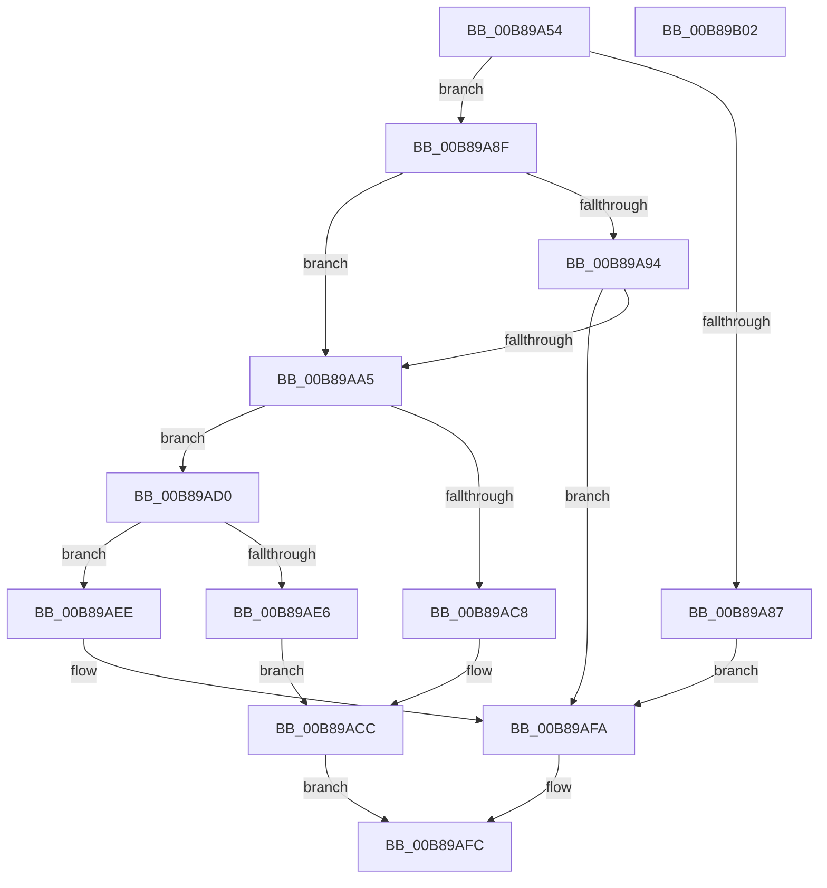

# KdpLowRestoreBreakpoint

- RVA: `0x00B89A54`–`0x00B89B03` (길이 `175` bytes)
- VA: `0x0000000140B89A54`
- 실행 섹션: `PAGEKD`
- PDB 이름 있음: `예`; PDB Function 태그: `아니요`
- unwind 정보 RVA: `0x0005CF00`
- 디코드: `55`개 명령, `175/175` bytes 표시
- 미해석 바이트: `0` (있으면 어셈블리에 `.byte`로 보존)

> 이 문서는 커널 이미지의 기계어와 PDB 기호를 분석해 생성했습니다. 4번과 5번은 함수 원형과 자료형을 바이너리 사용 방식에서 추정한 C 해석이며 원본 소스 복구 결과는 아닙니다.

## 1. Dependencies

- 직접 호출 지점: **3**; 고유 호출 대상: **3**
- 직접 호출자로 확인된 함수: **1**
- RIP 상대 이미지 참조: **3**

### Outgoing calls
- `0x00B89A9B` → [KdpIsBreakpoint](../../text/5B/KdpIsBreakpoint_function_005B13C8.md) (function, `0x005B13C8`)
- `0x00B89ABF` → [KdpCopyCodeStream](KdpCopyCodeStream_function_00B8930C.md) (function, `0x00B8930C`)
- `0x00B89AD8` → [KdpInsertBreakpoint](KdpInsertBreakpoint_function_00B899F0.md) (function, `0x00B899F0`)

### Direct callers
- [KdpRestoreAllBreakpoints](KdpRestoreAllBreakpoints_function_00B89C58.md) at `0x00B89C7D`

### Static image references
- `0x00B89A5A` → RVA `0x00F49620` (`.data`; read)
- `0x00B89A6A` → RVA `0x00F49620` (`.data`; write)
- `0x00B89A74` → RVA `0x00F49640` (`.data`; read)

## 2. Other-region calls and transfers

- 다른 실행 섹션으로 향하는 call: **1**
  - `0x00B89A9B` → [KdpIsBreakpoint](../../text/5B/KdpIsBreakpoint_function_005B13C8.md) (`PAGEKD` → `.text`)
- 별도 외부 분기/꼬리 이동을 확인하지 못했습니다.

## 3. Assembly (complete function range)

```asm
00B89A54  40 53                           push rbx
00B89A56  48 83 EC 20                     sub rsp, 0x20
00B89A5A  8B 05 C0 FB 3B 00               mov eax, dword ptr [rip + 0x3bfbc0]
00B89A60  48 83 64 24 38 00               and qword ptr [rsp + 0x38], 0
00B89A66  FF C0                           inc eax
00B89A68  8B C9                           mov ecx, ecx
00B89A6A  89 05 B0 FB 3B 00               mov dword ptr [rip + 0x3bfbb0], eax
00B89A70  48 8D 14 89                     lea rdx, [rcx + rcx*4]
00B89A74  48 8D 0D C5 FB 3B 00            lea rcx, [rip + 0x3bfbc5]
00B89A7B  48 8D 1C D1                     lea rbx, [rcx + rdx*8]
00B89A7F  8B 4B 20                        mov ecx, dword ptr [rbx + 0x20]
00B89A82  F6 C1 08                        test cl, 8
00B89A85  74 08                           je 0x140b89a8f
00B89A87  83 E1 F7                        and ecx, 0xfffffff7
00B89A8A  89 4B 20                        mov dword ptr [rbx + 0x20], ecx
00B89A8D  EB 6B                           jmp 0x140b89afa
00B89A8F  F6 C1 10                        test cl, 0x10
00B89A92  75 11                           jne 0x140b89aa5
00B89A94  48 8D 53 18                     lea rdx, [rbx + 0x18]
00B89A98  48 8B CB                        mov rcx, rbx
00B89A9B  E8 28 79 A2 FF                  call 0x1405b13c8
00B89AA0  83 F8 01                        cmp eax, 1
00B89AA3  74 55                           je 0x140b89afa
00B89AA5  0F B6 4B 25                     movzx ecx, byte ptr [rbx + 0x25]
00B89AA9  48 8D 54 24 38                  lea rdx, [rsp + 0x38]
00B89AAE  44 0F B6 43 24                  movzx r8d, byte ptr [rbx + 0x24]
00B89AB3  48 F7 D1                        not rcx
00B89AB6  48 23 0B                        and rcx, qword ptr [rbx]
00B89AB9  41 B9 04 00 00 00               mov r9d, 4
00B89ABF  E8 48 F8 FF FF                  call 0x140b8930c
00B89AC4  85 C0                           test eax, eax
00B89AC6  79 08                           jns 0x140b89ad0
00B89AC8  83 4B 20 02                     or dword ptr [rbx + 0x20], 2
00B89ACC  32 C0                           xor al, al
00B89ACE  EB 2C                           jmp 0x140b89afc
00B89AD0  48 8D 54 24 38                  lea rdx, [rsp + 0x38]
00B89AD5  48 8B CB                        mov rcx, rbx
00B89AD8  E8 13 FF FF FF                  call 0x140b899f0
00B89ADD  8B 4B 20                        mov ecx, dword ptr [rbx + 0x20]
00B89AE0  8B D0                           mov edx, eax
00B89AE2  85 C0                           test eax, eax
00B89AE4  75 08                           jne 0x140b89aee
00B89AE6  83 C9 02                        or ecx, 2
00B89AE9  89 4B 20                        mov dword ptr [rbx + 0x20], ecx
00B89AEC  EB DE                           jmp 0x140b89acc
00B89AEE  8B C1                           mov eax, ecx
00B89AF0  33 C2                           xor eax, edx
00B89AF2  83 E0 02                        and eax, 2
00B89AF5  33 C1                           xor eax, ecx
00B89AF7  89 43 20                        mov dword ptr [rbx + 0x20], eax
00B89AFA  B0 01                           mov al, 1
00B89AFC  48 83 C4 20                     add rsp, 0x20
00B89B00  5B                              pop rbx
00B89B01  C3                              ret
00B89B02  CC                              int3
```

## 4. C-style interpretation (structured pseudocode)

```c
__int64 __fastcall KdpLowRestoreBreakpoint(int a1)
{
    __int64 result;
    __int64 v_rsp;
    unsigned __int64 v_stack_p10;

    v_rsp = (v_rsp) - (32);
    result = (unsigned int)(((unsigned int)(*(unsigned int *)(v_rip + 3931072))) + 1);
    *(unsigned int *)(v_rip + 3931056) = (unsigned int)(result);
    if ((((unsigned __int8)((unsigned int)(*(unsigned int *)(v_rip + 3931077 + (unsigned int)(a1) + (unsigned int)(a1) * 4 * 8 + 32)))) & (8)) == 0) goto loc_00B89A8F;
    a1 = (unsigned int)(((unsigned int)(*(unsigned int *)(v_rip + 3931077 + (unsigned int)(a1) + (unsigned int)(a1) * 4 * 8 + 32))) & (0xFFFFFFF7ULL));
    *(unsigned int *)(v_rip + 3931077 + (unsigned int)(a1) + (unsigned int)(a1) * 4 * 8 + 32) = a1;
    goto loc_00B89AFA;
loc_00B89A8F:
    if ((((unsigned __int8)(a1)) & (16)) != 0) goto loc_00B89AA5;
    result = KdpIsBreakpoint(v_rip + 3931077 + (unsigned int)(a1) + (unsigned int)(a1) * 4 * 8, v_rip + 3931077 + (unsigned int)(a1) + (unsigned int)(a1) * 4 * 8 + 24, a3, a4);
    if (((unsigned int)(result)) == 1) goto loc_00B89AFA;
loc_00B89AA5:
    a1 = ~(*(unsigned __int8 *)(v_rip + 3931077 + (unsigned int)(a1) + (unsigned int)(a1) * 4 * 8 + 37));
    a1 = (a1) & (*(unsigned __int64 *)(v_rip + 3931077 + (unsigned int)(a1) + (unsigned int)(a1) * 4 * 8));
    result = KdpCopyCodeStream(a1, v_stack_p10, *(unsigned __int8 *)(v_rip + 3931077 + (unsigned int)(a1) + (unsigned int)(a1) * 4 * 8 + 36), 4);
    if (!sign_flag) goto loc_00B89AD0;
loc_00B89ACC:
    result = 0;
    goto loc_00B89AFC;
loc_00B89AD0:
    result = KdpInsertBreakpoint(v_rip + 3931077 + (unsigned int)(a1) + (unsigned int)(a1) * 4 * 8, v_stack_p10, *(unsigned __int8 *)(v_rip + 3931077 + (unsigned int)(a1) + (unsigned int)(a1) * 4 * 8 + 36), 4);
    if ((unsigned int)(result) != 0) goto loc_00B89AEE;
    a1 = (unsigned int)(((unsigned int)(*(unsigned int *)(v_rip + 3931077 + (unsigned int)(a1) + (unsigned int)(a1) * 4 * 8 + 32))) | (2));
    *(unsigned int *)(v_rip + 3931077 + (unsigned int)(a1) + (unsigned int)(a1) * 4 * 8 + 32) = a1;
    goto loc_00B89ACC;
loc_00B89AEE:
    result = (unsigned int)(((unsigned int)(a1)) ^ ((unsigned int)((unsigned int)((unsigned int)(result)))));
    result = (unsigned int)((result) & (2));
    result = (unsigned int)((result) ^ (a1));
    *(unsigned int *)(v_rip + 3931077 + (unsigned int)(a1) + (unsigned int)(a1) * 4 * 8 + 32) = (unsigned int)(result);
loc_00B89AFA:
loc_00B89AFC:
    v_rsp = (v_rsp) + (32);
    return 1;
}
```

## 5. (Beta) C Style

```c
int64_t KdpLowRestoreBreakpoint(void *Arg1)
{
    uint8_t *arg1 = (uint8_t *)Arg1;

    int64_t result;
    int64_t local_rsp;
    uint64_t v_stack_p10;

    local_rsp = (local_rsp) - (32);
    result = (uint32_t)(((uint32_t)(*(uint32_t *)(v_rip + 0x3BFBC0))) + 1);
    *(uint32_t *)(v_rip + 0x3BFBB0) = (uint32_t)(result);
    if ((((uint8_t)((uint32_t)(*(uint32_t *)(v_rip + 0x3BFBC5 + (uint32_t)(arg1) + (uint32_t)(arg1) * 4 * 8 + 0x20)))) & (8)) == 0) goto loc_00B89A8F;
    Arg1 = (uint32_t)(((uint32_t)(*(uint32_t *)(v_rip + 0x3BFBC5 + (uint32_t)(arg1) + (uint32_t)(arg1) * 4 * 8 + 0x20))) & (0xFFFFFFF7ULL));
    *(uint32_t *)(v_rip + 0x3BFBC5 + (uint32_t)(arg1) + (uint32_t)(arg1) * 4 * 8 + 0x20) = Arg1;
    goto loc_00B89AFA;
loc_00B89A8F:
    if ((((uint8_t)(Arg1)) & (16)) != 0) goto loc_00B89AA5;
    result = KdpIsBreakpoint(v_rip + 3931077 + (uint32_t)(Arg1) + (uint32_t)(Arg1) * 4 * 8, v_rip + 3931077 + (uint32_t)(Arg1) + (uint32_t)(Arg1) * 4 * 8 + 24, a3, a4);
    if (((uint32_t)(result)) == 1) goto loc_00B89AFA;
loc_00B89AA5:
    Arg1 = ~(*(uint8_t *)(v_rip + 0x3BFBC5 + (uint32_t)(arg1) + (uint32_t)(arg1) * 4 * 8 + 0x25));
    Arg1 = (Arg1) & (*(uint64_t *)(v_rip + 0x3BFBC5 + (uint32_t)(arg1) + (uint32_t)(arg1) * 4 * 8));
    result = KdpCopyCodeStream(Arg1, v_stack_p10, *(uint8_t *)(v_rip + 0x3BFBC5 + (uint32_t)(arg1) + (uint32_t)(arg1) * 4 * 8 + 0x24), 4);
    if (!sign_flag) goto loc_00B89AD0;
loc_00B89ACC:
    result = 0;
    goto loc_00B89AFC;
loc_00B89AD0:
    result = KdpInsertBreakpoint(v_rip + 3931077 + (uint32_t)(Arg1) + (uint32_t)(Arg1) * 4 * 8, v_stack_p10, *(uint8_t *)(v_rip + 0x3BFBC5 + (uint32_t)(arg1) + (uint32_t)(arg1) * 4 * 8 + 0x24), 4);
    if ((uint32_t)(result) != 0) goto loc_00B89AEE;
    Arg1 = (uint32_t)(((uint32_t)(*(uint32_t *)(v_rip + 0x3BFBC5 + (uint32_t)(arg1) + (uint32_t)(arg1) * 4 * 8 + 0x20))) | (2));
    *(uint32_t *)(v_rip + 0x3BFBC5 + (uint32_t)(arg1) + (uint32_t)(arg1) * 4 * 8 + 0x20) = Arg1;
    goto loc_00B89ACC;
loc_00B89AEE:
    result = (uint32_t)(((uint32_t)(Arg1)) ^ ((uint32_t)((uint32_t)((uint32_t)(result)))));
    result = (uint32_t)((result) & (2));
    result = (uint32_t)((result) ^ (Arg1));
    *(uint32_t *)(v_rip + 0x3BFBC5 + (uint32_t)(arg1) + (uint32_t)(arg1) * 4 * 8 + 0x20) = (uint32_t)(result);
loc_00B89AFA:
loc_00B89AFC:
    local_rsp = (local_rsp) + (32);
    return 1;
}
```

### 관측된 메모리 오프셋

구조체 형식이 확인되지 않은 접근은 인자 기준의 오프셋으로만 기록했습니다.

| 기준 인자 | 오프셋 표현 | 폭 (bit) | 접근 |
|---|---:|---:|---|
| `Arg1` | `+ 0x0 + rcx*4` | `64` | `R` |

## 6. Execution-region graph

[열기: 2D/3D 그래프와 함수 탐색 컨트롤 패널](../../../control-panel.html?section=pagekd&rva=0x00B89A54&view=graph)

- 2D 그래프는 위에서 아래로 흐르고, 3D 그래프는 빈 공간을 드래그해 회전합니다. Shift+드래그는 이동, 휠은 확대·축소, 함수 노드 선택은 대상 보고서 이동입니다.

### Static fallback


