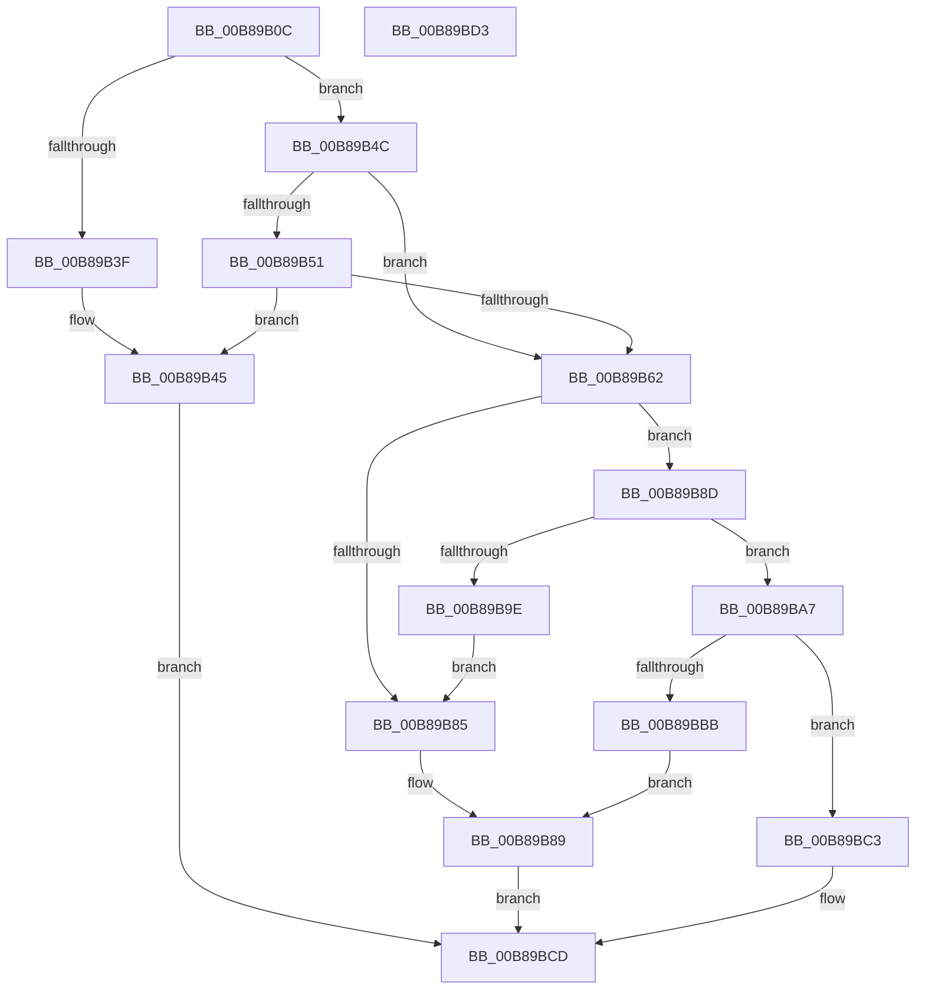

# KdpLowWriteContent

- RVA: `0x00B89B0C`–`0x00B89BD4` (길이 `200` bytes)
- VA: `0x0000000140B89B0C`
- 실행 섹션: `PAGEKD`
- PDB 이름 있음: `예`; PDB Function 태그: `아니요`
- unwind 정보 RVA: `0x0005CF00`
- 디코드: `60`개 명령, `200/200` bytes 표시
- 미해석 바이트: `0` (있으면 어셈블리에 `.byte`로 보존)

> 이 문서는 커널 이미지의 기계어와 PDB 기호를 분석해 생성했습니다. 4번과 5번은 함수 원형과 자료형을 바이너리 사용 방식에서 추정한 C 해석이며 원본 소스 복구 결과는 아닙니다.

## 1. Dependencies

- 직접 호출 지점: **4**; 고유 호출 대상: **3**
- 직접 호출자로 확인된 함수: **2**
- RIP 상대 이미지 참조: **4**

### Outgoing calls
- `0x00B89B58` → [KdpIsBreakpoint](../../text/5B/KdpIsBreakpoint_function_005B13C8.md) (function, `0x005B13C8`)
- `0x00B89B7C` → [KdpCopyCodeStream](KdpCopyCodeStream_function_00B8930C.md) (function, `0x00B8930C`)
- `0x00B89B95` → [KdpIsBreakpoint](../../text/5B/KdpIsBreakpoint_function_005B13C8.md) (function, `0x005B13C8`)
- `0x00B89BAF` → [KdpRemoveBreakpoint](KdpRemoveBreakpoint_function_00B89BDC.md) (function, `0x00B89BDC`)

### Direct callers
- [KdpDeleteBreakpoint](KdpDeleteBreakpoint_function_00B89988.md) at `0x00B899CD`
- [KdpSuspendAllBreakpoints](KdpSuspendAllBreakpoints_function_00B89CA0.md) at `0x00B89CCC`

### Static image references
- `0x00B89B12` → RVA `0x00F49620` (`.data`; read)
- `0x00B89B22` → RVA `0x00F49620` (`.data`; write)
- `0x00B89B2C` → RVA `0x00F49640` (`.data`; read)
- `0x00B89B9E` → RVA `0x00F55BC0` (`.data`; write)

## 2. Other-region calls and transfers

- 다른 실행 섹션으로 향하는 call: **2**
  - `0x00B89B58` → [KdpIsBreakpoint](../../text/5B/KdpIsBreakpoint_function_005B13C8.md) (`PAGEKD` → `.text`)
  - `0x00B89B95` → [KdpIsBreakpoint](../../text/5B/KdpIsBreakpoint_function_005B13C8.md) (`PAGEKD` → `.text`)
- 별도 외부 분기/꼬리 이동을 확인하지 못했습니다.

## 3. Assembly (complete function range)

```asm
00B89B0C  40 53                           push rbx
00B89B0E  48 83 EC 20                     sub rsp, 0x20
00B89B12  8B 05 08 FB 3B 00               mov eax, dword ptr [rip + 0x3bfb08]
00B89B18  48 83 64 24 38 00               and qword ptr [rsp + 0x38], 0
00B89B1E  FF C0                           inc eax
00B89B20  8B C9                           mov ecx, ecx
00B89B22  89 05 F8 FA 3B 00               mov dword ptr [rip + 0x3bfaf8], eax
00B89B28  48 8D 14 89                     lea rdx, [rcx + rcx*4]
00B89B2C  48 8D 0D 0D FB 3B 00            lea rcx, [rip + 0x3bfb0d]
00B89B33  48 8D 1C D1                     lea rbx, [rcx + rdx*8]
00B89B37  8B 4B 20                        mov ecx, dword ptr [rbx + 0x20]
00B89B3A  F6 C1 02                        test cl, 2
00B89B3D  74 0D                           je 0x140b89b4c
00B89B3F  83 E1 FD                        and ecx, 0xfffffffd
00B89B42  89 4B 20                        mov dword ptr [rbx + 0x20], ecx
00B89B45  B0 01                           mov al, 1
00B89B47  E9 81 00 00 00                  jmp 0x140b89bcd
00B89B4C  F6 C1 10                        test cl, 0x10
00B89B4F  75 11                           jne 0x140b89b62
00B89B51  48 8D 53 18                     lea rdx, [rbx + 0x18]
00B89B55  48 8B CB                        mov rcx, rbx
00B89B58  E8 6B 78 A2 FF                  call 0x1405b13c8
00B89B5D  83 F8 01                        cmp eax, 1
00B89B60  74 E3                           je 0x140b89b45
00B89B62  0F B6 4B 25                     movzx ecx, byte ptr [rbx + 0x25]
00B89B66  48 8D 54 24 38                  lea rdx, [rsp + 0x38]
00B89B6B  44 0F B6 43 24                  movzx r8d, byte ptr [rbx + 0x24]
00B89B70  48 F7 D1                        not rcx
00B89B73  48 23 0B                        and rcx, qword ptr [rbx]
00B89B76  41 B9 04 00 00 00               mov r9d, 4
00B89B7C  E8 8B F7 FF FF                  call 0x140b8930c
00B89B81  85 C0                           test eax, eax
00B89B83  79 08                           jns 0x140b89b8d
00B89B85  83 4B 20 08                     or dword ptr [rbx + 0x20], 8
00B89B89  32 C0                           xor al, al
00B89B8B  EB 40                           jmp 0x140b89bcd
00B89B8D  48 8D 54 24 38                  lea rdx, [rsp + 0x38]
00B89B92  48 8B CB                        mov rcx, rbx
00B89B95  E8 2E 78 A2 FF                  call 0x1405b13c8
00B89B9A  85 C0                           test eax, eax
00B89B9C  75 09                           jne 0x140b89ba7
00B89B9E  C6 05 1B C0 3C 00 01            mov byte ptr [rip + 0x3cc01b], 1
00B89BA5  EB DE                           jmp 0x140b89b85
00B89BA7  48 8D 54 24 38                  lea rdx, [rsp + 0x38]
00B89BAC  48 8B CB                        mov rcx, rbx
00B89BAF  E8 28 00 00 00                  call 0x140b89bdc
00B89BB4  8B 4B 20                        mov ecx, dword ptr [rbx + 0x20]
00B89BB7  85 C0                           test eax, eax
00B89BB9  75 08                           jne 0x140b89bc3
00B89BBB  83 C9 08                        or ecx, 8
00B89BBE  89 4B 20                        mov dword ptr [rbx + 0x20], ecx
00B89BC1  EB C6                           jmp 0x140b89b89
00B89BC3  C1 E9 03                        shr ecx, 3
00B89BC6  F6 D1                           not cl
00B89BC8  80 E1 01                        and cl, 1
00B89BCB  8A C1                           mov al, cl
00B89BCD  48 83 C4 20                     add rsp, 0x20
00B89BD1  5B                              pop rbx
00B89BD2  C3                              ret
00B89BD3  CC                              int3
```

## 4. C-style interpretation (structured pseudocode)

```c
__int64 __fastcall KdpLowWriteContent(int a1)
{
    __int64 result;
    __int64 v_rsp;
    unsigned __int64 v_stack_p10;

    v_rsp = (v_rsp) - (32);
    result = (unsigned int)(((unsigned int)(*(unsigned int *)(v_rip + 3930888))) + 1);
    *(unsigned int *)(v_rip + 3930872) = (unsigned int)(result);
    if ((((unsigned __int8)((unsigned int)(*(unsigned int *)(v_rip + 3930893 + (unsigned int)(a1) + (unsigned int)(a1) * 4 * 8 + 32)))) & (2)) == 0) goto loc_00B89B4C;
    a1 = (unsigned int)(((unsigned int)(*(unsigned int *)(v_rip + 3930893 + (unsigned int)(a1) + (unsigned int)(a1) * 4 * 8 + 32))) & (0xFFFFFFFDULL));
    *(unsigned int *)(v_rip + 3930893 + (unsigned int)(a1) + (unsigned int)(a1) * 4 * 8 + 32) = a1;
loc_00B89B45:
    goto loc_00B89BCD;
loc_00B89B4C:
    if ((((unsigned __int8)(a1)) & (16)) != 0) goto loc_00B89B62;
    result = KdpIsBreakpoint(v_rip + 3930893 + (unsigned int)(a1) + (unsigned int)(a1) * 4 * 8, v_rip + 3930893 + (unsigned int)(a1) + (unsigned int)(a1) * 4 * 8 + 24, a3, a4);
    if (((unsigned int)(result)) == 1) goto loc_00B89B45;
loc_00B89B62:
    a1 = ~(*(unsigned __int8 *)(v_rip + 3930893 + (unsigned int)(a1) + (unsigned int)(a1) * 4 * 8 + 37));
    a1 = (a1) & (*(unsigned __int64 *)(v_rip + 3930893 + (unsigned int)(a1) + (unsigned int)(a1) * 4 * 8));
    result = KdpCopyCodeStream(a1, v_stack_p10, *(unsigned __int8 *)(v_rip + 3930893 + (unsigned int)(a1) + (unsigned int)(a1) * 4 * 8 + 36), 4);
    if (!sign_flag) goto loc_00B89B8D;
loc_00B89B85:
loc_00B89B89:
    result = 0;
    goto loc_00B89BCD;
loc_00B89B8D:
    result = KdpIsBreakpoint(v_rip + 3930893 + (unsigned int)(a1) + (unsigned int)(a1) * 4 * 8, v_stack_p10, *(unsigned __int8 *)(v_rip + 3930893 + (unsigned int)(a1) + (unsigned int)(a1) * 4 * 8 + 36), 4);
    if ((unsigned int)(result) != 0) goto loc_00B89BA7;
    *(unsigned __int8 *)(v_rip + 3981339) = 1;
    goto loc_00B89B85;
loc_00B89BA7:
    result = KdpRemoveBreakpoint(v_rip + 3930893 + (unsigned int)(a1) + (unsigned int)(a1) * 4 * 8, v_stack_p10, *(unsigned __int8 *)(v_rip + 3930893 + (unsigned int)(a1) + (unsigned int)(a1) * 4 * 8 + 36), 4);
    if ((unsigned int)(result) != 0) goto loc_00B89BC3;
    a1 = (unsigned int)(((unsigned int)(*(unsigned int *)(v_rip + 3930893 + (unsigned int)(a1) + (unsigned int)(a1) * 4 * 8 + 32))) | (8));
    *(unsigned int *)(v_rip + 3930893 + (unsigned int)(a1) + (unsigned int)(a1) * 4 * 8 + 32) = a1;
    goto loc_00B89B89;
loc_00B89BC3:
    a1 = (unsigned int)((a1) >> (3));
    a1 = (unsigned __int8)(~(a1));
    a1 = (unsigned __int8)((a1) & (1));
loc_00B89BCD:
    v_rsp = (v_rsp) + (32);
    return (unsigned __int8)(a1);
}
```

## 5. (Beta) C Style

```c
int64_t KdpLowWriteContent(void *Arg1)
{
    uint8_t *arg1 = (uint8_t *)Arg1;

    int64_t result;
    int64_t local_rsp;
    uint64_t v_stack_p10;

    local_rsp = (local_rsp) - (32);
    result = (uint32_t)(((uint32_t)(*(uint32_t *)(v_rip + 0x3BFB08))) + 1);
    *(uint32_t *)(v_rip + 0x3BFAF8) = (uint32_t)(result);
    if ((((uint8_t)((uint32_t)(*(uint32_t *)(v_rip + 0x3BFB0D + (uint32_t)(arg1) + (uint32_t)(arg1) * 4 * 8 + 0x20)))) & (2)) == 0) goto loc_00B89B4C;
    Arg1 = (uint32_t)(((uint32_t)(*(uint32_t *)(v_rip + 0x3BFB0D + (uint32_t)(arg1) + (uint32_t)(arg1) * 4 * 8 + 0x20))) & (0xFFFFFFFDULL));
    *(uint32_t *)(v_rip + 0x3BFB0D + (uint32_t)(arg1) + (uint32_t)(arg1) * 4 * 8 + 0x20) = Arg1;
loc_00B89B45:
    goto loc_00B89BCD;
loc_00B89B4C:
    if ((((uint8_t)(Arg1)) & (16)) != 0) goto loc_00B89B62;
    result = KdpIsBreakpoint(v_rip + 3930893 + (uint32_t)(Arg1) + (uint32_t)(Arg1) * 4 * 8, v_rip + 3930893 + (uint32_t)(Arg1) + (uint32_t)(Arg1) * 4 * 8 + 24, a3, a4);
    if (((uint32_t)(result)) == 1) goto loc_00B89B45;
loc_00B89B62:
    Arg1 = ~(*(uint8_t *)(v_rip + 0x3BFB0D + (uint32_t)(arg1) + (uint32_t)(arg1) * 4 * 8 + 0x25));
    Arg1 = (Arg1) & (*(uint64_t *)(v_rip + 0x3BFB0D + (uint32_t)(arg1) + (uint32_t)(arg1) * 4 * 8));
    result = KdpCopyCodeStream(Arg1, v_stack_p10, *(uint8_t *)(v_rip + 0x3BFB0D + (uint32_t)(arg1) + (uint32_t)(arg1) * 4 * 8 + 0x24), 4);
    if (!sign_flag) goto loc_00B89B8D;
loc_00B89B85:
loc_00B89B89:
    result = 0;
    goto loc_00B89BCD;
loc_00B89B8D:
    result = KdpIsBreakpoint(v_rip + 3930893 + (uint32_t)(Arg1) + (uint32_t)(Arg1) * 4 * 8, v_stack_p10, *(uint8_t *)(v_rip + 0x3BFB0D + (uint32_t)(arg1) + (uint32_t)(arg1) * 4 * 8 + 0x24), 4);
    if ((uint32_t)(result) != 0) goto loc_00B89BA7;
    *(uint8_t *)(v_rip + 0x3CC01B) = 1;
    goto loc_00B89B85;
loc_00B89BA7:
    result = KdpRemoveBreakpoint(v_rip + 3930893 + (uint32_t)(Arg1) + (uint32_t)(Arg1) * 4 * 8, v_stack_p10, *(uint8_t *)(v_rip + 0x3BFB0D + (uint32_t)(arg1) + (uint32_t)(arg1) * 4 * 8 + 0x24), 4);
    if ((uint32_t)(result) != 0) goto loc_00B89BC3;
    Arg1 = (uint32_t)(((uint32_t)(*(uint32_t *)(v_rip + 0x3BFB0D + (uint32_t)(arg1) + (uint32_t)(arg1) * 4 * 8 + 0x20))) | (8));
    *(uint32_t *)(v_rip + 0x3BFB0D + (uint32_t)(arg1) + (uint32_t)(arg1) * 4 * 8 + 0x20) = Arg1;
    goto loc_00B89B89;
loc_00B89BC3:
    Arg1 = (uint32_t)((Arg1) >> (3));
    Arg1 = (uint8_t)(~(Arg1));
    Arg1 = (uint8_t)((Arg1) & (1));
loc_00B89BCD:
    local_rsp = (local_rsp) + (32);
    return (uint8_t)(Arg1);
}
```

### 관측된 메모리 오프셋

구조체 형식이 확인되지 않은 접근은 인자 기준의 오프셋으로만 기록했습니다.

| 기준 인자 | 오프셋 표현 | 폭 (bit) | 접근 |
|---|---:|---:|---|
| `Arg1` | `+ 0x0 + rcx*4` | `64` | `R` |

## 6. Execution-region graph

[열기: 2D/3D 그래프와 함수 탐색 컨트롤 패널](../../../control-panel.html?section=pagekd&rva=0x00B89B0C&view=graph)

- 2D 그래프는 위에서 아래로 흐르고, 3D 그래프는 빈 공간을 드래그해 회전합니다. Shift+드래그는 이동, 휠은 확대·축소, 함수 노드 선택은 대상 보고서 이동입니다.

### Static fallback


