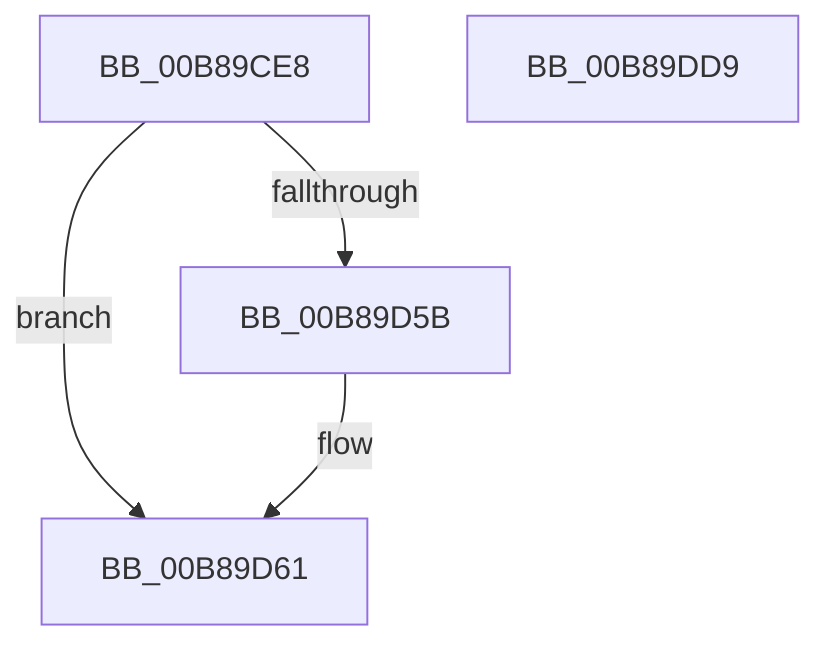

# KdpPrintString

- RVA: `0x00B89CE8`–`0x00B89DDA` (길이 `242` bytes)
- VA: `0x0000000140B89CE8`
- 실행 섹션: `PAGEKD`
- PDB 이름 있음: `예`; PDB Function 태그: `아니요`
- unwind 정보 RVA: `0x000C9B84`
- 디코드: `57`개 명령, `242/242` bytes 표시
- 미해석 바이트: `0` (있으면 어셈블리에 `.byte`로 보존)

> 이 문서는 커널 이미지의 기계어와 PDB 기호를 분석해 생성했습니다. 4번과 5번은 함수 원형과 자료형을 바이너리 사용 방식에서 추정한 C 해석이며 원본 소스 복구 결과는 아닙니다.

## 1. Dependencies

- 직접 호출 지점: **4**; 고유 호출 대상: **4**
- 직접 호출자로 확인된 함수: **2**
- RIP 상대 이미지 참조: **6**

### Outgoing calls
- `0x00B89D3F` → [KdpCopyMemoryChunks](KdpCopyMemoryChunks_function_00B8AACC.md) (function, `0x00B8AACC`)
- `0x00B89DAE` → `kdcom.dll!KdSendPacket` (import, 간접 대상; import `kdcom.dll!KdSendPacket`)
- `0x00B89DBA` → [KdpPollBreakInWithPortLock](../../text/5B/KdpPollBreakInWithPortLock_function_005B1188.md) (function, `0x005B1188`)
- `0x00B89DC6` → [_security_check_cookie](../../text/6A/_security_check_cookie_function_006AC640.md) (function, `0x006AC640`)

### Direct callers
- [sub_006FC51A](../../text/6F/Unknown_function_006FC51A.md) at `0x006FC536`
- [KdpPrint](KdpPrint_function_00B88F08.md) at `0x00B89046`

### Static image references
- `0x00B89CF5` → RVA `0x00E0A740` (`.data`; read)
- `0x00B89D0F` → RVA `0x00E12710` (`.data`; read)
- `0x00B89D4D` → RVA `0x00E0AA48` (`.data`; read)
- `0x00B89D61` → RVA `0x00FC6BE8` (`ALMOSTRO`; read)
- `0x00B89D70` → RVA `0x00F475E0` (`.data`; read)
- `0x00B89DAE` → RVA `0x001516C0` (`kdcom.dll!KdSendPacket (IAT)`; read)

## 2. Other-region calls and transfers

- 다른 실행 섹션으로 향하는 call: **2**
  - `0x00B89DBA` → [KdpPollBreakInWithPortLock](../../text/5B/KdpPollBreakInWithPortLock_function_005B1188.md) (`PAGEKD` → `.text`)
  - `0x00B89DC6` → [_security_check_cookie](../../text/6A/_security_check_cookie_function_006AC640.md) (`PAGEKD` → `.text`)
- 별도 외부 분기/꼬리 이동을 확인하지 못했습니다.

## 3. Assembly (complete function range)

```asm
00B89CE8  48 89 5C 24 10                  mov qword ptr [rsp + 0x10], rbx
00B89CED  55                              push rbp
00B89CEE  48 8B EC                        mov rbp, rsp
00B89CF1  48 83 EC 70                     sub rsp, 0x70
00B89CF5  48 8B 05 44 0A 28 00            mov rax, qword ptr [rip + 0x280a44]
00B89CFC  48 33 C4                        xor rax, rsp
00B89CFF  48 89 45 F8                     mov qword ptr [rbp - 8], rax
00B89D03  44 0F B7 01                     movzx r8d, word ptr [rcx]
00B89D07  48 8D 45 C0                     lea rax, [rbp - 0x40]
00B89D0B  48 8B 49 08                     mov rcx, qword ptr [rcx + 8]
00B89D0F  48 8D 1D FA 89 28 00            lea rbx, [rip + 0x2889fa]
00B89D16  83 65 C0 00                     and dword ptr [rbp - 0x40], 0
00B89D1A  0F 57 C0                        xorps xmm0, xmm0
00B89D1D  83 65 F4 00                     and dword ptr [rbp - 0xc], 0
00B89D21  0F 57 C9                        xorps xmm1, xmm1
00B89D24  48 89 44 24 28                  mov qword ptr [rsp + 0x28], rax
00B89D29  48 8B D3                        mov rdx, rbx
00B89D2C  45 33 C9                        xor r9d, r9d
00B89D2F  C7 44 24 20 04 00 00 00         mov dword ptr [rsp + 0x20], 4
00B89D37  0F 11 45 C8                     movups xmmword ptr [rbp - 0x38], xmm0
00B89D3B  0F 11 4D D8                     movups xmmword ptr [rbp - 0x28], xmm1
00B89D3F  E8 88 0D 00 00                  call 0x140b8aacc
00B89D44  8B 4D C0                        mov ecx, dword ptr [rbp - 0x40]
00B89D47  41 B8 10 00 00 00               mov r8d, 0x10
00B89D4D  8B 15 F5 0C 28 00               mov edx, dword ptr [rip + 0x280cf5]
00B89D53  49 03 C8                        add rcx, r8
00B89D56  48 3B CA                        cmp rcx, rdx
00B89D59  76 06                           jbe 0x140b89d61
00B89D5B  8D 42 F0                        lea eax, [rdx - 0x10]
00B89D5E  89 45 C0                        mov dword ptr [rbp - 0x40], eax
00B89D61  0F B7 05 80 CE 43 00            movzx eax, word ptr [rip + 0x43ce80]
00B89D68  48 8D 4D E8                     lea rcx, [rbp - 0x18]
00B89D6C  66 89 45 EC                     mov word ptr [rbp - 0x14], ax
00B89D70  4C 8D 0D 69 D8 3B 00            lea r9, [rip + 0x3bd869]
00B89D77  C7 45 E8 30 32 00 00            mov dword ptr [rbp - 0x18], 0x3230
00B89D7E  48 8D 55 D8                     lea rdx, [rbp - 0x28]
00B89D82  65 8B 04 25 A4 01 00 00         mov eax, dword ptr gs:[0x1a4]
00B89D8A  66 89 45 EE                     mov word ptr [rbp - 0x12], ax
00B89D8E  8B 45 C0                        mov eax, dword ptr [rbp - 0x40]
00B89D91  66 44 89 45 D8                  mov word ptr [rbp - 0x28], r8w
00B89D96  4C 8D 45 C8                     lea r8, [rbp - 0x38]
00B89D9A  48 89 4D E0                     mov qword ptr [rbp - 0x20], rcx
00B89D9E  B9 03 00 00 00                  mov ecx, 3
00B89DA3  89 45 F0                        mov dword ptr [rbp - 0x10], eax
00B89DA6  66 89 45 C8                     mov word ptr [rbp - 0x38], ax
00B89DAA  48 89 5D D0                     mov qword ptr [rbp - 0x30], rbx
00B89DAE  48 FF 15 0B 79 5C FF            call qword ptr [rip - 0xa386f5]
00B89DB5  0F 1F 44 00 00                  nop dword ptr [rax + rax]
00B89DBA  E8 C9 73 A2 FF                  call 0x1405b1188
00B89DBF  48 8B 4D F8                     mov rcx, qword ptr [rbp - 8]
00B89DC3  48 33 CC                        xor rcx, rsp
00B89DC6  E8 75 28 B2 FF                  call 0x1406ac640
00B89DCB  48 8B 9C 24 88 00 00 00         mov rbx, qword ptr [rsp + 0x88]
00B89DD3  48 83 C4 70                     add rsp, 0x70
00B89DD7  5D                              pop rbp
00B89DD8  C3                              ret
00B89DD9  CC                              int3
```

## 4. C-style interpretation (structured pseudocode)

```c
__int64 __fastcall KdpPrintString(__int64 a1, __int64 a2, __int64 a3, int a4)
{
    __int64 result;
    __int64 v_rsp;
    unsigned __int64 v_stack_m10;
    unsigned int v_stack_m14;
    unsigned int v_stack_m18;
    unsigned __int16 v_stack_m1A;
    unsigned __int16 v_stack_m1C;
    unsigned __int64 v_stack_m20;
    unsigned __int64 v_stack_m28;
    unsigned __int64 v_stack_m30;
    unsigned __int64 v_stack_m38;
    unsigned __int64 v_stack_m40;
    unsigned __int64 v_stack_m48;
    unsigned __int64 v_stack_m50;
    unsigned int v_stack_m58;
    unsigned __int64 v_stack_p10;

    v_stack_p10 = v_rbx;
    v_rsp = (v_rsp) - (112);
    result = (*(unsigned __int64 *)(v_rip + 2624068)) ^ (v_rsp);
    v_stack_m10 = result;
    v_stack_m50 = v_stack_m48;
    a4 = 0;
    v_stack_m58 = 4;
    v_stack_m40 = v_xmm0;
    v_stack_m30 = v_xmm1;
    result = KdpCopyMemoryChunks(*(unsigned __int64 *)(a1 + 8), v_rip + 2656762, *(unsigned __int16 *)(a1), a4);
    a1 = ((unsigned int)(v_stack_m48)) + (16);
    if (a1 >= = ((unsigned int)(*(unsigned int *)(v_rip + 2624757)))) {
        result = (unsigned int)(*(unsigned int *)(v_rip + 2624757)) - 16;
        v_stack_m48 = (unsigned int)(result);
    }
    v_stack_m1C = (unsigned __int16)(*(unsigned __int16 *)(v_rip + 4443776));
    v_stack_m20 = 0x3230ULL;
    v_stack_m1A = (unsigned __int16)((unsigned int)(*(unsigned int *)(gs_base + (0 + 420))));
    v_stack_m30 = 16;
    v_stack_m28 = v_stack_m20;
    v_stack_m18 = (unsigned int)((unsigned int)(v_stack_m48));
    v_stack_m40 = (unsigned __int16)((unsigned int)(v_stack_m48));
    v_stack_m38 = v_rip + 2656762;
    result = kdcom_dll_KdSendPacket(3, v_stack_m30, v_stack_m40, v_rip + 3922025);
    result = KdpPollBreakInWithPortLock(3, v_stack_m30, v_stack_m40, v_rip + 3922025);
    a1 = (v_stack_m10) ^ (v_rsp);
    result = _security_check_cookie(a1, v_stack_m30, v_stack_m40, v_rip + 3922025);
    v_rsp = (v_rsp) + (112);
    return result;
}
```

## 5. (Beta) C Style

```c
int64_t KdpPrintString(void *Arg1, int64_t Arg2, int64_t Arg3, int32_t Arg4)
{
    uint8_t *arg1 = (uint8_t *)Arg1;

    int64_t result;
    int64_t local_rsp;
    uint64_t v_stack_m10;
    uint32_t v_stack_m14;
    uint32_t v_stack_m18;
    uint16_t v_stack_m1A;
    uint16_t v_stack_m1C;
    uint64_t v_stack_m20;
    uint64_t v_stack_m28;
    uint64_t v_stack_m30;
    uint64_t v_stack_m38;
    uint64_t v_stack_m40;
    uint64_t v_stack_m48;
    uint64_t v_stack_m50;
    uint32_t v_stack_m58;
    uint64_t v_stack_p10;

    v_stack_p10 = local_rbx;
    local_rsp = (local_rsp) - (112);
    result = (*(uint64_t *)(v_rip + 0x280A44)) ^ (local_rsp);
    v_stack_m10 = result;
    v_stack_m50 = v_stack_m48;
    Arg4 = 0;
    v_stack_m58 = 4;
    v_stack_m40 = v_xmm0;
    v_stack_m30 = v_xmm1;
    result = KdpCopyMemoryChunks(*(uint64_t *)(arg1 + 0x8), v_rip + 2656762, *(uint16_t *)(arg1), Arg4);
    Arg1 = ((uint32_t)(v_stack_m48)) + (16);
    if (Arg1 >= = ((uint32_t)(*(uint32_t *)(v_rip + 0x280CF5)))) {
        result = (uint32_t)(*(uint32_t *)(v_rip + 0x280CF5)) - 16;
        v_stack_m48 = (uint32_t)(result);
    }
    v_stack_m1C = (uint16_t)(*(uint16_t *)(v_rip + 0x43CE80));
    v_stack_m20 = 0x3230ULL;
    v_stack_m1A = (uint16_t)((uint32_t)(*(uint32_t *)(gs_base + (0 + 0x1A4))));
    v_stack_m30 = 16;
    v_stack_m28 = v_stack_m20;
    v_stack_m18 = (uint32_t)((uint32_t)(v_stack_m48));
    v_stack_m40 = (uint16_t)((uint32_t)(v_stack_m48));
    v_stack_m38 = v_rip + 2656762;
    result = kernel_indirect_call(3, v_stack_m30, v_stack_m40, v_rip + 3922025);
    result = KdpPollBreakInWithPortLock(3, v_stack_m30, v_stack_m40, v_rip + 3922025);
    Arg1 = (v_stack_m10) ^ (local_rsp);
    result = _security_check_cookie(Arg1, v_stack_m30, v_stack_m40, v_rip + 3922025);
    local_rsp = (local_rsp) + (112);
    return result;
}
```

### 관측된 메모리 오프셋

구조체 형식이 확인되지 않은 접근은 인자 기준의 오프셋으로만 기록했습니다.

| 기준 인자 | 오프셋 표현 | 폭 (bit) | 접근 |
|---|---:|---:|---|
| `Arg1` | `+ 0x0` | `16` | `R` |
| `Arg1` | `+ 0x8` | `64` | `R` |

## 6. Execution-region graph

[열기: 2D/3D 그래프와 함수 탐색 컨트롤 패널](../../../control-panel.html?section=pagekd&rva=0x00B89CE8&view=graph)

- 2D 그래프는 위에서 아래로 흐르고, 3D 그래프는 빈 공간을 드래그해 회전합니다. Shift+드래그는 이동, 휠은 확대·축소, 함수 노드 선택은 대상 보고서 이동입니다.

### Static fallback


