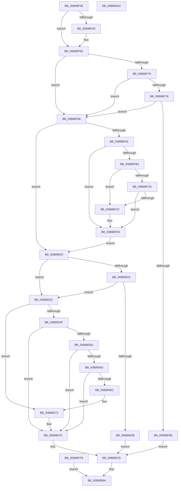

# KdpPrint

- RVA: `0x00B88F08`–`0x00B890A3` (길이 `411` bytes)
- VA: `0x0000000140B88F08`
- 실행 섹션: `PAGEKD`
- PDB 이름 있음: `예`; PDB Function 태그: `아니요`
- unwind 정보 RVA: `0x000C9A90`
- 디코드: `110`개 명령, `411/411` bytes 표시
- 미해석 바이트: `0` (있으면 어셈블리에 `.byte`로 보존)

> 이 문서는 커널 이미지의 기계어와 PDB 기호를 분석해 생성했습니다. 4번과 5번은 함수 원형과 자료형을 바이너리 사용 방식에서 추정한 C 해석이며 원본 소스 복구 결과는 아닙니다.

## 1. Dependencies

- 직접 호출 지점: **6**; 고유 호출 대상: **6**
- 직접 호출자로 확인된 함수: **1**
- RIP 상대 이미지 참조: **8**

### Outgoing calls
- `0x00B88FEE` → [KdpQuickMoveMemory](KdpQuickMoveMemory_function_00B85490.md) (function, `0x00B85490`)
- `0x00B89014` → [KdLogDbgPrint](KdLogDbgPrint_function_00B88C20.md) (function, `0x00B88C20`)
- `0x00B8903A` → [KdEnterDebugger](KdEnterDebugger_function_00B8A96C.md) (function, `0x00B8A96C`)
- `0x00B89046` → [KdpPrintString](KdpPrintString_function_00B89CE8.md) (function, `0x00B89CE8`)
- `0x00B89079` → [KdExitDebugger](KdExitDebugger_function_00B85008.md) (function, `0x00B85008`)
- `0x00B8908B` → [_security_check_cookie](../../text/6A/_security_check_cookie_function_006AC640.md) (function, `0x006AC640`)

### Direct callers
- [KdpTrap](KdpTrap_function_00B852B8.md) at `0x00B8540A`

### Static image references
- `0x00B88F23` → RVA `0x00E0A740` (`.data`; read)
- `0x00B88F6D` → RVA `0x00E0AA50` (`.data`; reference)
- `0x00B88F7E` → RVA `0x0000AC70` (`.rdata`; read)
- `0x00B89019` → RVA `0x00F475DC` (`.data`; read)
- `0x00B89022` → RVA `0x00F55CB3` (`.data`; read)
- `0x00B89054` → RVA `0x00F55CB1` (`.data`; read)
- `0x00B89063` → RVA `0x00F55CA0` (`.data`; read)
- `0x00B8906C` → RVA `0x00F475E4` (`.data`; write)

## 2. Other-region calls and transfers

- 다른 실행 섹션으로 향하는 call: **1**
  - `0x00B8908B` → [_security_check_cookie](../../text/6A/_security_check_cookie_function_006AC640.md) (`PAGEKD` → `.text`)
- 별도 외부 분기/꼬리 이동을 확인하지 못했습니다.

## 3. Assembly (complete function range)

```asm
00B88F08  4C 89 44 24 18                  mov qword ptr [rsp + 0x18], r8
00B88F0D  55                              push rbp
00B88F0E  41 56                           push r14
00B88F10  41 57                           push r15
00B88F12  48 83 EC 40                     sub rsp, 0x40
00B88F16  48 8D 6C 24 20                  lea rbp, [rsp + 0x20]
00B88F1B  48 89 5D 40                     mov qword ptr [rbp + 0x40], rbx
00B88F1F  48 89 75 48                     mov qword ptr [rbp + 0x48], rsi
00B88F23  48 8B 05 16 18 28 00            mov rax, qword ptr [rip + 0x281816]
00B88F2A  48 33 C5                        xor rax, rbp
00B88F2D  48 89 45 10                     mov qword ptr [rbp + 0x10], rax
00B88F31  0F 57 C0                        xorps xmm0, xmm0
00B88F34  0F 11 45 00                     movups xmmword ptr [rbp], xmm0
00B88F38  41 BA 65 00 00 00               mov r10d, 0x65
00B88F3E  45 8D 5A 37                     lea r11d, [r10 + 0x37]
00B88F42  41 3B CB                        cmp ecx, r11d
00B88F45  44 0F 42 D1                     cmovb r10d, ecx
00B88F49  41 B8 03 00 00 00               mov r8d, 3
00B88F4F  44 0F 42 C2                     cmovb r8d, edx
00B88F53  45 33 FF                        xor r15d, r15d
00B88F56  4C 8B 75 78                     mov r14, qword ptr [rbp + 0x78]
00B88F5A  45 88 3E                        mov byte ptr [r14], r15b
00B88F5D  41 83 F8 1F                     cmp r8d, 0x1f
00B88F61  77 0A                           ja 0x140b88f6d
00B88F63  41 8B C8                        mov ecx, r8d
00B88F66  45 8D 47 01                     lea r8d, [r15 + 1]
00B88F6A  41 D3 E0                        shl r8d, cl
00B88F6D  44 85 05 DC 1A 28 00            test dword ptr [rip + 0x281adc], r8d
00B88F74  75 20                           jne 0x140b88f96
00B88F76  45 3B D3                        cmp r10d, r11d
00B88F79  73 1B                           jae 0x140b88f96
00B88F7B  0F AE E8                        lfence
00B88F7E  48 8D 0D EB 1C 48 FF            lea rcx, [rip - 0xb7e315]
00B88F85  4A 8B 04 D1                     mov rax, qword ptr [rcx + r10*8]
00B88F89  44 85 00                        test dword ptr [rax], r8d
00B88F8C  75 08                           jne 0x140b88f96
00B88F8E  41 8B DF                        mov ebx, r15d
00B88F91  E9 E8 00 00 00                  jmp 0x140b8907e
00B88F96  41 B8 00 02 00 00               mov r8d, 0x200
00B88F9C  45 8B D0                        mov r10d, r8d
00B88F9F  66 45 3B C8                     cmp r9w, r8w
00B88FA3  66 45 0F 46 D1                  cmovbe r10w, r9w
00B88FA8  44 38 7D 60                     cmp byte ptr [rbp + 0x60], r15b
00B88FAC  74 55                           je 0x140b89003
00B88FAE  66 45 85 D2                     test r10w, r10w
00B88FB2  74 21                           je 0x140b88fd5
00B88FB4  41 0F B7 D2                     movzx edx, r10w
00B88FB8  48 8B 4D 50                     mov rcx, qword ptr [rbp + 0x50]
00B88FBC  48 03 D1                        add rdx, rcx
00B88FBF  48 B8 00 00 FF FF FF 7F 00 00   movabs rax, 0x7fffffff0000
00B88FC9  48 3B D0                        cmp rdx, rax
00B88FCC  77 05                           ja 0x140b88fd3
00B88FCE  48 3B D1                        cmp rdx, rcx
00B88FD1  73 02                           jae 0x140b88fd5
00B88FD3  8A 00                           mov al, byte ptr [rax]
00B88FD5  8B 04 24                        mov eax, dword ptr [rsp]
00B88FD8  49 2B E0                        sub rsp, r8
00B88FDB  4C 8D 4C 24 20                  lea r9, [rsp + 0x20]
00B88FE0  41 8B 01                        mov eax, dword ptr [r9]
00B88FE3  45 0F B7 C2                     movzx r8d, r10w
00B88FE7  48 8B 55 50                     mov rdx, qword ptr [rbp + 0x50]
00B88FEB  49 8B C9                        mov rcx, r9
00B88FEE  E8 9D C4 FF FF                  call 0x140b85490
00B88FF3  4C 89 4D 50                     mov qword ptr [rbp + 0x50], r9
00B88FF7  EB 0A                           jmp 0x140b89003
00B88FF9  B8 05 00 00 C0                  mov eax, 0xc0000005
00B88FFE  E9 81 00 00 00                  jmp 0x140b89084
00B89003  48 8B 45 50                     mov rax, qword ptr [rbp + 0x50]
00B89007  48 89 45 08                     mov qword ptr [rbp + 8], rax
00B8900B  66 44 89 55 00                  mov word ptr [rbp], r10w
00B89010  48 8D 4D 00                     lea rcx, [rbp]
00B89014  E8 07 FC FF FF                  call 0x140b88c20
00B89019  80 3D BC E5 3B 00 00            cmp byte ptr [rip + 0x3be5bc], 0
00B89020  74 10                           je 0x140b89032
00B89022  80 3D 8A CC 3C 00 00            cmp byte ptr [rip + 0x3ccc8a], 0
00B89029  75 07                           jne 0x140b89032
00B8902B  BB 9D 00 00 C0                  mov ebx, 0xc000009d
00B89030  EB 4C                           jmp 0x140b8907e
00B89032  48 8B 55 70                     mov rdx, qword ptr [rbp + 0x70]
00B89036  48 8B 4D 68                     mov rcx, qword ptr [rbp + 0x68]
00B8903A  E8 2D 19 00 00                  call 0x140b8a96c
00B8903F  40 8A F0                        mov sil, al
00B89042  48 8D 4D 00                     lea rcx, [rbp]
00B89046  E8 9D 0C 00 00                  call 0x140b89ce8
00B8904B  84 C0                           test al, al
00B8904D  74 24                           je 0x140b89073
00B8904F  BB 03 00 00 80                  mov ebx, 0x80000003
00B89054  80 3D 56 CC 3C 00 00            cmp byte ptr [rip + 0x3ccc56], 0
00B8905B  75 19                           jne 0x140b89076
00B8905D  44 38 7D 60                     cmp byte ptr [rbp + 0x60], r15b
00B89061  74 13                           je 0x140b89076
00B89063  80 3D 36 CC 3C 00 00            cmp byte ptr [rip + 0x3ccc36], 0
00B8906A  74 0A                           je 0x140b89076
00B8906C  C6 05 71 E5 3B 00 01            mov byte ptr [rip + 0x3be571], 1
00B89073  41 8B DF                        mov ebx, r15d
00B89076  40 8A CE                        mov cl, sil
00B89079  E8 8A BF FF FF                  call 0x140b85008
00B8907E  41 C6 06 01                     mov byte ptr [r14], 1
00B89082  8B C3                           mov eax, ebx
00B89084  48 8B 4D 10                     mov rcx, qword ptr [rbp + 0x10]
00B89088  48 33 CD                        xor rcx, rbp
00B8908B  E8 B0 35 B2 FF                  call 0x1406ac640
00B89090  48 8B 5D 40                     mov rbx, qword ptr [rbp + 0x40]
00B89094  48 8B 75 48                     mov rsi, qword ptr [rbp + 0x48]
00B89098  48 8D 65 20                     lea rsp, [rbp + 0x20]
00B8909C  41 5F                           pop r15
00B8909E  41 5E                           pop r14
00B890A0  5D                              pop rbp
00B890A1  C3                              ret
00B890A2  CC                              int3
```

## 4. C-style interpretation (structured pseudocode)

```c
__int64 __fastcall KdpPrint(int a1, int a2, __int64 a3, unsigned __int16 a4, unsigned __int8 a5, __int64 a6, __int64 a7, __int64 a8)
{
    __int64 result;
    __int64 v_r10;
    __int64 v_r15;
    __int64 v_rsp;
    unsigned __int64 v_stack_m18;
    unsigned __int64 v_stack_m28;
    unsigned __int64 v_stack_m30;
    unsigned __int64 v_stack_m38;
    unsigned int v_stack_m58;
    unsigned __int64 v_stack_p10;
    unsigned __int64 v_stack_p18;
    unsigned __int64 v_stack_p8;

    v_stack_p18 = a3;
    v_rsp = (v_rsp) - (64);
    v_stack_p8 = v_rbx;
    v_stack_p10 = v_rsi;
    result = (*(unsigned __int64 *)(v_rip + 2627606)) ^ (v_stack_m38);
    v_stack_m28 = result;
    v_stack_m38 = v_xmm0;
    v_r10 = 101;
    if (a1 < ((unsigned int)(101 + 55))) { v_r10 = a1; }
    a3 = 3;
    if (a1 < ((unsigned int)(101 + 55))) { a3 = a2; }
    v_r15 = 0;
    *(unsigned __int8 *)(a8) = 0;
    if (((unsigned int)(a3)) <= 31) {
        a1 = (unsigned int)(a3);
        a3 = v_r15 + 1;
        a3 = (unsigned int)((a3) << ((unsigned __int8)(a1)));
    }
    if (((*(unsigned int *)(v_rip + 2628316)) & ((unsigned int)(a3))) != 0) goto loc_00B88F96;
    if (((unsigned int)(v_r10)) >= ((unsigned int)(101 + 55))) goto loc_00B88F96;
    if (((*(unsigned int *)(*(unsigned __int64 *)(v_rip - 12051221 + v_r10 * 8))) & ((unsigned int)(a3))) != 0) goto loc_00B88F96;
    goto loc_00B8907E;
loc_00B88F96:
    v_r10 = 512;
    if (a4 <= 512) { v_r10 = a4; }
    if (a5 == 0) goto loc_00B89003;
    if ((unsigned __int16)(v_r10) == 0) goto loc_00B88FD5;
    a2 = ((unsigned __int16)(v_r10)) + (v_stack_p18);
    if (a2 > (*(unsigned __int64 *)(v_rip - 12051221 + v_r10 * 8))) goto loc_00B88FD3;
    result = *(unsigned __int64 *)(v_rip - 12051221 + v_r10 * 8);
    if (a2 < v_stack_p18) {
        result = *(unsigned __int8 *)(*(unsigned __int64 *)(v_rip - 12051221 + v_r10 * 8));
    }
    v_rsp = (v_rsp) - (512);
    result = KdpQuickMoveMemory(v_stack_m38, v_stack_p18, (unsigned __int16)(v_r10), v_stack_m38);
    v_stack_p18 = v_stack_m38;
    goto loc_00B89003;
loc_00B89003:
    v_stack_m30 = v_stack_p18;
    v_stack_m38 = (unsigned __int16)(v_r10);
    result = KdLogDbgPrint(v_stack_m38, v_stack_p18, (unsigned __int16)(v_r10), v_stack_m38);
    if ((*(unsigned __int8 *)(v_rip + 3925436)) == 0) goto loc_00B89032;
    if ((*(unsigned __int8 *)(v_rip + 3984522)) != 0) goto loc_00B89032;
    goto loc_00B8907E;
loc_00B89032:
    result = KdEnterDebugger(a6, a7, (unsigned __int16)(v_r10), v_stack_m38);
    result = KdpPrintString(v_stack_m38, a7, (unsigned __int16)(v_r10), v_stack_m38);
    if ((unsigned __int8)(result) == 0) goto loc_00B89073;
    if ((*(unsigned __int8 *)(v_rip + 3984470)) != 0) goto loc_00B89076;
    if (a5 == 0) goto loc_00B89076;
    if ((*(unsigned __int8 *)(v_rip + 3984438)) == 0) goto loc_00B89076;
    *(unsigned __int8 *)(v_rip + 3925361) = 1;
loc_00B89073:
loc_00B89076:
    result = KdExitDebugger((unsigned __int8)((unsigned __int8)(result)), a7, (unsigned __int16)(v_r10), v_stack_m38);
loc_00B8907E:
    *(unsigned __int8 *)(a8) = 1;
loc_00B89084:
    a1 = (v_stack_m28) ^ (v_stack_m38);
    result = _security_check_cookie(a1, a7, (unsigned __int16)(v_r10), v_stack_m38);
    return result;
}
```

## 5. (Beta) C Style

```c
int64_t KdpPrint(int32_t Arg1, int32_t Arg2, int64_t Arg3, uint16_t Arg4, uint8_t Arg5, int64_t Arg6, int64_t Arg7, void *Arg8)
{
    uint8_t *arg8 = (uint8_t *)Arg8;

    int64_t result;
    int64_t local_r10;
    int64_t local_r15;
    int64_t local_rsp;
    uint64_t v_stack_m18;
    uint64_t v_stack_m28;
    uint64_t v_stack_m30;
    uint64_t v_stack_m38;
    uint32_t v_stack_m58;
    uint64_t v_stack_p10;
    uint64_t v_stack_p18;
    uint64_t v_stack_p8;

    v_stack_p18 = Arg3;
    local_rsp = (local_rsp) - (64);
    v_stack_p8 = local_rbx;
    v_stack_p10 = local_rsi;
    result = (*(uint64_t *)(v_rip + 0x281816)) ^ (v_stack_m38);
    v_stack_m28 = result;
    v_stack_m38 = v_xmm0;
    local_r10 = 101;
    if (Arg1 < ((uint32_t)(101 + 55))) { local_r10 = Arg1; }
    Arg3 = 3;
    if (Arg1 < ((uint32_t)(101 + 55))) { Arg3 = Arg2; }
    local_r15 = 0;
    *(uint8_t *)(arg8) = 0;
    if (((uint32_t)(Arg3)) <= 31) {
        Arg1 = (uint32_t)(Arg3);
        Arg3 = local_r15 + 1;
        Arg3 = (uint32_t)((Arg3) << ((uint8_t)(Arg1)));
    }
    if (((*(uint32_t *)(v_rip + 0x281ADC)) & ((uint32_t)(Arg3))) != 0) goto loc_00B88F96;
    if (((uint32_t)(local_r10)) >= ((uint32_t)(101 + 55))) goto loc_00B88F96;
    if (((*(uint32_t *)(*(uint64_t *)(v_rip - 0xB7E315 + local_r10 * 8))) & ((uint32_t)(Arg3))) != 0) goto loc_00B88F96;
    goto loc_00B8907E;
loc_00B88F96:
    local_r10 = 512;
    if (Arg4 <= 512) { local_r10 = Arg4; }
    if (Arg5 == 0) goto loc_00B89003;
    if ((uint16_t)(local_r10) == 0) goto loc_00B88FD5;
    Arg2 = ((uint16_t)(local_r10)) + (v_stack_p18);
    if (Arg2 > (*(uint64_t *)(v_rip - 0xB7E315 + local_r10 * 8))) goto loc_00B88FD3;
    result = *(uint64_t *)(v_rip - 0xB7E315 + local_r10 * 8);
    if (Arg2 < v_stack_p18) {
        result = *(uint8_t *)(*(uint64_t *)(v_rip - 0xB7E315 + local_r10 * 8));
    }
    local_rsp = (local_rsp) - (512);
    result = KdpQuickMoveMemory(v_stack_m38, v_stack_p18, (uint16_t)(local_r10), v_stack_m38);
    v_stack_p18 = v_stack_m38;
    goto loc_00B89003;
loc_00B89003:
    v_stack_m30 = v_stack_p18;
    v_stack_m38 = (uint16_t)(local_r10);
    result = KdLogDbgPrint(v_stack_m38, v_stack_p18, (uint16_t)(local_r10), v_stack_m38);
    if ((*(uint8_t *)(v_rip + 0x3BE5BC)) == 0) goto loc_00B89032;
    if ((*(uint8_t *)(v_rip + 0x3CCC8A)) != 0) goto loc_00B89032;
    goto loc_00B8907E;
loc_00B89032:
    result = KdEnterDebugger(Arg6, Arg7, (uint16_t)(local_r10), v_stack_m38);
    result = KdpPrintString(v_stack_m38, Arg7, (uint16_t)(local_r10), v_stack_m38);
    if ((uint8_t)(result) == 0) goto loc_00B89073;
    if ((*(uint8_t *)(v_rip + 0x3CCC56)) != 0) goto loc_00B89076;
    if (Arg5 == 0) goto loc_00B89076;
    if ((*(uint8_t *)(v_rip + 0x3CCC36)) == 0) goto loc_00B89076;
    *(uint8_t *)(v_rip + 0x3BE571) = 1;
loc_00B89073:
loc_00B89076:
    result = KdExitDebugger((uint8_t)((uint8_t)(result)), Arg7, (uint16_t)(local_r10), v_stack_m38);
loc_00B8907E:
    *(uint8_t *)(arg8) = 1;
loc_00B89084:
    Arg1 = (v_stack_m28) ^ (v_stack_m38);
    result = _security_check_cookie(Arg1, Arg7, (uint16_t)(local_r10), v_stack_m38);
    return result;
}
```

### 관측된 메모리 오프셋

구조체 형식이 확인되지 않은 접근은 인자 기준의 오프셋으로만 기록했습니다.

| 기준 인자 | 오프셋 표현 | 폭 (bit) | 접근 |
|---|---:|---:|---|
| `Arg8` | `+ 0x0` | `8` | `W` |

## 6. Execution-region graph

[열기: 2D/3D 그래프와 함수 탐색 컨트롤 패널](../../../control-panel.html?section=pagekd&rva=0x00B88F08&view=graph)

- 2D 그래프는 위에서 아래로 흐르고, 3D 그래프는 빈 공간을 드래그해 회전합니다. Shift+드래그는 이동, 휠은 확대·축소, 함수 노드 선택은 대상 보고서 이동입니다.

### Static fallback


