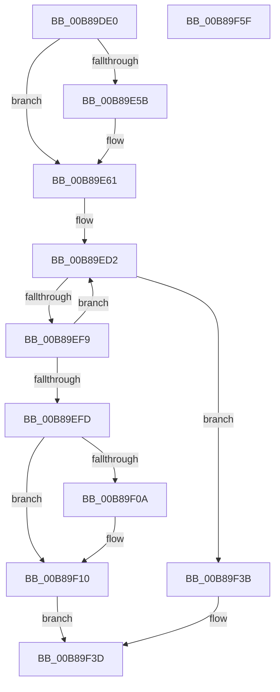

# KdpPromptString

- RVA: `0x00B89DE0`–`0x00B89F60` (길이 `384` bytes)
- VA: `0x0000000140B89DE0`
- 실행 섹션: `PAGEKD`
- PDB 이름 있음: `예`; PDB Function 태그: `아니요`
- unwind 정보 RVA: `0x000C9B64`
- 디코드: `98`개 명령, `384/384` bytes 표시
- 미해석 바이트: `0` (있으면 어셈블리에 `.byte`로 보존)

> 이 문서는 커널 이미지의 기계어와 PDB 기호를 분석해 생성했습니다. 4번과 5번은 함수 원형과 자료형을 바이너리 사용 방식에서 추정한 C 해석이며 원본 소스 복구 결과는 아닙니다.

## 1. Dependencies

- 직접 호출 지점: **5**; 고유 호출 대상: **4**
- 직접 호출자로 확인된 함수: **1**
- RIP 상대 이미지 참조: **7**

### Outgoing calls
- `0x00B89E3F` → [KdpCopyMemoryChunks](KdpCopyMemoryChunks_function_00B8AACC.md) (function, `0x00B8AACC`)
- `0x00B89EB8` → `kdcom.dll!KdSendPacket` (import, 간접 대상; import `kdcom.dll!KdSendPacket`)
- `0x00B89EE8` → `kdcom.dll!KdReceivePacket` (import, 간접 대상; import `kdcom.dll!KdReceivePacket`)
- `0x00B89F2B` → [KdpCopyMemoryChunks](KdpCopyMemoryChunks_function_00B8AACC.md) (function, `0x00B8AACC`)
- `0x00B89F44` → [_security_check_cookie](../../text/6A/_security_check_cookie_function_006AC640.md) (function, `0x006AC640`)

### Direct callers
- [KdpPrompt](KdpPrompt_function_00B890AC.md) at `0x00B891C7`

### Static image references
- `0x00B89DF6` → RVA `0x00E0A740` (`.data`; read)
- `0x00B89E10` → RVA `0x00E12710` (`.data`; read)
- `0x00B89E4D` → RVA `0x00E0AA48` (`.data`; read)
- `0x00B89E61` → RVA `0x00FC6BE8` (`ALMOSTRO`; read)
- `0x00B89E68` → RVA `0x00F475E0` (`.data`; read)
- `0x00B89EB8` → RVA `0x001516C0` (`kdcom.dll!KdSendPacket (IAT)`; read)
- `0x00B89EE8` → RVA `0x001516B0` (`kdcom.dll!KdReceivePacket (IAT)`; read)

## 2. Other-region calls and transfers

- 다른 실행 섹션으로 향하는 call: **1**
  - `0x00B89F44` → [_security_check_cookie](../../text/6A/_security_check_cookie_function_006AC640.md) (`PAGEKD` → `.text`)
- 별도 외부 분기/꼬리 이동을 확인하지 못했습니다.

## 3. Assembly (complete function range)

```asm
00B89DE0  48 89 5C 24 18                  mov qword ptr [rsp + 0x18], rbx
00B89DE5  48 89 7C 24 20                  mov qword ptr [rsp + 0x20], rdi
00B89DEA  55                              push rbp
00B89DEB  41 56                           push r14
00B89DED  41 57                           push r15
00B89DEF  48 8B EC                        mov rbp, rsp
00B89DF2  48 83 EC 70                     sub rsp, 0x70
00B89DF6  48 8B 05 43 09 28 00            mov rax, qword ptr [rip + 0x280943]
00B89DFD  48 33 C4                        xor rax, rsp
00B89E00  48 89 45 F8                     mov qword ptr [rbp - 8], rax
00B89E04  44 0F B7 01                     movzx r8d, word ptr [rcx]
00B89E08  48 8D 45 C0                     lea rax, [rbp - 0x40]
00B89E0C  48 8B 49 08                     mov rcx, qword ptr [rcx + 8]
00B89E10  48 8D 3D F9 88 28 00            lea rdi, [rip + 0x2888f9]
00B89E17  83 65 C0 00                     and dword ptr [rbp - 0x40], 0
00B89E1B  48 8B DA                        mov rbx, rdx
00B89E1E  0F 57 C0                        xorps xmm0, xmm0
00B89E21  48 89 44 24 28                  mov qword ptr [rsp + 0x28], rax
00B89E26  0F 57 C9                        xorps xmm1, xmm1
00B89E29  C7 44 24 20 04 00 00 00         mov dword ptr [rsp + 0x20], 4
00B89E31  48 8B D7                        mov rdx, rdi
00B89E34  45 33 C9                        xor r9d, r9d
00B89E37  0F 11 45 C8                     movups xmmword ptr [rbp - 0x38], xmm0
00B89E3B  0F 11 4D D8                     movups xmmword ptr [rbp - 0x28], xmm1
00B89E3F  E8 88 0C 00 00                  call 0x140b8aacc
00B89E44  8B 4D C0                        mov ecx, dword ptr [rbp - 0x40]
00B89E47  41 BF 10 00 00 00               mov r15d, 0x10
00B89E4D  8B 15 F5 0B 28 00               mov edx, dword ptr [rip + 0x280bf5]
00B89E53  49 03 CF                        add rcx, r15
00B89E56  48 3B CA                        cmp rcx, rdx
00B89E59  76 06                           jbe 0x140b89e61
00B89E5B  8D 42 F0                        lea eax, [rdx - 0x10]
00B89E5E  89 45 C0                        mov dword ptr [rbp - 0x40], eax
00B89E61  0F B7 05 80 CD 43 00            movzx eax, word ptr [rip + 0x43cd80]
00B89E68  4C 8D 35 71 D7 3B 00            lea r14, [rip + 0x3bd771]
00B89E6F  66 89 45 EC                     mov word ptr [rbp - 0x14], ax
00B89E73  4C 8D 45 C8                     lea r8, [rbp - 0x38]
00B89E77  C7 45 E8 31 32 00 00            mov dword ptr [rbp - 0x18], 0x3231
00B89E7E  48 8D 55 D8                     lea rdx, [rbp - 0x28]
00B89E82  65 8B 04 25 A4 01 00 00         mov eax, dword ptr gs:[0x1a4]
00B89E8A  4D 8B CE                        mov r9, r14
00B89E8D  8B 4D C0                        mov ecx, dword ptr [rbp - 0x40]
00B89E90  66 89 45 EE                     mov word ptr [rbp - 0x12], ax
00B89E94  0F B7 43 02                     movzx eax, word ptr [rbx + 2]
00B89E98  89 45 F4                        mov dword ptr [rbp - 0xc], eax
00B89E9B  48 8D 45 E8                     lea rax, [rbp - 0x18]
00B89E9F  89 4D F0                        mov dword ptr [rbp - 0x10], ecx
00B89EA2  66 89 4D C8                     mov word ptr [rbp - 0x38], cx
00B89EA6  B9 03 00 00 00                  mov ecx, 3
00B89EAB  48 89 45 E0                     mov qword ptr [rbp - 0x20], rax
00B89EAF  66 44 89 7D D8                  mov word ptr [rbp - 0x28], r15w
00B89EB4  48 89 7D D0                     mov qword ptr [rbp - 0x30], rdi
00B89EB8  48 FF 15 01 78 5C FF            call qword ptr [rip - 0xa387ff]
00B89EBF  0F 1F 44 00 00                  nop dword ptr [rax + rax]
00B89EC4  B8 00 30 00 00                  mov eax, 0x3000
00B89EC9  66 44 89 7D DA                  mov word ptr [rbp - 0x26], r15w
00B89ECE  66 89 45 CA                     mov word ptr [rbp - 0x36], ax
00B89ED2  4C 8D 4D C0                     lea r9, [rbp - 0x40]
00B89ED6  4C 89 74 24 20                  mov qword ptr [rsp + 0x20], r14
00B89EDB  4C 8D 45 C8                     lea r8, [rbp - 0x38]
00B89EDF  B9 03 00 00 00                  mov ecx, 3
00B89EE4  48 8D 55 D8                     lea rdx, [rbp - 0x28]
00B89EE8  48 FF 15 C1 77 5C FF            call qword ptr [rip - 0xa3883f]
00B89EEF  0F 1F 44 00 00                  nop dword ptr [rax + rax]
00B89EF4  83 F8 02                        cmp eax, 2
00B89EF7  74 42                           je 0x140b89f3b
00B89EF9  85 C0                           test eax, eax
00B89EFB  75 D5                           jne 0x140b89ed2
00B89EFD  0F B7 43 02                     movzx eax, word ptr [rbx + 2]
00B89F01  44 8B 45 C0                     mov r8d, dword ptr [rbp - 0x40]
00B89F05  44 3B C0                        cmp r8d, eax
00B89F08  76 06                           jbe 0x140b89f10
00B89F0A  44 8B C0                        mov r8d, eax
00B89F0D  89 45 C0                        mov dword ptr [rbp - 0x40], eax
00B89F10  48 8B 4B 08                     mov rcx, qword ptr [rbx + 8]
00B89F14  48 8D 45 C0                     lea rax, [rbp - 0x40]
00B89F18  48 89 44 24 28                  mov qword ptr [rsp + 0x28], rax
00B89F1D  45 33 C9                        xor r9d, r9d
00B89F20  48 8B D7                        mov rdx, rdi
00B89F23  C7 44 24 20 05 00 00 00         mov dword ptr [rsp + 0x20], 5
00B89F2B  E8 9C 0B 00 00                  call 0x140b8aacc
00B89F30  0F B7 45 C0                     movzx eax, word ptr [rbp - 0x40]
00B89F34  66 89 03                        mov word ptr [rbx], ax
00B89F37  32 C0                           xor al, al
00B89F39  EB 02                           jmp 0x140b89f3d
00B89F3B  B0 01                           mov al, 1
00B89F3D  48 8B 4D F8                     mov rcx, qword ptr [rbp - 8]
00B89F41  48 33 CC                        xor rcx, rsp
00B89F44  E8 F7 26 B2 FF                  call 0x1406ac640
00B89F49  4C 8D 5C 24 70                  lea r11, [rsp + 0x70]
00B89F4E  49 8B 5B 30                     mov rbx, qword ptr [r11 + 0x30]
00B89F52  49 8B 7B 38                     mov rdi, qword ptr [r11 + 0x38]
00B89F56  49 8B E3                        mov rsp, r11
00B89F59  41 5F                           pop r15
00B89F5B  41 5E                           pop r14
00B89F5D  5D                              pop rbp
00B89F5E  C3                              ret
00B89F5F  CC                              int3
```

## 4. C-style interpretation (structured pseudocode)

```c
__int64 __fastcall KdpPromptString(__int64 a1, __int64 a2, __int64 a3, int a4)
{
    __int64 result;
    __int64 v_rsp;
    unsigned __int64 v_stack_m18;
    unsigned __int64 v_stack_m20;
    unsigned int v_stack_m24;
    unsigned int v_stack_m28;
    unsigned __int16 v_stack_m2A;
    unsigned __int16 v_stack_m2C;
    unsigned int v_stack_m30;
    unsigned __int64 v_stack_m38;
    unsigned __int16 v_stack_m3E;
    unsigned __int64 v_stack_m40;
    unsigned __int64 v_stack_m48;
    unsigned __int16 v_stack_m4E;
    unsigned __int64 v_stack_m50;
    unsigned __int64 v_stack_m58;
    unsigned __int64 v_stack_m60;
    unsigned int v_stack_m68;
    unsigned __int64 v_stack_p18;
    unsigned __int64 v_stack_p20;

    v_stack_p18 = v_rbx;
    v_stack_p20 = v_rdi;
    v_rsp = (v_rsp) - (112);
    result = (*(unsigned __int64 *)(v_rip + 2623811)) ^ (v_rsp);
    v_stack_m20 = result;
    v_stack_m60 = v_stack_m58;
    v_stack_m68 = 4;
    a4 = 0;
    v_stack_m50 = v_xmm0;
    v_stack_m40 = v_xmm1;
    result = KdpCopyMemoryChunks(*(unsigned __int64 *)(a1 + 8), v_rip + 2656505, *(unsigned __int16 *)(a1), a4);
    a1 = ((unsigned int)(v_stack_m58)) + (16);
    if (a1 >= = ((unsigned int)(*(unsigned int *)(v_rip + 2624501)))) {
        result = (unsigned int)(*(unsigned int *)(v_rip + 2624501)) - 16;
        v_stack_m58 = (unsigned int)(result);
    }
    v_stack_m2C = (unsigned __int16)(*(unsigned __int16 *)(v_rip + 4443520));
    v_stack_m30 = 0x3231ULL;
    v_stack_m2A = (unsigned __int16)((unsigned int)(*(unsigned int *)(gs_base + (0 + 420))));
    v_stack_m24 = (unsigned int)(*(unsigned __int16 *)(a2 + 2));
    v_stack_m28 = (unsigned int)((unsigned int)(v_stack_m58));
    v_stack_m50 = (unsigned __int16)((unsigned int)(v_stack_m58));
    v_stack_m38 = v_stack_m30;
    v_stack_m40 = 16;
    v_stack_m48 = v_rip + 2656505;
    result = kdcom_dll_KdSendPacket(3, v_stack_m40, v_stack_m50, v_rip + 3921777);
    v_stack_m3E = 16;
    v_stack_m4E = (unsigned __int16)((unsigned int)(0x3000ULL));
loc_00B89ED2:
    v_stack_m68 = v_rip + 3921777;
    result = kdcom_dll_KdReceivePacket(3, v_stack_m40, v_stack_m50, v_stack_m58);
    if (((unsigned int)(result)) == 2) goto loc_00B89F3B;
    if ((unsigned int)(result) != 0) goto loc_00B89ED2;
    if (((unsigned int)((unsigned int)(v_stack_m58))) >= = ((unsigned int)(*(unsigned __int16 *)(a2 + 2)))) {
        a3 = (unsigned int)(*(unsigned __int16 *)(a2 + 2));
        v_stack_m58 = (unsigned int)(*(unsigned __int16 *)(a2 + 2));
    }
    v_stack_m60 = v_stack_m58;
    a4 = 0;
    v_stack_m68 = 5;
    result = KdpCopyMemoryChunks(*(unsigned __int64 *)(a2 + 8), v_rip + 2656505, a3, a4);
    *(unsigned __int16 *)(a2) = (unsigned __int16)(v_stack_m58);
    result = 0;
    goto loc_00B89F3D;
loc_00B89F3B:
loc_00B89F3D:
    a1 = (v_stack_m20) ^ (v_rsp);
    result = _security_check_cookie(a1, v_rip + 2656505, a3, a4);
    return result;
}
```

## 5. (Beta) C Style

```c
int64_t KdpPromptString(void *Arg1, void *Arg2, int64_t Arg3, int32_t Arg4)
{
    uint8_t *arg1 = (uint8_t *)Arg1;
    uint8_t *arg2 = (uint8_t *)Arg2;

    int64_t result;
    int64_t local_rsp;
    uint64_t v_stack_m18;
    uint64_t v_stack_m20;
    uint32_t v_stack_m24;
    uint32_t v_stack_m28;
    uint16_t v_stack_m2A;
    uint16_t v_stack_m2C;
    uint32_t v_stack_m30;
    uint64_t v_stack_m38;
    uint16_t v_stack_m3E;
    uint64_t v_stack_m40;
    uint64_t v_stack_m48;
    uint16_t v_stack_m4E;
    uint64_t v_stack_m50;
    uint64_t v_stack_m58;
    uint64_t v_stack_m60;
    uint32_t v_stack_m68;
    uint64_t v_stack_p18;
    uint64_t v_stack_p20;

    v_stack_p18 = local_rbx;
    v_stack_p20 = local_rdi;
    local_rsp = (local_rsp) - (112);
    result = (*(uint64_t *)(v_rip + 0x280943)) ^ (local_rsp);
    v_stack_m20 = result;
    v_stack_m60 = v_stack_m58;
    v_stack_m68 = 4;
    Arg4 = 0;
    v_stack_m50 = v_xmm0;
    v_stack_m40 = v_xmm1;
    result = KdpCopyMemoryChunks(*(uint64_t *)(arg1 + 0x8), v_rip + 2656505, *(uint16_t *)(arg1), Arg4);
    Arg1 = ((uint32_t)(v_stack_m58)) + (16);
    if (Arg1 >= = ((uint32_t)(*(uint32_t *)(v_rip + 0x280BF5)))) {
        result = (uint32_t)(*(uint32_t *)(v_rip + 0x280BF5)) - 16;
        v_stack_m58 = (uint32_t)(result);
    }
    v_stack_m2C = (uint16_t)(*(uint16_t *)(v_rip + 0x43CD80));
    v_stack_m30 = 0x3231ULL;
    v_stack_m2A = (uint16_t)((uint32_t)(*(uint32_t *)(gs_base + (0 + 0x1A4))));
    v_stack_m24 = (uint32_t)(*(uint16_t *)(arg2 + 0x2));
    v_stack_m28 = (uint32_t)((uint32_t)(v_stack_m58));
    v_stack_m50 = (uint16_t)((uint32_t)(v_stack_m58));
    v_stack_m38 = v_stack_m30;
    v_stack_m40 = 16;
    v_stack_m48 = v_rip + 2656505;
    result = kernel_indirect_call(3, v_stack_m40, v_stack_m50, v_rip + 3921777);
    v_stack_m3E = 16;
    v_stack_m4E = (uint16_t)((uint32_t)(0x3000ULL));
loc_00B89ED2:
    v_stack_m68 = v_rip + 3921777;
    result = kernel_indirect_call(3, v_stack_m40, v_stack_m50, v_stack_m58);
    if (((uint32_t)(result)) == 2) goto loc_00B89F3B;
    if ((uint32_t)(result) != 0) goto loc_00B89ED2;
    if (((uint32_t)((uint32_t)(v_stack_m58))) >= = ((uint32_t)(*(uint16_t *)(arg2 + 0x2)))) {
        Arg3 = (uint32_t)(*(uint16_t *)(arg2 + 0x2));
        v_stack_m58 = (uint32_t)(*(uint16_t *)(arg2 + 0x2));
    }
    v_stack_m60 = v_stack_m58;
    Arg4 = 0;
    v_stack_m68 = 5;
    result = KdpCopyMemoryChunks(*(uint64_t *)(arg2 + 0x8), v_rip + 2656505, Arg3, Arg4);
    *(uint16_t *)(arg2) = (uint16_t)(v_stack_m58);
    result = 0;
    goto loc_00B89F3D;
loc_00B89F3B:
loc_00B89F3D:
    Arg1 = (v_stack_m20) ^ (local_rsp);
    result = _security_check_cookie(Arg1, v_rip + 2656505, Arg3, Arg4);
    return result;
}
```

### 관측된 메모리 오프셋

구조체 형식이 확인되지 않은 접근은 인자 기준의 오프셋으로만 기록했습니다.

| 기준 인자 | 오프셋 표현 | 폭 (bit) | 접근 |
|---|---:|---:|---|
| `Arg1` | `+ 0x0` | `16` | `R` |
| `Arg1` | `+ 0x8` | `64` | `R` |
| `Arg2` | `+ 0x0` | `16` | `W` |
| `Arg2` | `+ 0x2` | `16` | `R` |
| `Arg2` | `+ 0x8` | `64` | `R` |

## 6. Execution-region graph

[열기: 2D/3D 그래프와 함수 탐색 컨트롤 패널](../../../control-panel.html?section=pagekd&rva=0x00B89DE0&view=graph)

- 2D 그래프는 위에서 아래로 흐르고, 3D 그래프는 빈 공간을 드래그해 회전합니다. Shift+드래그는 이동, 휠은 확대·축소, 함수 노드 선택은 대상 보고서 이동입니다.

### Static fallback


