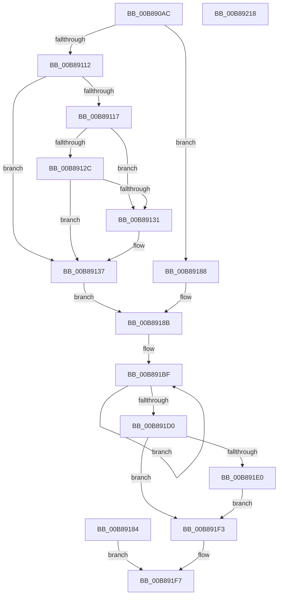

# KdpPrompt

- RVA: `0x00B890AC`–`0x00B89219` (길이 `365` bytes)
- VA: `0x0000000140B890AC`
- 실행 섹션: `PAGEKD`
- PDB 이름 있음: `예`; PDB Function 태그: `아니요`
- unwind 정보 RVA: `0x000C9A44`
- 디코드: `102`개 명령, `365/365` bytes 표시
- 미해석 바이트: `0` (있으면 어셈블리에 `.byte`로 보존)

> 이 문서는 커널 이미지의 기계어와 PDB 기호를 분석해 생성했습니다. 4번과 5번은 함수 원형과 자료형을 바이너리 사용 방식에서 추정한 C 해석이며 원본 소스 복구 결과는 아닙니다.

## 1. Dependencies

- 직접 호출 지점: **8**; 고유 호출 대상: **7**
- 직접 호출자로 확인된 함수: **1**
- RIP 상대 이미지 참조: **1**

### Outgoing calls
- `0x00B89153` → [KdpQuickMoveMemory](KdpQuickMoveMemory_function_00B85490.md) (function, `0x00B85490`)
- `0x00B8916C` → [ProbeForWrite](../../page/8E/ProbeForWrite_function_008E91C0.md) (function, `0x008E91C0`)
- `0x00B891A5` → [KdLogDbgPrint](KdLogDbgPrint_function_00B88C20.md) (function, `0x00B88C20`)
- `0x00B891B8` → [KdEnterDebugger](KdEnterDebugger_function_00B8A96C.md) (function, `0x00B8A96C`)
- `0x00B891C7` → [KdpPromptString](KdpPromptString_function_00B89DE0.md) (function, `0x00B89DE0`)
- `0x00B891D2` → [KdExitDebugger](KdExitDebugger_function_00B85008.md) (function, `0x00B85008`)
- `0x00B891EC` → [KdpQuickMoveMemory](KdpQuickMoveMemory_function_00B85490.md) (function, `0x00B85490`)
- `0x00B891FE` → [_security_check_cookie](../../text/6A/_security_check_cookie_function_006AC640.md) (function, `0x006AC640`)

### Direct callers
- [KdpTrap](KdpTrap_function_00B852B8.md) at `0x00B853C2`

### Static image references
- `0x00B890CA` → RVA `0x00E0A740` (`.data`; read)

## 2. Other-region calls and transfers

- 다른 실행 섹션으로 향하는 call: **2**
  - `0x00B8916C` → [ProbeForWrite](../../page/8E/ProbeForWrite_function_008E91C0.md) (`PAGEKD` → `PAGE`)
  - `0x00B891FE` → [_security_check_cookie](../../text/6A/_security_check_cookie_function_006AC640.md) (`PAGEKD` → `.text`)
- 별도 외부 분기/꼬리 이동을 확인하지 못했습니다.

## 3. Assembly (complete function range)

```asm
00B890AC  48 89 4C 24 08                  mov qword ptr [rsp + 8], rcx
00B890B1  55                              push rbp
00B890B2  57                              push rdi
00B890B3  41 54                           push r12
00B890B5  41 55                           push r13
00B890B7  41 56                           push r14
00B890B9  48 83 EC 50                     sub rsp, 0x50
00B890BD  48 8D 6C 24 20                  lea rbp, [rsp + 0x20]
00B890C2  48 89 5D 68                     mov qword ptr [rbp + 0x68], rbx
00B890C6  48 89 75 70                     mov qword ptr [rbp + 0x70], rsi
00B890CA  48 8B 05 6F 16 28 00            mov rax, qword ptr [rip + 0x28166f]
00B890D1  48 33 C5                        xor rax, rbp
00B890D4  48 89 45 28                     mov qword ptr [rbp + 0x28], rax
00B890D8  49 8B F0                        mov rsi, r8
00B890DB  48 8B D9                        mov rbx, rcx
00B890DE  45 33 E4                        xor r12d, r12d
00B890E1  44 89 65 04                     mov dword ptr [rbp + 4], r12d
00B890E5  0F 57 C0                        xorps xmm0, xmm0
00B890E8  0F 11 45 10                     movups xmmword ptr [rbp + 0x10], xmm0
00B890EC  41 BD 00 02 00 00               mov r13d, 0x200
00B890F2  41 8B FD                        mov edi, r13d
00B890F5  66 41 3B D5                     cmp dx, r13w
00B890F9  66 0F 46 FA                     cmovbe di, dx
00B890FD  45 8B F5                        mov r14d, r13d
00B89100  66 45 3B CD                     cmp r9w, r13w
00B89104  66 45 0F 46 F1                  cmovbe r14w, r9w
00B89109  44 38 A5 80 00 00 00            cmp byte ptr [rbp + 0x80], r12b
00B89110  74 76                           je 0x140b89188
00B89112  66 85 FF                        test di, di
00B89115  74 20                           je 0x140b89137
00B89117  0F B7 CF                        movzx ecx, di
00B8911A  48 03 CB                        add rcx, rbx
00B8911D  48 B8 00 00 FF FF FF 7F 00 00   movabs rax, 0x7fffffff0000
00B89127  48 3B C8                        cmp rcx, rax
00B8912A  77 05                           ja 0x140b89131
00B8912C  48 3B CB                        cmp rcx, rbx
00B8912F  73 06                           jae 0x140b89137
00B89131  8A 00                           mov al, byte ptr [rax]
00B89133  48 8B 5D 60                     mov rbx, qword ptr [rbp + 0x60]
00B89137  8B 04 24                        mov eax, dword ptr [rsp]
00B8913A  49 2B E5                        sub rsp, r13
00B8913D  4C 8D 4C 24 20                  lea r9, [rsp + 0x20]
00B89142  41 8B 01                        mov eax, dword ptr [r9]
00B89145  4C 89 4D 20                     mov qword ptr [rbp + 0x20], r9
00B89149  44 0F B7 C7                     movzx r8d, di
00B8914D  48 8B D3                        mov rdx, rbx
00B89150  49 8B C9                        mov rcx, r9
00B89153  E8 38 C3 FF FF                  call 0x140b85490
00B89158  49 8B D9                        mov rbx, r9
00B8915B  48 89 5D 60                     mov qword ptr [rbp + 0x60], rbx
00B8915F  41 0F B7 D6                     movzx edx, r14w
00B89163  41 B8 01 00 00 00               mov r8d, 1
00B89169  48 8B CE                        mov rcx, rsi
00B8916C  E8 4F 00 D6 FF                  call 0x1408e91c0
00B89171  8B 0C 24                        mov ecx, dword ptr [rsp]
00B89174  49 2B E5                        sub rsp, r13
00B89177  48 8D 4C 24 20                  lea rcx, [rsp + 0x20]
00B8917C  8B 01                           mov eax, dword ptr [rcx]
00B8917E  48 89 4D 20                     mov qword ptr [rbp + 0x20], rcx
00B89182  EB 07                           jmp 0x140b8918b
00B89184  33 C0                           xor eax, eax
00B89186  EB 6F                           jmp 0x140b891f7
00B89188  48 8B CE                        mov rcx, rsi
00B8918B  48 89 4D 08                     mov qword ptr [rbp + 8], rcx
00B8918F  66 44 89 65 00                  mov word ptr [rbp], r12w
00B89194  66 44 89 75 02                  mov word ptr [rbp + 2], r14w
00B89199  48 89 5D 18                     mov qword ptr [rbp + 0x18], rbx
00B8919D  66 89 7D 10                     mov word ptr [rbp + 0x10], di
00B891A1  48 8D 4D 10                     lea rcx, [rbp + 0x10]
00B891A5  E8 76 FA FF FF                  call 0x140b88c20
00B891AA  48 8B 95 90 00 00 00            mov rdx, qword ptr [rbp + 0x90]
00B891B1  48 8B 8D 88 00 00 00            mov rcx, qword ptr [rbp + 0x88]
00B891B8  E8 AF 17 00 00                  call 0x140b8a96c
00B891BD  8A D8                           mov bl, al
00B891BF  48 8D 55 00                     lea rdx, [rbp]
00B891C3  48 8D 4D 10                     lea rcx, [rbp + 0x10]
00B891C7  E8 14 0C 00 00                  call 0x140b89de0
00B891CC  3C 01                           cmp al, 1
00B891CE  74 EF                           je 0x140b891bf
00B891D0  8A CB                           mov cl, bl
00B891D2  E8 31 BE FF FF                  call 0x140b85008
00B891D7  80 BD 80 00 00 00 01            cmp byte ptr [rbp + 0x80], 1
00B891DE  75 13                           jne 0x140b891f3
00B891E0  44 0F B7 45 00                  movzx r8d, word ptr [rbp]
00B891E5  48 8B 55 08                     mov rdx, qword ptr [rbp + 8]
00B891E9  48 8B CE                        mov rcx, rsi
00B891EC  E8 9F C2 FF FF                  call 0x140b85490
00B891F1  EB 00                           jmp 0x140b891f3
00B891F3  0F B7 45 00                     movzx eax, word ptr [rbp]
00B891F7  48 8B 4D 28                     mov rcx, qword ptr [rbp + 0x28]
00B891FB  48 33 CD                        xor rcx, rbp
00B891FE  E8 3D 34 B2 FF                  call 0x1406ac640
00B89203  48 8B 5D 68                     mov rbx, qword ptr [rbp + 0x68]
00B89207  48 8B 75 70                     mov rsi, qword ptr [rbp + 0x70]
00B8920B  48 8D 65 30                     lea rsp, [rbp + 0x30]
00B8920F  41 5E                           pop r14
00B89211  41 5D                           pop r13
00B89213  41 5C                           pop r12
00B89215  5F                              pop rdi
00B89216  5D                              pop rbp
00B89217  C3                              ret
00B89218  CC                              int3
```

## 4. C-style interpretation (structured pseudocode)

```c
__int64 __fastcall KdpPrompt(__int64 a1, unsigned __int16 a2, __int64 a3, unsigned __int16 a4, unsigned __int8 a5, __int64 a6, __int64 a7)
{
    __int64 result;
    __int64 v_r12;
    __int64 v_r14;
    __int64 v_rbx;
    __int64 v_rdi;
    __int64 v_rsp;
    unsigned __int64 v_stack_m28;
    unsigned __int64 v_stack_m30;
    unsigned __int64 v_stack_m38;
    unsigned __int64 v_stack_m40;
    unsigned __int64 v_stack_m48;
    unsigned __int64 v_stack_m50;
    unsigned int v_stack_m54;
    unsigned __int16 v_stack_m56;
    unsigned __int64 v_stack_m58;
    unsigned int v_stack_m78;
    unsigned __int64 v_stack_p10;
    unsigned __int64 v_stack_p18;
    unsigned __int64 v_stack_p8;

    v_stack_p8 = a1;
    v_rsp = (v_rsp) - (80);
    v_stack_p10 = v_rbx;
    v_stack_p18 = v_rsi;
    result = (*(unsigned __int64 *)(v_rip + 2627183)) ^ (v_stack_m58);
    v_stack_m30 = result;
    v_r12 = 0;
    v_stack_m54 = 0;
    v_stack_m48 = v_xmm0;
    v_rdi = 512;
    if (a2 <= 512) { v_rdi = a2; }
    v_r14 = 512;
    if (a4 <= 512) { v_r14 = a4; }
    if (a5 == 0) goto loc_00B89188;
    if ((unsigned __int16)(v_rdi) == 0) goto loc_00B89137;
    a1 = ((unsigned __int16)(v_rdi)) + (a1);
    if (a1 > result) goto loc_00B89131;
    v_rbx = a1;
    if (a1 < a1) {
        result = *(unsigned __int8 *)(result);
        v_rbx = v_stack_p8;
    }
    v_rsp = (v_rsp) - (512);
    v_stack_m38 = v_stack_m58;
    result = KdpQuickMoveMemory(v_stack_m58, v_rbx, (unsigned __int16)(v_rdi), v_stack_m58);
    v_stack_p8 = v_stack_m58;
    result = ProbeForWrite(a3, (unsigned __int16)(v_r14), 1, v_stack_m58);
    v_rsp = (v_rsp) - (512);
    v_stack_m38 = v_stack_m58;
    goto loc_00B8918B;
loc_00B89188:
loc_00B8918B:
    v_stack_m50 = a3;
    v_stack_m58 = 0;
    v_stack_m56 = (unsigned __int16)(v_r14);
    v_stack_m40 = v_stack_m58;
    v_stack_m48 = (unsigned __int16)(v_rdi);
    result = KdLogDbgPrint(v_stack_m48, (unsigned __int16)(v_r14), 1, v_stack_m58);
    result = KdEnterDebugger(a6, a7, 1, v_stack_m58);
loc_00B891BF:
    result = KdpPromptString(v_stack_m48, v_stack_m58, 1, v_stack_m58);
    if (((unsigned __int8)(result)) == 1) goto loc_00B891BF;
    result = KdExitDebugger((unsigned __int8)((unsigned __int8)(result)), v_stack_m58, 1, v_stack_m58);
    if (a5 != 1) goto loc_00B891F3;
    result = KdpQuickMoveMemory(a3, v_stack_m50, v_stack_m58, v_stack_m58);
    goto loc_00B891F3;
loc_00B891F3:
loc_00B891F7:
    a1 = (v_stack_m30) ^ (v_stack_m58);
    result = _security_check_cookie(a1, v_stack_m50, v_stack_m58, v_stack_m58);
    return result;
}
```

## 5. (Beta) C Style

```c
int64_t KdpPrompt(int64_t Arg1, uint16_t Arg2, int64_t Arg3, uint16_t Arg4, uint8_t Arg5, int64_t Arg6, int64_t Arg7)
{
    int64_t result;
    int64_t local_r12;
    int64_t local_r14;
    int64_t local_rbx;
    int64_t local_rdi;
    int64_t local_rsp;
    uint64_t v_stack_m28;
    uint64_t v_stack_m30;
    uint64_t v_stack_m38;
    uint64_t v_stack_m40;
    uint64_t v_stack_m48;
    uint64_t v_stack_m50;
    uint32_t v_stack_m54;
    uint16_t v_stack_m56;
    uint64_t v_stack_m58;
    uint32_t v_stack_m78;
    uint64_t v_stack_p10;
    uint64_t v_stack_p18;
    uint64_t v_stack_p8;

    v_stack_p8 = Arg1;
    local_rsp = (local_rsp) - (80);
    v_stack_p10 = local_rbx;
    v_stack_p18 = local_rsi;
    result = (*(uint64_t *)(v_rip + 0x28166F)) ^ (v_stack_m58);
    v_stack_m30 = result;
    local_r12 = 0;
    v_stack_m54 = 0;
    v_stack_m48 = v_xmm0;
    local_rdi = 512;
    if (Arg2 <= 512) { local_rdi = Arg2; }
    local_r14 = 512;
    if (Arg4 <= 512) { local_r14 = Arg4; }
    if (Arg5 == 0) goto loc_00B89188;
    if ((uint16_t)(local_rdi) == 0) goto loc_00B89137;
    Arg1 = ((uint16_t)(local_rdi)) + (Arg1);
    if (Arg1 > result) goto loc_00B89131;
    local_rbx = Arg1;
    if (Arg1 < Arg1) {
        result = *(uint8_t *)(result);
        local_rbx = v_stack_p8;
    }
    local_rsp = (local_rsp) - (512);
    v_stack_m38 = v_stack_m58;
    result = KdpQuickMoveMemory(v_stack_m58, local_rbx, (uint16_t)(local_rdi), v_stack_m58);
    v_stack_p8 = v_stack_m58;
    result = ProbeForWrite(Arg3, (uint16_t)(local_r14), 1, v_stack_m58);
    local_rsp = (local_rsp) - (512);
    v_stack_m38 = v_stack_m58;
    goto loc_00B8918B;
loc_00B89188:
loc_00B8918B:
    v_stack_m50 = Arg3;
    v_stack_m58 = 0;
    v_stack_m56 = (uint16_t)(local_r14);
    v_stack_m40 = v_stack_m58;
    v_stack_m48 = (uint16_t)(local_rdi);
    result = KdLogDbgPrint(v_stack_m48, (uint16_t)(local_r14), 1, v_stack_m58);
    result = KdEnterDebugger(Arg6, Arg7, 1, v_stack_m58);
loc_00B891BF:
    result = KdpPromptString(v_stack_m48, v_stack_m58, 1, v_stack_m58);
    if (((uint8_t)(result)) == 1) goto loc_00B891BF;
    result = KdExitDebugger((uint8_t)((uint8_t)(result)), v_stack_m58, 1, v_stack_m58);
    if (Arg5 != 1) goto loc_00B891F3;
    result = KdpQuickMoveMemory(Arg3, v_stack_m50, v_stack_m58, v_stack_m58);
    goto loc_00B891F3;
loc_00B891F3:
loc_00B891F7:
    Arg1 = (v_stack_m30) ^ (v_stack_m58);
    result = _security_check_cookie(Arg1, v_stack_m50, v_stack_m58, v_stack_m58);
    return result;
}
```

## 6. Execution-region graph

[열기: 2D/3D 그래프와 함수 탐색 컨트롤 패널](../../../control-panel.html?section=pagekd&rva=0x00B890AC&view=graph)

- 2D 그래프는 위에서 아래로 흐르고, 3D 그래프는 빈 공간을 드래그해 회전합니다. Shift+드래그는 이동, 휠은 확대·축소, 함수 노드 선택은 대상 보고서 이동입니다.

### Static fallback


