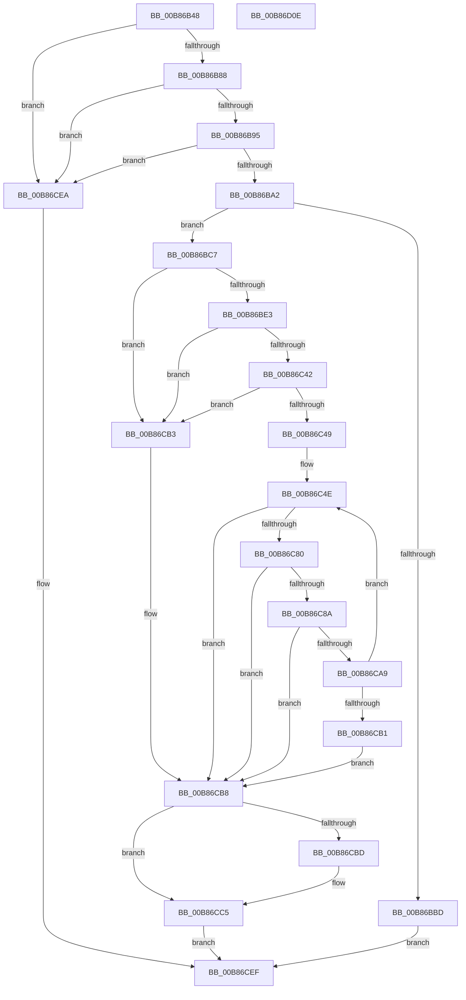

# KdpPullRemoteFile

- RVA: `0x00B86B48`–`0x00B86D0F` (길이 `455` bytes)
- VA: `0x0000000140B86B48`
- 실행 섹션: `PAGEKD`
- PDB 이름 있음: `예`; PDB Function 태그: `아니요`
- unwind 정보 RVA: `0x000C9860`
- 디코드: `121`개 명령, `455/455` bytes 표시
- 미해석 바이트: `0` (있으면 어셈블리에 `.byte`로 보존)

> 이 문서는 커널 이미지의 기계어와 PDB 기호를 분석해 생성했습니다. 4번과 5번은 함수 원형과 자료형을 바이너리 사용 방식에서 추정한 C 해석이며 원본 소스 복구 결과는 아닙니다.

## 1. Dependencies

- 직접 호출 지점: **10**; 고유 호출 대상: **8**
- 직접 호출자로 확인된 함수: **2**
- RIP 상대 이미지 참조: **4**

### Outgoing calls
- `0x00B86BB0` → [ExAllocatePool2](../../poolcode/B8/ExAllocatePool2_function_00B820F0.md) (function, `0x00B820F0`)
- `0x00B86BD4` → [KdpCreateRemoteFile](KdpCreateRemoteFile_function_00B86920.md) (function, `0x00B86920`)
- `0x00B86BEE` → [memcpy](../../text/6C/memcpy_function_006C6840.md) (function, `0x006C6840`)
- `0x00B86C21` → [DbgPrintEx](../../text/35/DbgPrintEx_function_00359290.md) (function, `0x00359290`)
- `0x00B86C37` → [guard_dispatch_icall](../../text/6B/guard_dispatch_icall_function_006BAAD0.md) (function, `0x006BAAD0`)
- `0x00B86C75` → [KdpReadRemoteFile](KdpReadRemoteFile_function_00B86D18.md) (function, `0x00B86D18`)
- `0x00B86C9E` → [guard_dispatch_icall](../../text/6B/guard_dispatch_icall_function_006BAAD0.md) (function, `0x006BAAD0`)
- `0x00B86CC0` → [KdpCloseRemoteFile](KdpCloseRemoteFile_function_00B866D0.md) (function, `0x00B866D0`)
- `0x00B86CD7` → [guard_dispatch_icall](../../text/6B/guard_dispatch_icall_function_006BAAD0.md) (function, `0x006BAAD0`)
- `0x00B86CE1` → [ExFreePoolWithTag](../../poolcode/B8/ExFreePoolWithTag_function_00B82870.md) (function, `0x00B82870`)

### Direct callers
- [KdPullRemoteFile](KdPullRemoteFile_function_00B86618.md) at `0x00B86660`
- [KdPullRemoteFileEx](KdPullRemoteFileEx_function_00B86680.md) at `0x00B8669C`

### Static image references
- `0x00B86B6A` → RVA `0x00F475F8` (`.data`; read)
- `0x00B86B88` → RVA `0x00F475DC` (`.data`; read)
- `0x00B86B95` → RVA `0x00E0AA1C` (`.data`; read)
- `0x00B86BF6` → RVA `0x00B8AC70` (` ?? ::DFIOBLLK::`string'`; read)

## 2. Other-region calls and transfers

- 다른 실행 섹션으로 향하는 call: **7**
  - `0x00B86BB0` → [ExAllocatePool2](../../poolcode/B8/ExAllocatePool2_function_00B820F0.md) (`PAGEKD` → `POOLCODE`)
  - `0x00B86BEE` → [memcpy](../../text/6C/memcpy_function_006C6840.md) (`PAGEKD` → `.text`)
  - `0x00B86C21` → [DbgPrintEx](../../text/35/DbgPrintEx_function_00359290.md) (`PAGEKD` → `.text`)
  - `0x00B86C37` → [guard_dispatch_icall](../../text/6B/guard_dispatch_icall_function_006BAAD0.md) (`PAGEKD` → `.text`)
  - `0x00B86C9E` → [guard_dispatch_icall](../../text/6B/guard_dispatch_icall_function_006BAAD0.md) (`PAGEKD` → `.text`)
  - `0x00B86CD7` → [guard_dispatch_icall](../../text/6B/guard_dispatch_icall_function_006BAAD0.md) (`PAGEKD` → `.text`)
  - `0x00B86CE1` → [ExFreePoolWithTag](../../poolcode/B8/ExFreePoolWithTag_function_00B82870.md) (`PAGEKD` → `POOLCODE`)
- 별도 외부 분기/꼬리 이동을 확인하지 못했습니다.

## 3. Assembly (complete function range)

```asm
00B86B48  48 8B C4                        mov rax, rsp
00B86B4B  48 89 58 08                     mov qword ptr [rax + 8], rbx
00B86B4F  48 89 68 10                     mov qword ptr [rax + 0x10], rbp
00B86B53  48 89 70 18                     mov qword ptr [rax + 0x18], rsi
00B86B57  48 89 78 20                     mov qword ptr [rax + 0x20], rdi
00B86B5B  41 55                           push r13
00B86B5D  41 56                           push r14
00B86B5F  41 57                           push r15
00B86B61  48 83 EC 50                     sub rsp, 0x50
00B86B65  33 F6                           xor esi, esi
00B86B67  4D 8B E9                        mov r13, r9
00B86B6A  40 38 35 87 0A 3C 00            cmp byte ptr [rip + 0x3c0a87], sil
00B86B71  49 8B E8                        mov rbp, r8
00B86B74  4C 8B FA                        mov r15, rdx
00B86B77  48 89 70 E0                     mov qword ptr [rax - 0x20], rsi
00B86B7B  48 8B F9                        mov rdi, rcx
00B86B7E  48 89 70 D8                     mov qword ptr [rax - 0x28], rsi
00B86B82  0F 84 62 01 00 00               je 0x140b86cea
00B86B88  40 38 35 4D 0A 3C 00            cmp byte ptr [rip + 0x3c0a4d], sil
00B86B8F  0F 85 55 01 00 00               jne 0x140b86cea
00B86B95  40 38 35 80 3E 28 00            cmp byte ptr [rip + 0x283e80], sil
00B86B9C  0F 85 48 01 00 00               jne 0x140b86cea
00B86BA2  BA 00 20 00 00                  mov edx, 0x2000
00B86BA7  8D 4E 40                        lea ecx, [rsi + 0x40]
00B86BAA  41 B8 4B 64 49 6F               mov r8d, 0x6f49644b
00B86BB0  E8 3B B5 FF FF                  call 0x140b820f0
00B86BB5  4C 8B F0                        mov r14, rax
00B86BB8  48 85 C0                        test rax, rax
00B86BBB  75 0A                           jne 0x140b86bc7
00B86BBD  B8 17 00 00 C0                  mov eax, 0xc0000017
00B86BC2  E9 28 01 00 00                  jmp 0x140b86cef
00B86BC7  4C 8B C7                        mov r8, rdi
00B86BCA  48 8D 54 24 48                  lea rdx, [rsp + 0x48]
00B86BCF  48 8D 4C 24 40                  lea rcx, [rsp + 0x40]
00B86BD4  E8 47 FD FF FF                  call 0x140b86920
00B86BD9  8B D8                           mov ebx, eax
00B86BDB  85 C0                           test eax, eax
00B86BDD  0F 88 D0 00 00 00               js 0x140b86cb3
00B86BE3  44 0F B7 07                     movzx r8d, word ptr [rdi]
00B86BE7  49 8B CE                        mov rcx, r14
00B86BEA  48 8B 57 08                     mov rdx, qword ptr [rdi + 8]
00B86BEE  E8 4D FC B3 FF                  call 0x1406c6840
00B86BF3  0F B7 07                        movzx eax, word ptr [rdi]
00B86BF6  4C 8D 05 73 40 00 00            lea r8, [rip + 0x4073]
00B86BFD  48 D1 E8                        shr rax, 1
00B86C00  33 D2                           xor edx, edx
00B86C02  33 C9                           xor ecx, ecx
00B86C04  66 41 89 34 46                  mov word ptr [r14 + rax*2], si
00B86C09  65 4C 8B 0C 25 88 01 00 00      mov r9, qword ptr gs:[0x188]
00B86C12  48 8B 74 24 48                  mov rsi, qword ptr [rsp + 0x48]
00B86C17  48 89 74 24 28                  mov qword ptr [rsp + 0x28], rsi
00B86C1C  4C 89 74 24 20                  mov qword ptr [rsp + 0x20], r14
00B86C21  E8 6A 26 7D FF                  call 0x140359290
00B86C26  48 8B 8C 24 98 00 00 00         mov rcx, qword ptr [rsp + 0x98]
00B86C2E  4C 8B C6                        mov r8, rsi
00B86C31  49 8B D7                        mov rdx, r15
00B86C34  48 8B C5                        mov rax, rbp
00B86C37  E8 94 3E B3 FF                  call 0x1406baad0
00B86C3C  8B D8                           mov ebx, eax
00B86C3E  85 C0                           test eax, eax
00B86C40  78 71                           js 0x140b86cb3
00B86C42  33 ED                           xor ebp, ebp
00B86C44  48 85 F6                        test rsi, rsi
00B86C47  74 6A                           je 0x140b86cb3
00B86C49  48 8B 7C 24 40                  mov rdi, qword ptr [rsp + 0x40]
00B86C4E  83 64 24 40 00                  and dword ptr [rsp + 0x40], 0
00B86C53  B8 00 20 00 00                  mov eax, 0x2000
00B86C58  48 3B F0                        cmp rsi, rax
00B86C5B  44 8B CE                        mov r9d, esi
00B86C5E  4D 8B C6                        mov r8, r14
00B86C61  48 8B D5                        mov rdx, rbp
00B86C64  44 0F 47 C8                     cmova r9d, eax
00B86C68  48 8B CF                        mov rcx, rdi
00B86C6B  48 8D 44 24 40                  lea rax, [rsp + 0x40]
00B86C70  48 89 44 24 20                  mov qword ptr [rsp + 0x20], rax
00B86C75  E8 9E 00 00 00                  call 0x140b86d18
00B86C7A  8B D8                           mov ebx, eax
00B86C7C  85 C0                           test eax, eax
00B86C7E  78 38                           js 0x140b86cb8
00B86C80  44 8B 7C 24 40                  mov r15d, dword ptr [rsp + 0x40]
00B86C85  45 85 FF                        test r15d, r15d
00B86C88  74 2E                           je 0x140b86cb8
00B86C8A  48 8B 8C 24 98 00 00 00         mov rcx, qword ptr [rsp + 0x98]
00B86C92  45 8B CF                        mov r9d, r15d
00B86C95  4D 8B C6                        mov r8, r14
00B86C98  48 8B D5                        mov rdx, rbp
00B86C9B  49 8B C5                        mov rax, r13
00B86C9E  E8 2D 3E B3 FF                  call 0x1406baad0
00B86CA3  8B D8                           mov ebx, eax
00B86CA5  85 C0                           test eax, eax
00B86CA7  78 0F                           js 0x140b86cb8
00B86CA9  49 03 EF                        add rbp, r15
00B86CAC  49 2B F7                        sub rsi, r15
00B86CAF  75 9D                           jne 0x140b86c4e
00B86CB1  EB 05                           jmp 0x140b86cb8
00B86CB3  48 8B 7C 24 40                  mov rdi, qword ptr [rsp + 0x40]
00B86CB8  48 85 FF                        test rdi, rdi
00B86CBB  74 08                           je 0x140b86cc5
00B86CBD  48 8B CF                        mov rcx, rdi
00B86CC0  E8 0B FA FF FF                  call 0x140b866d0
00B86CC5  48 8B 8C 24 98 00 00 00         mov rcx, qword ptr [rsp + 0x98]
00B86CCD  8B D3                           mov edx, ebx
00B86CCF  48 8B 84 24 90 00 00 00         mov rax, qword ptr [rsp + 0x90]
00B86CD7  E8 F4 3D B3 FF                  call 0x1406baad0
00B86CDC  33 D2                           xor edx, edx
00B86CDE  49 8B CE                        mov rcx, r14
00B86CE1  E8 8A BB FF FF                  call 0x140b82870
00B86CE6  8B C3                           mov eax, ebx
00B86CE8  EB 05                           jmp 0x140b86cef
00B86CEA  B8 54 03 00 C0                  mov eax, 0xc0000354
00B86CEF  4C 8D 5C 24 50                  lea r11, [rsp + 0x50]
00B86CF4  49 8B 5B 20                     mov rbx, qword ptr [r11 + 0x20]
00B86CF8  49 8B 6B 28                     mov rbp, qword ptr [r11 + 0x28]
00B86CFC  49 8B 73 30                     mov rsi, qword ptr [r11 + 0x30]
00B86D00  49 8B 7B 38                     mov rdi, qword ptr [r11 + 0x38]
00B86D04  49 8B E3                        mov rsp, r11
00B86D07  41 5F                           pop r15
00B86D09  41 5E                           pop r14
00B86D0B  41 5D                           pop r13
00B86D0D  C3                              ret
00B86D0E  CC                              int3
```

## 4. C-style interpretation (structured pseudocode)

```c
__int64 __fastcall KdpPullRemoteFile(__int64 a1, __int64 a2, __int64 a3, __int64 a4, __int64 a5, __int64 a6)
{
    __int64 result;
    __int64 v_rbp;
    __int64 v_rsi;
    __int64 v_rsp;
    unsigned __int64 v_stack_m18;
    unsigned __int64 v_stack_m20;
    unsigned __int64 v_stack_m28;
    unsigned __int64 v_stack_m40;
    unsigned __int64 v_stack_m48;

    *(unsigned __int64 *)(v_rsp + 8) = v_rbx;
    *(unsigned __int64 *)(v_rsp + 16) = v_rbp;
    *(unsigned __int64 *)(v_rsp + 24) = v_rsi;
    *(unsigned __int64 *)(v_rsp + 32) = v_rdi;
    v_rsp = (v_rsp) - (80);
    v_rsi = 0;
    *(unsigned __int64 *)(v_rsp - 32) = 0;
    *(unsigned __int64 *)(v_rsp - 40) = 0;
    if ((*(unsigned __int8 *)(v_rip + 3934855)) == 0) goto loc_00B86CEA;
    if ((*(unsigned __int8 *)(v_rip + 3934797)) != 0) goto loc_00B86CEA;
    if ((*(unsigned __int8 *)(v_rip + 2637440)) != 0) goto loc_00B86CEA;
    result = ExAllocatePool2(v_rsi + 64, (unsigned int)(0x2000ULL), (unsigned int)(0x6F49644BULL), a4);
    if (result != 0) goto loc_00B86BC7;
    goto loc_00B86CEF;
loc_00B86BC7:
    result = KdpCreateRemoteFile(v_stack_m28, v_stack_m20, a1, a4);
    if (sign_flag) goto loc_00B86CB3;
    result = memcpy(result, *(unsigned __int64 *)(a1 + 8), *(unsigned __int16 *)(a1), a4);
    result = (*(unsigned __int16 *)(a1)) >> (1);
    a2 = 0;
    a1 = 0;
    *(unsigned __int16 *)(result + result * 2) = 0;
    v_stack_m40 = v_stack_m20;
    v_stack_m48 = result;
    result = DbgPrintEx(a1, a2, v_rip + 16499, *(unsigned __int64 *)(gs_base + (0 + 392)));
    result = guard_dispatch_icall(a6, 0, v_stack_m20, *(unsigned __int64 *)(gs_base + (0 + 392)));
    if (sign_flag) goto loc_00B86CB3;
    v_rbp = 0;
    if (v_stack_m20 == 0) goto loc_00B86CB3;
loc_00B86C4E:
    a4 = (unsigned int)((unsigned int)(v_stack_m20));
    if (v_stack_m20 > ((unsigned int)(0x2000ULL))) { a4 = (unsigned int)((unsigned int)(0x2000ULL)); }
    v_stack_m48 = v_stack_m28;
    result = KdpReadRemoteFile(v_stack_m28, 0, result, a4);
    if (sign_flag) goto loc_00B86CB8;
    if ((unsigned int)((unsigned int)(v_stack_m28)) == 0) goto loc_00B86CB8;
    result = guard_dispatch_icall(a6, 0, result, (unsigned int)((unsigned int)((unsigned int)(v_stack_m28))));
    if (sign_flag) goto loc_00B86CB8;
    v_rbp = (v_rbp) + ((unsigned int)(v_stack_m28));
    v_rsi = (v_stack_m20) - ((unsigned int)(v_stack_m28));
    if (condition_is_not_equal) goto loc_00B86C4E;
    goto loc_00B86CB8;
loc_00B86CB3:
loc_00B86CB8:
    if (v_stack_m28 != 0) {
        a1 = v_stack_m28;
        result = KdpCloseRemoteFile(a1, 0, result, (unsigned int)((unsigned int)((unsigned int)(v_stack_m28))));
    }
    result = guard_dispatch_icall(a6, (unsigned int)((unsigned int)((unsigned int)((unsigned int)(result)))), result, (unsigned int)((unsigned int)((unsigned int)(v_stack_m28))));
    a2 = 0;
    result = ExFreePoolWithTag(result, a2, result, (unsigned int)((unsigned int)((unsigned int)(v_stack_m28))));
    goto loc_00B86CEF;
loc_00B86CEA:
loc_00B86CEF:
    return (unsigned int)(0xC0000354ULL);
}
```

## 5. (Beta) C Style

```c
int64_t KdpPullRemoteFile(void *Arg1, int64_t Arg2, int64_t Arg3, int64_t Arg4, int64_t Arg5, int64_t Arg6)
{
    uint8_t *arg1 = (uint8_t *)Arg1;

    int64_t result;
    int64_t local_rbp;
    int64_t local_rsi;
    int64_t local_rsp;
    uint64_t v_stack_m18;
    uint64_t v_stack_m20;
    uint64_t v_stack_m28;
    uint64_t v_stack_m40;
    uint64_t v_stack_m48;

    *(uint64_t *)(local_rsp + 0x8) = local_rbx;
    *(uint64_t *)(local_rsp + 0x10) = local_rbp;
    *(uint64_t *)(local_rsp + 0x18) = local_rsi;
    *(uint64_t *)(local_rsp + 0x20) = local_rdi;
    local_rsp = (local_rsp) - (80);
    local_rsi = 0;
    *(uint64_t *)(local_rsp - 0x20) = 0;
    *(uint64_t *)(local_rsp - 0x28) = 0;
    if ((*(uint8_t *)(v_rip + 0x3C0A87)) == 0) goto loc_00B86CEA;
    if ((*(uint8_t *)(v_rip + 0x3C0A4D)) != 0) goto loc_00B86CEA;
    if ((*(uint8_t *)(v_rip + 0x283E80)) != 0) goto loc_00B86CEA;
    result = ExAllocatePool2(local_rsi + 64, (uint32_t)(0x2000ULL), (uint32_t)(0x6F49644BULL), Arg4);
    if (result != 0) goto loc_00B86BC7;
    goto loc_00B86CEF;
loc_00B86BC7:
    result = KdpCreateRemoteFile(v_stack_m28, v_stack_m20, Arg1, Arg4);
    if (sign_flag) goto loc_00B86CB3;
    result = memcpy(result, *(uint64_t *)(arg1 + 0x8), *(uint16_t *)(arg1), Arg4);
    result = (*(uint16_t *)(arg1)) >> (1);
    Arg2 = 0;
    Arg1 = 0;
    *(uint16_t *)(result + result * 2) = 0;
    v_stack_m40 = v_stack_m20;
    v_stack_m48 = result;
    result = DbgPrintEx(Arg1, Arg2, v_rip + 16499, *(uint64_t *)(gs_base + (0 + 0x188)));
    result = guard_dispatch_icall(Arg6, 0, v_stack_m20, *(uint64_t *)(gs_base + (0 + 0x188)));
    if (sign_flag) goto loc_00B86CB3;
    local_rbp = 0;
    if (v_stack_m20 == 0) goto loc_00B86CB3;
loc_00B86C4E:
    Arg4 = (uint32_t)((uint32_t)(v_stack_m20));
    if (v_stack_m20 > ((uint32_t)(0x2000ULL))) { Arg4 = (uint32_t)((uint32_t)(0x2000ULL)); }
    v_stack_m48 = v_stack_m28;
    result = KdpReadRemoteFile(v_stack_m28, 0, result, Arg4);
    if (sign_flag) goto loc_00B86CB8;
    if ((uint32_t)((uint32_t)(v_stack_m28)) == 0) goto loc_00B86CB8;
    result = guard_dispatch_icall(Arg6, 0, result, (uint32_t)((uint32_t)((uint32_t)(v_stack_m28))));
    if (sign_flag) goto loc_00B86CB8;
    local_rbp = (local_rbp) + ((uint32_t)(v_stack_m28));
    local_rsi = (v_stack_m20) - ((uint32_t)(v_stack_m28));
    if (condition_is_not_equal) goto loc_00B86C4E;
    goto loc_00B86CB8;
loc_00B86CB3:
loc_00B86CB8:
    if (v_stack_m28 != 0) {
        Arg1 = v_stack_m28;
        result = KdpCloseRemoteFile(Arg1, 0, result, (uint32_t)((uint32_t)((uint32_t)(v_stack_m28))));
    }
    result = guard_dispatch_icall(Arg6, (uint32_t)((uint32_t)((uint32_t)((uint32_t)(result)))), result, (uint32_t)((uint32_t)((uint32_t)(v_stack_m28))));
    Arg2 = 0;
    result = ExFreePoolWithTag(result, Arg2, result, (uint32_t)((uint32_t)((uint32_t)(v_stack_m28))));
    goto loc_00B86CEF;
loc_00B86CEA:
loc_00B86CEF:
    return (uint32_t)(0xC0000354ULL);
}
```

### 관측된 메모리 오프셋

구조체 형식이 확인되지 않은 접근은 인자 기준의 오프셋으로만 기록했습니다.

| 기준 인자 | 오프셋 표현 | 폭 (bit) | 접근 |
|---|---:|---:|---|
| `Arg1` | `+ 0x0` | `16` | `R` |
| `Arg1` | `+ 0x8` | `64` | `R` |

## 6. Execution-region graph

[열기: 2D/3D 그래프와 함수 탐색 컨트롤 패널](../../../control-panel.html?section=pagekd&rva=0x00B86B48&view=graph)

- 2D 그래프는 위에서 아래로 흐르고, 3D 그래프는 빈 공간을 드래그해 회전합니다. Shift+드래그는 이동, 휠은 확대·축소, 함수 노드 선택은 대상 보고서 이동입니다.

### Static fallback


