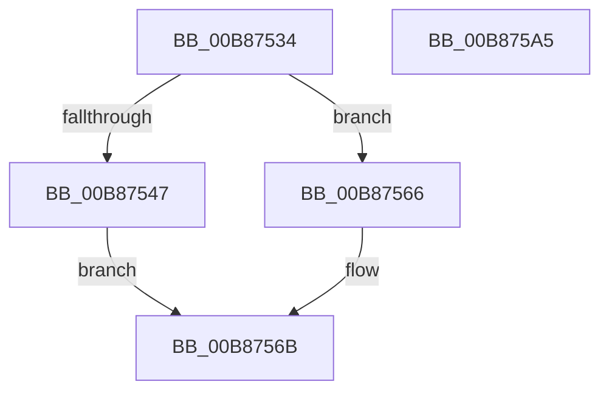

# KdpQueryMemory

- RVA: `0x00B87534`–`0x00B875A6` (길이 `114` bytes)
- VA: `0x0000000140B87534`
- 실행 섹션: `PAGEKD`
- PDB 이름 있음: `예`; PDB Function 태그: `아니요`
- unwind 정보 RVA: `0x0005D2F4`
- 디코드: `28`개 명령, `114/114` bytes 표시
- 미해석 바이트: `0` (있으면 어셈블리에 `.byte`로 보존)

> 이 문서는 커널 이미지의 기계어와 PDB 기호를 분석해 생성했습니다. 4번과 5번은 함수 원형과 자료형을 바이너리 사용 방식에서 추정한 C 해석이며 원본 소스 복구 결과는 아닙니다.

## 1. Dependencies

- 직접 호출 지점: **1**; 고유 호출 대상: **1**
- 직접 호출자로 확인된 함수: **1**
- RIP 상대 이미지 참조: **2**

### Outgoing calls
- `0x00B87594` → `kdcom.dll!KdSendPacket` (import, 간접 대상; import `kdcom.dll!KdSendPacket`)

### Direct callers
- [KdpSendWaitContinue](KdpSendWaitContinue_function_00B8A32C.md) at `0x00B8A65D`

### Static image references
- `0x00B87570` → RVA `0x00F475E0` (`.data`; read)
- `0x00B87594` → RVA `0x001516C0` (`kdcom.dll!KdSendPacket (IAT)`; read)

## 2. Other-region calls and transfers

- 다른 실행 섹션으로 향하는 call: **0**
- 별도 외부 분기/꼬리 이동을 확인하지 못했습니다.

## 3. Assembly (complete function range)

```asm
00B87534  48 83 EC 38                     sub rsp, 0x38
00B87538  33 D2                           xor edx, edx
00B8753A  0F 57 C0                        xorps xmm0, xmm0
00B8753D  0F 11 44 24 20                  movups xmmword ptr [rsp + 0x20], xmm0
00B87542  39 51 20                        cmp dword ptr [rcx + 0x20], edx
00B87545  75 1F                           jne 0x140b87566
00B87547  48 B8 FF FF FE FF FF 7F 00 00   movabs rax, 0x7ffffffeffff
00B87551  C7 41 24 07 00 00 00            mov dword ptr [rcx + 0x24], 7
00B87558  48 3B 41 10                     cmp rax, qword ptr [rcx + 0x10]
00B8755C  1B C0                           sbb eax, eax
00B8755E  83 E0 02                        and eax, 2
00B87561  89 41 20                        mov dword ptr [rcx + 0x20], eax
00B87564  EB 05                           jmp 0x140b8756b
00B87566  BA 0D 00 00 C0                  mov edx, 0xc000000d
00B8756B  48 83 61 18 00                  and qword ptr [rcx + 0x18], 0
00B87570  4C 8D 0D 69 00 3C 00            lea r9, [rip + 0x3c0069]
00B87577  B8 38 00 00 00                  mov eax, 0x38
00B8757C  89 51 08                        mov dword ptr [rcx + 8], edx
00B8757F  48 89 4C 24 28                  mov qword ptr [rsp + 0x28], rcx
00B87584  48 8D 54 24 20                  lea rdx, [rsp + 0x20]
00B87589  45 33 C0                        xor r8d, r8d
00B8758C  66 89 44 24 20                  mov word ptr [rsp + 0x20], ax
00B87591  8D 48 CA                        lea ecx, [rax - 0x36]
00B87594  48 FF 15 25 A1 5C FF            call qword ptr [rip - 0xa35edb]
00B8759B  0F 1F 44 00 00                  nop dword ptr [rax + rax]
00B875A0  48 83 C4 38                     add rsp, 0x38
00B875A4  C3                              ret
00B875A5  CC                              int3
```

## 4. C-style interpretation (structured pseudocode)

```c
__int64 __fastcall KdpQueryMemory(__int64 a1, int a2, int a3)
{
    __int64 result;
    __int64 v_rsp;
    unsigned __int64 v_stack_m10;
    unsigned __int64 v_stack_m18;

    v_rsp = (v_rsp) - (56);
    a2 = 0;
    v_stack_m18 = v_xmm0;
    if ((*(unsigned int *)(a1 + 32)) != 0) goto loc_00B87566;
    *(unsigned int *)(a1 + 36) = 7;
    result = (unsigned int)((result) & (2));
    *(unsigned int *)(a1 + 32) = (unsigned int)(result);
    goto loc_00B8756B;
loc_00B87566:
loc_00B8756B:
    *(unsigned int *)(a1 + 8) = (unsigned int)((unsigned int)(0xC000000DULL));
    v_stack_m10 = a1;
    a3 = 0;
    v_stack_m18 = 56;
    result = kdcom_dll_KdSendPacket(56 - 54, v_stack_m18, a3, v_rip + 3932265);
    v_rsp = (v_rsp) + (56);
    return result;
}
```

## 5. (Beta) C Style

```c
int64_t KdpQueryMemory(void *Arg1, int32_t Arg2, int32_t Arg3)
{
    uint8_t *arg1 = (uint8_t *)Arg1;

    int64_t result;
    int64_t local_rsp;
    uint64_t v_stack_m10;
    uint64_t v_stack_m18;

    local_rsp = (local_rsp) - (56);
    Arg2 = 0;
    v_stack_m18 = v_xmm0;
    if ((*(uint32_t *)(arg1 + 0x20)) != 0) goto loc_00B87566;
    *(uint32_t *)(arg1 + 0x24) = 7;
    result = (uint32_t)((result) & (2));
    *(uint32_t *)(arg1 + 0x20) = (uint32_t)(result);
    goto loc_00B8756B;
loc_00B87566:
loc_00B8756B:
    *(uint32_t *)(arg1 + 0x8) = (uint32_t)((uint32_t)(0xC000000DULL));
    v_stack_m10 = Arg1;
    Arg3 = 0;
    v_stack_m18 = 56;
    result = kernel_indirect_call(56 - 54, v_stack_m18, Arg3, v_rip + 3932265);
    local_rsp = (local_rsp) + (56);
    return result;
}
```

### 관측된 메모리 오프셋

구조체 형식이 확인되지 않은 접근은 인자 기준의 오프셋으로만 기록했습니다.

| 기준 인자 | 오프셋 표현 | 폭 (bit) | 접근 |
|---|---:|---:|---|
| `Arg1` | `+ 0x8` | `32` | `W` |
| `Arg1` | `+ 0x10` | `64` | `R` |
| `Arg1` | `+ 0x18` | `64` | `R/W` |
| `Arg1` | `+ 0x20` | `32` | `R` |
| `Arg1` | `+ 0x20` | `32` | `W` |
| `Arg1` | `+ 0x24` | `32` | `W` |

## 6. Execution-region graph

[열기: 2D/3D 그래프와 함수 탐색 컨트롤 패널](../../../control-panel.html?section=pagekd&rva=0x00B87534&view=graph)

- 2D 그래프는 위에서 아래로 흐르고, 3D 그래프는 빈 공간을 드래그해 회전합니다. Shift+드래그는 이동, 휠은 확대·축소, 함수 노드 선택은 대상 보고서 이동입니다.

### Static fallback


