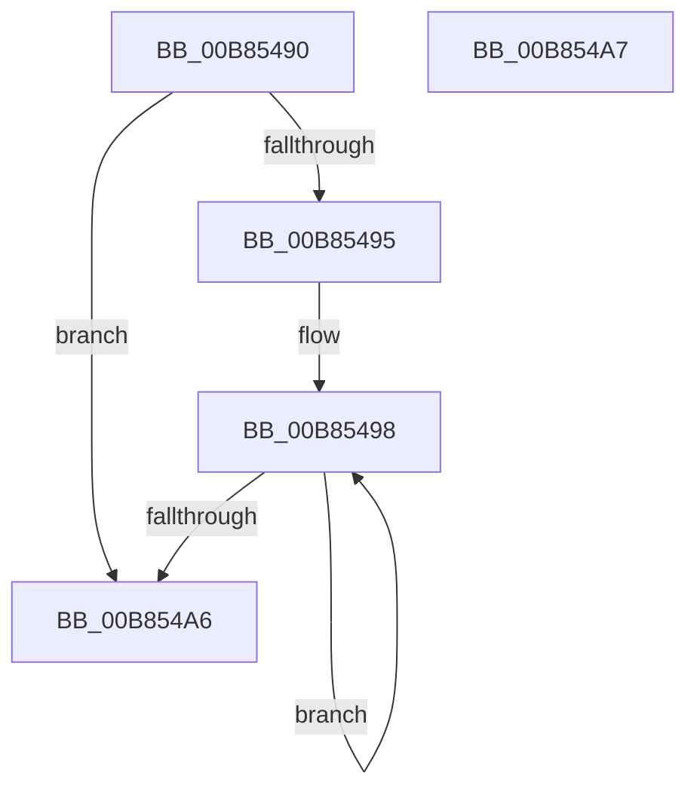

# KdpQuickMoveMemory

- RVA: `0x00B85490`–`0x00B854A8` (길이 `24` bytes)
- VA: `0x0000000140B85490`
- 실행 섹션: `PAGEKD`
- PDB 이름 있음: `예`; PDB Function 태그: `아니요`
- unwind 정보 RVA: `0x000DB714`
- 디코드: `10`개 명령, `24/24` bytes 표시
- 미해석 바이트: `0` (있으면 어셈블리에 `.byte`로 보존)

> 이 문서는 커널 이미지의 기계어와 PDB 기호를 분석해 생성했습니다. 4번과 5번은 함수 원형과 자료형을 바이너리 사용 방식에서 추정한 C 해석이며 원본 소스 복구 결과는 아닙니다.

## 1. Dependencies

- 직접 호출 지점: **0**; 고유 호출 대상: **0**
- 직접 호출자로 확인된 함수: **6**
- RIP 상대 이미지 참조: **0**

### Outgoing calls
- 직접 디코드된 call 명령이 없습니다.

### Direct callers
- [KdpGetContextEx](../../text/5B/KdpGetContextEx_function_005B0C80.md) at `0x005B0CF4`
- [KdpSetContextEx](../../text/5B/KdpSetContextEx_function_005B0D64.md) at `0x005B0E01`
- [KdpCopyContext](KdpCopyContext_function_00B851E8.md) at `0x00B8525B`
- [KdpCopyContext](KdpCopyContext_function_00B851E8.md) at `0x00B852A4`
- [KdpSearchMemory](KdpSearchMemory_function_00B87EF4.md) at `0x00B87F98`
- [KdpPrint](KdpPrint_function_00B88F08.md) at `0x00B88FEE`
- [KdpPrompt](KdpPrompt_function_00B890AC.md) at `0x00B89153`
- [KdpPrompt](KdpPrompt_function_00B890AC.md) at `0x00B891EC`

### Static image references
- 디코드된 RIP-relative 메모리 참조가 없습니다.

## 2. Other-region calls and transfers

- 다른 실행 섹션으로 향하는 call: **0**
- 별도 외부 분기/꼬리 이동을 확인하지 못했습니다.

## 3. Assembly (complete function range)

```asm
00B85490  45 85 C0                        test r8d, r8d
00B85493  74 11                           je 0x140b854a6
00B85495  48 2B CA                        sub rcx, rdx
00B85498  8A 02                           mov al, byte ptr [rdx]
00B8549A  88 04 11                        mov byte ptr [rcx + rdx], al
00B8549D  48 FF C2                        inc rdx
00B854A0  41 83 C0 FF                     add r8d, -1
00B854A4  75 F2                           jne 0x140b85498
00B854A6  C3                              ret
00B854A7  CC                              int3
```

## 4. C-style interpretation (structured pseudocode)

```c
__int64 __fastcall KdpQuickMoveMemory(__int64 a1, __int64 a2, int a3)
{
    if (a3 == 0) goto loc_00B854A6;
    a1 = (a1) - (a2);
loc_00B85498:
    *(unsigned __int8 *)(a1 + a2 * 1) = (unsigned __int8)(*(unsigned __int8 *)(a2));
    a2 = (a2) + 1;
    a3 = (unsigned int)((a3) + (-1));
    if (condition_is_not_equal) goto loc_00B85498;
loc_00B854A6:
    return *(unsigned __int8 *)(a2);
}
```

## 5. (Beta) C Style

```c
int64_t KdpQuickMoveMemory(void *Arg1, int64_t Arg2, int32_t Arg3)
{
    uint8_t *arg1 = (uint8_t *)Arg1;

    if (Arg3 == 0) goto loc_00B854A6;
    Arg1 = (Arg1) - (Arg2);
loc_00B85498:
    *(uint8_t *)(arg1 + Arg2 * 1) = (uint8_t)(*(uint8_t *)(Arg2));
    Arg2 = (Arg2) + 1;
    Arg3 = (uint32_t)((Arg3) + (-1));
    if (condition_is_not_equal) goto loc_00B85498;
loc_00B854A6:
    return *(uint8_t *)(Arg2);
}
```

### 관측된 메모리 오프셋

구조체 형식이 확인되지 않은 접근은 인자 기준의 오프셋으로만 기록했습니다.

| 기준 인자 | 오프셋 표현 | 폭 (bit) | 접근 |
|---|---:|---:|---|
| `Arg1` | `+ 0x0 + rdx*1` | `8` | `W` |

## 6. Execution-region graph

[열기: 2D/3D 그래프와 함수 탐색 컨트롤 패널](../../../control-panel.html?section=pagekd&rva=0x00B85490&view=graph)

- 2D 그래프는 위에서 아래로 흐르고, 3D 그래프는 빈 공간을 드래그해 회전합니다. Shift+드래그는 이동, 휠은 확대·축소, 함수 노드 선택은 대상 보고서 이동입니다.

### Static fallback


