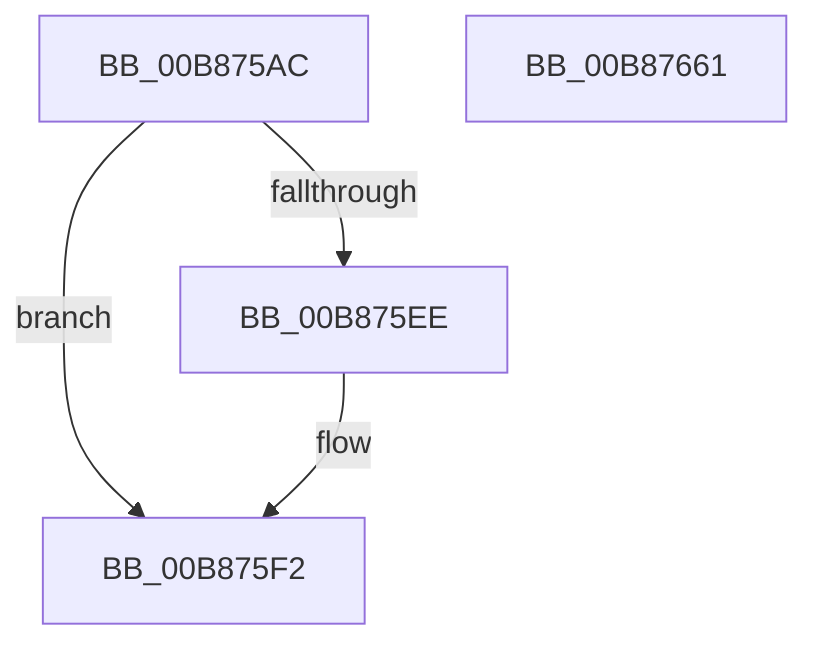

# KdpReadControlSpace

- RVA: `0x00B875AC`–`0x00B87662` (길이 `182` bytes)
- VA: `0x0000000140B875AC`
- 실행 섹션: `PAGEKD`
- PDB 이름 있음: `예`; PDB Function 태그: `아니요`
- unwind 정보 RVA: `0x000C99BC`
- 디코드: `48`개 명령, `182/182` bytes 표시
- 미해석 바이트: `0` (있으면 어셈블리에 `.byte`로 보존)

> 이 문서는 커널 이미지의 기계어와 PDB 기호를 분석해 생성했습니다. 4번과 5번은 함수 원형과 자료형을 바이너리 사용 방식에서 추정한 C 해석이며 원본 소스 복구 결과는 아닙니다.

## 1. Dependencies

- 직접 호출 지점: **2**; 고유 호출 대상: **2**
- 직접 호출자로 확인된 함수: **1**
- RIP 상대 이미지 참조: **3**

### Outgoing calls
- `0x00B8761A` → [KdpSysReadControlSpace](KdpSysReadControlSpace_function_00B89658.md) (function, `0x00B89658`)
- `0x00B87645` → `kdcom.dll!KdSendPacket` (import, 간접 대상; import `kdcom.dll!KdSendPacket`)

### Direct callers
- [KdpSendWaitContinue](KdpSendWaitContinue_function_00B8A32C.md) at `0x00B8A52F`

### Static image references
- `0x00B875DA` → RVA `0x00E0AA48` (`.data`; read)
- `0x00B87623` → RVA `0x00F475E0` (`.data`; read)
- `0x00B87645` → RVA `0x001516C0` (`kdcom.dll!KdSendPacket (IAT)`; read)

## 2. Other-region calls and transfers

- 다른 실행 섹션으로 향하는 call: **0**
- 별도 외부 분기/꼬리 이동을 확인하지 못했습니다.

## 3. Assembly (complete function range)

```asm
00B875AC  48 8B C4                        mov rax, rsp
00B875AF  48 89 58 08                     mov qword ptr [rax + 8], rbx
00B875B3  48 89 70 10                     mov qword ptr [rax + 0x10], rsi
00B875B7  4C 89 40 18                     mov qword ptr [rax + 0x18], r8
00B875BB  57                              push rdi
00B875BC  48 83 EC 40                     sub rsp, 0x40
00B875C0  44 8B 41 18                     mov r8d, dword ptr [rcx + 0x18]
00B875C4  0F 57 C0                        xorps xmm0, xmm0
00B875C7  0F 11 40 E8                     movups xmmword ptr [rax - 0x18], xmm0
00B875CB  48 89 48 F0                     mov qword ptr [rax - 0x10], rcx
00B875CF  48 8B F2                        mov rsi, rdx
00B875D2  BA 38 00 00 00                  mov edx, 0x38
00B875D7  48 8B F9                        mov rdi, rcx
00B875DA  8B 0D 68 34 28 00               mov ecx, dword ptr [rip + 0x283468]
00B875E0  66 89 50 E8                     mov word ptr [rax - 0x18], dx
00B875E4  8B C1                           mov eax, ecx
00B875E6  48 2B C2                        sub rax, rdx
00B875E9  4C 3B C0                        cmp r8, rax
00B875EC  76 04                           jbe 0x140b875f2
00B875EE  44 8D 41 C8                     lea r8d, [rcx - 0x38]
00B875F2  0F B7 5E 02                     movzx ebx, word ptr [rsi + 2]
00B875F6  48 8D 44 24 60                  lea rax, [rsp + 0x60]
00B875FB  0F B7 4F 06                     movzx ecx, word ptr [rdi + 6]
00B875FF  44 3B C3                        cmp r8d, ebx
00B87602  48 8B 57 10                     mov rdx, qword ptr [rdi + 0x10]
00B87606  41 0F 46 D8                     cmovbe ebx, r8d
00B8760A  48 89 44 24 20                  mov qword ptr [rsp + 0x20], rax
00B8760F  4C 8B 46 08                     mov r8, qword ptr [rsi + 8]
00B87613  44 8B CB                        mov r9d, ebx
00B87616  89 5C 24 60                     mov dword ptr [rsp + 0x60], ebx
00B8761A  E8 39 20 00 00                  call 0x140b89658
00B8761F  39 5C 24 60                     cmp dword ptr [rsp + 0x60], ebx
00B87623  4C 8D 0D B6 FF 3B 00            lea r9, [rip + 0x3bffb6]
00B8762A  89 47 08                        mov dword ptr [rdi + 8], eax
00B8762D  48 8D 54 24 30                  lea rdx, [rsp + 0x30]
00B87632  0F 42 5C 24 60                  cmovb ebx, dword ptr [rsp + 0x60]
00B87637  4C 8B C6                        mov r8, rsi
00B8763A  66 89 1E                        mov word ptr [rsi], bx
00B8763D  B9 02 00 00 00                  mov ecx, 2
00B87642  89 5F 1C                        mov dword ptr [rdi + 0x1c], ebx
00B87645  48 FF 15 74 A0 5C FF            call qword ptr [rip - 0xa35f8c]
00B8764C  0F 1F 44 00 00                  nop dword ptr [rax + rax]
00B87651  48 8B 5C 24 50                  mov rbx, qword ptr [rsp + 0x50]
00B87656  48 8B 74 24 58                  mov rsi, qword ptr [rsp + 0x58]
00B8765B  48 83 C4 40                     add rsp, 0x40
00B8765F  5F                              pop rdi
00B87660  C3                              ret
00B87661  CC                              int3
```

## 4. C-style interpretation (structured pseudocode)

```c
__int64 __fastcall KdpReadControlSpace(__int64 a1, __int64 a2, __int64 a3)
{
    __int64 result;
    __int64 v_rbx;
    __int64 v_rsp;
    unsigned __int64 v_stack_m18;
    unsigned __int64 v_stack_m28;
    unsigned __int64 v_stack_p10;
    unsigned __int64 v_stack_p18;
    unsigned __int64 v_stack_p8;

    *(unsigned __int64 *)(v_rsp + 8) = v_rbx;
    *(unsigned __int64 *)(v_rsp + 16) = v_rsi;
    *(unsigned __int64 *)(v_rsp + 24) = a3;
    v_rsp = (v_rsp) - (64);
    *(unsigned __int64 *)(v_rsp - 24) = v_xmm0;
    *(unsigned __int64 *)(v_rsp - 16) = a1;
    *(unsigned __int16 *)(v_rsp - 24) = 56;
    result = ((unsigned int)((unsigned int)((unsigned int)(*(unsigned int *)(v_rip + 2634856))))) - (56);
    if (((unsigned int)(*(unsigned int *)(a1 + 24))) >= = result) {
        a3 = (unsigned int)(*(unsigned int *)(v_rip + 2634856)) - 56;
    }
    v_rbx = *(unsigned __int16 *)(a2 + 2);
    if (((unsigned int)(a3)) <= ((unsigned int)(*(unsigned __int16 *)(a2 + 2)))) { v_rbx = (unsigned int)(a3); }
    v_stack_m28 = v_stack_p18;
    v_stack_p18 = (unsigned int)(v_rbx);
    result = KdpSysReadControlSpace(*(unsigned __int16 *)(a1 + 6), *(unsigned __int64 *)(a1 + 16), *(unsigned __int64 *)(a2 + 8), (unsigned int)((unsigned int)(v_rbx)));
    *(unsigned int *)(a1 + 8) = (unsigned int)(result);
    if (v_stack_p18 < ((unsigned int)(v_rbx))) { v_rbx = v_stack_p18; }
    *(unsigned __int16 *)(a2) = (unsigned __int16)(v_rbx);
    *(unsigned int *)(a1 + 28) = (unsigned int)(v_rbx);
    result = kdcom_dll_KdSendPacket(2, v_stack_m18, a2, v_rip + 3932086);
    v_rsp = (v_rsp) + (64);
    return result;
}
```

## 5. (Beta) C Style

```c
int64_t KdpReadControlSpace(void *Arg1, void *Arg2, int64_t Arg3)
{
    uint8_t *arg1 = (uint8_t *)Arg1;
    uint8_t *arg2 = (uint8_t *)Arg2;

    int64_t result;
    int64_t local_rbx;
    int64_t local_rsp;
    uint64_t v_stack_m18;
    uint64_t v_stack_m28;
    uint64_t v_stack_p10;
    uint64_t v_stack_p18;
    uint64_t v_stack_p8;

    *(uint64_t *)(local_rsp + 0x8) = local_rbx;
    *(uint64_t *)(local_rsp + 0x10) = local_rsi;
    *(uint64_t *)(local_rsp + 0x18) = Arg3;
    local_rsp = (local_rsp) - (64);
    *(uint64_t *)(local_rsp - 0x18) = v_xmm0;
    *(void **)(local_rsp - 0x10) = Arg1;
    *(uint16_t *)(local_rsp - 0x18) = 56;
    result = ((uint32_t)((uint32_t)((uint32_t)(*(uint32_t *)(v_rip + 0x283468))))) - (56);
    if (((uint32_t)(*(uint32_t *)(arg1 + 0x18))) >= = result) {
        Arg3 = (uint32_t)(*(uint32_t *)(v_rip + 0x283468)) - 56;
    }
    local_rbx = *(uint16_t *)(arg2 + 0x2);
    if (((uint32_t)(Arg3)) <= ((uint32_t)(*(uint16_t *)(arg2 + 0x2)))) { local_rbx = (uint32_t)(Arg3); }
    v_stack_m28 = v_stack_p18;
    v_stack_p18 = (uint32_t)(local_rbx);
    result = KdpSysReadControlSpace(*(uint16_t *)(arg1 + 0x6), *(uint64_t *)(arg1 + 0x10), *(uint64_t *)(arg2 + 0x8), (uint32_t)((uint32_t)(local_rbx)));
    *(uint32_t *)(arg1 + 0x8) = (uint32_t)(result);
    if (v_stack_p18 < ((uint32_t)(local_rbx))) { local_rbx = v_stack_p18; }
    *(uint16_t *)(arg2) = (uint16_t)(local_rbx);
    *(uint32_t *)(arg1 + 0x1C) = (uint32_t)(local_rbx);
    result = kernel_indirect_call(2, v_stack_m18, Arg2, v_rip + 3932086);
    local_rsp = (local_rsp) + (64);
    return result;
}
```

### 관측된 메모리 오프셋

구조체 형식이 확인되지 않은 접근은 인자 기준의 오프셋으로만 기록했습니다.

| 기준 인자 | 오프셋 표현 | 폭 (bit) | 접근 |
|---|---:|---:|---|
| `Arg1` | `+ 0x6` | `16` | `R` |
| `Arg1` | `+ 0x8` | `32` | `W` |
| `Arg1` | `+ 0x10` | `64` | `R` |
| `Arg1` | `+ 0x18` | `32` | `R` |
| `Arg1` | `+ 0x1C` | `32` | `W` |
| `Arg2` | `+ 0x0` | `16` | `W` |
| `Arg2` | `+ 0x2` | `16` | `R` |
| `Arg2` | `+ 0x8` | `64` | `R` |

## 6. Execution-region graph

[열기: 2D/3D 그래프와 함수 탐색 컨트롤 패널](../../../control-panel.html?section=pagekd&rva=0x00B875AC&view=graph)

- 2D 그래프는 위에서 아래로 흐르고, 3D 그래프는 빈 공간을 드래그해 회전합니다. Shift+드래그는 이동, 휠은 확대·축소, 함수 노드 선택은 대상 보고서 이동입니다.

### Static fallback


