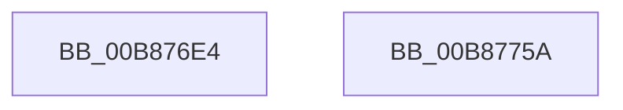

# KdpReadIoSpaceExtended

- RVA: `0x00B876E4`–`0x00B8775B` (길이 `119` bytes)
- VA: `0x0000000140B876E4`
- 실행 섹션: `PAGEKD`
- PDB 이름 있음: `예`; PDB Function 태그: `아니요`
- unwind 정보 RVA: `0x000AF0B0`
- 디코드: `32`개 명령, `119/119` bytes 표시
- 미해석 바이트: `0` (있으면 어셈블리에 `.byte`로 보존)

> 이 문서는 커널 이미지의 기계어와 PDB 기호를 분석해 생성했습니다. 4번과 5번은 함수 원형과 자료형을 바이너리 사용 방식에서 추정한 C 해석이며 원본 소스 복구 결과는 아닙니다.

## 1. Dependencies

- 직접 호출 지점: **2**; 고유 호출 대상: **2**
- 직접 호출자로 확인된 함수: **1**
- RIP 상대 이미지 참조: **2**

### Outgoing calls
- `0x00B8772D` → [KdpSysReadIoSpace](../../text/5B/KdpSysReadIoSpace_function_005B11EC.md) (function, `0x005B11EC`)
- `0x00B87748` → `kdcom.dll!KdSendPacket` (import, 간접 대상; import `kdcom.dll!KdSendPacket`)

### Direct callers
- [KdpSendWaitContinue](KdpSendWaitContinue_function_00B8A32C.md) at `0x00B8A56B`

### Static image references
- `0x00B87738` → RVA `0x00F475E0` (`.data`; read)
- `0x00B87748` → RVA `0x001516C0` (`kdcom.dll!KdSendPacket (IAT)`; read)

## 2. Other-region calls and transfers

- 다른 실행 섹션으로 향하는 call: **1**
  - `0x00B8772D` → [KdpSysReadIoSpace](../../text/5B/KdpSysReadIoSpace_function_005B11EC.md) (`PAGEKD` → `.text`)
- 별도 외부 분기/꼬리 이동을 확인하지 못했습니다.

## 3. Assembly (complete function range)

```asm
00B876E4  4C 8B DC                        mov r11, rsp
00B876E7  53                              push rbx
00B876E8  48 83 EC 50                     sub rsp, 0x50
00B876EC  4C 8B 49 20                     mov r9, qword ptr [rcx + 0x20]
00B876F0  48 8D 51 28                     lea rdx, [rcx + 0x28]
00B876F4  83 22 00                        and dword ptr [rdx], 0
00B876F7  B8 38 00 00 00                  mov eax, 0x38
00B876FC  44 8B 41 1C                     mov r8d, dword ptr [rcx + 0x1c]
00B87700  48 8B D9                        mov rbx, rcx
00B87703  0F 57 C0                        xorps xmm0, xmm0
00B87706  0F 11 44 24 40                  movups xmmword ptr [rsp + 0x40], xmm0
00B8770B  66 89 44 24 40                  mov word ptr [rsp + 0x40], ax
00B87710  49 8D 43 18                     lea rax, [r11 + 0x18]
00B87714  49 89 43 D8                     mov qword ptr [r11 - 0x28], rax
00B87718  8B 41 10                        mov eax, dword ptr [rcx + 0x10]
00B8771B  89 44 24 28                     mov dword ptr [rsp + 0x28], eax
00B8771F  49 89 53 C8                     mov qword ptr [r11 - 0x38], rdx
00B87723  8B 51 18                        mov edx, dword ptr [rcx + 0x18]
00B87726  49 89 4B F0                     mov qword ptr [r11 - 0x10], rcx
00B8772A  8B 49 14                        mov ecx, dword ptr [rcx + 0x14]
00B8772D  E8 BA 9A A2 FF                  call 0x1405b11ec
00B87732  45 33 C0                        xor r8d, r8d
00B87735  89 43 08                        mov dword ptr [rbx + 8], eax
00B87738  4C 8D 0D A1 FE 3B 00            lea r9, [rip + 0x3bfea1]
00B8773F  48 8D 54 24 40                  lea rdx, [rsp + 0x40]
00B87744  41 8D 48 02                     lea ecx, [r8 + 2]
00B87748  48 FF 15 71 9F 5C FF            call qword ptr [rip - 0xa3608f]
00B8774F  0F 1F 44 00 00                  nop dword ptr [rax + rax]
00B87754  48 83 C4 50                     add rsp, 0x50
00B87758  5B                              pop rbx
00B87759  C3                              ret
00B8775A  CC                              int3
```

## 4. C-style interpretation (structured pseudocode)

```c
__int64 __fastcall KdpReadIoSpaceExtended(__int64 a1)
{
    __int64 result;
    __int64 v_rsp;
    unsigned __int64 v_stack_m18;
    unsigned int v_stack_m30;

    v_rsp = (v_rsp) - (80);
    v_stack_m18 = v_xmm0;
    v_stack_m18 = 56;
    *(unsigned __int64 *)(v_rsp - 40) = v_rsp + 24;
    v_stack_m30 = (unsigned int)((unsigned int)(*(unsigned int *)(a1 + 16)));
    *(unsigned __int64 *)(v_rsp - 56) = a1 + 40;
    *(unsigned __int64 *)(v_rsp - 16) = a1;
    result = KdpSysReadIoSpace((unsigned int)(*(unsigned int *)(a1 + 20)), (unsigned int)(*(unsigned int *)(a1 + 24)), (unsigned int)(*(unsigned int *)(a1 + 28)), *(unsigned __int64 *)(a1 + 32));
    a3 = 0;
    *(unsigned int *)(a1 + 8) = (unsigned int)(result);
    result = kdcom_dll_KdSendPacket(a3 + 2, v_stack_m18, a3, v_rip + 3931809);
    v_rsp = (v_rsp) + (80);
    return result;
}
```

## 5. (Beta) C Style

```c
int64_t KdpReadIoSpaceExtended(void *Arg1)
{
    uint8_t *arg1 = (uint8_t *)Arg1;

    int64_t result;
    int64_t local_rsp;
    uint64_t v_stack_m18;
    uint32_t v_stack_m30;

    local_rsp = (local_rsp) - (80);
    v_stack_m18 = v_xmm0;
    v_stack_m18 = 56;
    *(uint64_t *)(local_rsp - 0x28) = local_rsp + 24;
    v_stack_m30 = (uint32_t)((uint32_t)(*(uint32_t *)(arg1 + 0x10)));
    *(void **)(local_rsp - 0x38) = Arg1 + 40;
    *(void **)(local_rsp - 0x10) = Arg1;
    result = KdpSysReadIoSpace((uint32_t)(*(uint32_t *)(arg1 + 0x14)), (uint32_t)(*(uint32_t *)(arg1 + 0x18)), (uint32_t)(*(uint32_t *)(arg1 + 0x1C)), *(uint64_t *)(arg1 + 0x20));
    a3 = 0;
    *(uint32_t *)(arg1 + 0x8) = (uint32_t)(result);
    result = kernel_indirect_call(a3 + 2, v_stack_m18, a3, v_rip + 3931809);
    local_rsp = (local_rsp) + (80);
    return result;
}
```

### 관측된 메모리 오프셋

구조체 형식이 확인되지 않은 접근은 인자 기준의 오프셋으로만 기록했습니다.

| 기준 인자 | 오프셋 표현 | 폭 (bit) | 접근 |
|---|---:|---:|---|
| `Arg1` | `+ 0x0` | `32` | `R/W` |
| `Arg1` | `+ 0x8` | `32` | `W` |
| `Arg1` | `+ 0x10` | `32` | `R` |
| `Arg1` | `+ 0x14` | `32` | `R` |
| `Arg1` | `+ 0x18` | `32` | `R` |
| `Arg1` | `+ 0x1C` | `32` | `R` |
| `Arg1` | `+ 0x20` | `64` | `R` |
| `Arg1` | `+ 0x28` | `64` | `R` |

## 6. Execution-region graph

[열기: 2D/3D 그래프와 함수 탐색 컨트롤 패널](../../../control-panel.html?section=pagekd&rva=0x00B876E4&view=graph)

- 2D 그래프는 위에서 아래로 흐르고, 3D 그래프는 빈 공간을 드래그해 회전합니다. Shift+드래그는 이동, 휠은 확대·축소, 함수 노드 선택은 대상 보고서 이동입니다.

### Static fallback


