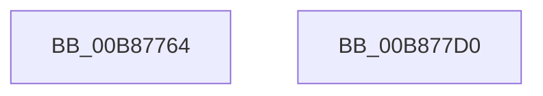

# KdpReadMachineSpecificRegister

- RVA: `0x00B87764`–`0x00B877D1` (길이 `109` bytes)
- VA: `0x0000000140B87764`
- 실행 섹션: `PAGEKD`
- PDB 이름 있음: `예`; PDB Function 태그: `아니요`
- unwind 정보 RVA: `0x000C99A0`
- 디코드: `29`개 명령, `109/109` bytes 표시
- 미해석 바이트: `0` (있으면 어셈블리에 `.byte`로 보존)

> 이 문서는 커널 이미지의 기계어와 PDB 기호를 분석해 생성했습니다. 4번과 5번은 함수 원형과 자료형을 바이너리 사용 방식에서 추정한 C 해석이며 원본 소스 복구 결과는 아닙니다.

## 1. Dependencies

- 직접 호출 지점: **2**; 고유 호출 대상: **2**
- 직접 호출자로 확인된 함수: **1**
- RIP 상대 이미지 참조: **2**

### Outgoing calls
- `0x00B87795` → [KdpSysReadMsr](../../text/5B/KdpSysReadMsr_function_005B12B0.md) (function, `0x005B12B0`)
- `0x00B877BE` → `kdcom.dll!KdSendPacket` (import, 간접 대상; import `kdcom.dll!KdSendPacket`)

### Direct callers
- [KdpSendWaitContinue](KdpSendWaitContinue_function_00B8A32C.md) at `0x00B8A587`

### Static image references
- `0x00B8779D` → RVA `0x00F475E0` (`.data`; read)
- `0x00B877BE` → RVA `0x001516C0` (`kdcom.dll!KdSendPacket (IAT)`; read)

## 2. Other-region calls and transfers

- 다른 실행 섹션으로 향하는 call: **1**
  - `0x00B87795` → [KdpSysReadMsr](../../text/5B/KdpSysReadMsr_function_005B12B0.md) (`PAGEKD` → `.text`)
- 별도 외부 분기/꼬리 이동을 확인하지 못했습니다.

## 3. Assembly (complete function range)

```asm
00B87764  4C 8B DC                        mov r11, rsp
00B87767  4D 89 43 18                     mov qword ptr [r11 + 0x18], r8
00B8776B  53                              push rbx
00B8776C  48 83 EC 30                     sub rsp, 0x30
00B87770  49 83 63 18 00                  and qword ptr [r11 + 0x18], 0
00B87775  49 8D 53 18                     lea rdx, [r11 + 0x18]
00B87779  0F 57 C0                        xorps xmm0, xmm0
00B8777C  B8 38 00 00 00                  mov eax, 0x38
00B87781  0F 11 44 24 20                  movups xmmword ptr [rsp + 0x20], xmm0
00B87786  66 89 44 24 20                  mov word ptr [rsp + 0x20], ax
00B8778B  48 8B D9                        mov rbx, rcx
00B8778E  49 89 4B F0                     mov qword ptr [r11 - 0x10], rcx
00B87792  8B 49 10                        mov ecx, dword ptr [rcx + 0x10]
00B87795  E8 16 9B A2 FF                  call 0x1405b12b0
00B8779A  89 43 08                        mov dword ptr [rbx + 8], eax
00B8779D  4C 8D 0D 3C FE 3B 00            lea r9, [rip + 0x3bfe3c]
00B877A4  8B 44 24 50                     mov eax, dword ptr [rsp + 0x50]
00B877A8  48 8D 54 24 20                  lea rdx, [rsp + 0x20]
00B877AD  45 33 C0                        xor r8d, r8d
00B877B0  89 43 14                        mov dword ptr [rbx + 0x14], eax
00B877B3  8B 44 24 54                     mov eax, dword ptr [rsp + 0x54]
00B877B7  89 43 18                        mov dword ptr [rbx + 0x18], eax
00B877BA  41 8D 48 02                     lea ecx, [r8 + 2]
00B877BE  48 FF 15 FB 9E 5C FF            call qword ptr [rip - 0xa36105]
00B877C5  0F 1F 44 00 00                  nop dword ptr [rax + rax]
00B877CA  48 83 C4 30                     add rsp, 0x30
00B877CE  5B                              pop rbx
00B877CF  C3                              ret
00B877D0  CC                              int3
```

## 4. C-style interpretation (structured pseudocode)

```c
__int64 __fastcall KdpReadMachineSpecificRegister(__int64 a1, __int64 a2, __int64 a3)
{
    __int64 result;
    __int64 v_rsp;
    unsigned __int64 v_stack_m18;
    unsigned int v_stack_p18;
    unsigned int v_stack_p1C;

    *(unsigned __int64 *)(v_rsp + 24) = a3;
    v_rsp = (v_rsp) - (48);
    v_stack_m18 = v_xmm0;
    v_stack_m18 = 56;
    *(unsigned __int64 *)(v_rsp - 16) = a1;
    result = KdpSysReadMsr((unsigned int)(*(unsigned int *)(a1 + 16)), v_rsp + 24, a3, a4);
    *(unsigned int *)(a1 + 8) = (unsigned int)(result);
    a3 = 0;
    *(unsigned int *)(a1 + 20) = (unsigned int)((unsigned int)(v_stack_p18));
    *(unsigned int *)(a1 + 24) = (unsigned int)((unsigned int)(v_stack_p1C));
    result = kdcom_dll_KdSendPacket(a3 + 2, v_stack_m18, a3, v_rip + 3931708);
    v_rsp = (v_rsp) + (48);
    return result;
}
```

## 5. (Beta) C Style

```c
int64_t KdpReadMachineSpecificRegister(void *Arg1, int64_t Arg2, int64_t Arg3)
{
    uint8_t *arg1 = (uint8_t *)Arg1;

    int64_t result;
    int64_t local_rsp;
    uint64_t v_stack_m18;
    uint32_t v_stack_p18;
    uint32_t v_stack_p1C;

    *(uint64_t *)(local_rsp + 0x18) = Arg3;
    local_rsp = (local_rsp) - (48);
    v_stack_m18 = v_xmm0;
    v_stack_m18 = 56;
    *(void **)(local_rsp - 0x10) = Arg1;
    result = KdpSysReadMsr((uint32_t)(*(uint32_t *)(arg1 + 0x10)), local_rsp + 24, Arg3, a4);
    *(uint32_t *)(arg1 + 0x8) = (uint32_t)(result);
    Arg3 = 0;
    *(uint32_t *)(arg1 + 0x14) = (uint32_t)((uint32_t)(v_stack_p18));
    *(uint32_t *)(arg1 + 0x18) = (uint32_t)((uint32_t)(v_stack_p1C));
    result = kernel_indirect_call(Arg3 + 2, v_stack_m18, Arg3, v_rip + 3931708);
    local_rsp = (local_rsp) + (48);
    return result;
}
```

### 관측된 메모리 오프셋

구조체 형식이 확인되지 않은 접근은 인자 기준의 오프셋으로만 기록했습니다.

| 기준 인자 | 오프셋 표현 | 폭 (bit) | 접근 |
|---|---:|---:|---|
| `Arg1` | `+ 0x8` | `32` | `W` |
| `Arg1` | `+ 0x10` | `32` | `R` |
| `Arg1` | `+ 0x14` | `32` | `W` |
| `Arg1` | `+ 0x18` | `32` | `W` |

## 6. Execution-region graph

[열기: 2D/3D 그래프와 함수 탐색 컨트롤 패널](../../../control-panel.html?section=pagekd&rva=0x00B87764&view=graph)

- 2D 그래프는 위에서 아래로 흐르고, 3D 그래프는 빈 공간을 드래그해 회전합니다. Shift+드래그는 이동, 휠은 확대·축소, 함수 노드 선택은 대상 보고서 이동입니다.

### Static fallback


