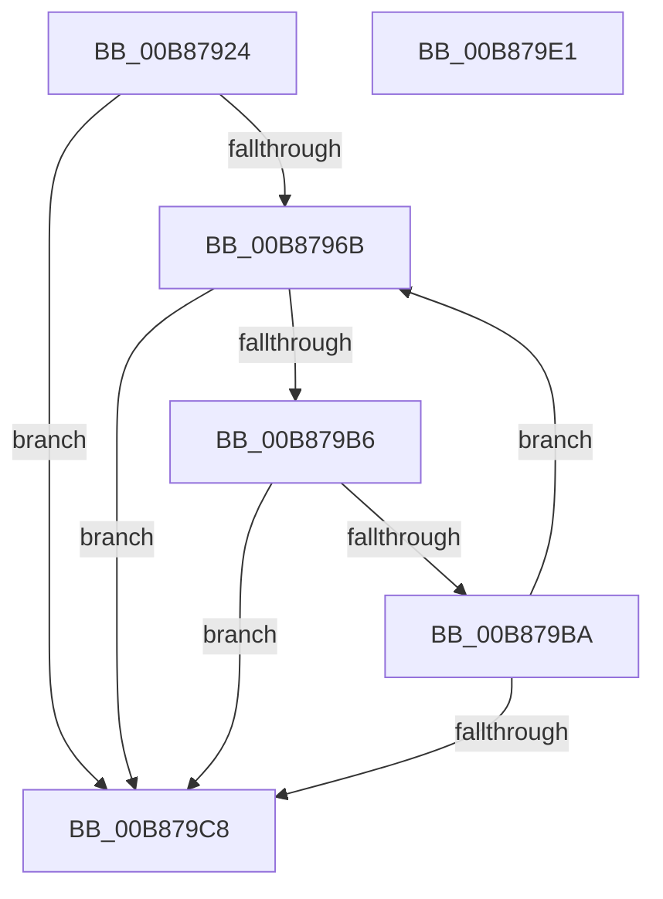

# KdpReadPhysicalMemoryLong

- RVA: `0x00B87924`–`0x00B879E2` (길이 `190` bytes)
- VA: `0x0000000140B87924`
- 실행 섹션: `PAGEKD`
- PDB 이름 있음: `예`; PDB Function 태그: `아니요`
- unwind 정보 RVA: `0x00093E28`
- 디코드: `56`개 명령, `190/190` bytes 표시
- 미해석 바이트: `0` (있으면 어셈블리에 `.byte`로 보존)

> 이 문서는 커널 이미지의 기계어와 PDB 기호를 분석해 생성했습니다. 4번과 5번은 함수 원형과 자료형을 바이너리 사용 방식에서 추정한 C 해석이며 원본 소스 복구 결과는 아닙니다.

## 1. Dependencies

- 직접 호출 지점: **1**; 고유 호출 대상: **1**
- 직접 호출자로 확인된 함수: **1**
- RIP 상대 이미지 참조: **2**

### Outgoing calls
- `0x00B87992` → [KdpReadPhysicalMemory](KdpReadPhysicalMemory_function_00B877D8.md) (function, `0x00B877D8`)

### Direct callers
- [KdpSendWaitContinue](KdpSendWaitContinue_function_00B8A32C.md) at `0x00B8A48D`

### Static image references
- `0x00B8793C` → RVA `0x00F475E0` (`.data`; read)
- `0x00B87949` → RVA `0x00F475F0` (`.data`; read)

## 2. Other-region calls and transfers

- 다른 실행 섹션으로 향하는 call: **0**
- 별도 외부 분기/꼬리 이동을 확인하지 못했습니다.

## 3. Assembly (complete function range)

```asm
00B87924  48 8B C4                        mov rax, rsp
00B87927  48 89 58 08                     mov qword ptr [rax + 8], rbx
00B8792B  48 89 68 10                     mov qword ptr [rax + 0x10], rbp
00B8792F  48 89 70 18                     mov qword ptr [rax + 0x18], rsi
00B87933  57                              push rdi
00B87934  41 56                           push r14
00B87936  41 57                           push r15
00B87938  48 83 EC 40                     sub rsp, 0x40
00B8793C  0F 10 05 9D FC 3B 00            movups xmm0, xmmword ptr [rip + 0x3bfc9d]
00B87943  45 33 FF                        xor r15d, r15d
00B87946  8B 59 18                        mov ebx, dword ptr [rcx + 0x18]
00B87949  F2 0F 10 0D 9F FC 3B 00         movsd xmm1, qword ptr [rip + 0x3bfc9f]
00B87951  4C 8B F2                        mov r14, rdx
00B87954  48 8B 71 10                     mov rsi, qword ptr [rcx + 0x10]
00B87958  48 8B F9                        mov rdi, rcx
00B8795B  8B 69 1C                        mov ebp, dword ptr [rcx + 0x1c]
00B8795E  F2 0F 11 48 D8                  movsd qword ptr [rax - 0x28], xmm1
00B87963  0F 11 40 C8                     movups xmmword ptr [rax - 0x38], xmm0
00B87967  85 DB                           test ebx, ebx
00B87969  74 5D                           je 0x140b879c8
00B8796B  48 89 77 10                     mov qword ptr [rdi + 0x10], rsi
00B8796F  4C 8D 4C 24 20                  lea r9, [rsp + 0x20]
00B87974  89 5F 18                        mov dword ptr [rdi + 0x18], ebx
00B87977  B8 0D 00 00 00                  mov eax, 0xd
00B8797C  89 6F 1C                        mov dword ptr [rdi + 0x1c], ebp
00B8797F  49 8B D6                        mov rdx, r14
00B87982  66 45 89 3E                     mov word ptr [r14], r15w
00B87986  48 8B CF                        mov rcx, rdi
00B87989  44 89 7F 08                     mov dword ptr [rdi + 8], r15d
00B8798D  66 89 44 24 26                  mov word ptr [rsp + 0x26], ax
00B87992  E8 41 FE FF FF                  call 0x140b877d8
00B87997  8B 4F 1C                        mov ecx, dword ptr [rdi + 0x1c]
00B8799A  8B C1                           mov eax, ecx
00B8799C  25 00 00 00 C0                  and eax, 0xc0000000
00B879A1  3D 00 00 00 40                  cmp eax, 0x40000000
00B879A6  8D 14 8D 00 00 00 00            lea edx, [rcx*4]
00B879AD  0F 45 D1                        cmovne edx, ecx
00B879B0  44 39 7F 08                     cmp dword ptr [rdi + 8], r15d
00B879B4  7C 12                           jl 0x140b879c8
00B879B6  85 D2                           test edx, edx
00B879B8  74 0E                           je 0x140b879c8
00B879BA  8B C3                           mov eax, ebx
00B879BC  3B D3                           cmp edx, ebx
00B879BE  0F 46 C2                        cmovbe eax, edx
00B879C1  48 03 F0                        add rsi, rax
00B879C4  2B D8                           sub ebx, eax
00B879C6  75 A3                           jne 0x140b8796b
00B879C8  48 8B 5C 24 60                  mov rbx, qword ptr [rsp + 0x60]
00B879CD  48 8B 6C 24 68                  mov rbp, qword ptr [rsp + 0x68]
00B879D2  48 8B 74 24 70                  mov rsi, qword ptr [rsp + 0x70]
00B879D7  48 83 C4 40                     add rsp, 0x40
00B879DB  41 5F                           pop r15
00B879DD  41 5E                           pop r14
00B879DF  5F                              pop rdi
00B879E0  C3                              ret
00B879E1  CC                              int3
```

## 4. C-style interpretation (structured pseudocode)

```c
__int64 __fastcall KdpReadPhysicalMemoryLong(__int64 a1, __int64 a2)
{
    __int64 result;
    __int64 v_r15;
    __int64 v_rbx;
    __int64 v_rsi;
    __int64 v_rsp;
    unsigned __int16 v_stack_m32;
    unsigned __int64 v_stack_m38;
    unsigned __int64 v_stack_p10;
    unsigned __int64 v_stack_p18;
    unsigned __int64 v_stack_p8;

    *(unsigned __int64 *)(v_rsp + 8) = v_rbx;
    *(unsigned __int64 *)(v_rsp + 16) = v_rbp;
    *(unsigned __int64 *)(v_rsp + 24) = v_rsi;
    v_rsp = (v_rsp) - (64);
    v_r15 = 0;
    *(unsigned __int64 *)(v_rsp - 40) = v_xmm1;
    *(unsigned __int64 *)(v_rsp - 56) = v_xmm0;
    if ((unsigned int)((unsigned int)(*(unsigned int *)(a1 + 24))) == 0) goto loc_00B879C8;
loc_00B8796B:
    *(unsigned __int64 *)(a1 + 16) = *(unsigned __int64 *)(a1 + 16);
    *(unsigned int *)(a1 + 24) = (unsigned int)((unsigned int)(*(unsigned int *)(a1 + 24)));
    *(unsigned int *)(a1 + 28) = (unsigned int)((unsigned int)(*(unsigned int *)(a1 + 28)));
    *(unsigned __int16 *)(a2) = 0;
    *(unsigned int *)(a1 + 8) = 0;
    v_stack_m32 = 13;
    result = KdpReadPhysicalMemory(a1, a2, a3, v_stack_m38);
    result = (unsigned int)(((unsigned int)((unsigned int)((unsigned int)(*(unsigned int *)(a1 + 28))))) & (0xC0000000ULL));
    a2 = (unsigned int)(*(unsigned int *)(a1 + 28)) * 4;
    if (((unsigned int)(result)) != 0x40000000ULL) { a2 = (unsigned int)((unsigned int)(*(unsigned int *)(a1 + 28))); }
    if ((*(unsigned int *)(a1 + 8)) < 0) goto loc_00B879C8;
    if ((unsigned int)(a2) == 0) goto loc_00B879C8;
    result = (unsigned int)((unsigned int)((unsigned int)(*(unsigned int *)(a1 + 24))));
    if (((unsigned int)(a2)) <= ((unsigned int)((unsigned int)(*(unsigned int *)(a1 + 24))))) { result = (unsigned int)(a2); }
    v_rsi = (*(unsigned __int64 *)(a1 + 16)) + (result);
    v_rbx = (unsigned int)(((unsigned int)(*(unsigned int *)(a1 + 24))) - ((unsigned int)(result)));
    if (condition_is_not_equal) goto loc_00B8796B;
loc_00B879C8:
    v_rsp = (v_rsp) + (64);
    return result;
}
```

## 5. (Beta) C Style

```c
int64_t KdpReadPhysicalMemoryLong(void *Arg1, void *Arg2)
{
    uint8_t *arg1 = (uint8_t *)Arg1;
    uint8_t *arg2 = (uint8_t *)Arg2;

    int64_t result;
    int64_t local_r15;
    int64_t local_rbx;
    int64_t local_rsi;
    int64_t local_rsp;
    uint16_t v_stack_m32;
    uint64_t v_stack_m38;
    uint64_t v_stack_p10;
    uint64_t v_stack_p18;
    uint64_t v_stack_p8;

    *(uint64_t *)(local_rsp + 0x8) = local_rbx;
    *(uint64_t *)(local_rsp + 0x10) = local_rbp;
    *(uint64_t *)(local_rsp + 0x18) = local_rsi;
    local_rsp = (local_rsp) - (64);
    local_r15 = 0;
    *(uint64_t *)(local_rsp - 0x28) = v_xmm1;
    *(uint64_t *)(local_rsp - 0x38) = v_xmm0;
    if ((uint32_t)((uint32_t)(*(uint32_t *)(arg1 + 0x18))) == 0) goto loc_00B879C8;
loc_00B8796B:
    *(uint64_t *)(arg1 + 0x10) = *(uint64_t *)(arg1 + 0x10);
    *(uint32_t *)(arg1 + 0x18) = (uint32_t)((uint32_t)(*(uint32_t *)(arg1 + 0x18)));
    *(uint32_t *)(arg1 + 0x1C) = (uint32_t)((uint32_t)(*(uint32_t *)(arg1 + 0x1C)));
    *(uint16_t *)(arg2) = 0;
    *(uint32_t *)(arg1 + 0x8) = 0;
    v_stack_m32 = 13;
    result = KdpReadPhysicalMemory(Arg1, Arg2, a3, v_stack_m38);
    result = (uint32_t)(((uint32_t)((uint32_t)((uint32_t)(*(uint32_t *)(arg1 + 0x1C))))) & (0xC0000000ULL));
    Arg2 = (uint32_t)(*(uint32_t *)(arg1 + 0x1C)) * 4;
    if (((uint32_t)(result)) != 0x40000000ULL) { Arg2 = (uint32_t)((uint32_t)(*(uint32_t *)(arg1 + 0x1C))); }
    if ((*(uint32_t *)(arg1 + 0x8)) < 0) goto loc_00B879C8;
    if ((uint32_t)(Arg2) == 0) goto loc_00B879C8;
    result = (uint32_t)((uint32_t)((uint32_t)(*(uint32_t *)(arg1 + 0x18))));
    if (((uint32_t)(Arg2)) <= ((uint32_t)((uint32_t)(*(uint32_t *)(arg1 + 0x18))))) { result = (uint32_t)(Arg2); }
    local_rsi = (*(uint64_t *)(arg1 + 0x10)) + (result);
    local_rbx = (uint32_t)(((uint32_t)(*(uint32_t *)(arg1 + 0x18))) - ((uint32_t)(result)));
    if (condition_is_not_equal) goto loc_00B8796B;
loc_00B879C8:
    local_rsp = (local_rsp) + (64);
    return result;
}
```

### 관측된 메모리 오프셋

구조체 형식이 확인되지 않은 접근은 인자 기준의 오프셋으로만 기록했습니다.

| 기준 인자 | 오프셋 표현 | 폭 (bit) | 접근 |
|---|---:|---:|---|
| `Arg1` | `+ 0x8` | `32` | `R` |
| `Arg1` | `+ 0x8` | `32` | `W` |
| `Arg1` | `+ 0x10` | `64` | `R` |
| `Arg1` | `+ 0x10` | `64` | `W` |
| `Arg1` | `+ 0x18` | `32` | `R` |
| `Arg1` | `+ 0x18` | `32` | `W` |
| `Arg1` | `+ 0x1C` | `32` | `R` |
| `Arg1` | `+ 0x1C` | `32` | `W` |
| `Arg2` | `+ 0x0` | `16` | `W` |

## 6. Execution-region graph

[열기: 2D/3D 그래프와 함수 탐색 컨트롤 패널](../../../control-panel.html?section=pagekd&rva=0x00B87924&view=graph)

- 2D 그래프는 위에서 아래로 흐르고, 3D 그래프는 빈 공간을 드래그해 회전합니다. Shift+드래그는 이동, 휠은 확대·축소, 함수 노드 선택은 대상 보고서 이동입니다.

### Static fallback


