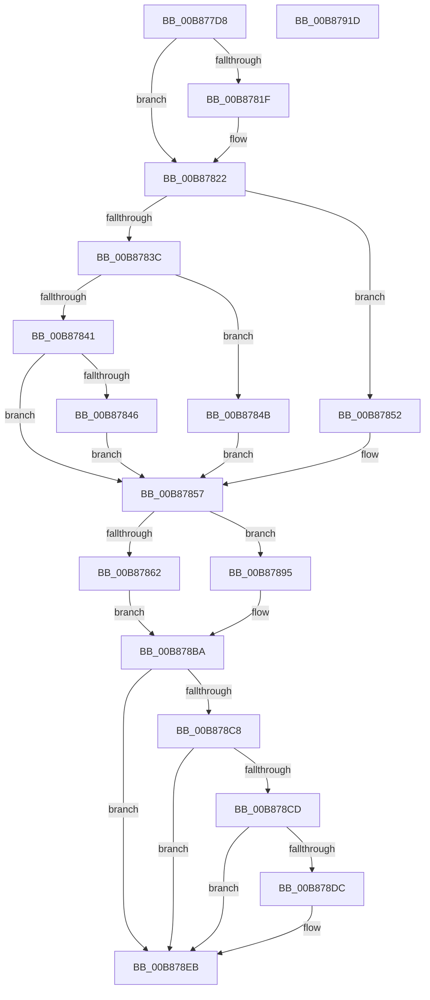

# KdpReadPhysicalMemory

- RVA: `0x00B877D8`–`0x00B8791E` (길이 `326` bytes)
- VA: `0x0000000140B877D8`
- 실행 섹션: `PAGEKD`
- PDB 이름 있음: `예`; PDB Function 태그: `아니요`
- unwind 정보 RVA: `0x000C99D0`
- 디코드: `97`개 명령, `326/326` bytes 표시
- 미해석 바이트: `0` (있으면 어셈블리에 `.byte`로 보존)

> 이 문서는 커널 이미지의 기계어와 PDB 기호를 분석해 생성했습니다. 4번과 5번은 함수 원형과 자료형을 바이너리 사용 방식에서 추정한 C 해석이며 원본 소스 복구 결과는 아닙니다.

## 1. Dependencies

- 직접 호출 지점: **4**; 고유 호출 대상: **4**
- 직접 호출자로 확인된 함수: **2**
- RIP 상대 이미지 참조: **2**

### Outgoing calls
- `0x00B87888` → [MmDbgCopyMemory](../../text/68/MmDbgCopyMemory_function_006861E8.md) (function, `0x006861E8`)
- `0x00B878B1` → [KdpCopyMemoryChunks](KdpCopyMemoryChunks_function_00B8AACC.md) (function, `0x00B8AACC`)
- `0x00B878D3` → [RunLengthEncode](../../text/5B/RunLengthEncode_function_005B0F10.md) (function, `0x005B0F10`)
- `0x00B878FE` → `kdcom.dll!KdSendPacket` (import, 간접 대상; import `kdcom.dll!KdSendPacket`)

### Direct callers
- [KdpReadPhysicalMemoryLong](KdpReadPhysicalMemoryLong_function_00B87924.md) at `0x00B87992`
- [KdpSendWaitContinue](KdpSendWaitContinue_function_00B8A32C.md) at `0x00B8A47B`

### Static image references
- `0x00B87808` → RVA `0x00E0AA48` (`.data`; read)
- `0x00B878FE` → RVA `0x001516C0` (`kdcom.dll!KdSendPacket (IAT)`; read)

## 2. Other-region calls and transfers

- 다른 실행 섹션으로 향하는 call: **2**
  - `0x00B87888` → [MmDbgCopyMemory](../../text/68/MmDbgCopyMemory_function_006861E8.md) (`PAGEKD` → `.text`)
  - `0x00B878D3` → [RunLengthEncode](../../text/5B/RunLengthEncode_function_005B0F10.md) (`PAGEKD` → `.text`)
- 별도 외부 분기/꼬리 이동을 확인하지 못했습니다.

## 3. Assembly (complete function range)

```asm
00B877D8  48 8B C4                        mov rax, rsp
00B877DB  48 89 58 08                     mov qword ptr [rax + 8], rbx
00B877DF  48 89 68 10                     mov qword ptr [rax + 0x10], rbp
00B877E3  4C 89 40 18                     mov qword ptr [rax + 0x18], r8
00B877E7  56                              push rsi
00B877E8  57                              push rdi
00B877E9  41 57                           push r15
00B877EB  48 83 EC 40                     sub rsp, 0x40
00B877EF  8B 59 18                        mov ebx, dword ptr [rcx + 0x18]
00B877F2  0F 57 C0                        xorps xmm0, xmm0
00B877F5  0F 11 40 D8                     movups xmmword ptr [rax - 0x28], xmm0
00B877F9  48 89 48 E0                     mov qword ptr [rax - 0x20], rcx
00B877FD  48 8B F2                        mov rsi, rdx
00B87800  BA 38 00 00 00                  mov edx, 0x38
00B87805  48 8B F9                        mov rdi, rcx
00B87808  8B 0D 3A 32 28 00               mov ecx, dword ptr [rip + 0x28323a]
00B8780E  49 8B E9                        mov rbp, r9
00B87811  66 89 50 D8                     mov word ptr [rax - 0x28], dx
00B87815  8B C1                           mov eax, ecx
00B87817  48 2B C2                        sub rax, rdx
00B8781A  48 3B D8                        cmp rbx, rax
00B8781D  76 03                           jbe 0x140b87822
00B8781F  8D 59 C8                        lea ebx, [rcx - 0x38]
00B87822  0F B7 46 02                     movzx eax, word ptr [rsi + 2]
00B87826  BA 06 00 00 00                  mov edx, 6
00B8782B  8B 4F 1C                        mov ecx, dword ptr [rdi + 0x1c]
00B8782E  3B D8                           cmp ebx, eax
00B87830  0F 47 D8                        cmova ebx, eax
00B87833  89 5C 24 70                     mov dword ptr [rsp + 0x70], ebx
00B87837  83 E9 01                        sub ecx, 1
00B8783A  74 16                           je 0x140b87852
00B8783C  83 E9 01                        sub ecx, 1
00B8783F  74 0A                           je 0x140b8784b
00B87841  83 F9 01                        cmp ecx, 1
00B87844  75 11                           jne 0x140b87857
00B87846  8D 51 25                        lea edx, [rcx + 0x25]
00B87849  EB 0C                           jmp 0x140b87857
00B8784B  BA 16 00 00 00                  mov edx, 0x16
00B87850  EB 05                           jmp 0x140b87857
00B87852  BA 0E 00 00 00                  mov edx, 0xe
00B87857  45 33 FF                        xor r15d, r15d
00B8785A  81 3F 62 31 00 00               cmp dword ptr [rdi], 0x3162
00B87860  75 33                           jne 0x140b87895
00B87862  8B 47 10                        mov eax, dword ptr [rdi + 0x10]
00B87865  B9 00 10 00 00                  mov ecx, 0x1000
00B8786A  25 FF 0F 00 00                  and eax, 0xfff
00B8786F  89 54 24 20                     mov dword ptr [rsp + 0x20], edx
00B87873  48 8B 56 08                     mov rdx, qword ptr [rsi + 8]
00B87877  2B C8                           sub ecx, eax
00B87879  3B D9                           cmp ebx, ecx
00B8787B  0F 47 D9                        cmova ebx, ecx
00B8787E  48 8B 4F 10                     mov rcx, qword ptr [rdi + 0x10]
00B87882  44 8B C3                        mov r8d, ebx
00B87885  45 33 C9                        xor r9d, r9d
00B87888  E8 5B E9 AF FF                  call 0x1406861e8
00B8788D  85 C0                           test eax, eax
00B8788F  41 0F 48 DF                     cmovs ebx, r15d
00B87893  EB 25                           jmp 0x140b878ba
00B87895  48 8B 4F 10                     mov rcx, qword ptr [rdi + 0x10]
00B87899  48 8D 44 24 70                  lea rax, [rsp + 0x70]
00B8789E  48 89 44 24 28                  mov qword ptr [rsp + 0x28], rax
00B878A3  45 33 C9                        xor r9d, r9d
00B878A6  89 54 24 20                     mov dword ptr [rsp + 0x20], edx
00B878AA  44 8B C3                        mov r8d, ebx
00B878AD  48 8B 56 08                     mov rdx, qword ptr [rsi + 8]
00B878B1  E8 16 32 00 00                  call 0x140b8aacc
00B878B6  8B 5C 24 70                     mov ebx, dword ptr [rsp + 0x70]
00B878BA  89 47 08                        mov dword ptr [rdi + 8], eax
00B878BD  89 5F 1C                        mov dword ptr [rdi + 0x1c], ebx
00B878C0  81 3F 62 31 00 00               cmp dword ptr [rdi], 0x3162
00B878C6  75 23                           jne 0x140b878eb
00B878C8  83 FB 04                        cmp ebx, 4
00B878CB  72 1E                           jb 0x140b878eb
00B878CD  48 8B 4E 08                     mov rcx, qword ptr [rsi + 8]
00B878D1  8B D3                           mov edx, ebx
00B878D3  E8 38 96 A2 FF                  call 0x1405b0f10
00B878D8  84 C0                           test al, al
00B878DA  74 0F                           je 0x140b878eb
00B878DC  C1 EB 02                        shr ebx, 2
00B878DF  0F BA EB 1E                     bts ebx, 0x1e
00B878E3  89 5F 1C                        mov dword ptr [rdi + 0x1c], ebx
00B878E6  BB 04 00 00 00                  mov ebx, 4
00B878EB  4C 8B CD                        mov r9, rbp
00B878EE  66 89 1E                        mov word ptr [rsi], bx
00B878F1  4C 8B C6                        mov r8, rsi
00B878F4  48 8D 54 24 30                  lea rdx, [rsp + 0x30]
00B878F9  B9 02 00 00 00                  mov ecx, 2
00B878FE  48 FF 15 BB 9D 5C FF            call qword ptr [rip - 0xa36245]
00B87905  0F 1F 44 00 00                  nop dword ptr [rax + rax]
00B8790A  48 8B 5C 24 60                  mov rbx, qword ptr [rsp + 0x60]
00B8790F  48 8B 6C 24 68                  mov rbp, qword ptr [rsp + 0x68]
00B87914  48 83 C4 40                     add rsp, 0x40
00B87918  41 5F                           pop r15
00B8791A  5F                              pop rdi
00B8791B  5E                              pop rsi
00B8791C  C3                              ret
00B8791D  CC                              int3
```

## 4. C-style interpretation (structured pseudocode)

```c
__int64 __fastcall KdpReadPhysicalMemory(__int64 a1, __int64 a2, __int64 a3, __int64 a4)
{
    __int64 result;
    __int64 v_r15;
    __int64 v_rbx;
    __int64 v_rsp;
    unsigned __int64 v_stack_m28;
    unsigned __int64 v_stack_m30;
    unsigned int v_stack_m38;
    unsigned __int64 v_stack_p10;
    unsigned int v_stack_p18;
    unsigned __int64 v_stack_p8;

    *(unsigned __int64 *)(v_rsp + 8) = v_rbx;
    *(unsigned __int64 *)(v_rsp + 16) = v_rbp;
    *(unsigned __int64 *)(v_rsp + 24) = a3;
    v_rsp = (v_rsp) - (64);
    *(unsigned __int64 *)(v_rsp - 40) = v_xmm0;
    *(unsigned __int64 *)(v_rsp - 32) = a1;
    *(unsigned __int16 *)(v_rsp - 40) = 56;
    result = ((unsigned int)((unsigned int)((unsigned int)(*(unsigned int *)(v_rip + 2634298))))) - (56);
    v_rbx = (unsigned int)(*(unsigned int *)(a1 + 24));
    if (((unsigned int)(*(unsigned int *)(a1 + 24))) >= = result) {
        v_rbx = (unsigned int)(*(unsigned int *)(v_rip + 2634298)) - 56;
    }
    if (((unsigned int)(v_rbx)) > ((unsigned int)(*(unsigned __int16 *)(a2 + 2)))) { v_rbx = (unsigned int)(*(unsigned __int16 *)(a2 + 2)); }
    v_stack_p18 = (unsigned int)(v_rbx);
    a1 = (unsigned int)(((unsigned int)(*(unsigned int *)(a1 + 28))) - (1));
    if (condition_is_equal) goto loc_00B87852;
    a1 = (unsigned int)((a1) - (1));
    if (condition_is_equal) goto loc_00B8784B;
    if (((unsigned int)(a1)) != 1) goto loc_00B87857;
    goto loc_00B87857;
loc_00B8784B:
    goto loc_00B87857;
loc_00B87852:
loc_00B87857:
    v_r15 = 0;
    if ((*(unsigned int *)(a1)) != 0x3162ULL) goto loc_00B87895;
    result = (unsigned int)(((unsigned int)(*(unsigned int *)(a1 + 16))) & (0xFFFULL));
    v_stack_m38 = 14;
    a1 = (unsigned int)(((unsigned int)(0x1000ULL)) - ((unsigned int)(result)));
    if (((unsigned int)(v_rbx)) > ((unsigned int)(a1))) { v_rbx = (unsigned int)(a1); }
    a4 = 0;
    result = MmDbgCopyMemory(*(unsigned __int64 *)(a1 + 16), *(unsigned __int64 *)(a2 + 8), (unsigned int)((unsigned int)(v_rbx)), a4);
    if (sign_flag) { v_rbx = 0; }
    goto loc_00B878BA;
loc_00B87895:
    v_stack_m30 = v_stack_p18;
    a4 = 0;
    v_stack_m38 = (unsigned int)(*(unsigned __int64 *)(a2 + 8));
    result = KdpCopyMemoryChunks(*(unsigned __int64 *)(a1 + 16), *(unsigned __int64 *)(a2 + 8), (unsigned int)((unsigned int)(v_rbx)), a4);
loc_00B878BA:
    *(unsigned int *)(a1 + 8) = (unsigned int)(result);
    *(unsigned int *)(a1 + 28) = (unsigned int)((unsigned int)(v_stack_p18));
    if ((*(unsigned int *)(a1)) != 0x3162ULL) goto loc_00B878EB;
    if (((unsigned int)((unsigned int)(v_stack_p18))) < 4) goto loc_00B878EB;
    result = RunLengthEncode(*(unsigned __int64 *)(a2 + 8), (unsigned int)((unsigned int)((unsigned int)(v_stack_p18))), (unsigned int)((unsigned int)(v_rbx)), a4);
    v_rbx = (unsigned int)(v_stack_p18);
    if ((unsigned __int8)(result) != 0) {
        v_rbx = (unsigned int)(((unsigned int)(v_stack_p18)) >> (2));
        *(unsigned int *)(a1 + 28) = (unsigned int)(v_rbx);
        v_rbx = 4;
    }
    *(unsigned __int16 *)(a2) = (unsigned __int16)(v_rbx);
    result = kdcom_dll_KdSendPacket(2, v_stack_m28, a2, 0);
    v_rsp = (v_rsp) + (64);
    return result;
}
```

## 5. (Beta) C Style

```c
int64_t KdpReadPhysicalMemory(void *Arg1, void *Arg2, int64_t Arg3, int64_t Arg4)
{
    uint8_t *arg1 = (uint8_t *)Arg1;
    uint8_t *arg2 = (uint8_t *)Arg2;

    int64_t result;
    int64_t local_r15;
    int64_t local_rbx;
    int64_t local_rsp;
    uint64_t v_stack_m28;
    uint64_t v_stack_m30;
    uint32_t v_stack_m38;
    uint64_t v_stack_p10;
    uint32_t v_stack_p18;
    uint64_t v_stack_p8;

    *(uint64_t *)(local_rsp + 0x8) = local_rbx;
    *(uint64_t *)(local_rsp + 0x10) = local_rbp;
    *(uint64_t *)(local_rsp + 0x18) = Arg3;
    local_rsp = (local_rsp) - (64);
    *(uint64_t *)(local_rsp - 0x28) = v_xmm0;
    *(void **)(local_rsp - 0x20) = Arg1;
    *(uint16_t *)(local_rsp - 0x28) = 56;
    result = ((uint32_t)((uint32_t)((uint32_t)(*(uint32_t *)(v_rip + 0x28323A))))) - (56);
    local_rbx = (uint32_t)(*(uint32_t *)(arg1 + 0x18));
    if (((uint32_t)(*(uint32_t *)(arg1 + 0x18))) >= = result) {
        local_rbx = (uint32_t)(*(uint32_t *)(v_rip + 0x28323A)) - 56;
    }
    if (((uint32_t)(local_rbx)) > ((uint32_t)(*(uint16_t *)(arg2 + 0x2)))) { local_rbx = (uint32_t)(*(uint16_t *)(arg2 + 0x2)); }
    v_stack_p18 = (uint32_t)(local_rbx);
    Arg1 = (uint32_t)(((uint32_t)(*(uint32_t *)(arg1 + 0x1C))) - (1));
    if (condition_is_equal) goto loc_00B87852;
    Arg1 = (uint32_t)((Arg1) - (1));
    if (condition_is_equal) goto loc_00B8784B;
    if (((uint32_t)(Arg1)) != 1) goto loc_00B87857;
    goto loc_00B87857;
loc_00B8784B:
    goto loc_00B87857;
loc_00B87852:
loc_00B87857:
    local_r15 = 0;
    if ((*(uint32_t *)(arg1)) != 0x3162ULL) goto loc_00B87895;
    result = (uint32_t)(((uint32_t)(*(uint32_t *)(arg1 + 0x10))) & (0xFFFULL));
    v_stack_m38 = 14;
    Arg1 = (uint32_t)(((uint32_t)(0x1000ULL)) - ((uint32_t)(result)));
    if (((uint32_t)(local_rbx)) > ((uint32_t)(Arg1))) { local_rbx = (uint32_t)(Arg1); }
    Arg4 = 0;
    result = MmDbgCopyMemory(*(uint64_t *)(arg1 + 0x10), *(uint64_t *)(arg2 + 0x8), (uint32_t)((uint32_t)(local_rbx)), Arg4);
    if (sign_flag) { local_rbx = 0; }
    goto loc_00B878BA;
loc_00B87895:
    v_stack_m30 = v_stack_p18;
    Arg4 = 0;
    v_stack_m38 = (uint32_t)(*(uint64_t *)(arg2 + 0x8));
    result = KdpCopyMemoryChunks(*(uint64_t *)(arg1 + 0x10), *(uint64_t *)(arg2 + 0x8), (uint32_t)((uint32_t)(local_rbx)), Arg4);
loc_00B878BA:
    *(uint32_t *)(arg1 + 0x8) = (uint32_t)(result);
    *(uint32_t *)(arg1 + 0x1C) = (uint32_t)((uint32_t)(v_stack_p18));
    if ((*(uint32_t *)(arg1)) != 0x3162ULL) goto loc_00B878EB;
    if (((uint32_t)((uint32_t)(v_stack_p18))) < 4) goto loc_00B878EB;
    result = RunLengthEncode(*(uint64_t *)(arg2 + 0x8), (uint32_t)((uint32_t)((uint32_t)(v_stack_p18))), (uint32_t)((uint32_t)(local_rbx)), Arg4);
    local_rbx = (uint32_t)(v_stack_p18);
    if ((uint8_t)(result) != 0) {
        local_rbx = (uint32_t)(((uint32_t)(v_stack_p18)) >> (2));
        *(uint32_t *)(arg1 + 0x1C) = (uint32_t)(local_rbx);
        local_rbx = 4;
    }
    *(uint16_t *)(arg2) = (uint16_t)(local_rbx);
    result = kernel_indirect_call(2, v_stack_m28, Arg2, 0);
    local_rsp = (local_rsp) + (64);
    return result;
}
```

### 관측된 메모리 오프셋

구조체 형식이 확인되지 않은 접근은 인자 기준의 오프셋으로만 기록했습니다.

| 기준 인자 | 오프셋 표현 | 폭 (bit) | 접근 |
|---|---:|---:|---|
| `Arg1` | `+ 0x0` | `32` | `R` |
| `Arg1` | `+ 0x8` | `32` | `W` |
| `Arg1` | `+ 0x10` | `32` | `R` |
| `Arg1` | `+ 0x10` | `64` | `R` |
| `Arg1` | `+ 0x18` | `32` | `R` |
| `Arg1` | `+ 0x1C` | `32` | `R` |
| `Arg1` | `+ 0x1C` | `32` | `W` |
| `Arg2` | `+ 0x0` | `16` | `W` |
| `Arg2` | `+ 0x2` | `16` | `R` |
| `Arg2` | `+ 0x8` | `64` | `R` |

## 6. Execution-region graph

[열기: 2D/3D 그래프와 함수 탐색 컨트롤 패널](../../../control-panel.html?section=pagekd&rva=0x00B877D8&view=graph)

- 2D 그래프는 위에서 아래로 흐르고, 3D 그래프는 빈 공간을 드래그해 회전합니다. Shift+드래그는 이동, 휠은 확대·축소, 함수 노드 선택은 대상 보고서 이동입니다.

### Static fallback


