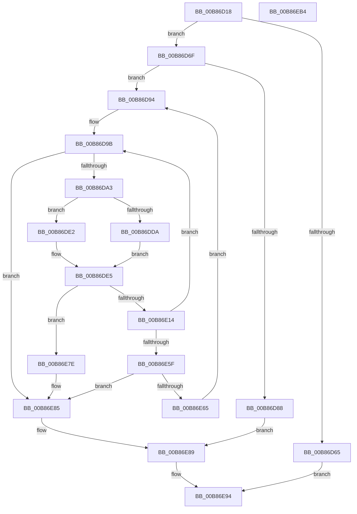

# KdpReadRemoteFile

- RVA: `0x00B86D18`–`0x00B86EB5` (길이 `413` bytes)
- VA: `0x0000000140B86D18`
- 실행 섹션: `PAGEKD`
- PDB 이름 있음: `예`; PDB Function 태그: `아니요`
- unwind 정보 RVA: `0x000C6EAC`
- 디코드: `110`개 명령, `413/413` bytes 표시
- 미해석 바이트: `0` (있으면 어셈블리에 `.byte`로 보존)

> 이 문서는 커널 이미지의 기계어와 PDB 기호를 분석해 생성했습니다. 4번과 5번은 함수 원형과 자료형을 바이너리 사용 방식에서 추정한 C 해석이며 원본 소스 복구 결과는 아닙니다.

## 1. Dependencies

- 직접 호출 지점: **6**; 고유 호출 대상: **6**
- 직접 호출자로 확인된 함수: **1**
- RIP 상대 이미지 참조: **7**

### Outgoing calls
- `0x00B86D59` → [memset](../../text/6C/memset_function_006C6C40.md) (function, `0x006C6C40`)
- `0x00B86D73` → [KdEnterDebugger](KdEnterDebugger_function_00B8A96C.md) (function, `0x00B8A96C`)
- `0x00B86DFF` → `kdcom.dll!KdSendPacket` (import, 간접 대상; import `kdcom.dll!KdSendPacket`)
- `0x00B86E3D` → `kdcom.dll!KdReceivePacket` (import, 간접 대상; import `kdcom.dll!KdReceivePacket`)
- `0x00B86E8C` → [KdExitDebugger](KdExitDebugger_function_00B85008.md) (function, `0x00B85008`)
- `0x00B86E9B` → [_security_check_cookie](../../text/6A/_security_check_cookie_function_006AC640.md) (function, `0x006AC640`)

### Direct callers
- [KdpPullRemoteFile](KdpPullRemoteFile_function_00B86B48.md) at `0x00B86C75`

### Static image references
- `0x00B86D31` → RVA `0x00E0A740` (`.data`; read)
- `0x00B86D7B` → RVA `0x00F55BE0` (`.data`; read)
- `0x00B86D94` → RVA `0x00F475E0` (`.data`; read)
- `0x00B86DAA` → RVA `0x00E0AA48` (`.data`; read)
- `0x00B86DFF` → RVA `0x001516C0` (`kdcom.dll!KdSendPacket (IAT)`; read)
- `0x00B86E0B` → RVA `0x00F475DC` (`.data`; read)
- `0x00B86E3D` → RVA `0x001516B0` (`kdcom.dll!KdReceivePacket (IAT)`; read)

## 2. Other-region calls and transfers

- 다른 실행 섹션으로 향하는 call: **2**
  - `0x00B86D59` → [memset](../../text/6C/memset_function_006C6C40.md) (`PAGEKD` → `.text`)
  - `0x00B86E9B` → [_security_check_cookie](../../text/6A/_security_check_cookie_function_006AC640.md) (`PAGEKD` → `.text`)
- 별도 외부 분기/꼬리 이동을 확인하지 못했습니다.

## 3. Assembly (complete function range)

```asm
00B86D18  40 55                           push rbp
00B86D1A  53                              push rbx
00B86D1B  56                              push rsi
00B86D1C  57                              push rdi
00B86D1D  41 54                           push r12
00B86D1F  41 55                           push r13
00B86D21  41 56                           push r14
00B86D23  41 57                           push r15
00B86D25  48 8D 6C 24 E9                  lea rbp, [rsp - 0x17]
00B86D2A  48 81 EC B8 00 00 00            sub rsp, 0xb8
00B86D31  48 8B 05 08 3A 28 00            mov rax, qword ptr [rip + 0x283a08]
00B86D38  48 33 C4                        xor rax, rsp
00B86D3B  48 89 45 FF                     mov qword ptr [rbp - 1], rax
00B86D3F  4C 8B 6D 7F                     mov r13, qword ptr [rbp + 0x7f]
00B86D43  8D 59 FF                        lea ebx, [rcx - 1]
00B86D46  4C 8B F2                        mov r14, rdx
00B86D49  48 8D 4D BF                     lea rcx, [rbp - 0x41]
00B86D4D  33 D2                           xor edx, edx
00B86D4F  4D 8B F8                        mov r15, r8
00B86D52  41 8B F9                        mov edi, r9d
00B86D55  44 8D 42 40                     lea r8d, [rdx + 0x40]
00B86D59  E8 E2 FE B3 FF                  call 0x1406c6c40
00B86D5E  33 F6                           xor esi, esi
00B86D60  83 FB 10                        cmp ebx, 0x10
00B86D63  72 0A                           jb 0x140b86d6f
00B86D65  B8 0D 00 00 C0                  mov eax, 0xc000000d
00B86D6A  E9 25 01 00 00                  jmp 0x140b86e94
00B86D6F  33 D2                           xor edx, edx
00B86D71  33 C9                           xor ecx, ecx
00B86D73  E8 F4 3B 00 00                  call 0x140b8a96c
00B86D78  44 8A E0                        mov r12b, al
00B86D7B  48 8D 05 5E EE 3C 00            lea rax, [rip + 0x3cee5e]
00B86D82  48 39 34 D8                     cmp qword ptr [rax + rbx*8], rsi
00B86D86  75 0C                           jne 0x140b86d94
00B86D88  C7 45 C3 0D 00 00 C0            mov dword ptr [rbp - 0x3d], 0xc000000d
00B86D8F  E9 F5 00 00 00                  jmp 0x140b86e89
00B86D94  4C 8D 0D 45 08 3C 00            lea r9, [rip + 0x3c0845]
00B86D9B  85 FF                           test edi, edi
00B86D9D  0F 84 E2 00 00 00               je 0x140b86e85
00B86DA3  48 8B 04 D8                     mov rax, qword ptr [rax + rbx*8]
00B86DA7  0F 57 C0                        xorps xmm0, xmm0
00B86DAA  8B 15 98 3C 28 00               mov edx, dword ptr [rip + 0x283c98]
00B86DB0  83 65 9B 00                     and dword ptr [rbp - 0x65], 0
00B86DB4  83 65 8F 00                     and dword ptr [rbp - 0x71], 0
00B86DB8  83 65 C3 00                     and dword ptr [rbp - 0x3d], 0
00B86DBC  48 89 45 C7                     mov qword ptr [rbp - 0x39], rax
00B86DC0  48 8D 4A C0                     lea rcx, [rdx - 0x40]
00B86DC4  8B C7                           mov eax, edi
00B86DC6  C7 45 BF 31 34 00 00            mov dword ptr [rbp - 0x41], 0x3431
00B86DCD  4C 89 75 CF                     mov qword ptr [rbp - 0x31], r14
00B86DD1  0F 11 45 A7                     movups xmmword ptr [rbp - 0x59], xmm0
00B86DD5  48 3B C1                        cmp rax, rcx
00B86DD8  76 08                           jbe 0x140b86de2
00B86DDA  8D 42 C0                        lea eax, [rdx - 0x40]
00B86DDD  89 45 D7                        mov dword ptr [rbp - 0x29], eax
00B86DE0  EB 03                           jmp 0x140b86de5
00B86DE2  89 7D D7                        mov dword ptr [rbp - 0x29], edi
00B86DE5  45 33 C0                        xor r8d, r8d
00B86DE8  C7 45 97 40 00 40 00            mov dword ptr [rbp - 0x69], 0x400040
00B86DEF  48 8D 45 BF                     lea rax, [rbp - 0x41]
00B86DF3  48 8D 55 97                     lea rdx, [rbp - 0x69]
00B86DF7  48 89 45 9F                     mov qword ptr [rbp - 0x61], rax
00B86DFB  41 8D 48 0B                     lea ecx, [r8 + 0xb]
00B86DFF  48 FF 15 BA A8 5C FF            call qword ptr [rip - 0xa35746]
00B86E06  0F 1F 44 00 00                  nop dword ptr [rax + rax]
00B86E0B  80 3D CA 07 3C 00 00            cmp byte ptr [rip + 0x3c07ca], 0
00B86E12  75 6A                           jne 0x140b86e7e
00B86E14  0F B7 45 D7                     movzx eax, word ptr [rbp - 0x29]
00B86E18  4C 8D 4D 8F                     lea r9, [rbp - 0x71]
00B86E1C  66 89 45 A9                     mov word ptr [rbp - 0x57], ax
00B86E20  4C 8D 45 A7                     lea r8, [rbp - 0x59]
00B86E24  48 8D 05 B5 07 3C 00            lea rax, [rip + 0x3c07b5]
00B86E2B  4C 89 7D AF                     mov qword ptr [rbp - 0x51], r15
00B86E2F  48 8D 55 97                     lea rdx, [rbp - 0x69]
00B86E33  48 89 44 24 20                  mov qword ptr [rsp + 0x20], rax
00B86E38  B9 0B 00 00 00                  mov ecx, 0xb
00B86E3D  48 FF 15 6C A8 5C FF            call qword ptr [rip - 0xa35794]
00B86E44  0F 1F 44 00 00                  nop dword ptr [rax + rax]
00B86E49  85 C0                           test eax, eax
00B86E4B  4C 8D 0D 8E 07 3C 00            lea r9, [rip + 0x3c078e]
00B86E52  48 8D 05 87 ED 3C 00            lea rax, [rip + 0x3ced87]
00B86E59  0F 85 3C FF FF FF               jne 0x140b86d9b
00B86E5F  83 7D C3 00                     cmp dword ptr [rbp - 0x3d], 0
00B86E63  7C 20                           jl 0x140b86e85
00B86E65  8B 4D 8F                        mov ecx, dword ptr [rbp - 0x71]
00B86E68  48 8D 05 71 ED 3C 00            lea rax, [rip + 0x3ced71]
00B86E6F  03 F1                           add esi, ecx
00B86E71  4C 03 F9                        add r15, rcx
00B86E74  4C 03 F1                        add r14, rcx
00B86E77  2B F9                           sub edi, ecx
00B86E79  E9 16 FF FF FF                  jmp 0x140b86d94
00B86E7E  C7 45 C3 54 03 00 C0            mov dword ptr [rbp - 0x3d], 0xc0000354
00B86E85  41 89 75 00                     mov dword ptr [r13], esi
00B86E89  41 8A CC                        mov cl, r12b
00B86E8C  E8 77 E1 FF FF                  call 0x140b85008
00B86E91  8B 45 C3                        mov eax, dword ptr [rbp - 0x3d]
00B86E94  48 8B 4D FF                     mov rcx, qword ptr [rbp - 1]
00B86E98  48 33 CC                        xor rcx, rsp
00B86E9B  E8 A0 57 B2 FF                  call 0x1406ac640
00B86EA0  48 81 C4 B8 00 00 00            add rsp, 0xb8
00B86EA7  41 5F                           pop r15
00B86EA9  41 5E                           pop r14
00B86EAB  41 5D                           pop r13
00B86EAD  41 5C                           pop r12
00B86EAF  5F                              pop rdi
00B86EB0  5E                              pop rsi
00B86EB1  5B                              pop rbx
00B86EB2  5D                              pop rbp
00B86EB3  C3                              ret
00B86EB4  CC                              int3
```

## 4. C-style interpretation (structured pseudocode)

```c
__int64 __fastcall KdpReadRemoteFile(__int64 a1, __int64 a2, __int64 a3, int a4, __int64 a5)
{
    __int64 result;
    __int64 v_r14;
    __int64 v_r15;
    __int64 v_rdi;
    __int64 v_rsi;
    __int64 v_rsp;
    unsigned __int64 v_stack_m57;
    unsigned __int64 v_stack_m58;
    unsigned int v_stack_m80;
    unsigned __int64 v_stack_m88;
    unsigned __int64 v_stack_m90;
    unsigned int v_stack_m94;
    unsigned __int64 v_stack_m98;
    unsigned __int64 v_stack_mA8;
    unsigned __int16 v_stack_mAE;
    unsigned __int64 v_stack_mB0;
    unsigned __int64 v_stack_mB8;
    unsigned int v_stack_mBC;
    unsigned int v_stack_mC0;
    unsigned int v_stack_mC8;
    unsigned __int64 v_stack_mD8;

    v_rsp = (v_rsp) - (184);
    result = (*(unsigned __int64 *)(v_rip + 2636296)) ^ (v_rsp);
    v_stack_m58 = result;
    a2 = 0;
    result = memset(v_stack_m98, a2, a2 + 64, a4);
    v_rsi = 0;
    if (((unsigned int)(a1 - 1)) < 16) goto loc_00B86D6F;
    goto loc_00B86E94;
loc_00B86D6F:
    a2 = 0;
    a1 = 0;
    result = KdEnterDebugger(a1, a2, a2 + 64, a4);
    if ((*(unsigned __int64 *)(v_rip + 3993182 + a1 - 1 * 8)) != 0) goto loc_00B86D94;
    v_stack_m94 = 0xC000000DULL;
    goto loc_00B86E89;
loc_00B86D94:
loc_00B86D9B:
    if ((unsigned int)((unsigned int)(a4)) == 0) goto loc_00B86E85;
    v_stack_m90 = *(unsigned __int64 *)(v_rip + 3993182 + a1 - 1 * 8);
    v_stack_m98 = 0x3431ULL;
    v_stack_m88 = 0;
    v_stack_mB0 = v_xmm0;
    if (((unsigned int)((unsigned int)((unsigned int)(a4)))) <= ((unsigned int)(*(unsigned int *)(v_rip + 2636952)) - 64)) goto loc_00B86DE2;
    v_stack_m80 = (unsigned int)((unsigned int)(*(unsigned int *)(v_rip + 2636952)) - 64);
    goto loc_00B86DE5;
loc_00B86DE2:
    v_stack_m80 = (unsigned int)((unsigned int)(a4));
loc_00B86DE5:
    a3 = 0;
    v_stack_mC0 = 0x400040ULL;
    v_stack_mB8 = v_stack_m98;
    result = kdcom_dll_KdSendPacket(a3 + 11, v_stack_mC0, a3, v_rip + 3934277);
    if ((*(unsigned __int8 *)(v_rip + 3934154)) != 0) goto loc_00B86E7E;
    v_stack_mAE = (unsigned __int16)(v_stack_m80);
    v_stack_mA8 = 0;
    v_stack_mD8 = v_rip + 3934133;
    result = kdcom_dll_KdReceivePacket(11, v_stack_mC0, v_stack_mB0, v_stack_mC8);
    if ((unsigned int)(result) != 0) goto loc_00B86D9B;
    if (v_stack_m94 < 0) goto loc_00B86E85;
    v_rsi = (unsigned int)((v_rsi) + ((unsigned int)((unsigned int)(v_stack_mC8))));
    v_r15 = (a3) + ((unsigned int)(v_stack_mC8));
    v_r14 = (a2) + ((unsigned int)(v_stack_mC8));
    v_rdi = (unsigned int)(((unsigned int)(a4)) - ((unsigned int)((unsigned int)(v_stack_mC8))));
    goto loc_00B86D94;
loc_00B86E7E:
    v_stack_m94 = 0xC0000354ULL;
loc_00B86E85:
    *(unsigned int *)(a5) = (unsigned int)(v_rsi);
loc_00B86E89:
    result = KdExitDebugger((unsigned __int8)((unsigned __int8)(result)), v_stack_mC0, v_stack_mB0, v_rip + 3934094);
loc_00B86E94:
    a1 = (v_stack_m58) ^ (v_rsp);
    result = _security_check_cookie(a1, v_stack_mC0, v_stack_mB0, v_rip + 3934094);
    v_rsp = (v_rsp) + (184);
    return result;
}
```

## 5. (Beta) C Style

```c
int64_t KdpReadRemoteFile(void *Arg1, int64_t Arg2, int64_t Arg3, int32_t Arg4, void *Arg5)
{
    uint8_t *arg1 = (uint8_t *)Arg1;
    uint8_t *arg5 = (uint8_t *)Arg5;

    int64_t result;
    int64_t local_r14;
    int64_t local_r15;
    int64_t local_rdi;
    int64_t local_rsi;
    int64_t local_rsp;
    uint64_t v_stack_m57;
    uint64_t v_stack_m58;
    uint32_t v_stack_m80;
    uint64_t v_stack_m88;
    uint64_t v_stack_m90;
    uint32_t v_stack_m94;
    uint64_t v_stack_m98;
    uint64_t v_stack_mA8;
    uint16_t v_stack_mAE;
    uint64_t v_stack_mB0;
    uint64_t v_stack_mB8;
    uint32_t v_stack_mBC;
    uint32_t v_stack_mC0;
    uint32_t v_stack_mC8;
    uint64_t v_stack_mD8;

    local_rsp = (local_rsp) - (184);
    result = (*(uint64_t *)(v_rip + 0x283A08)) ^ (local_rsp);
    v_stack_m58 = result;
    Arg2 = 0;
    result = memset(v_stack_m98, Arg2, Arg2 + 64, Arg4);
    local_rsi = 0;
    if (((uint32_t)(Arg1 - 1)) < 16) goto loc_00B86D6F;
    goto loc_00B86E94;
loc_00B86D6F:
    Arg2 = 0;
    Arg1 = 0;
    result = KdEnterDebugger(Arg1, Arg2, Arg2 + 64, Arg4);
    if ((*(uint64_t *)(v_rip + 0x3CEE5E + arg1 - 0x1 * 8)) != 0) goto loc_00B86D94;
    v_stack_m94 = 0xC000000DULL;
    goto loc_00B86E89;
loc_00B86D94:
loc_00B86D9B:
    if ((uint32_t)((uint32_t)(Arg4)) == 0) goto loc_00B86E85;
    v_stack_m90 = *(uint64_t *)(v_rip + 0x3CEE5E + arg1 - 0x1 * 8);
    v_stack_m98 = 0x3431ULL;
    v_stack_m88 = 0;
    v_stack_mB0 = v_xmm0;
    if (((uint32_t)((uint32_t)((uint32_t)(Arg4)))) <= ((uint32_t)(*(uint32_t *)(v_rip + 0x283C98)) - 64)) goto loc_00B86DE2;
    v_stack_m80 = (uint32_t)((uint32_t)(*(uint32_t *)(v_rip + 0x283C98)) - 64);
    goto loc_00B86DE5;
loc_00B86DE2:
    v_stack_m80 = (uint32_t)((uint32_t)(Arg4));
loc_00B86DE5:
    Arg3 = 0;
    v_stack_mC0 = 0x400040ULL;
    v_stack_mB8 = v_stack_m98;
    result = kernel_indirect_call(Arg3 + 11, v_stack_mC0, Arg3, v_rip + 3934277);
    if ((*(uint8_t *)(v_rip + 0x3C07CA)) != 0) goto loc_00B86E7E;
    v_stack_mAE = (uint16_t)(v_stack_m80);
    v_stack_mA8 = 0;
    v_stack_mD8 = v_rip + 3934133;
    result = kernel_indirect_call(11, v_stack_mC0, v_stack_mB0, v_stack_mC8);
    if ((uint32_t)(result) != 0) goto loc_00B86D9B;
    if (v_stack_m94 < 0) goto loc_00B86E85;
    local_rsi = (uint32_t)((local_rsi) + ((uint32_t)((uint32_t)(v_stack_mC8))));
    local_r15 = (Arg3) + ((uint32_t)(v_stack_mC8));
    local_r14 = (Arg2) + ((uint32_t)(v_stack_mC8));
    local_rdi = (uint32_t)(((uint32_t)(Arg4)) - ((uint32_t)((uint32_t)(v_stack_mC8))));
    goto loc_00B86D94;
loc_00B86E7E:
    v_stack_m94 = 0xC0000354ULL;
loc_00B86E85:
    *(uint32_t *)(arg5) = (uint32_t)(local_rsi);
loc_00B86E89:
    result = KdExitDebugger((uint8_t)((uint8_t)(result)), v_stack_mC0, v_stack_mB0, v_rip + 3934094);
loc_00B86E94:
    Arg1 = (v_stack_m58) ^ (local_rsp);
    result = _security_check_cookie(Arg1, v_stack_mC0, v_stack_mB0, v_rip + 3934094);
    local_rsp = (local_rsp) + (184);
    return result;
}
```

### 관측된 메모리 오프셋

구조체 형식이 확인되지 않은 접근은 인자 기준의 오프셋으로만 기록했습니다.

| 기준 인자 | 오프셋 표현 | 폭 (bit) | 접근 |
|---|---:|---:|---|
| `Arg1` | `- 0x1` | `32` | `R` |
| `Arg5` | `+ 0x0` | `32` | `W` |

## 6. Execution-region graph

[열기: 2D/3D 그래프와 함수 탐색 컨트롤 패널](../../../control-panel.html?section=pagekd&rva=0x00B86D18&view=graph)

- 2D 그래프는 위에서 아래로 흐르고, 3D 그래프는 빈 공간을 드래그해 회전합니다. Shift+드래그는 이동, 휠은 확대·축소, 함수 노드 선택은 대상 보고서 이동입니다.

### Static fallback


