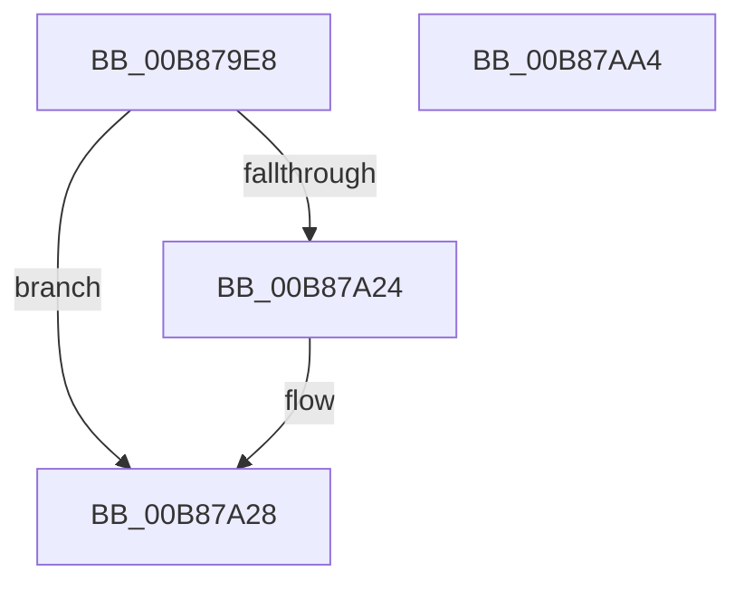

# KdpReadVirtualMemory

- RVA: `0x00B879E8`–`0x00B87AA5` (길이 `189` bytes)
- VA: `0x0000000140B879E8`
- 실행 섹션: `PAGEKD`
- PDB 이름 있음: `예`; PDB Function 태그: `아니요`
- unwind 정보 RVA: `0x000C99BC`
- 디코드: `48`개 명령, `189/189` bytes 표시
- 미해석 바이트: `0` (있으면 어셈블리에 `.byte`로 보존)

> 이 문서는 커널 이미지의 기계어와 PDB 기호를 분석해 생성했습니다. 4번과 5번은 함수 원형과 자료형을 바이너리 사용 방식에서 추정한 C 해석이며 원본 소스 복구 결과는 아닙니다.

## 1. Dependencies

- 직접 호출 지점: **2**; 고유 호출 대상: **2**
- 직접 호출자로 확인된 함수: **1**
- RIP 상대 이미지 참조: **3**

### Outgoing calls
- `0x00B87A58` → [KdpCopyMemoryChunks](KdpCopyMemoryChunks_function_00B8AACC.md) (function, `0x00B8AACC`)
- `0x00B87A88` → `kdcom.dll!KdSendPacket` (import, 간접 대상; import `kdcom.dll!KdSendPacket`)

### Direct callers
- [KdpSendWaitContinue](KdpSendWaitContinue_function_00B8A32C.md) at `0x00B8A449`

### Static image references
- `0x00B879FC` → RVA `0x00E0AA48` (`.data`; read)
- `0x00B87A60` → RVA `0x00F475E0` (`.data`; read)
- `0x00B87A88` → RVA `0x001516C0` (`kdcom.dll!KdSendPacket (IAT)`; read)

## 2. Other-region calls and transfers

- 다른 실행 섹션으로 향하는 call: **0**
- 별도 외부 분기/꼬리 이동을 확인하지 못했습니다.

## 3. Assembly (complete function range)

```asm
00B879E8  48 8B C4                        mov rax, rsp
00B879EB  48 89 58 08                     mov qword ptr [rax + 8], rbx
00B879EF  48 89 70 10                     mov qword ptr [rax + 0x10], rsi
00B879F3  4C 89 40 18                     mov qword ptr [rax + 0x18], r8
00B879F7  57                              push rdi
00B879F8  48 83 EC 40                     sub rsp, 0x40
00B879FC  44 8B 0D 45 30 28 00            mov r9d, dword ptr [rip + 0x283045]
00B87A03  BE 38 00 00 00                  mov esi, 0x38
00B87A08  44 8B 51 18                     mov r10d, dword ptr [rcx + 0x18]
00B87A0C  45 8B C1                        mov r8d, r9d
00B87A0F  4C 2B C6                        sub r8, rsi
00B87A12  0F 57 C0                        xorps xmm0, xmm0
00B87A15  48 8B FA                        mov rdi, rdx
00B87A18  48 8B D9                        mov rbx, rcx
00B87A1B  0F 11 40 E8                     movups xmmword ptr [rax - 0x18], xmm0
00B87A1F  4D 3B D0                        cmp r10, r8
00B87A22  76 04                           jbe 0x140b87a28
00B87A24  45 8D 51 C8                     lea r10d, [r9 - 0x38]
00B87A28  0F B7 42 02                     movzx eax, word ptr [rdx + 2]
00B87A2C  48 8B 52 08                     mov rdx, qword ptr [rdx + 8]
00B87A30  44 3B D0                        cmp r10d, eax
00B87A33  48 8B 49 10                     mov rcx, qword ptr [rcx + 0x10]
00B87A37  44 0F 47 D0                     cmova r10d, eax
00B87A3B  48 8D 44 24 60                  lea rax, [rsp + 0x60]
00B87A40  48 89 44 24 28                  mov qword ptr [rsp + 0x28], rax
00B87A45  45 33 C9                        xor r9d, r9d
00B87A48  45 8B C2                        mov r8d, r10d
00B87A4B  C7 44 24 20 04 00 00 00         mov dword ptr [rsp + 0x20], 4
00B87A53  44 89 54 24 60                  mov dword ptr [rsp + 0x60], r10d
00B87A58  E8 6F 30 00 00                  call 0x140b8aacc
00B87A5D  89 43 08                        mov dword ptr [rbx + 8], eax
00B87A60  4C 8D 0D 79 FB 3B 00            lea r9, [rip + 0x3bfb79]
00B87A67  8B 44 24 60                     mov eax, dword ptr [rsp + 0x60]
00B87A6B  48 8D 54 24 30                  lea rdx, [rsp + 0x30]
00B87A70  66 89 07                        mov word ptr [rdi], ax
00B87A73  4C 8B C7                        mov r8, rdi
00B87A76  B9 02 00 00 00                  mov ecx, 2
00B87A7B  89 43 1C                        mov dword ptr [rbx + 0x1c], eax
00B87A7E  66 89 74 24 30                  mov word ptr [rsp + 0x30], si
00B87A83  48 89 5C 24 38                  mov qword ptr [rsp + 0x38], rbx
00B87A88  48 FF 15 31 9C 5C FF            call qword ptr [rip - 0xa363cf]
00B87A8F  0F 1F 44 00 00                  nop dword ptr [rax + rax]
00B87A94  48 8B 5C 24 50                  mov rbx, qword ptr [rsp + 0x50]
00B87A99  48 8B 74 24 58                  mov rsi, qword ptr [rsp + 0x58]
00B87A9E  48 83 C4 40                     add rsp, 0x40
00B87AA2  5F                              pop rdi
00B87AA3  C3                              ret
00B87AA4  CC                              int3
```

## 4. C-style interpretation (structured pseudocode)

```c
__int64 __fastcall KdpReadVirtualMemory(__int64 a1, __int64 a2, __int64 a3)
{
    __int64 result;
    __int64 v_r10;
    __int64 v_rsp;
    unsigned __int64 v_stack_m10;
    unsigned __int64 v_stack_m18;
    unsigned __int64 v_stack_m20;
    unsigned int v_stack_m28;
    unsigned __int64 v_stack_p10;
    unsigned __int64 v_stack_p18;
    unsigned __int64 v_stack_p8;

    *(unsigned __int64 *)(v_rsp + 8) = v_rbx;
    *(unsigned __int64 *)(v_rsp + 16) = v_rsi;
    *(unsigned __int64 *)(v_rsp + 24) = a3;
    v_rsp = (v_rsp) - (64);
    a3 = ((unsigned int)((unsigned int)((unsigned int)(*(unsigned int *)(v_rip + 2633797))))) - (56);
    *(unsigned __int64 *)(v_rsp - 24) = v_xmm0;
    v_r10 = (unsigned int)(*(unsigned int *)(a1 + 24));
    if (((unsigned int)(*(unsigned int *)(a1 + 24))) >= = a3) {
        v_r10 = (unsigned int)(*(unsigned int *)(v_rip + 2633797)) - 56;
    }
    if (((unsigned int)(v_r10)) > ((unsigned int)(*(unsigned __int16 *)(a2 + 2)))) { v_r10 = (unsigned int)(*(unsigned __int16 *)(a2 + 2)); }
    v_stack_m20 = v_stack_p18;
    a4 = 0;
    v_stack_m28 = 4;
    v_stack_p18 = (unsigned int)(v_r10);
    result = KdpCopyMemoryChunks(*(unsigned __int64 *)(a1 + 16), *(unsigned __int64 *)(a2 + 8), (unsigned int)((unsigned int)(v_r10)), a4);
    *(unsigned int *)(a1 + 8) = (unsigned int)(result);
    *(unsigned __int16 *)(a2) = (unsigned __int16)((unsigned int)(v_stack_p18));
    *(unsigned int *)(a1 + 28) = (unsigned int)((unsigned int)(v_stack_p18));
    v_stack_m18 = 56;
    v_stack_m10 = a1;
    result = kdcom_dll_KdSendPacket(2, v_stack_m18, a2, v_rip + 3931001);
    v_rsp = (v_rsp) + (64);
    return result;
}
```

## 5. (Beta) C Style

```c
int64_t KdpReadVirtualMemory(void *Arg1, void *Arg2, int64_t Arg3)
{
    uint8_t *arg1 = (uint8_t *)Arg1;
    uint8_t *arg2 = (uint8_t *)Arg2;

    int64_t result;
    int64_t local_r10;
    int64_t local_rsp;
    uint64_t v_stack_m10;
    uint64_t v_stack_m18;
    uint64_t v_stack_m20;
    uint32_t v_stack_m28;
    uint64_t v_stack_p10;
    uint64_t v_stack_p18;
    uint64_t v_stack_p8;

    *(uint64_t *)(local_rsp + 0x8) = local_rbx;
    *(uint64_t *)(local_rsp + 0x10) = local_rsi;
    *(uint64_t *)(local_rsp + 0x18) = Arg3;
    local_rsp = (local_rsp) - (64);
    Arg3 = ((uint32_t)((uint32_t)((uint32_t)(*(uint32_t *)(v_rip + 0x283045))))) - (56);
    *(uint64_t *)(local_rsp - 0x18) = v_xmm0;
    local_r10 = (uint32_t)(*(uint32_t *)(arg1 + 0x18));
    if (((uint32_t)(*(uint32_t *)(arg1 + 0x18))) >= = Arg3) {
        local_r10 = (uint32_t)(*(uint32_t *)(v_rip + 0x283045)) - 56;
    }
    if (((uint32_t)(local_r10)) > ((uint32_t)(*(uint16_t *)(arg2 + 0x2)))) { local_r10 = (uint32_t)(*(uint16_t *)(arg2 + 0x2)); }
    v_stack_m20 = v_stack_p18;
    a4 = 0;
    v_stack_m28 = 4;
    v_stack_p18 = (uint32_t)(local_r10);
    result = KdpCopyMemoryChunks(*(uint64_t *)(arg1 + 0x10), *(uint64_t *)(arg2 + 0x8), (uint32_t)((uint32_t)(local_r10)), a4);
    *(uint32_t *)(arg1 + 0x8) = (uint32_t)(result);
    *(uint16_t *)(arg2) = (uint16_t)((uint32_t)(v_stack_p18));
    *(uint32_t *)(arg1 + 0x1C) = (uint32_t)((uint32_t)(v_stack_p18));
    v_stack_m18 = 56;
    v_stack_m10 = Arg1;
    result = kernel_indirect_call(2, v_stack_m18, Arg2, v_rip + 3931001);
    local_rsp = (local_rsp) + (64);
    return result;
}
```

### 관측된 메모리 오프셋

구조체 형식이 확인되지 않은 접근은 인자 기준의 오프셋으로만 기록했습니다.

| 기준 인자 | 오프셋 표현 | 폭 (bit) | 접근 |
|---|---:|---:|---|
| `Arg1` | `+ 0x8` | `32` | `W` |
| `Arg1` | `+ 0x10` | `64` | `R` |
| `Arg1` | `+ 0x18` | `32` | `R` |
| `Arg1` | `+ 0x1C` | `32` | `W` |
| `Arg2` | `+ 0x0` | `16` | `W` |
| `Arg2` | `+ 0x2` | `16` | `R` |
| `Arg2` | `+ 0x8` | `64` | `R` |

## 6. Execution-region graph

[열기: 2D/3D 그래프와 함수 탐색 컨트롤 패널](../../../control-panel.html?section=pagekd&rva=0x00B879E8&view=graph)

- 2D 그래프는 위에서 아래로 흐르고, 3D 그래프는 빈 공간을 드래그해 회전합니다. Shift+드래그는 이동, 휠은 확대·축소, 함수 노드 선택은 대상 보고서 이동입니다.

### Static fallback


