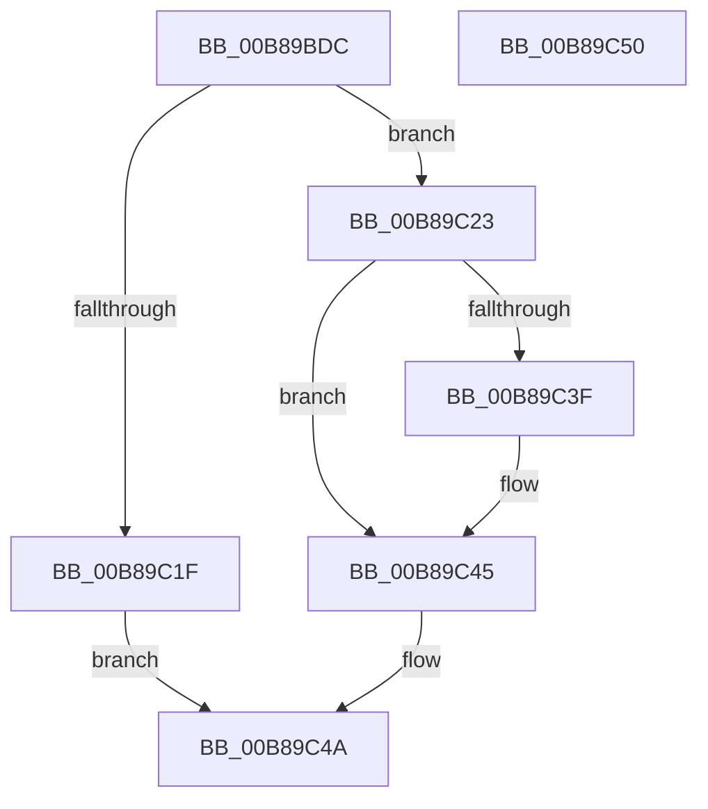

# KdpRemoveBreakpoint

- RVA: `0x00B89BDC`–`0x00B89C51` (길이 `117` bytes)
- VA: `0x0000000140B89BDC`
- 실행 섹션: `PAGEKD`
- PDB 이름 있음: `예`; PDB Function 태그: `아니요`
- unwind 정보 RVA: `0x0005CF00`
- 디코드: `38`개 명령, `117/117` bytes 표시
- 미해석 바이트: `0` (있으면 어셈블리에 `.byte`로 보존)

> 이 문서는 커널 이미지의 기계어와 PDB 기호를 분석해 생성했습니다. 4번과 5번은 함수 원형과 자료형을 바이너리 사용 방식에서 추정한 C 해석이며 원본 소스 복구 결과는 아닙니다.

## 1. Dependencies

- 직접 호출 지점: **2**; 고유 호출 대상: **2**
- 직접 호출자로 확인된 함수: **2**
- RIP 상대 이미지 참조: **0**

### Outgoing calls
- `0x00B89BF6` → [KdpWriteInstructionBuffer](../../text/5B/KdpWriteInstructionBuffer_function_005B1424.md) (function, `0x005B1424`)
- `0x00B89C13` → [KdpCopyCodeStream](KdpCopyCodeStream_function_00B8930C.md) (function, `0x00B8930C`)

### Direct callers
- [KdpLowWriteContent](KdpLowWriteContent_function_00B89B0C.md) at `0x00B89BAF`
- [KdpSetOwedBreakpoints](KdpSetOwedBreakpoints_function_00B8A7DC.md) at `0x00B8A933`

### Static image references
- 디코드된 RIP-relative 메모리 참조가 없습니다.

## 2. Other-region calls and transfers

- 다른 실행 섹션으로 향하는 call: **1**
  - `0x00B89BF6` → [KdpWriteInstructionBuffer](../../text/5B/KdpWriteInstructionBuffer_function_005B1424.md) (`PAGEKD` → `.text`)
- 별도 외부 분기/꼬리 이동을 확인하지 못했습니다.

## 3. Assembly (complete function range)

```asm
00B89BDC  40 53                           push rbx
00B89BDE  48 83 EC 20                     sub rsp, 0x20
00B89BE2  48 8B 01                        mov rax, qword ptr [rcx]
00B89BE5  4C 8B D2                        mov r10, rdx
00B89BE8  48 8B 51 18                     mov rdx, qword ptr [rcx + 0x18]
00B89BEC  48 8B D9                        mov rbx, rcx
00B89BEF  44 8A 41 24                     mov r8b, byte ptr [rcx + 0x24]
00B89BF3  49 8B CA                        mov rcx, r10
00B89BF6  E8 29 78 A2 FF                  call 0x1405b1424
00B89BFB  0F B6 4B 25                     movzx ecx, byte ptr [rbx + 0x25]
00B89BFF  41 B9 05 00 00 00               mov r9d, 5
00B89C05  44 0F B6 43 24                  movzx r8d, byte ptr [rbx + 0x24]
00B89C0A  48 F7 D1                        not rcx
00B89C0D  48 23 C8                        and rcx, rax
00B89C10  49 8B D2                        mov rdx, r10
00B89C13  E8 F4 F6 FF FF                  call 0x140b8930c
00B89C18  44 8B C0                        mov r8d, eax
00B89C1B  85 C0                           test eax, eax
00B89C1D  79 04                           jns 0x140b89c23
00B89C1F  33 C0                           xor eax, eax
00B89C21  EB 27                           jmp 0x140b89c4a
00B89C23  8B 4B 20                        mov ecx, dword ptr [rbx + 0x20]
00B89C26  8B C1                           mov eax, ecx
00B89C28  83 C9 05                        or ecx, 5
00B89C2B  24 04                           and al, 4
00B89C2D  F6 D8                           neg al
00B89C2F  1B D2                           sbb edx, edx
00B89C31  23 D1                           and edx, ecx
00B89C33  89 53 20                        mov dword ptr [rbx + 0x20], edx
00B89C36  41 81 F8 03 01 00 00            cmp r8d, 0x103
00B89C3D  75 06                           jne 0x140b89c45
00B89C3F  83 CA 09                        or edx, 9
00B89C42  89 53 20                        mov dword ptr [rbx + 0x20], edx
00B89C45  B8 01 00 00 00                  mov eax, 1
00B89C4A  48 83 C4 20                     add rsp, 0x20
00B89C4E  5B                              pop rbx
00B89C4F  C3                              ret
00B89C50  CC                              int3
```

## 4. C-style interpretation (structured pseudocode)

```c
__int64 __fastcall KdpRemoveBreakpoint(__int64 a1, __int64 a2)
{
    __int64 result;
    __int64 v_rsp;

    v_rsp = (v_rsp) - (32);
    result = KdpWriteInstructionBuffer(a2, *(unsigned __int64 *)(a1 + 24), *(unsigned __int8 *)(a1 + 36), a4);
    a1 = ~(*(unsigned __int8 *)(a1 + 37));
    a1 = (a1) & (result);
    result = KdpCopyCodeStream(a1, a2, *(unsigned __int8 *)(a1 + 36), 5);
    if (!sign_flag) goto loc_00B89C23;
    result = 0;
    goto loc_00B89C4A;
loc_00B89C23:
    a1 = (unsigned int)(((unsigned int)(*(unsigned int *)(a1 + 32))) | (5));
    result = (unsigned __int8)(((unsigned int)((unsigned int)((unsigned int)(*(unsigned int *)(a1 + 32))))) & (4));
    result = (unsigned __int8)(-(result));
    a2 = (unsigned int)((a2) & ((unsigned int)(a1)));
    *(unsigned int *)(a1 + 32) = (unsigned int)(a2);
    if (((unsigned int)((unsigned int)((unsigned int)(result)))) == 259) {
        a2 = (unsigned int)((a2) | (9));
        *(unsigned int *)(a1 + 32) = (unsigned int)(a2);
    }
loc_00B89C4A:
    v_rsp = (v_rsp) + (32);
    return 1;
}
```

## 5. (Beta) C Style

```c
int64_t KdpRemoveBreakpoint(void *Arg1, int64_t Arg2)
{
    uint8_t *arg1 = (uint8_t *)Arg1;

    int64_t result;
    int64_t local_rsp;

    local_rsp = (local_rsp) - (32);
    result = KdpWriteInstructionBuffer(Arg2, *(uint64_t *)(arg1 + 0x18), *(uint8_t *)(arg1 + 0x24), a4);
    Arg1 = ~(*(uint8_t *)(arg1 + 0x25));
    Arg1 = (Arg1) & (result);
    result = KdpCopyCodeStream(Arg1, Arg2, *(uint8_t *)(arg1 + 0x24), 5);
    if (!sign_flag) goto loc_00B89C23;
    result = 0;
    goto loc_00B89C4A;
loc_00B89C23:
    Arg1 = (uint32_t)(((uint32_t)(*(uint32_t *)(arg1 + 0x20))) | (5));
    result = (uint8_t)(((uint32_t)((uint32_t)((uint32_t)(*(uint32_t *)(arg1 + 0x20))))) & (4));
    result = (uint8_t)(-(result));
    Arg2 = (uint32_t)((Arg2) & ((uint32_t)(Arg1)));
    *(uint32_t *)(arg1 + 0x20) = (uint32_t)(Arg2);
    if (((uint32_t)((uint32_t)((uint32_t)(result)))) == 259) {
        Arg2 = (uint32_t)((Arg2) | (9));
        *(uint32_t *)(arg1 + 0x20) = (uint32_t)(Arg2);
    }
loc_00B89C4A:
    local_rsp = (local_rsp) + (32);
    return 1;
}
```

### 관측된 메모리 오프셋

구조체 형식이 확인되지 않은 접근은 인자 기준의 오프셋으로만 기록했습니다.

| 기준 인자 | 오프셋 표현 | 폭 (bit) | 접근 |
|---|---:|---:|---|
| `Arg1` | `+ 0x0` | `64` | `R` |
| `Arg1` | `+ 0x18` | `64` | `R` |
| `Arg1` | `+ 0x20` | `32` | `R` |
| `Arg1` | `+ 0x20` | `32` | `W` |
| `Arg1` | `+ 0x24` | `8` | `R` |
| `Arg1` | `+ 0x25` | `8` | `R` |

## 6. Execution-region graph

[열기: 2D/3D 그래프와 함수 탐색 컨트롤 패널](../../../control-panel.html?section=pagekd&rva=0x00B89BDC&view=graph)

- 2D 그래프는 위에서 아래로 흐르고, 3D 그래프는 빈 공간을 드래그해 회전합니다. Shift+드래그는 이동, 휠은 확대·축소, 함수 노드 선택은 대상 보고서 이동입니다.

### Static fallback


