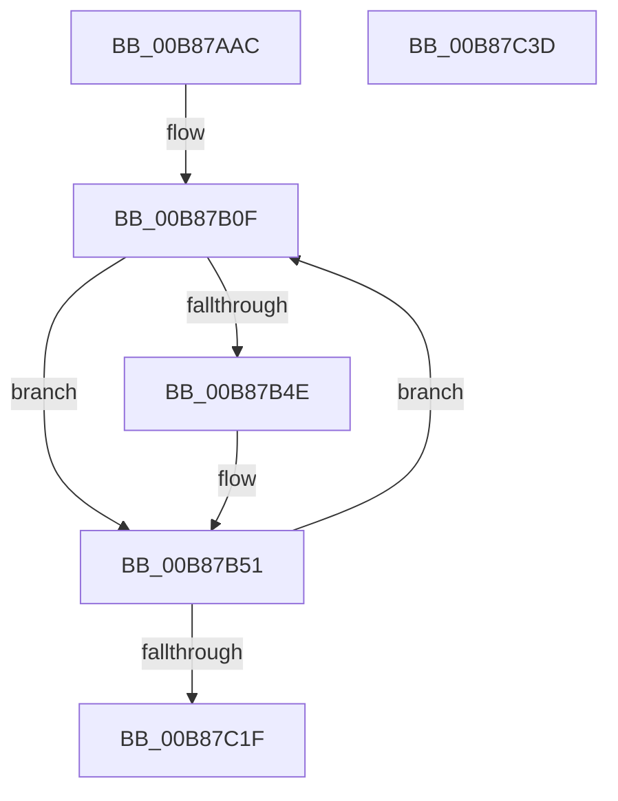

# KdpReportCommandStringStateChange

- RVA: `0x00B87AAC`–`0x00B87C3E` (길이 `402` bytes)
- VA: `0x0000000140B87AAC`
- 실행 섹션: `PAGEKD`
- PDB 이름 있음: `예`; PDB Function 태그: `아니요`
- unwind 정보 RVA: `0x000C39E4`
- 디코드: `102`개 명령, `402/402` bytes 표시
- 미해석 바이트: `0` (있으면 어셈블리에 `.byte`로 보존)

> 이 문서는 커널 이미지의 기계어와 PDB 기호를 분석해 생성했습니다. 4번과 5번은 함수 원형과 자료형을 바이너리 사용 방식에서 추정한 C 해석이며 원본 소스 복구 결과는 아닙니다.

## 1. Dependencies

- 직접 호출 지점: **8**; 고유 호출 대상: **6**
- 직접 호출자로 확인된 함수: **1**
- RIP 상대 이미지 참조: **3**

### Outgoing calls
- `0x00B87AFA` → [memset](../../text/6C/memset_function_006C6C40.md) (function, `0x006C6C40`)
- `0x00B87B1C` → [KdpSetCommonState](../../text/4E/KdpSetCommonState_function_004E0298.md) (function, `0x004E0298`)
- `0x00B87B29` → [KdpSetContextState](KdpSetContextState_function_00B85164.md) (function, `0x00B85164`)
- `0x00B87B38` → [memset](../../text/6C/memset_function_006C6C40.md) (function, `0x006C6C40`)
- `0x00B87B6D` → [KdpCopyMemoryChunks](KdpCopyMemoryChunks_function_00B8AACC.md) (function, `0x00B8AACC`)
- `0x00B87BCD` → [KdpCopyMemoryChunks](KdpCopyMemoryChunks_function_00B8AACC.md) (function, `0x00B8AACC`)
- `0x00B87C11` → [KdpSendWaitContinue](KdpSendWaitContinue_function_00B8A32C.md) (function, `0x00B8A32C`)
- `0x00B87C26` → [_security_check_cookie](../../text/6A/_security_check_cookie_function_006AC640.md) (function, `0x006AC640`)

### Direct callers
- [KdpCommandString](KdpCommandString_function_00B88E2C.md) at `0x00B88EB3`

### Static image references
- `0x00B87AC3` → RVA `0x00E0A740` (`.data`; read)
- `0x00B87B04` → RVA `0x00E12710` (`.data`; read)
- `0x00B87B91` → RVA `0x00E0AA48` (`.data`; read)

## 2. Other-region calls and transfers

- 다른 실행 섹션으로 향하는 call: **4**
  - `0x00B87AFA` → [memset](../../text/6C/memset_function_006C6C40.md) (`PAGEKD` → `.text`)
  - `0x00B87B1C` → [KdpSetCommonState](../../text/4E/KdpSetCommonState_function_004E0298.md) (`PAGEKD` → `.text`)
  - `0x00B87B38` → [memset](../../text/6C/memset_function_006C6C40.md) (`PAGEKD` → `.text`)
  - `0x00B87C26` → [_security_check_cookie](../../text/6A/_security_check_cookie_function_006AC640.md) (`PAGEKD` → `.text`)
- 별도 외부 분기/꼬리 이동을 확인하지 못했습니다.

## 3. Assembly (complete function range)

```asm
00B87AAC  40 55                           push rbp
00B87AAE  53                              push rbx
00B87AAF  56                              push rsi
00B87AB0  57                              push rdi
00B87AB1  41 55                           push r13
00B87AB3  41 56                           push r14
00B87AB5  41 57                           push r15
00B87AB7  48 8D 6C 24 A0                  lea rbp, [rsp - 0x60]
00B87ABC  48 81 EC 60 01 00 00            sub rsp, 0x160
00B87AC3  48 8B 05 76 2C 28 00            mov rax, qword ptr [rip + 0x282c76]
00B87ACA  48 33 C4                        xor rax, rsp
00B87ACD  48 89 45 50                     mov qword ptr [rbp + 0x50], rax
00B87AD1  49 8B D8                        mov rbx, r8
00B87AD4  48 8B F2                        mov rsi, rdx
00B87AD7  48 8B F9                        mov rdi, rcx
00B87ADA  0F 57 C0                        xorps xmm0, xmm0
00B87ADD  0F 57 C9                        xorps xmm1, xmm1
00B87AE0  48 8D 4C 24 60                  lea rcx, [rsp + 0x60]
00B87AE5  41 BD F0 00 00 00               mov r13d, 0xf0
00B87AEB  33 D2                           xor edx, edx
00B87AED  45 8B C5                        mov r8d, r13d
00B87AF0  0F 11 44 24 38                  movups xmmword ptr [rsp + 0x38], xmm0
00B87AF5  0F 11 4C 24 48                  movups xmmword ptr [rsp + 0x48], xmm1
00B87AFA  E8 41 F1 B3 FF                  call 0x1406c6c40
00B87AFF  83 64 24 30 00                  and dword ptr [rsp + 0x30], 0
00B87B04  4C 8D 3D 05 AC 28 00            lea r15, [rip + 0x28ac05]
00B87B0B  45 8D 75 8F                     lea r14d, [r13 - 0x71]
00B87B0F  4C 8D 44 24 60                  lea r8, [rsp + 0x60]
00B87B14  48 8B D3                        mov rdx, rbx
00B87B17  B9 32 30 00 00                  mov ecx, 0x3032
00B87B1C  E8 77 87 95 FF                  call 0x1404e0298
00B87B21  48 8B D3                        mov rdx, rbx
00B87B24  48 8D 4C 24 60                  lea rcx, [rsp + 0x60]
00B87B29  E8 36 D6 FF FF                  call 0x140b85164
00B87B2E  33 D2                           xor edx, edx
00B87B30  48 8D 4D 80                     lea rcx, [rbp - 0x80]
00B87B34  44 8D 42 40                     lea r8d, [rdx + 0x40]
00B87B38  E8 03 F1 B3 FF                  call 0x1406c6c40
00B87B3D  0F B7 07                        movzx eax, word ptr [rdi]
00B87B40  45 8B C6                        mov r8d, r14d
00B87B43  4C 89 7C 24 40                  mov qword ptr [rsp + 0x40], r15
00B87B48  66 41 3B C6                     cmp ax, r14w
00B87B4C  77 03                           ja 0x140b87b51
00B87B4E  44 8B C0                        mov r8d, eax
00B87B51  48 8B 4F 08                     mov rcx, qword ptr [rdi + 8]
00B87B55  48 8D 44 24 30                  lea rax, [rsp + 0x30]
00B87B5A  48 89 44 24 28                  mov qword ptr [rsp + 0x28], rax
00B87B5F  45 33 C9                        xor r9d, r9d
00B87B62  49 8B D7                        mov rdx, r15
00B87B65  C7 44 24 20 04 00 00 00         mov dword ptr [rsp + 0x20], 4
00B87B6D  E8 5A 2F 00 00                  call 0x140b8aacc
00B87B72  0F B7 44 24 30                  movzx eax, word ptr [rsp + 0x30]
00B87B77  66 FF C0                        inc ax
00B87B7A  0F B7 C8                        movzx ecx, ax
00B87B7D  48 8B 44 24 40                  mov rax, qword ptr [rsp + 0x40]
00B87B82  66 89 4C 24 38                  mov word ptr [rsp + 0x38], cx
00B87B87  C6 44 01 FF 00                  mov byte ptr [rcx + rax - 1], 0
00B87B8C  0F B7 44 24 38                  movzx eax, word ptr [rsp + 0x38]
00B87B91  8B 0D B1 2E 28 00               mov ecx, dword ptr [rip + 0x282eb1]
00B87B97  44 0F B7 06                     movzx r8d, word ptr [rsi]
00B87B9B  2B C8                           sub ecx, eax
00B87B9D  0F B7 54 24 38                  movzx edx, word ptr [rsp + 0x38]
00B87BA2  48 8D 44 24 30                  lea rax, [rsp + 0x30]
00B87BA7  81 C1 10 FF FF FF               add ecx, 0xffffff10
00B87BAD  48 89 44 24 28                  mov qword ptr [rsp + 0x28], rax
00B87BB2  44 3B C1                        cmp r8d, ecx
00B87BB5  C7 44 24 20 04 00 00 00         mov dword ptr [rsp + 0x20], 4
00B87BBD  44 0F 43 C1                     cmovae r8d, ecx
00B87BC1  48 03 54 24 40                  add rdx, qword ptr [rsp + 0x40]
00B87BC6  48 8B 4E 08                     mov rcx, qword ptr [rsi + 8]
00B87BCA  45 33 C9                        xor r9d, r9d
00B87BCD  E8 FA 2E 00 00                  call 0x140b8aacc
00B87BD2  0F B7 4C 24 38                  movzx ecx, word ptr [rsp + 0x38]
00B87BD7  4C 8D 44 24 38                  lea r8, [rsp + 0x38]
00B87BDC  0F B7 44 24 30                  movzx eax, word ptr [rsp + 0x30]
00B87BE1  4C 8B CB                        mov r9, rbx
00B87BE4  66 FF C0                        inc ax
00B87BE7  66 03 C8                        add cx, ax
00B87BEA  48 8B 44 24 40                  mov rax, qword ptr [rsp + 0x40]
00B87BEF  0F B7 D1                        movzx edx, cx
00B87BF2  66 89 4C 24 38                  mov word ptr [rsp + 0x38], cx
00B87BF7  C6 44 02 FF 00                  mov byte ptr [rdx + rax - 1], 0
00B87BFC  48 8D 44 24 60                  lea rax, [rsp + 0x60]
00B87C01  48 8D 54 24 48                  lea rdx, [rsp + 0x48]
00B87C06  48 89 44 24 50                  mov qword ptr [rsp + 0x50], rax
00B87C0B  66 44 89 6C 24 48               mov word ptr [rsp + 0x48], r13w
00B87C11  E8 16 27 00 00                  call 0x140b8a32c
00B87C16  83 F8 02                        cmp eax, 2
00B87C19  0F 84 F0 FE FF FF               je 0x140b87b0f
00B87C1F  48 8B 4D 50                     mov rcx, qword ptr [rbp + 0x50]
00B87C23  48 33 CC                        xor rcx, rsp
00B87C26  E8 15 4A B2 FF                  call 0x1406ac640
00B87C2B  48 81 C4 60 01 00 00            add rsp, 0x160
00B87C32  41 5F                           pop r15
00B87C34  41 5E                           pop r14
00B87C36  41 5D                           pop r13
00B87C38  5F                              pop rdi
00B87C39  5E                              pop rsi
00B87C3A  5B                              pop rbx
00B87C3B  5D                              pop rbp
00B87C3C  C3                              ret
00B87C3D  CC                              int3
```

## 4. C-style interpretation (structured pseudocode)

```c
__int64 __fastcall KdpReportCommandStringStateChange(__int64 a1, __int64 a2, __int64 a3, int a4)
{
    __int64 result;
    __int64 v_rsp;
    unsigned __int64 v_stack_m118;
    unsigned __int64 v_stack_m138;
    unsigned __int64 v_stack_m148;
    unsigned __int64 v_stack_m150;
    unsigned __int64 v_stack_m158;
    unsigned __int64 v_stack_m160;
    unsigned int v_stack_m168;
    unsigned __int64 v_stack_m170;
    unsigned int v_stack_m178;
    unsigned __int64 v_stack_m48;
    unsigned __int64 v_stack_m98;

    v_rsp = (v_rsp) - (352);
    result = (*(unsigned __int64 *)(v_rip + 2632822)) ^ (v_rsp);
    v_stack_m48 = result;
    a2 = 0;
    v_stack_m160 = v_xmm0;
    v_stack_m150 = v_xmm1;
    result = memset(v_stack_m138, a2, 240, a4);
loc_00B87B0F:
    result = KdpSetCommonState((unsigned int)(0x3032ULL), a3, v_stack_m138, a4);
    result = KdpSetContextState(v_stack_m138, a3, v_stack_m138, a4);
    a2 = 0;
    result = memset(v_stack_m118, a2, a2 + 64, a4);
    v_stack_m158 = v_rip + 2665477;
    if (((unsigned __int16)(*(unsigned __int16 *)(a1))) <= ((unsigned __int16)(240 - 113))) {
        a3 = (unsigned int)(*(unsigned __int16 *)(a1));
    }
    v_stack_m170 = v_stack_m168;
    a4 = 0;
    v_stack_m178 = 4;
    result = KdpCopyMemoryChunks(*(unsigned __int64 *)(a1 + 8), v_rip + 2665477, a3, a4);
    result = (unsigned __int16)((v_stack_m168) + 1);
    v_stack_m160 = (unsigned __int16)((unsigned __int16)(result));
    *(unsigned __int8 *)((unsigned __int16)(result) + v_stack_m158 * 1 - 1) = 0;
    a1 = (unsigned int)(((unsigned int)(*(unsigned int *)(v_rip + 2633393))) - ((unsigned int)(v_stack_m160)));
    a1 = (unsigned int)((a1) + (0xFFFFFF10ULL));
    v_stack_m170 = v_stack_m168;
    v_stack_m178 = 4;
    a3 = *(unsigned __int16 *)(a2);
    if (((unsigned int)(*(unsigned __int16 *)(a2))) >= ((unsigned int)(a1))) { a3 = (unsigned int)(a1); }
    a2 = (v_stack_m160) + (v_stack_m158);
    a4 = 0;
    result = KdpCopyMemoryChunks(*(unsigned __int64 *)(a2 + 8), a2, a3, a4);
    result = (unsigned __int16)((v_stack_m168) + 1);
    a1 = (unsigned __int16)((v_stack_m160) + ((unsigned __int16)(result)));
    v_stack_m160 = (unsigned __int16)(a1);
    *(unsigned __int8 *)((unsigned __int16)(a1) + v_stack_m158 * 1 - 1) = 0;
    v_stack_m148 = v_stack_m138;
    v_stack_m150 = 240;
    result = KdpSendWaitContinue(a1, v_stack_m150, v_stack_m160, a3);
    if (((unsigned int)(result)) == 2) goto loc_00B87B0F;
    a1 = (v_stack_m48) ^ (v_rsp);
    result = _security_check_cookie(a1, v_stack_m150, v_stack_m160, a3);
    v_rsp = (v_rsp) + (352);
    return result;
}
```

## 5. (Beta) C Style

```c
int64_t KdpReportCommandStringStateChange(void *Arg1, void *Arg2, int64_t Arg3, int32_t Arg4)
{
    uint8_t *arg1 = (uint8_t *)Arg1;
    uint8_t *arg2 = (uint8_t *)Arg2;

    int64_t result;
    int64_t local_rsp;
    uint64_t v_stack_m118;
    uint64_t v_stack_m138;
    uint64_t v_stack_m148;
    uint64_t v_stack_m150;
    uint64_t v_stack_m158;
    uint64_t v_stack_m160;
    uint32_t v_stack_m168;
    uint64_t v_stack_m170;
    uint32_t v_stack_m178;
    uint64_t v_stack_m48;
    uint64_t v_stack_m98;

    local_rsp = (local_rsp) - (352);
    result = (*(uint64_t *)(v_rip + 0x282C76)) ^ (local_rsp);
    v_stack_m48 = result;
    Arg2 = 0;
    v_stack_m160 = v_xmm0;
    v_stack_m150 = v_xmm1;
    result = memset(v_stack_m138, Arg2, 240, Arg4);
loc_00B87B0F:
    result = KdpSetCommonState((uint32_t)(0x3032ULL), Arg3, v_stack_m138, Arg4);
    result = KdpSetContextState(v_stack_m138, Arg3, v_stack_m138, Arg4);
    Arg2 = 0;
    result = memset(v_stack_m118, Arg2, Arg2 + 64, Arg4);
    v_stack_m158 = v_rip + 2665477;
    if (((uint16_t)(*(uint16_t *)(arg1))) <= ((uint16_t)(240 - 113))) {
        Arg3 = (uint32_t)(*(uint16_t *)(arg1));
    }
    v_stack_m170 = v_stack_m168;
    Arg4 = 0;
    v_stack_m178 = 4;
    result = KdpCopyMemoryChunks(*(uint64_t *)(arg1 + 0x8), v_rip + 2665477, Arg3, Arg4);
    result = (uint16_t)((v_stack_m168) + 1);
    v_stack_m160 = (uint16_t)((uint16_t)(result));
    *(uint8_t *)((uint16_t)(result) + v_stack_m158 * 1 - 0x1) = 0;
    Arg1 = (uint32_t)(((uint32_t)(*(uint32_t *)(v_rip + 0x282EB1))) - ((uint32_t)(v_stack_m160)));
    Arg1 = (uint32_t)((Arg1) + (0xFFFFFF10ULL));
    v_stack_m170 = v_stack_m168;
    v_stack_m178 = 4;
    Arg3 = *(uint16_t *)(arg2);
    if (((uint32_t)(*(uint16_t *)(arg2))) >= ((uint32_t)(Arg1))) { Arg3 = (uint32_t)(Arg1); }
    Arg2 = (v_stack_m160) + (v_stack_m158);
    Arg4 = 0;
    result = KdpCopyMemoryChunks(*(uint64_t *)(arg2 + 0x8), Arg2, Arg3, Arg4);
    result = (uint16_t)((v_stack_m168) + 1);
    Arg1 = (uint16_t)((v_stack_m160) + ((uint16_t)(result)));
    v_stack_m160 = (uint16_t)(Arg1);
    *(uint8_t *)((uint16_t)(arg1) + v_stack_m158 * 1 - 0x1) = 0;
    v_stack_m148 = v_stack_m138;
    v_stack_m150 = 240;
    result = KdpSendWaitContinue(Arg1, v_stack_m150, v_stack_m160, Arg3);
    if (((uint32_t)(result)) == 2) goto loc_00B87B0F;
    Arg1 = (v_stack_m48) ^ (local_rsp);
    result = _security_check_cookie(Arg1, v_stack_m150, v_stack_m160, Arg3);
    local_rsp = (local_rsp) + (352);
    return result;
}
```

### 관측된 메모리 오프셋

구조체 형식이 확인되지 않은 접근은 인자 기준의 오프셋으로만 기록했습니다.

| 기준 인자 | 오프셋 표현 | 폭 (bit) | 접근 |
|---|---:|---:|---|
| `Arg1` | `+ 0x0` | `16` | `R` |
| `Arg1` | `+ 0x8` | `64` | `R` |
| `Arg2` | `+ 0x0` | `16` | `R` |
| `Arg2` | `+ 0x8` | `64` | `R` |

## 6. Execution-region graph

[열기: 2D/3D 그래프와 함수 탐색 컨트롤 패널](../../../control-panel.html?section=pagekd&rva=0x00B87AAC&view=graph)

- 2D 그래프는 위에서 아래로 흐르고, 3D 그래프는 빈 공간을 드래그해 회전합니다. Shift+드래그는 이동, 휠은 확대·축소, 함수 노드 선택은 대상 보고서 이동입니다.

### Static fallback


