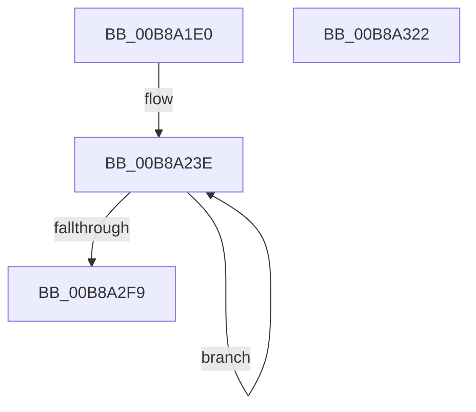

# KdpReportExceptionStateChange

- RVA: `0x00B8A1E0`–`0x00B8A323` (길이 `323` bytes)
- VA: `0x0000000140B8A1E0`
- 실행 섹션: `PAGEKD`
- PDB 이름 있음: `예`; PDB Function 태그: `아니요`
- unwind 정보 RVA: `0x000BE3E0`
- 디코드: `80`개 명령, `323/323` bytes 표시
- 미해석 바이트: `0` (있으면 어셈블리에 `.byte`로 보존)

> 이 문서는 커널 이미지의 기계어와 PDB 기호를 분석해 생성했습니다. 4번과 5번은 함수 원형과 자료형을 바이너리 사용 방식에서 추정한 C 해석이며 원본 소스 복구 결과는 아닙니다.

## 1. Dependencies

- 직접 호출 지점: **5**; 고유 호출 대상: **5**
- 직접 호출자로 확인된 함수: **2**
- RIP 상대 이미지 참조: **1**

### Outgoing calls
- `0x00B8A236` → [memset](../../text/6C/memset_function_006C6C40.md) (function, `0x006C6C40`)
- `0x00B8A24B` → [KdpSetCommonState](../../text/4E/KdpSetCommonState_function_004E0298.md) (function, `0x004E0298`)
- `0x00B8A2C3` → [KdpSetContextState](KdpSetContextState_function_00B85164.md) (function, `0x00B85164`)
- `0x00B8A2EB` → [KdpSendWaitContinue](KdpSendWaitContinue_function_00B8A32C.md) (function, `0x00B8A32C`)
- `0x00B8A300` → [_security_check_cookie](../../text/6A/_security_check_cookie_function_006AC640.md) (function, `0x006AC640`)

### Direct callers
- [KdpReport](../../text/4D/KdpReport_function_004DF360.md) at `0x004DF425`
- [KiFreezeTargetExecution](../../text/5C/KiFreezeTargetExecution_function_005C30A0.md) at `0x005C3212`

### Static image references
- `0x00B8A1FF` → RVA `0x00E0A740` (`.data`; read)

## 2. Other-region calls and transfers

- 다른 실행 섹션으로 향하는 call: **3**
  - `0x00B8A236` → [memset](../../text/6C/memset_function_006C6C40.md) (`PAGEKD` → `.text`)
  - `0x00B8A24B` → [KdpSetCommonState](../../text/4E/KdpSetCommonState_function_004E0298.md) (`PAGEKD` → `.text`)
  - `0x00B8A300` → [_security_check_cookie](../../text/6A/_security_check_cookie_function_006AC640.md) (`PAGEKD` → `.text`)
- 별도 외부 분기/꼬리 이동을 확인하지 못했습니다.

## 3. Assembly (complete function range)

```asm
00B8A1E0  48 8B C4                        mov rax, rsp
00B8A1E3  48 89 58 08                     mov qword ptr [rax + 8], rbx
00B8A1E7  48 89 70 18                     mov qword ptr [rax + 0x18], rsi
00B8A1EB  48 89 78 20                     mov qword ptr [rax + 0x20], rdi
00B8A1EF  55                              push rbp
00B8A1F0  41 56                           push r14
00B8A1F2  41 57                           push r15
00B8A1F4  48 8D 68 A8                     lea rbp, [rax - 0x58]
00B8A1F8  48 81 EC 40 01 00 00            sub rsp, 0x140
00B8A1FF  48 8B 05 3A 05 28 00            mov rax, qword ptr [rip + 0x28053a]
00B8A206  48 33 C4                        xor rax, rsp
00B8A209  48 89 45 30                     mov qword ptr [rbp + 0x30], rax
00B8A20D  41 8A F8                        mov dil, r8b
00B8A210  48 8B DA                        mov rbx, rdx
00B8A213  48 8B F1                        mov rsi, rcx
00B8A216  0F 57 C0                        xorps xmm0, xmm0
00B8A219  0F 57 C9                        xorps xmm1, xmm1
00B8A21C  48 8D 4C 24 40                  lea rcx, [rsp + 0x40]
00B8A221  41 BE F0 00 00 00               mov r14d, 0xf0
00B8A227  33 D2                           xor edx, edx
00B8A229  45 8B C6                        mov r8d, r14d
00B8A22C  0F 11 44 24 30                  movups xmmword ptr [rsp + 0x30], xmm0
00B8A231  0F 11 4C 24 20                  movups xmmword ptr [rsp + 0x20], xmm1
00B8A236  E8 05 CA B3 FF                  call 0x1406c6c40
00B8A23B  45 33 FF                        xor r15d, r15d
00B8A23E  4C 8D 44 24 40                  lea r8, [rsp + 0x40]
00B8A243  48 8B D3                        mov rdx, rbx
00B8A246  B9 30 30 00 00                  mov ecx, 0x3030
00B8A24B  E8 48 60 95 FF                  call 0x1404e0298
00B8A250  48 8B 86 90 00 00 00            mov rax, qword ptr [rsi + 0x90]
00B8A257  48 8D 4C 24 60                  lea rcx, [rsp + 0x60]
00B8A25C  0F 10 06                        movups xmm0, xmmword ptr [rsi]
00B8A25F  40 84 FF                        test dil, dil
00B8A262  48 8B D3                        mov rdx, rbx
00B8A265  0F 10 4E 10                     movups xmm1, xmmword ptr [rsi + 0x10]
00B8A269  0F 11 01                        movups xmmword ptr [rcx], xmm0
00B8A26C  0F 10 46 20                     movups xmm0, xmmword ptr [rsi + 0x20]
00B8A270  0F 11 49 10                     movups xmmword ptr [rcx + 0x10], xmm1
00B8A274  0F 10 4E 30                     movups xmm1, xmmword ptr [rsi + 0x30]
00B8A278  0F 11 41 20                     movups xmmword ptr [rcx + 0x20], xmm0
00B8A27C  0F 10 46 40                     movups xmm0, xmmword ptr [rsi + 0x40]
00B8A280  0F 11 49 30                     movups xmmword ptr [rcx + 0x30], xmm1
00B8A284  0F 10 4E 50                     movups xmm1, xmmword ptr [rsi + 0x50]
00B8A288  0F 11 41 40                     movups xmmword ptr [rcx + 0x40], xmm0
00B8A28C  0F 10 46 60                     movups xmm0, xmmword ptr [rsi + 0x60]
00B8A290  0F 11 49 50                     movups xmmword ptr [rcx + 0x50], xmm1
00B8A294  0F 10 4E 70                     movups xmm1, xmmword ptr [rsi + 0x70]
00B8A298  0F 11 41 60                     movups xmmword ptr [rcx + 0x60], xmm0
00B8A29C  0F 10 86 80 00 00 00            movups xmm0, xmmword ptr [rsi + 0x80]
00B8A2A3  0F 11 49 70                     movups xmmword ptr [rcx + 0x70], xmm1
00B8A2A7  0F 11 81 80 00 00 00            movups xmmword ptr [rcx + 0x80], xmm0
00B8A2AE  48 89 81 90 00 00 00            mov qword ptr [rcx + 0x90], rax
00B8A2B5  41 8B C7                        mov eax, r15d
00B8A2B8  0F 94 C0                        sete al
00B8A2BB  48 8D 4C 24 40                  lea rcx, [rsp + 0x40]
00B8A2C0  89 45 F8                        mov dword ptr [rbp - 8], eax
00B8A2C3  E8 9C AE FF FF                  call 0x140b85164
00B8A2C8  48 8D 44 24 40                  lea rax, [rsp + 0x40]
00B8A2CD  66 44 89 74 24 20               mov word ptr [rsp + 0x20], r14w
00B8A2D3  4C 8B CB                        mov r9, rbx
00B8A2D6  48 89 44 24 28                  mov qword ptr [rsp + 0x28], rax
00B8A2DB  4C 8D 44 24 30                  lea r8, [rsp + 0x30]
00B8A2E0  66 44 89 7C 24 30               mov word ptr [rsp + 0x30], r15w
00B8A2E6  48 8D 54 24 20                  lea rdx, [rsp + 0x20]
00B8A2EB  E8 3C 00 00 00                  call 0x140b8a32c
00B8A2F0  83 F8 02                        cmp eax, 2
00B8A2F3  0F 84 45 FF FF FF               je 0x140b8a23e
00B8A2F9  48 8B 4D 30                     mov rcx, qword ptr [rbp + 0x30]
00B8A2FD  48 33 CC                        xor rcx, rsp
00B8A300  E8 3B 23 B2 FF                  call 0x1406ac640
00B8A305  4C 8D 9C 24 40 01 00 00         lea r11, [rsp + 0x140]
00B8A30D  49 8B 5B 20                     mov rbx, qword ptr [r11 + 0x20]
00B8A311  49 8B 73 30                     mov rsi, qword ptr [r11 + 0x30]
00B8A315  49 8B 7B 38                     mov rdi, qword ptr [r11 + 0x38]
00B8A319  49 8B E3                        mov rsp, r11
00B8A31C  41 5F                           pop r15
00B8A31E  41 5E                           pop r14
00B8A320  5D                              pop rbp
00B8A321  C3                              ret
00B8A322  CC                              int3
```

## 4. C-style interpretation (structured pseudocode)

```c
__int64 __fastcall KdpReportExceptionStateChange(__int64 a1, __int64 a2, unsigned __int8 a3)
{
    __int64 result;
    __int64 v_r15;
    __int64 v_rsp;
    unsigned __int64 v_stack_m118;
    unsigned __int64 v_stack_m128;
    unsigned __int64 v_stack_m130;
    unsigned __int64 v_stack_m138;
    unsigned __int64 v_stack_m18;
    unsigned __int64 v_stack_mF8;

    *(unsigned __int64 *)(v_rsp + 8) = v_rbx;
    *(unsigned __int64 *)(v_rsp + 24) = v_rsi;
    *(unsigned __int64 *)(v_rsp + 32) = v_rdi;
    v_rsp = (v_rsp) - (320);
    result = (*(unsigned __int64 *)(v_rip + 2622778)) ^ (v_rsp);
    *(unsigned __int64 *)(v_rsp - 88 + 48) = result;
    a2 = 0;
    v_stack_m128 = v_xmm0;
    v_stack_m138 = v_xmm1;
    result = memset(v_stack_m118, a2, 240, a4);
    v_r15 = 0;
loc_00B8A23E:
    result = KdpSetCommonState((unsigned int)(0x3030ULL), 0, v_stack_m118, a4);
    *(unsigned __int64 *)(v_stack_mF8) = v_xmm0;
    *(unsigned __int64 *)(v_stack_mF8 + 16) = v_xmm1;
    *(unsigned __int64 *)(v_stack_mF8 + 32) = v_xmm0;
    *(unsigned __int64 *)(v_stack_mF8 + 48) = v_xmm1;
    *(unsigned __int64 *)(v_stack_mF8 + 64) = v_xmm0;
    *(unsigned __int64 *)(v_stack_mF8 + 80) = v_xmm1;
    *(unsigned __int64 *)(v_stack_mF8 + 96) = v_xmm0;
    *(unsigned __int64 *)(v_stack_mF8 + 112) = v_xmm1;
    *(unsigned __int64 *)(v_stack_mF8 + 128) = v_xmm0;
    *(unsigned __int64 *)(v_stack_mF8 + 144) = *(unsigned __int64 *)(a1 + 144);
    result = (a3 == 0) ? 1 : 0;
    *(unsigned int *)(v_rsp - 88 - 8) = (unsigned int)(result);
    result = KdpSetContextState(v_stack_m118, 0, v_stack_m118, a4);
    v_stack_m138 = 240;
    v_stack_m130 = v_stack_m118;
    v_stack_m128 = 0;
    result = KdpSendWaitContinue(v_stack_m118, v_stack_m138, v_stack_m128, 0);
    if (((unsigned int)(result)) == 2) goto loc_00B8A23E;
    a1 = (*(unsigned __int64 *)(v_rsp - 88 + 48)) ^ (v_rsp);
    result = _security_check_cookie(a1, v_stack_m138, v_stack_m128, 0);
    return result;
}
```

## 5. (Beta) C Style

```c
int64_t KdpReportExceptionStateChange(void *Arg1, int64_t Arg2, uint8_t Arg3)
{
    uint8_t *arg1 = (uint8_t *)Arg1;

    int64_t result;
    int64_t local_r15;
    int64_t local_rsp;
    uint64_t v_stack_m118;
    uint64_t v_stack_m128;
    uint64_t v_stack_m130;
    uint64_t v_stack_m138;
    uint64_t v_stack_m18;
    uint64_t v_stack_mF8;

    *(uint64_t *)(local_rsp + 0x8) = local_rbx;
    *(uint64_t *)(local_rsp + 0x18) = local_rsi;
    *(uint64_t *)(local_rsp + 0x20) = local_rdi;
    local_rsp = (local_rsp) - (320);
    result = (*(uint64_t *)(v_rip + 0x28053A)) ^ (local_rsp);
    *(uint64_t *)(local_rsp - 0x58 + 0x30) = result;
    Arg2 = 0;
    v_stack_m128 = v_xmm0;
    v_stack_m138 = v_xmm1;
    result = memset(v_stack_m118, Arg2, 240, a4);
    local_r15 = 0;
loc_00B8A23E:
    result = KdpSetCommonState((uint32_t)(0x3030ULL), 0, v_stack_m118, a4);
    *(uint64_t *)(v_stack_mF8) = v_xmm0;
    *(uint64_t *)(v_stack_mF8 + 0x10) = v_xmm1;
    *(uint64_t *)(v_stack_mF8 + 0x20) = v_xmm0;
    *(uint64_t *)(v_stack_mF8 + 0x30) = v_xmm1;
    *(uint64_t *)(v_stack_mF8 + 0x40) = v_xmm0;
    *(uint64_t *)(v_stack_mF8 + 0x50) = v_xmm1;
    *(uint64_t *)(v_stack_mF8 + 0x60) = v_xmm0;
    *(uint64_t *)(v_stack_mF8 + 0x70) = v_xmm1;
    *(uint64_t *)(v_stack_mF8 + 0x80) = v_xmm0;
    *(uint64_t *)(v_stack_mF8 + 0x90) = *(uint64_t *)(arg1 + 0x90);
    result = (Arg3 == 0) ? 1 : 0;
    *(uint32_t *)(local_rsp - 0x58 - 0x8) = (uint32_t)(result);
    result = KdpSetContextState(v_stack_m118, 0, v_stack_m118, a4);
    v_stack_m138 = 240;
    v_stack_m130 = v_stack_m118;
    v_stack_m128 = 0;
    result = KdpSendWaitContinue(v_stack_m118, v_stack_m138, v_stack_m128, 0);
    if (((uint32_t)(result)) == 2) goto loc_00B8A23E;
    Arg1 = (*(uint64_t *)(local_rsp - 0x58 + 0x30)) ^ (local_rsp);
    result = _security_check_cookie(Arg1, v_stack_m138, v_stack_m128, 0);
    return result;
}
```

### 관측된 메모리 오프셋

구조체 형식이 확인되지 않은 접근은 인자 기준의 오프셋으로만 기록했습니다.

| 기준 인자 | 오프셋 표현 | 폭 (bit) | 접근 |
|---|---:|---:|---|
| `Arg1` | `+ 0x0` | `128` | `R` |
| `Arg1` | `+ 0x10` | `128` | `R` |
| `Arg1` | `+ 0x20` | `128` | `R` |
| `Arg1` | `+ 0x30` | `128` | `R` |
| `Arg1` | `+ 0x40` | `128` | `R` |
| `Arg1` | `+ 0x50` | `128` | `R` |
| `Arg1` | `+ 0x60` | `128` | `R` |
| `Arg1` | `+ 0x70` | `128` | `R` |
| `Arg1` | `+ 0x80` | `128` | `R` |
| `Arg1` | `+ 0x90` | `64` | `R` |

## 6. Execution-region graph

[열기: 2D/3D 그래프와 함수 탐색 컨트롤 패널](../../../control-panel.html?section=pagekd&rva=0x00B8A1E0&view=graph)

- 2D 그래프는 위에서 아래로 흐르고, 3D 그래프는 빈 공간을 드래그해 회전합니다. Shift+드래그는 이동, 휠은 확대·축소, 함수 노드 선택은 대상 보고서 이동입니다.

### Static fallback


