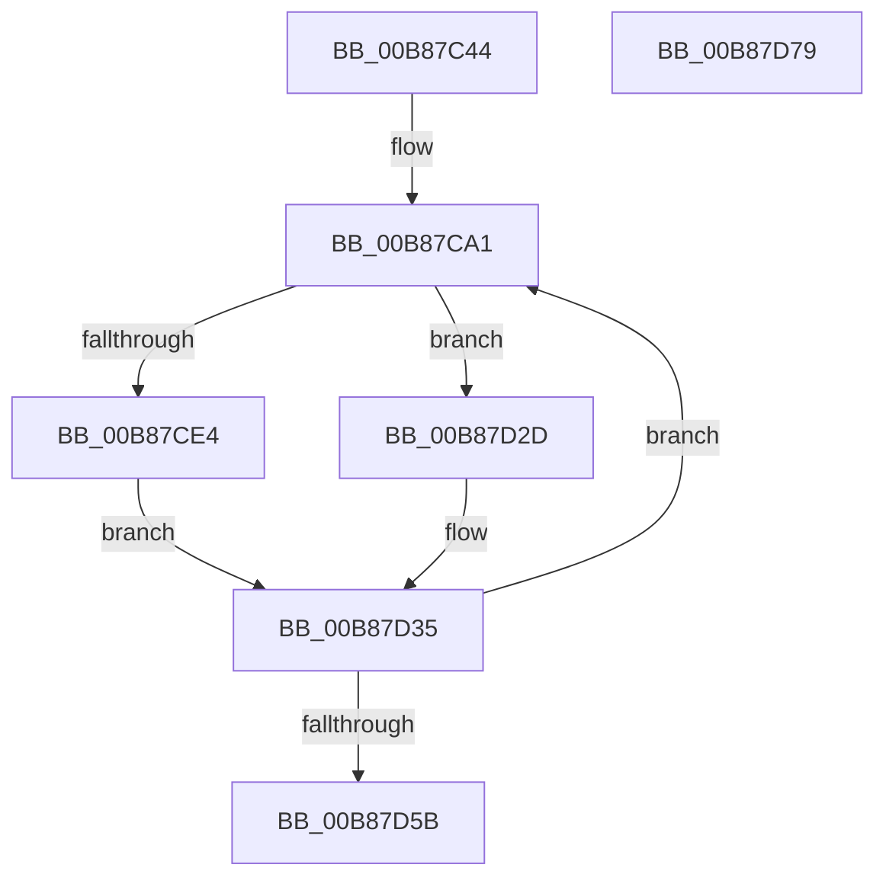

# KdpReportLoadSymbolsStateChange

- RVA: `0x00B87C44`–`0x00B87D7A` (길이 `310` bytes)
- VA: `0x0000000140B87C44`
- 실행 섹션: `PAGEKD`
- PDB 이름 있음: `예`; PDB Function 태그: `아니요`
- unwind 정보 RVA: `0x000C99E8`
- 디코드: `84`개 명령, `310/310` bytes 표시
- 미해석 바이트: `0` (있으면 어셈블리에 `.byte`로 보존)

> 이 문서는 커널 이미지의 기계어와 PDB 기호를 분석해 생성했습니다. 4번과 5번은 함수 원형과 자료형을 바이너리 사용 방식에서 추정한 C 해석이며 원본 소스 복구 결과는 아닙니다.

## 1. Dependencies

- 직접 호출 지점: **6**; 고유 호출 대상: **6**
- 직접 호출자로 확인된 함수: **1**
- RIP 상대 이미지 참조: **2**

### Outgoing calls
- `0x00B87C95` → [memset](../../text/6C/memset_function_006C6C40.md) (function, `0x006C6C40`)
- `0x00B87CAE` → [KdpSetCommonState](../../text/4E/KdpSetCommonState_function_004E0298.md) (function, `0x004E0298`)
- `0x00B87CBB` → [KdpSetContextState](KdpSetContextState_function_00B85164.md) (function, `0x00B85164`)
- `0x00B87D04` → [KdpCopyMemoryChunks](KdpCopyMemoryChunks_function_00B8AACC.md) (function, `0x00B8AACC`)
- `0x00B87D4D` → [KdpSendWaitContinue](KdpSendWaitContinue_function_00B8A32C.md) (function, `0x00B8A32C`)
- `0x00B87D62` → [_security_check_cookie](../../text/6A/_security_check_cookie_function_006AC640.md) (function, `0x006AC640`)

### Direct callers
- [KdpSymbol](KdpSymbol_function_00B89220.md) at `0x00B892B3`

### Static image references
- `0x00B87C5B` → RVA `0x00E0A740` (`.data`; read)
- `0x00B87C9A` → RVA `0x00F48620` (`.data`; read)

## 2. Other-region calls and transfers

- 다른 실행 섹션으로 향하는 call: **3**
  - `0x00B87C95` → [memset](../../text/6C/memset_function_006C6C40.md) (`PAGEKD` → `.text`)
  - `0x00B87CAE` → [KdpSetCommonState](../../text/4E/KdpSetCommonState_function_004E0298.md) (`PAGEKD` → `.text`)
  - `0x00B87D62` → [_security_check_cookie](../../text/6A/_security_check_cookie_function_006AC640.md) (`PAGEKD` → `.text`)
- 별도 외부 분기/꼬리 이동을 확인하지 못했습니다.

## 3. Assembly (complete function range)

```asm
00B87C44  40 55                           push rbp
00B87C46  53                              push rbx
00B87C47  56                              push rsi
00B87C48  57                              push rdi
00B87C49  41 54                           push r12
00B87C4B  41 56                           push r14
00B87C4D  41 57                           push r15
00B87C4F  48 8D 6C 24 B0                  lea rbp, [rsp - 0x50]
00B87C54  48 81 EC 50 01 00 00            sub rsp, 0x150
00B87C5B  48 8B 05 DE 2A 28 00            mov rax, qword ptr [rip + 0x282ade]
00B87C62  48 33 C4                        xor rax, rsp
00B87C65  48 89 45 40                     mov qword ptr [rbp + 0x40], rax
00B87C69  45 8A F0                        mov r14b, r8b
00B87C6C  48 8B DA                        mov rbx, rdx
00B87C6F  48 8B F1                        mov rsi, rcx
00B87C72  0F 57 C0                        xorps xmm0, xmm0
00B87C75  0F 57 C9                        xorps xmm1, xmm1
00B87C78  48 8D 4C 24 50                  lea rcx, [rsp + 0x50]
00B87C7D  41 BC F0 00 00 00               mov r12d, 0xf0
00B87C83  33 D2                           xor edx, edx
00B87C85  45 8B C4                        mov r8d, r12d
00B87C88  49 8B F9                        mov rdi, r9
00B87C8B  0F 11 44 24 30                  movups xmmword ptr [rsp + 0x30], xmm0
00B87C90  0F 11 4C 24 40                  movups xmmword ptr [rsp + 0x40], xmm1
00B87C95  E8 A6 EF B3 FF                  call 0x1406c6c40
00B87C9A  4C 8D 3D 7F 09 3C 00            lea r15, [rip + 0x3c097f]
00B87CA1  4C 8D 44 24 50                  lea r8, [rsp + 0x50]
00B87CA6  48 8B D7                        mov rdx, rdi
00B87CA9  B9 31 30 00 00                  mov ecx, 0x3031
00B87CAE  E8 E5 85 95 FF                  call 0x1404e0298
00B87CB3  48 8B D7                        mov rdx, rdi
00B87CB6  48 8D 4C 24 50                  lea rcx, [rsp + 0x50]
00B87CBB  E8 A4 D4 FF FF                  call 0x140b85164
00B87CC0  48 8B 03                        mov rax, qword ptr [rbx]
00B87CC3  48 89 44 24 78                  mov qword ptr [rsp + 0x78], rax
00B87CC8  8B 43 08                        mov eax, dword ptr [rbx + 8]
00B87CCB  48 89 45 80                     mov qword ptr [rbp - 0x80], rax
00B87CCF  8B 43 10                        mov eax, dword ptr [rbx + 0x10]
00B87CD2  89 45 88                        mov dword ptr [rbp - 0x78], eax
00B87CD5  8B 43 14                        mov eax, dword ptr [rbx + 0x14]
00B87CD8  89 45 8C                        mov dword ptr [rbp - 0x74], eax
00B87CDB  44 88 75 90                     mov byte ptr [rbp - 0x70], r14b
00B87CDF  48 85 F6                        test rsi, rsi
00B87CE2  74 49                           je 0x140b87d2d
00B87CE4  44 0F B7 06                     movzx r8d, word ptr [rsi]
00B87CE8  48 8D 44 24 70                  lea rax, [rsp + 0x70]
00B87CED  48 8B 4E 08                     mov rcx, qword ptr [rsi + 8]
00B87CF1  45 33 C9                        xor r9d, r9d
00B87CF4  48 89 44 24 28                  mov qword ptr [rsp + 0x28], rax
00B87CF9  49 8B D7                        mov rdx, r15
00B87CFC  C7 44 24 20 04 00 00 00         mov dword ptr [rsp + 0x20], 4
00B87D04  E8 C3 2D 00 00                  call 0x140b8aacc
00B87D09  8B 44 24 70                     mov eax, dword ptr [rsp + 0x70]
00B87D0D  4C 8D 44 24 30                  lea r8, [rsp + 0x30]
00B87D12  FF C0                           inc eax
00B87D14  4C 89 7C 24 38                  mov qword ptr [rsp + 0x38], r15
00B87D19  89 44 24 70                     mov dword ptr [rsp + 0x70], eax
00B87D1D  66 89 44 24 30                  mov word ptr [rsp + 0x30], ax
00B87D22  0F B7 C0                        movzx eax, ax
00B87D25  42 C6 44 38 FF 00               mov byte ptr [rax + r15 - 1], 0
00B87D2B  EB 08                           jmp 0x140b87d35
00B87D2D  83 64 24 70 00                  and dword ptr [rsp + 0x70], 0
00B87D32  45 33 C0                        xor r8d, r8d
00B87D35  48 8D 44 24 50                  lea rax, [rsp + 0x50]
00B87D3A  66 44 89 64 24 40               mov word ptr [rsp + 0x40], r12w
00B87D40  4C 8B CF                        mov r9, rdi
00B87D43  48 89 44 24 48                  mov qword ptr [rsp + 0x48], rax
00B87D48  48 8D 54 24 40                  lea rdx, [rsp + 0x40]
00B87D4D  E8 DA 25 00 00                  call 0x140b8a32c
00B87D52  83 F8 02                        cmp eax, 2
00B87D55  0F 84 46 FF FF FF               je 0x140b87ca1
00B87D5B  48 8B 4D 40                     mov rcx, qword ptr [rbp + 0x40]
00B87D5F  48 33 CC                        xor rcx, rsp
00B87D62  E8 D9 48 B2 FF                  call 0x1406ac640
00B87D67  48 81 C4 50 01 00 00            add rsp, 0x150
00B87D6E  41 5F                           pop r15
00B87D70  41 5E                           pop r14
00B87D72  41 5C                           pop r12
00B87D74  5F                              pop rdi
00B87D75  5E                              pop rsi
00B87D76  5B                              pop rbx
00B87D77  5D                              pop rbp
00B87D78  C3                              ret
00B87D79  CC                              int3
```

## 4. C-style interpretation (structured pseudocode)

```c
__int64 __fastcall KdpReportLoadSymbolsStateChange(__int64 a1, __int64 a2, unsigned __int8 a3, __int64 a4)
{
    __int64 result;
    __int64 v_rsp;
    unsigned int v_stack_m100;
    unsigned __int64 v_stack_m108;
    unsigned __int64 v_stack_m110;
    unsigned __int64 v_stack_m118;
    unsigned __int64 v_stack_m138;
    unsigned __int64 v_stack_m140;
    unsigned __int64 v_stack_m148;
    unsigned __int64 v_stack_m150;
    unsigned __int64 v_stack_m158;
    unsigned __int64 v_stack_m160;
    unsigned int v_stack_m168;
    unsigned __int64 v_stack_m48;
    unsigned __int64 v_stack_m88;
    unsigned __int8 v_stack_mF8;
    unsigned int v_stack_mFC;

    v_rsp = (v_rsp) - (336);
    result = (*(unsigned __int64 *)(v_rip + 2632414)) ^ (v_rsp);
    v_stack_m48 = result;
    a2 = 0;
    v_stack_m158 = v_xmm0;
    v_stack_m148 = v_xmm1;
    result = memset(v_stack_m138, a2, 240, a4);
loc_00B87CA1:
    result = KdpSetCommonState((unsigned int)(0x3031ULL), a4, v_stack_m138, a4);
    result = KdpSetContextState(v_stack_m138, a4, v_stack_m138, a4);
    v_stack_m110 = *(unsigned __int64 *)(a2);
    v_stack_m108 = (unsigned int)(*(unsigned int *)(a2 + 8));
    v_stack_m100 = (unsigned int)((unsigned int)(*(unsigned int *)(a2 + 16)));
    v_stack_mFC = (unsigned int)((unsigned int)(*(unsigned int *)(a2 + 20)));
    v_stack_mF8 = a3;
    if (a1 == 0) goto loc_00B87D2D;
    a4 = 0;
    v_stack_m160 = v_stack_m118;
    v_stack_m168 = 4;
    result = KdpCopyMemoryChunks(*(unsigned __int64 *)(a1 + 8), v_rip + 3934591, *(unsigned __int16 *)(a1), a4);
    result = (unsigned int)(((unsigned int)(v_stack_m118)) + 1);
    v_stack_m150 = v_rip + 3934591;
    v_stack_m118 = (unsigned int)(result);
    v_stack_m158 = (unsigned __int16)(result);
    *(unsigned __int8 *)((unsigned __int16)(result) + v_rip + 3934591 * 1 - 1) = 0;
    goto loc_00B87D35;
loc_00B87D2D:
    a3 = 0;
loc_00B87D35:
    v_stack_m148 = 240;
    v_stack_m140 = v_stack_m138;
    result = KdpSendWaitContinue(*(unsigned __int64 *)(a1 + 8), v_stack_m148, a3, 0);
    if (((unsigned int)(result)) == 2) goto loc_00B87CA1;
    a1 = (v_stack_m48) ^ (v_rsp);
    result = _security_check_cookie(a1, v_stack_m148, a3, 0);
    v_rsp = (v_rsp) + (336);
    return result;
}
```

## 5. (Beta) C Style

```c
int64_t KdpReportLoadSymbolsStateChange(int64_t Arg1, void *Arg2, uint8_t Arg3, int64_t Arg4)
{
    uint8_t *arg2 = (uint8_t *)Arg2;

    int64_t result;
    int64_t local_rsp;
    uint32_t v_stack_m100;
    uint64_t v_stack_m108;
    uint64_t v_stack_m110;
    uint64_t v_stack_m118;
    uint64_t v_stack_m138;
    uint64_t v_stack_m140;
    uint64_t v_stack_m148;
    uint64_t v_stack_m150;
    uint64_t v_stack_m158;
    uint64_t v_stack_m160;
    uint32_t v_stack_m168;
    uint64_t v_stack_m48;
    uint64_t v_stack_m88;
    uint8_t v_stack_mF8;
    uint32_t v_stack_mFC;

    local_rsp = (local_rsp) - (336);
    result = (*(uint64_t *)(v_rip + 0x282ADE)) ^ (local_rsp);
    v_stack_m48 = result;
    Arg2 = 0;
    v_stack_m158 = v_xmm0;
    v_stack_m148 = v_xmm1;
    result = memset(v_stack_m138, Arg2, 240, Arg4);
loc_00B87CA1:
    result = KdpSetCommonState((uint32_t)(0x3031ULL), Arg4, v_stack_m138, Arg4);
    result = KdpSetContextState(v_stack_m138, Arg4, v_stack_m138, Arg4);
    v_stack_m110 = *(uint64_t *)(arg2);
    v_stack_m108 = (uint32_t)(*(uint32_t *)(arg2 + 0x8));
    v_stack_m100 = (uint32_t)((uint32_t)(*(uint32_t *)(arg2 + 0x10)));
    v_stack_mFC = (uint32_t)((uint32_t)(*(uint32_t *)(arg2 + 0x14)));
    v_stack_mF8 = Arg3;
    if (Arg1 == 0) goto loc_00B87D2D;
    Arg4 = 0;
    v_stack_m160 = v_stack_m118;
    v_stack_m168 = 4;
    result = KdpCopyMemoryChunks(*(uint64_t *)(Arg1 + 0x8), v_rip + 3934591, *(uint16_t *)(Arg1), Arg4);
    result = (uint32_t)(((uint32_t)(v_stack_m118)) + 1);
    v_stack_m150 = v_rip + 3934591;
    v_stack_m118 = (uint32_t)(result);
    v_stack_m158 = (uint16_t)(result);
    *(uint8_t *)((uint16_t)(result) + v_rip + 0x3C097F * 1 - 0x1) = 0;
    goto loc_00B87D35;
loc_00B87D2D:
    Arg3 = 0;
loc_00B87D35:
    v_stack_m148 = 240;
    v_stack_m140 = v_stack_m138;
    result = KdpSendWaitContinue(*(uint64_t *)(Arg1 + 0x8), v_stack_m148, Arg3, 0);
    if (((uint32_t)(result)) == 2) goto loc_00B87CA1;
    Arg1 = (v_stack_m48) ^ (local_rsp);
    result = _security_check_cookie(Arg1, v_stack_m148, Arg3, 0);
    local_rsp = (local_rsp) + (336);
    return result;
}
```

### 관측된 메모리 오프셋

구조체 형식이 확인되지 않은 접근은 인자 기준의 오프셋으로만 기록했습니다.

| 기준 인자 | 오프셋 표현 | 폭 (bit) | 접근 |
|---|---:|---:|---|
| `Arg2` | `+ 0x0` | `64` | `R` |
| `Arg2` | `+ 0x8` | `32` | `R` |
| `Arg2` | `+ 0x10` | `32` | `R` |
| `Arg2` | `+ 0x14` | `32` | `R` |

## 6. Execution-region graph

[열기: 2D/3D 그래프와 함수 탐색 컨트롤 패널](../../../control-panel.html?section=pagekd&rva=0x00B87C44&view=graph)

- 2D 그래프는 위에서 아래로 흐르고, 3D 그래프는 빈 공간을 드래그해 회전합니다. Shift+드래그는 이동, 휠은 확대·축소, 함수 노드 선택은 대상 보고서 이동입니다.

### Static fallback


