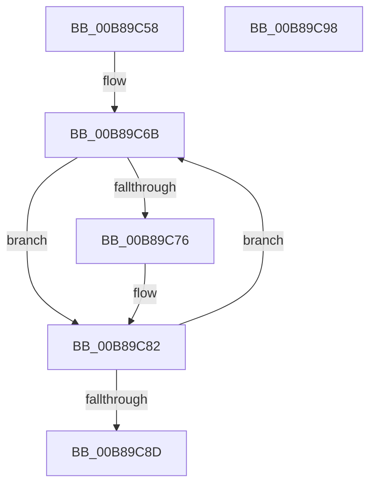

# KdpRestoreAllBreakpoints

- RVA: `0x00B89C58`–`0x00B89C99` (길이 `65` bytes)
- VA: `0x0000000140B89C58`
- 실행 섹션: `PAGEKD`
- PDB 이름 있음: `예`; PDB Function 태그: `아니요`
- unwind 정보 RVA: `0x0005CAAC`
- 디코드: `23`개 명령, `65/65` bytes 표시
- 미해석 바이트: `0` (있으면 어셈블리에 `.byte`로 보존)

> 이 문서는 커널 이미지의 기계어와 PDB 기호를 분석해 생성했습니다. 4번과 5번은 함수 원형과 자료형을 바이너리 사용 방식에서 추정한 C 해석이며 원본 소스 복구 결과는 아닙니다.

## 1. Dependencies

- 직접 호출 지점: **1**; 고유 호출 대상: **1**
- 직접 호출자로 확인된 함수: **1**
- RIP 상대 이미지 참조: **1**

### Outgoing calls
- `0x00B89C7D` → [KdpLowRestoreBreakpoint](KdpLowRestoreBreakpoint_function_00B89A54.md) (function, `0x00B89A54`)

### Direct callers
- [KdEnableDebuggerWithLock](../../text/5B/KdEnableDebuggerWithLock_function_005B0A7C.md) at `0x005B0B6F`
- [KdEnableDebuggerWithLock](../../text/5B/KdEnableDebuggerWithLock_function_005B0A7C.md) at `0x005B0B86`

### Static image references
- `0x00B89C64` → RVA `0x00F49660` (`.data`; read)

## 2. Other-region calls and transfers

- 다른 실행 섹션으로 향하는 call: **0**
- 별도 외부 분기/꼬리 이동을 확인하지 못했습니다.

## 3. Assembly (complete function range)

```asm
00B89C58  48 89 5C 24 08                  mov qword ptr [rsp + 8], rbx
00B89C5D  57                              push rdi
00B89C5E  48 83 EC 20                     sub rsp, 0x20
00B89C62  33 DB                           xor ebx, ebx
00B89C64  48 8D 3D F5 F9 3B 00            lea rdi, [rip + 0x3bf9f5]
00B89C6B  8B 0F                           mov ecx, dword ptr [rdi]
00B89C6D  8B C1                           mov eax, ecx
00B89C6F  83 E0 05                        and eax, 5
00B89C72  3C 05                           cmp al, 5
00B89C74  75 0C                           jne 0x140b89c82
00B89C76  83 E1 FB                        and ecx, 0xfffffffb
00B89C79  89 0F                           mov dword ptr [rdi], ecx
00B89C7B  8B CB                           mov ecx, ebx
00B89C7D  E8 D2 FD FF FF                  call 0x140b89a54
00B89C82  FF C3                           inc ebx
00B89C84  48 83 C7 28                     add rdi, 0x28
00B89C88  83 FB 20                        cmp ebx, 0x20
00B89C8B  72 DE                           jb 0x140b89c6b
00B89C8D  48 8B 5C 24 30                  mov rbx, qword ptr [rsp + 0x30]
00B89C92  48 83 C4 20                     add rsp, 0x20
00B89C96  5F                              pop rdi
00B89C97  C3                              ret
00B89C98  CC                              int3
```

## 4. C-style interpretation (structured pseudocode)

```c
__int64 __fastcall KdpRestoreAllBreakpoints(void)
{
    __int64 result;
    __int64 v_rbx;
    __int64 v_rdi;
    __int64 v_rsp;
    unsigned __int64 v_stack_p8;

    v_stack_p8 = v_rbx;
    v_rsp = (v_rsp) - (32);
    v_rbx = 0;
loc_00B89C6B:
    result = (unsigned int)(((unsigned int)((unsigned int)((unsigned int)(*(unsigned int *)(v_rip + 3930613))))) & (5));
    if (((unsigned __int8)(result)) == 5) {
        a1 = (unsigned int)(((unsigned int)(*(unsigned int *)(v_rip + 3930613))) & (0xFFFFFFFBULL));
        *(unsigned int *)(v_rip + 3930613) = (unsigned int)(a1);
        a1 = 0;
        result = KdpLowRestoreBreakpoint(a1, a2, a3, a4);
    }
    v_rbx = (unsigned int)((v_rbx) + 1);
    v_rdi = (v_rip + 3930613) + (40);
    if (((unsigned int)(v_rbx)) < 32) goto loc_00B89C6B;
    v_rsp = (v_rsp) + (32);
    return result;
}
```

## 5. (Beta) C Style

```c
void KdpRestoreAllBreakpoints(void)
{
    int64_t result;
    int64_t local_rbx;
    int64_t local_rdi;
    int64_t local_rsp;
    uint64_t v_stack_p8;

    v_stack_p8 = local_rbx;
    local_rsp = (local_rsp) - (32);
    local_rbx = 0;
loc_00B89C6B:
    result = (uint32_t)(((uint32_t)((uint32_t)((uint32_t)(*(uint32_t *)(v_rip + 0x3BF9F5))))) & (5));
    if (((uint8_t)(result)) == 5) {
        a1 = (uint32_t)(((uint32_t)(*(uint32_t *)(v_rip + 0x3BF9F5))) & (0xFFFFFFFBULL));
        *(uint32_t *)(v_rip + 0x3BF9F5) = (uint32_t)(a1);
        a1 = 0;
        result = KdpLowRestoreBreakpoint(a1, a2, a3, a4);
    }
    local_rbx = (uint32_t)((local_rbx) + 1);
    local_rdi = (v_rip + 3930613) + (40);
    if (((uint32_t)(local_rbx)) < 32) goto loc_00B89C6B;
    local_rsp = (local_rsp) + (32);
    return result;
}
```

## 6. Execution-region graph

[열기: 2D/3D 그래프와 함수 탐색 컨트롤 패널](../../../control-panel.html?section=pagekd&rva=0x00B89C58&view=graph)

- 2D 그래프는 위에서 아래로 흐르고, 3D 그래프는 빈 공간을 드래그해 회전합니다. Shift+드래그는 이동, 휠은 확대·축소, 함수 노드 선택은 대상 보고서 이동입니다.

### Static fallback


