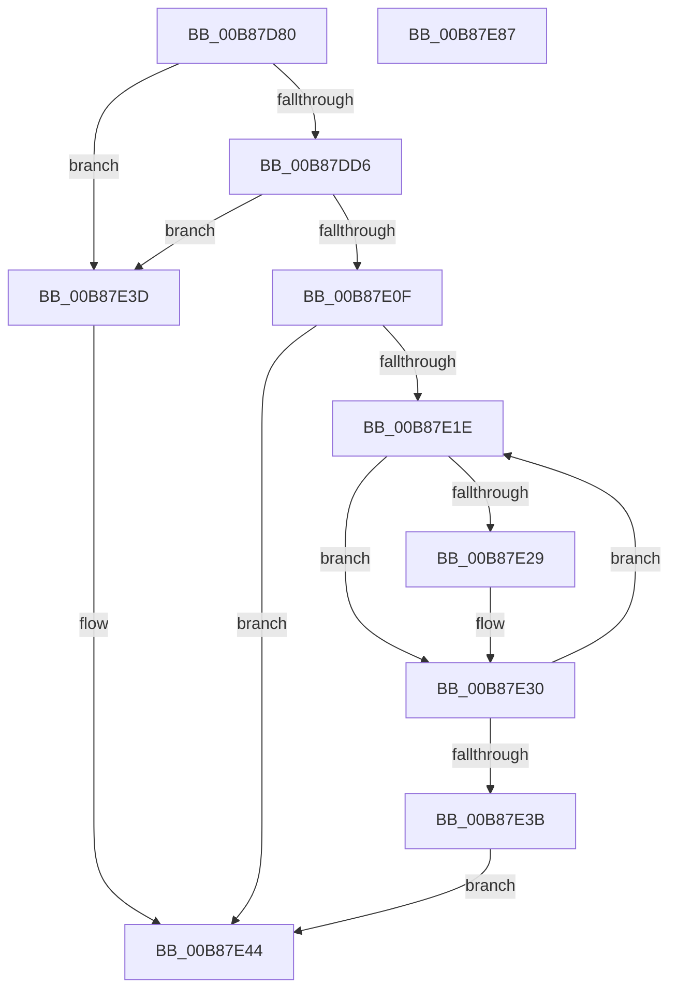

# KdpRestoreBreakPointEx

- RVA: `0x00B87D80`–`0x00B87E88` (길이 `264` bytes)
- VA: `0x0000000140B87D80`
- 실행 섹션: `PAGEKD`
- PDB 이름 있음: `예`; PDB Function 태그: `아니요`
- unwind 정보 RVA: `0x000C994C`
- 디코드: `68`개 명령, `264/264` bytes 표시
- 미해석 바이트: `0` (있으면 어셈블리에 `.byte`로 보존)

> 이 문서는 커널 이미지의 기계어와 PDB 기호를 분석해 생성했습니다. 4번과 5번은 함수 원형과 자료형을 바이너리 사용 방식에서 추정한 C 해석이며 원본 소스 복구 결과는 아닙니다.

## 1. Dependencies

- 직접 호출 지점: **4**; 고유 호출 대상: **4**
- 직접 호출자로 확인된 함수: **1**
- RIP 상대 이미지 참조: **3**

### Outgoing calls
- `0x00B87DF8` → [KdpCopyMemoryChunks](KdpCopyMemoryChunks_function_00B8AACC.md) (function, `0x00B8AACC`)
- `0x00B87E20` → [KdpDeleteBreakpoint](KdpDeleteBreakpoint_function_00B89988.md) (function, `0x00B89988`)
- `0x00B87E58` → `kdcom.dll!KdSendPacket` (import, 간접 대상; import `kdcom.dll!KdSendPacket`)
- `0x00B87E6F` → [_security_check_cookie](../../text/6A/_security_check_cookie_function_006AC640.md) (function, `0x006AC640`)

### Direct callers
- [KdpSendWaitContinue](KdpSendWaitContinue_function_00B8A32C.md) at `0x00B8A62B`

### Static image references
- `0x00B87D8F` → RVA `0x00E0A740` (`.data`; read)
- `0x00B87E44` → RVA `0x00F475E0` (`.data`; read)
- `0x00B87E58` → RVA `0x001516C0` (`kdcom.dll!KdSendPacket (IAT)`; read)

## 2. Other-region calls and transfers

- 다른 실행 섹션으로 향하는 call: **1**
  - `0x00B87E6F` → [_security_check_cookie](../../text/6A/_security_check_cookie_function_006AC640.md) (`PAGEKD` → `.text`)
- 별도 외부 분기/꼬리 이동을 확인하지 못했습니다.

## 3. Assembly (complete function range)

```asm
00B87D80  48 89 5C 24 18                  mov qword ptr [rsp + 0x18], rbx
00B87D85  55                              push rbp
00B87D86  56                              push rsi
00B87D87  57                              push rdi
00B87D88  48 81 EC E0 00 00 00            sub rsp, 0xe0
00B87D8F  48 8B 05 AA 29 28 00            mov rax, qword ptr [rip + 0x2829aa]
00B87D96  48 33 C4                        xor rax, rsp
00B87D99  48 89 84 24 D0 00 00 00         mov qword ptr [rsp + 0xd0], rax
00B87DA1  44 8B 41 10                     mov r8d, dword ptr [rcx + 0x10]
00B87DA5  48 8B D9                        mov rbx, rcx
00B87DA8  83 64 24 30 00                  and dword ptr [rsp + 0x30], 0
00B87DAD  B8 38 00 00 00                  mov eax, 0x38
00B87DB2  0F 57 C0                        xorps xmm0, xmm0
00B87DB5  48 8B EA                        mov rbp, rdx
00B87DB8  0F 11 44 24 38                  movups xmmword ptr [rsp + 0x38], xmm0
00B87DBD  48 89 4C 24 40                  mov qword ptr [rsp + 0x40], rcx
00B87DC2  41 8B C8                        mov ecx, r8d
00B87DC5  66 89 44 24 38                  mov word ptr [rsp + 0x38], ax
00B87DCA  0F B7 02                        movzx eax, word ptr [rdx]
00B87DCD  48 C1 E1 02                     shl rcx, 2
00B87DD1  48 3B C1                        cmp rax, rcx
00B87DD4  75 67                           jne 0x140b87e3d
00B87DD6  48 8B 4D 08                     mov rcx, qword ptr [rbp + 8]
00B87DDA  48 8D 44 24 30                  lea rax, [rsp + 0x30]
00B87DDF  48 89 44 24 28                  mov qword ptr [rsp + 0x28], rax
00B87DE4  48 8D 54 24 50                  lea rdx, [rsp + 0x50]
00B87DE9  41 C1 E0 02                     shl r8d, 2
00B87DED  45 33 C9                        xor r9d, r9d
00B87DF0  C7 44 24 20 04 00 00 00         mov dword ptr [rsp + 0x20], 4
00B87DF8  E8 CF 2C 00 00                  call 0x140b8aacc
00B87DFD  8B 53 10                        mov edx, dword ptr [rbx + 0x10]
00B87E00  8B 44 24 30                     mov eax, dword ptr [rsp + 0x30]
00B87E04  8B CA                           mov ecx, edx
00B87E06  48 C1 E1 02                     shl rcx, 2
00B87E0A  48 3B C1                        cmp rax, rcx
00B87E0D  75 2E                           jne 0x140b87e3d
00B87E0F  83 63 08 00                     and dword ptr [rbx + 8], 0
00B87E13  48 8D 74 24 50                  lea rsi, [rsp + 0x50]
00B87E18  33 FF                           xor edi, edi
00B87E1A  85 D2                           test edx, edx
00B87E1C  74 26                           je 0x140b87e44
00B87E1E  8B 0E                           mov ecx, dword ptr [rsi]
00B87E20  E8 63 1B 00 00                  call 0x140b89988
00B87E25  84 C0                           test al, al
00B87E27  75 07                           jne 0x140b87e30
00B87E29  C7 43 08 01 00 00 C0            mov dword ptr [rbx + 8], 0xc0000001
00B87E30  FF C7                           inc edi
00B87E32  48 83 C6 04                     add rsi, 4
00B87E36  3B 7B 10                        cmp edi, dword ptr [rbx + 0x10]
00B87E39  72 E3                           jb 0x140b87e1e
00B87E3B  EB 07                           jmp 0x140b87e44
00B87E3D  C7 43 08 01 00 00 C0            mov dword ptr [rbx + 8], 0xc0000001
00B87E44  4C 8D 0D 95 F7 3B 00            lea r9, [rip + 0x3bf795]
00B87E4B  4C 8B C5                        mov r8, rbp
00B87E4E  48 8D 54 24 38                  lea rdx, [rsp + 0x38]
00B87E53  B9 02 00 00 00                  mov ecx, 2
00B87E58  48 FF 15 61 98 5C FF            call qword ptr [rip - 0xa3679f]
00B87E5F  0F 1F 44 00 00                  nop dword ptr [rax + rax]
00B87E64  48 8B 8C 24 D0 00 00 00         mov rcx, qword ptr [rsp + 0xd0]
00B87E6C  48 33 CC                        xor rcx, rsp
00B87E6F  E8 CC 47 B2 FF                  call 0x1406ac640
00B87E74  48 8B 9C 24 10 01 00 00         mov rbx, qword ptr [rsp + 0x110]
00B87E7C  48 81 C4 E0 00 00 00            add rsp, 0xe0
00B87E83  5F                              pop rdi
00B87E84  5E                              pop rsi
00B87E85  5D                              pop rbp
00B87E86  C3                              ret
00B87E87  CC                              int3
```

## 4. C-style interpretation (structured pseudocode)

```c
__int64 __fastcall KdpRestoreBreakPointEx(__int64 a1, __int64 a2, __int64 a3, int a4)
{
    __int64 result;
    __int64 v_rdi;
    __int64 v_rsi;
    __int64 v_rsp;
    unsigned __int64 v_stack_m28;
    unsigned __int64 v_stack_mA8;
    unsigned __int64 v_stack_mB8;
    unsigned __int64 v_stack_mC0;
    unsigned int v_stack_mC8;
    unsigned __int64 v_stack_mD0;
    unsigned int v_stack_mD8;
    unsigned __int64 v_stack_p18;

    v_stack_p18 = v_rbx;
    v_rsp = (v_rsp) - (224);
    result = (*(unsigned __int64 *)(v_rip + 2632106)) ^ (v_rsp);
    v_stack_m28 = result;
    v_stack_mC0 = v_xmm0;
    v_stack_mB8 = a1;
    v_stack_mC0 = 56;
    a1 = ((unsigned int)((unsigned int)((unsigned int)(*(unsigned int *)(a1 + 16))))) << (2);
    if ((*(unsigned __int16 *)(a2)) != a1) goto loc_00B87E3D;
    v_stack_mD0 = v_stack_mC8;
    a3 = (unsigned int)(((unsigned int)(*(unsigned int *)(a1 + 16))) << (2));
    a4 = 0;
    v_stack_mD8 = 4;
    result = KdpCopyMemoryChunks(*(unsigned __int64 *)(a2 + 8), v_stack_mA8, a3, a4);
    a1 = ((unsigned int)((unsigned int)((unsigned int)(*(unsigned int *)(a1 + 16))))) << (2);
    if (((unsigned int)(v_stack_mC8)) != a1) goto loc_00B87E3D;
    v_rdi = 0;
    if ((unsigned int)((unsigned int)(*(unsigned int *)(a1 + 16))) == 0) goto loc_00B87E44;
loc_00B87E1E:
    result = KdpDeleteBreakpoint((unsigned int)(*(unsigned int *)(v_stack_mA8)), (unsigned int)(*(unsigned int *)(a1 + 16)), a3, a4);
    if ((unsigned __int8)(result) == 0) {
        *(unsigned int *)(a1 + 8) = 0xC0000001ULL;
    }
    v_rdi = (unsigned int)((v_rdi) + 1);
    v_rsi = (v_stack_mA8) + (4);
    if (((unsigned int)(v_rdi)) < (*(unsigned int *)(a1 + 16))) goto loc_00B87E1E;
    goto loc_00B87E44;
loc_00B87E3D:
    *(unsigned int *)(a1 + 8) = 0xC0000001ULL;
loc_00B87E44:
    result = kdcom_dll_KdSendPacket(2, v_stack_mC0, a2, v_rip + 3930005);
    a1 = (v_stack_m28) ^ (v_rsp);
    result = _security_check_cookie(a1, v_stack_mC0, a2, v_rip + 3930005);
    v_rsp = (v_rsp) + (224);
    return result;
}
```

## 5. (Beta) C Style

```c
int64_t KdpRestoreBreakPointEx(void *Arg1, void *Arg2, int64_t Arg3, int32_t Arg4)
{
    uint8_t *arg1 = (uint8_t *)Arg1;
    uint8_t *arg2 = (uint8_t *)Arg2;

    int64_t result;
    int64_t local_rdi;
    int64_t local_rsi;
    int64_t local_rsp;
    uint64_t v_stack_m28;
    uint64_t v_stack_mA8;
    uint64_t v_stack_mB8;
    uint64_t v_stack_mC0;
    uint32_t v_stack_mC8;
    uint64_t v_stack_mD0;
    uint32_t v_stack_mD8;
    uint64_t v_stack_p18;

    v_stack_p18 = local_rbx;
    local_rsp = (local_rsp) - (224);
    result = (*(uint64_t *)(v_rip + 0x2829AA)) ^ (local_rsp);
    v_stack_m28 = result;
    v_stack_mC0 = v_xmm0;
    v_stack_mB8 = Arg1;
    v_stack_mC0 = 56;
    Arg1 = ((uint32_t)((uint32_t)((uint32_t)(*(uint32_t *)(arg1 + 0x10))))) << (2);
    if ((*(uint16_t *)(arg2)) != Arg1) goto loc_00B87E3D;
    v_stack_mD0 = v_stack_mC8;
    Arg3 = (uint32_t)(((uint32_t)(*(uint32_t *)(arg1 + 0x10))) << (2));
    Arg4 = 0;
    v_stack_mD8 = 4;
    result = KdpCopyMemoryChunks(*(uint64_t *)(arg2 + 0x8), v_stack_mA8, Arg3, Arg4);
    Arg1 = ((uint32_t)((uint32_t)((uint32_t)(*(uint32_t *)(arg1 + 0x10))))) << (2);
    if (((uint32_t)(v_stack_mC8)) != Arg1) goto loc_00B87E3D;
    local_rdi = 0;
    if ((uint32_t)((uint32_t)(*(uint32_t *)(arg1 + 0x10))) == 0) goto loc_00B87E44;
loc_00B87E1E:
    result = KdpDeleteBreakpoint((uint32_t)(*(uint32_t *)(v_stack_mA8)), (uint32_t)(*(uint32_t *)(arg1 + 0x10)), Arg3, Arg4);
    if ((uint8_t)(result) == 0) {
        *(uint32_t *)(arg1 + 0x8) = 0xC0000001ULL;
    }
    local_rdi = (uint32_t)((local_rdi) + 1);
    local_rsi = (v_stack_mA8) + (4);
    if (((uint32_t)(local_rdi)) < (*(uint32_t *)(arg1 + 0x10))) goto loc_00B87E1E;
    goto loc_00B87E44;
loc_00B87E3D:
    *(uint32_t *)(arg1 + 0x8) = 0xC0000001ULL;
loc_00B87E44:
    result = kernel_indirect_call(2, v_stack_mC0, Arg2, v_rip + 3930005);
    Arg1 = (v_stack_m28) ^ (local_rsp);
    result = _security_check_cookie(Arg1, v_stack_mC0, Arg2, v_rip + 3930005);
    local_rsp = (local_rsp) + (224);
    return result;
}
```

### 관측된 메모리 오프셋

구조체 형식이 확인되지 않은 접근은 인자 기준의 오프셋으로만 기록했습니다.

| 기준 인자 | 오프셋 표현 | 폭 (bit) | 접근 |
|---|---:|---:|---|
| `Arg1` | `+ 0x8` | `32` | `R/W` |
| `Arg1` | `+ 0x8` | `32` | `W` |
| `Arg1` | `+ 0x10` | `32` | `R` |
| `Arg2` | `+ 0x0` | `16` | `R` |
| `Arg2` | `+ 0x8` | `64` | `R` |

## 6. Execution-region graph

[열기: 2D/3D 그래프와 함수 탐색 컨트롤 패널](../../../control-panel.html?section=pagekd&rva=0x00B87D80&view=graph)

- 2D 그래프는 위에서 아래로 흐르고, 3D 그래프는 빈 공간을 드래그해 회전합니다. Shift+드래그는 이동, 휠은 확대·축소, 함수 노드 선택은 대상 보고서 이동입니다.

### Static fallback


