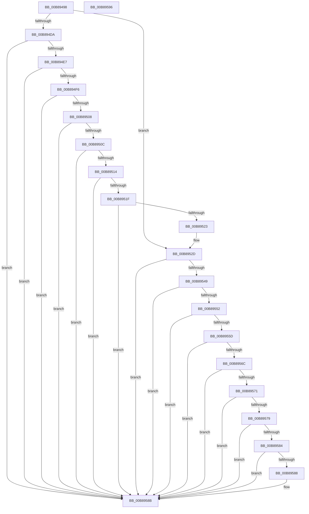

# KdpSanitizeContextFlags

- RVA: `0x00B89498`–`0x00B89597` (길이 `255` bytes)
- VA: `0x0000000140B89498`
- 실행 섹션: `PAGEKD`
- PDB 이름 있음: `예`; PDB Function 태그: `아니요`
- unwind 정보 RVA: `0x000950EC`
- 디코드: `74`개 명령, `255/255` bytes 표시
- 미해석 바이트: `0` (있으면 어셈블리에 `.byte`로 보존)

> 이 문서는 커널 이미지의 기계어와 PDB 기호를 분석해 생성했습니다. 4번과 5번은 함수 원형과 자료형을 바이너리 사용 방식에서 추정한 C 해석이며 원본 소스 복구 결과는 아닙니다.

## 1. Dependencies

- 직접 호출 지점: **0**; 고유 호출 대상: **0**
- 직접 호출자로 확인된 함수: **2**
- RIP 상대 이미지 참조: **0**

### Outgoing calls
- 직접 디코드된 call 명령이 없습니다.

### Direct callers
- [KdpSetContextEx](../../text/5B/KdpSetContextEx_function_005B0D64.md) at `0x005B0E32`
- [KdpSetContext](KdpSetContext_function_00B88424.md) at `0x00B884A1`

### Static image references
- 디코드된 RIP-relative 메모리 참조가 없습니다.

## 2. Other-region calls and transfers

- 다른 실행 섹션으로 향하는 call: **0**
- 별도 외부 분기/꼬리 이동을 확인하지 못했습니다.

## 3. Assembly (complete function range)

```asm
00B89498  48 89 5C 24 08                  mov qword ptr [rsp + 8], rbx
00B8949D  48 89 7C 24 10                  mov qword ptr [rsp + 0x10], rdi
00B894A2  8B 79 30                        mov edi, dword ptr [rcx + 0x30]
00B894A5  4C 8D 89 D0 04 00 00            lea r9, [rcx + 0x4d0]
00B894AC  65 48 8B 04 25 20 00 00 00      mov rax, qword ptr gs:[0x20]
00B894B5  44 8B D7                        mov r10d, edi
00B894B8  41 81 E2 1F 00 10 00            and r10d, 0x10001f
00B894BF  8B DA                           mov ebx, edx
00B894C1  45 89 10                        mov dword ptr [r8], r10d
00B894C4  8B 88 C8 8F 00 00               mov ecx, dword ptr [rax + 0x8fc8]
00B894CA  23 CF                           and ecx, edi
00B894CC  81 E1 40 00 10 00               and ecx, 0x100040
00B894D2  81 F9 40 00 10 00               cmp ecx, 0x100040
00B894D8  75 53                           jne 0x140b8952d
00B894DA  45 8B 59 04                     mov r11d, dword ptr [r9 + 4]
00B894DE  41 3B D3                        cmp edx, r11d
00B894E1  0F 82 A4 00 00 00               jb 0x140b8958b
00B894E7  41 8B 11                        mov edx, dword ptr [r9]
00B894EA  41 8B 49 08                     mov ecx, dword ptr [r9 + 8]
00B894EE  3B D1                           cmp edx, ecx
00B894F0  0F 8F 95 00 00 00               jg 0x140b8958b
00B894F6  41 8B 41 0C                     mov eax, dword ptr [r9 + 0xc]
00B894FA  44 03 DA                        add r11d, edx
00B894FD  03 C1                           add eax, ecx
00B894FF  41 3B C3                        cmp eax, r11d
00B89502  0F 8F 83 00 00 00               jg 0x140b8958b
00B89508  3B C8                           cmp ecx, eax
00B8950A  7F 7F                           jg 0x140b8958b
00B8950C  41 8B 49 10                     mov ecx, dword ptr [r9 + 0x10]
00B89510  3B D1                           cmp edx, ecx
00B89512  7F 77                           jg 0x140b8958b
00B89514  41 8B 51 14                     mov edx, dword ptr [r9 + 0x14]
00B89518  03 D1                           add edx, ecx
00B8951A  41 3B D3                        cmp edx, r11d
00B8951D  7F 6C                           jg 0x140b8958b
00B8951F  3B CA                           cmp ecx, edx
00B89521  7F 68                           jg 0x140b8958b
00B89523  41 81 CA 40 00 10 00            or r10d, 0x100040
00B8952A  45 89 10                        mov dword ptr [r8], r10d
00B8952D  65 48 8B 04 25 20 00 00 00      mov rax, qword ptr gs:[0x20]
00B89536  8B 88 C8 8F 00 00               mov ecx, dword ptr [rax + 0x8fc8]
00B8953C  23 CF                           and ecx, edi
00B8953E  BF 80 00 10 00                  mov edi, 0x100080
00B89543  23 CF                           and ecx, edi
00B89545  3B CF                           cmp ecx, edi
00B89547  75 42                           jne 0x140b8958b
00B89549  45 8B 51 04                     mov r10d, dword ptr [r9 + 4]
00B8954D  41 3B DA                        cmp ebx, r10d
00B89550  72 39                           jb 0x140b8958b
00B89552  41 8B 11                        mov edx, dword ptr [r9]
00B89555  41 8B 49 08                     mov ecx, dword ptr [r9 + 8]
00B89559  3B D1                           cmp edx, ecx
00B8955B  7F 2E                           jg 0x140b8958b
00B8955D  45 8B 59 0C                     mov r11d, dword ptr [r9 + 0xc]
00B89561  44 03 D2                        add r10d, edx
00B89564  44 03 D9                        add r11d, ecx
00B89567  45 3B DA                        cmp r11d, r10d
00B8956A  7F 1F                           jg 0x140b8958b
00B8956C  41 3B CB                        cmp ecx, r11d
00B8956F  7F 1A                           jg 0x140b8958b
00B89571  41 8B 49 18                     mov ecx, dword ptr [r9 + 0x18]
00B89575  3B D1                           cmp edx, ecx
00B89577  7F 12                           jg 0x140b8958b
00B89579  41 8B 51 1C                     mov edx, dword ptr [r9 + 0x1c]
00B8957D  03 D1                           add edx, ecx
00B8957F  41 3B D2                        cmp edx, r10d
00B89582  7F 07                           jg 0x140b8958b
00B89584  3B CA                           cmp ecx, edx
00B89586  7F 03                           jg 0x140b8958b
00B89588  41 09 38                        or dword ptr [r8], edi
00B8958B  48 8B 5C 24 08                  mov rbx, qword ptr [rsp + 8]
00B89590  48 8B 7C 24 10                  mov rdi, qword ptr [rsp + 0x10]
00B89595  C3                              ret
00B89596  CC                              int3
```

## 4. C-style interpretation (structured pseudocode)

```c
__int64 __fastcall KdpSanitizeContextFlags(__int64 a1, int a2, __int64 a3)
{
    __int64 result;
    __int64 v_r10;
    __int64 v_r11;
    unsigned __int64 v_stack_p10;
    unsigned __int64 v_stack_p8;

    v_stack_p8 = v_rbx;
    v_stack_p10 = v_rdi;
    v_r10 = (unsigned int)(((unsigned int)((unsigned int)((unsigned int)(*(unsigned int *)(a1 + 48))))) & (0x10001FULL));
    *(unsigned int *)(a3) = (unsigned int)(v_r10);
    a1 = (unsigned int)(((unsigned int)(*(unsigned int *)(*(unsigned __int64 *)(gs_base + (0 + 32)) + 36808))) & ((unsigned int)((unsigned int)(*(unsigned int *)(a1 + 48)))));
    a1 = (unsigned int)((a1) & (0x100040ULL));
    if (((unsigned int)(a1)) != 0x100040ULL) goto loc_00B8952D;
    if (a2 < ((unsigned int)((unsigned int)(*(unsigned int *)(a1 + 1232 + 4))))) goto loc_00B8958B;
    if (((unsigned int)((unsigned int)(*(unsigned int *)(a1 + 1232)))) > ((unsigned int)((unsigned int)(*(unsigned int *)(a1 + 1232 + 8))))) goto loc_00B8958B;
    v_r11 = (unsigned int)(((unsigned int)(*(unsigned int *)(a1 + 1232 + 4))) + ((unsigned int)((unsigned int)(*(unsigned int *)(a1 + 1232)))));
    result = (unsigned int)(((unsigned int)(*(unsigned int *)(a1 + 1232 + 12))) + ((unsigned int)((unsigned int)(*(unsigned int *)(a1 + 1232 + 8)))));
    if (((unsigned int)(result)) > ((unsigned int)(v_r11))) goto loc_00B8958B;
    if (((unsigned int)((unsigned int)(*(unsigned int *)(a1 + 1232 + 8)))) > ((unsigned int)(result))) goto loc_00B8958B;
    if (((unsigned int)((unsigned int)(*(unsigned int *)(a1 + 1232)))) > ((unsigned int)((unsigned int)(*(unsigned int *)(a1 + 1232 + 16))))) goto loc_00B8958B;
    a2 = (unsigned int)(((unsigned int)(*(unsigned int *)(a1 + 1232 + 20))) + ((unsigned int)((unsigned int)(*(unsigned int *)(a1 + 1232 + 16)))));
    if (a2 > ((unsigned int)(v_r11))) goto loc_00B8958B;
    if (((unsigned int)((unsigned int)(*(unsigned int *)(a1 + 1232 + 16)))) > a2) goto loc_00B8958B;
    v_r10 = (unsigned int)((v_r10) | (0x100040ULL));
    *(unsigned int *)(a3) = (unsigned int)(v_r10);
loc_00B8952D:
    a1 = (unsigned int)(((unsigned int)(*(unsigned int *)(*(unsigned __int64 *)(gs_base + (0 + 32)) + 36808))) & ((unsigned int)((unsigned int)(*(unsigned int *)(a1 + 48)))));
    a1 = (unsigned int)((a1) & ((unsigned int)((unsigned int)(0x100080ULL))));
    if (((unsigned int)(a1)) != ((unsigned int)((unsigned int)(0x100080ULL)))) goto loc_00B8958B;
    if (((unsigned int)((unsigned int)(a2))) < ((unsigned int)((unsigned int)(*(unsigned int *)(a1 + 1232 + 4))))) goto loc_00B8958B;
    if (((unsigned int)((unsigned int)(*(unsigned int *)(a1 + 1232)))) > ((unsigned int)((unsigned int)(*(unsigned int *)(a1 + 1232 + 8))))) goto loc_00B8958B;
    v_r10 = (unsigned int)(((unsigned int)(*(unsigned int *)(a1 + 1232 + 4))) + ((unsigned int)((unsigned int)(*(unsigned int *)(a1 + 1232)))));
    v_r11 = (unsigned int)(((unsigned int)(*(unsigned int *)(a1 + 1232 + 12))) + ((unsigned int)((unsigned int)(*(unsigned int *)(a1 + 1232 + 8)))));
    if (((unsigned int)(v_r11)) > ((unsigned int)(v_r10))) goto loc_00B8958B;
    if (((unsigned int)((unsigned int)(*(unsigned int *)(a1 + 1232 + 8)))) > ((unsigned int)(v_r11))) goto loc_00B8958B;
    if (((unsigned int)((unsigned int)(*(unsigned int *)(a1 + 1232)))) > ((unsigned int)((unsigned int)(*(unsigned int *)(a1 + 1232 + 24))))) goto loc_00B8958B;
    a2 = (unsigned int)(((unsigned int)(*(unsigned int *)(a1 + 1232 + 28))) + ((unsigned int)((unsigned int)(*(unsigned int *)(a1 + 1232 + 24)))));
    if (a2 > ((unsigned int)(v_r10))) goto loc_00B8958B;
    if (((unsigned int)((unsigned int)(*(unsigned int *)(a1 + 1232 + 24)))) <= a2) {
    }
    return *(unsigned __int64 *)(gs_base + (0 + 32));
}
```

## 5. (Beta) C Style

```c
int64_t KdpSanitizeContextFlags(void *Arg1, int32_t Arg2, void *Arg3)
{
    uint8_t *arg1 = (uint8_t *)Arg1;
    uint8_t *arg3 = (uint8_t *)Arg3;

    int64_t result;
    int64_t local_r10;
    int64_t local_r11;
    uint64_t v_stack_p10;
    uint64_t v_stack_p8;

    v_stack_p8 = local_rbx;
    v_stack_p10 = local_rdi;
    local_r10 = (uint32_t)(((uint32_t)((uint32_t)((uint32_t)(*(uint32_t *)(arg1 + 0x30))))) & (0x10001FULL));
    *(uint32_t *)(arg3) = (uint32_t)(local_r10);
    Arg1 = (uint32_t)(((uint32_t)(*(uint32_t *)(*(uint64_t *)(gs_base + (0 + 0x20)) + 0x8FC8))) & ((uint32_t)((uint32_t)(*(uint32_t *)(arg1 + 0x30)))));
    Arg1 = (uint32_t)((Arg1) & (0x100040ULL));
    if (((uint32_t)(Arg1)) != 0x100040ULL) goto loc_00B8952D;
    if (Arg2 < ((uint32_t)((uint32_t)(*(uint32_t *)(arg1 + 0x4D0 + 0x4))))) goto loc_00B8958B;
    if (((uint32_t)((uint32_t)(*(uint32_t *)(arg1 + 0x4D0)))) > ((uint32_t)((uint32_t)(*(uint32_t *)(arg1 + 0x4D0 + 0x8))))) goto loc_00B8958B;
    local_r11 = (uint32_t)(((uint32_t)(*(uint32_t *)(arg1 + 0x4D0 + 0x4))) + ((uint32_t)((uint32_t)(*(uint32_t *)(arg1 + 0x4D0)))));
    result = (uint32_t)(((uint32_t)(*(uint32_t *)(arg1 + 0x4D0 + 0xC))) + ((uint32_t)((uint32_t)(*(uint32_t *)(arg1 + 0x4D0 + 0x8)))));
    if (((uint32_t)(result)) > ((uint32_t)(local_r11))) goto loc_00B8958B;
    if (((uint32_t)((uint32_t)(*(uint32_t *)(arg1 + 0x4D0 + 0x8)))) > ((uint32_t)(result))) goto loc_00B8958B;
    if (((uint32_t)((uint32_t)(*(uint32_t *)(arg1 + 0x4D0)))) > ((uint32_t)((uint32_t)(*(uint32_t *)(arg1 + 0x4D0 + 0x10))))) goto loc_00B8958B;
    Arg2 = (uint32_t)(((uint32_t)(*(uint32_t *)(arg1 + 0x4D0 + 0x14))) + ((uint32_t)((uint32_t)(*(uint32_t *)(arg1 + 0x4D0 + 0x10)))));
    if (Arg2 > ((uint32_t)(local_r11))) goto loc_00B8958B;
    if (((uint32_t)((uint32_t)(*(uint32_t *)(arg1 + 0x4D0 + 0x10)))) > Arg2) goto loc_00B8958B;
    local_r10 = (uint32_t)((local_r10) | (0x100040ULL));
    *(uint32_t *)(arg3) = (uint32_t)(local_r10);
loc_00B8952D:
    Arg1 = (uint32_t)(((uint32_t)(*(uint32_t *)(*(uint64_t *)(gs_base + (0 + 0x20)) + 0x8FC8))) & ((uint32_t)((uint32_t)(*(uint32_t *)(arg1 + 0x30)))));
    Arg1 = (uint32_t)((Arg1) & ((uint32_t)((uint32_t)(0x100080ULL))));
    if (((uint32_t)(Arg1)) != ((uint32_t)((uint32_t)(0x100080ULL)))) goto loc_00B8958B;
    if (((uint32_t)((uint32_t)(Arg2))) < ((uint32_t)((uint32_t)(*(uint32_t *)(arg1 + 0x4D0 + 0x4))))) goto loc_00B8958B;
    if (((uint32_t)((uint32_t)(*(uint32_t *)(arg1 + 0x4D0)))) > ((uint32_t)((uint32_t)(*(uint32_t *)(arg1 + 0x4D0 + 0x8))))) goto loc_00B8958B;
    local_r10 = (uint32_t)(((uint32_t)(*(uint32_t *)(arg1 + 0x4D0 + 0x4))) + ((uint32_t)((uint32_t)(*(uint32_t *)(arg1 + 0x4D0)))));
    local_r11 = (uint32_t)(((uint32_t)(*(uint32_t *)(arg1 + 0x4D0 + 0xC))) + ((uint32_t)((uint32_t)(*(uint32_t *)(arg1 + 0x4D0 + 0x8)))));
    if (((uint32_t)(local_r11)) > ((uint32_t)(local_r10))) goto loc_00B8958B;
    if (((uint32_t)((uint32_t)(*(uint32_t *)(arg1 + 0x4D0 + 0x8)))) > ((uint32_t)(local_r11))) goto loc_00B8958B;
    if (((uint32_t)((uint32_t)(*(uint32_t *)(arg1 + 0x4D0)))) > ((uint32_t)((uint32_t)(*(uint32_t *)(arg1 + 0x4D0 + 0x18))))) goto loc_00B8958B;
    Arg2 = (uint32_t)(((uint32_t)(*(uint32_t *)(arg1 + 0x4D0 + 0x1C))) + ((uint32_t)((uint32_t)(*(uint32_t *)(arg1 + 0x4D0 + 0x18)))));
    if (Arg2 > ((uint32_t)(local_r10))) goto loc_00B8958B;
    if (((uint32_t)((uint32_t)(*(uint32_t *)(arg1 + 0x4D0 + 0x18)))) <= Arg2) {
    }
    return *(uint64_t *)(gs_base + (0 + 0x20));
}
```

### 관측된 메모리 오프셋

구조체 형식이 확인되지 않은 접근은 인자 기준의 오프셋으로만 기록했습니다.

| 기준 인자 | 오프셋 표현 | 폭 (bit) | 접근 |
|---|---:|---:|---|
| `Arg1` | `+ 0x0` | `32` | `R` |
| `Arg1` | `+ 0x4` | `32` | `R` |
| `Arg1` | `+ 0x8` | `32` | `R` |
| `Arg1` | `+ 0xC` | `32` | `R` |
| `Arg1` | `+ 0x10` | `32` | `R` |
| `Arg1` | `+ 0x14` | `32` | `R` |
| `Arg1` | `+ 0x18` | `32` | `R` |
| `Arg1` | `+ 0x1C` | `32` | `R` |
| `Arg1` | `+ 0x30` | `32` | `R` |
| `Arg1` | `+ 0x4D0` | `64` | `R` |
| `Arg3` | `+ 0x0` | `32` | `R/W` |
| `Arg3` | `+ 0x0` | `32` | `W` |

## 6. Execution-region graph

[열기: 2D/3D 그래프와 함수 탐색 컨트롤 패널](../../../control-panel.html?section=pagekd&rva=0x00B89498&view=graph)

- 2D 그래프는 위에서 아래로 흐르고, 3D 그래프는 빈 공간을 드래그해 회전합니다. Shift+드래그는 이동, 휠은 확대·축소, 함수 노드 선택은 대상 보고서 이동입니다.

### Static fallback


