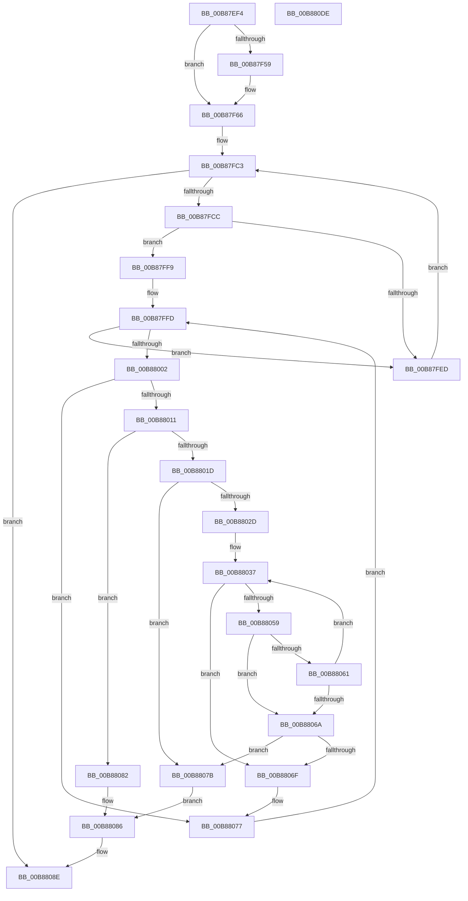

# KdpSearchMemory

- RVA: `0x00B87EF4`–`0x00B880DF` (길이 `491` bytes)
- VA: `0x0000000140B87EF4`
- 실행 섹션: `PAGEKD`
- PDB 이름 있음: `예`; PDB Function 태그: `아니요`
- unwind 정보 RVA: `0x000C9928`
- 디코드: `142`개 명령, `491/491` bytes 표시
- 미해석 바이트: `0` (있으면 어셈블리에 `.byte`로 보존)

> 이 문서는 커널 이미지의 기계어와 PDB 기호를 분석해 생성했습니다. 4번과 5번은 함수 원형과 자료형을 바이너리 사용 방식에서 추정한 C 해석이며 원본 소스 복구 결과는 아닙니다.

## 1. Dependencies

- 직접 호출 지점: **5**; 고유 호출 대상: **4**
- 직접 호출자로 확인된 함수: **1**
- RIP 상대 이미지 참조: **3**

### Outgoing calls
- `0x00B87F98` → [KdpQuickMoveMemory](KdpQuickMoveMemory_function_00B85490.md) (function, `0x00B85490`)
- `0x00B87FE4` → [MmDbgCopyMemory](../../text/68/MmDbgCopyMemory_function_006861E8.md) (function, `0x006861E8`)
- `0x00B88050` → [MmDbgCopyMemory](../../text/68/MmDbgCopyMemory_function_006861E8.md) (function, `0x006861E8`)
- `0x00B880AB` → `kdcom.dll!KdSendPacket` (import, 간접 대상; import `kdcom.dll!KdSendPacket`)
- `0x00B880BE` → [_security_check_cookie](../../text/6A/_security_check_cookie_function_006AC640.md) (function, `0x006AC640`)

### Direct callers
- [KdpSendWaitContinue](KdpSendWaitContinue_function_00B8A32C.md) at `0x00B8A63D`

### Static image references
- `0x00B87F0E` → RVA `0x00E0A740` (`.data`; read)
- `0x00B88098` → RVA `0x00F475E0` (`.data`; read)
- `0x00B880AB` → RVA `0x001516C0` (`kdcom.dll!KdSendPacket (IAT)`; read)

## 2. Other-region calls and transfers

- 다른 실행 섹션으로 향하는 call: **3**
  - `0x00B87FE4` → [MmDbgCopyMemory](../../text/68/MmDbgCopyMemory_function_006861E8.md) (`PAGEKD` → `.text`)
  - `0x00B88050` → [MmDbgCopyMemory](../../text/68/MmDbgCopyMemory_function_006861E8.md) (`PAGEKD` → `.text`)
  - `0x00B880BE` → [_security_check_cookie](../../text/6A/_security_check_cookie_function_006AC640.md) (`PAGEKD` → `.text`)
- 별도 외부 분기/꼬리 이동을 확인하지 못했습니다.

## 3. Assembly (complete function range)

```asm
00B87EF4  48 89 5C 24 18                  mov qword ptr [rsp + 0x18], rbx
00B87EF9  55                              push rbp
00B87EFA  56                              push rsi
00B87EFB  57                              push rdi
00B87EFC  41 54                           push r12
00B87EFE  41 55                           push r13
00B87F00  41 56                           push r14
00B87F02  41 57                           push r15
00B87F04  48 8B EC                        mov rbp, rsp
00B87F07  48 81 EC 80 00 00 00            sub rsp, 0x80
00B87F0E  48 8B 05 2B 28 28 00            mov rax, qword ptr [rip + 0x28282b]
00B87F15  48 33 C4                        xor rax, rsp
00B87F18  48 89 45 F8                     mov qword ptr [rbp - 8], rax
00B87F1C  4C 8B 72 08                     mov r14, qword ptr [rdx + 8]
00B87F20  0F 57 C0                        xorps xmm0, xmm0
00B87F23  48 8B 59 10                     mov rbx, qword ptr [rcx + 0x10]
00B87F27  83 CA FF                        or edx, 0xffffffff
00B87F2A  4C 8B 51 18                     mov r10, qword ptr [rcx + 0x18]
00B87F2E  48 8B F1                        mov rsi, rcx
00B87F31  83 65 B4 00                     and dword ptr [rbp - 0x4c], 0
00B87F35  4C 03 D3                        add r10, rbx
00B87F38  44 8B 69 20                     mov r13d, dword ptr [rcx + 0x20]
00B87F3C  4C 89 75 B8                     mov qword ptr [rbp - 0x48], r14
00B87F40  4C 89 55 C0                     mov qword ptr [rbp - 0x40], r10
00B87F44  C6 45 B0 00                     mov byte ptr [rbp - 0x50], 0
00B87F48  C7 41 08 1A 00 00 80            mov dword ptr [rcx + 8], 0x8000001a
00B87F4F  0F 11 45 C8                     movups xmmword ptr [rbp - 0x38], xmm0
00B87F53  41 83 FD 03                     cmp r13d, 3
00B87F57  77 0D                           ja 0x140b87f66
00B87F59  B9 04 00 00 00                  mov ecx, 4
00B87F5E  41 2B CD                        sub ecx, r13d
00B87F61  C1 E1 03                        shl ecx, 3
00B87F64  D3 EA                           shr edx, cl
00B87F66  83 65 D8 00                     and dword ptr [rbp - 0x28], 0
00B87F6A  48 8D 4D D8                     lea rcx, [rbp - 0x28]
00B87F6E  8B C2                           mov eax, edx
00B87F70  89 55 E8                        mov dword ptr [rbp - 0x18], edx
00B87F73  C1 E0 08                        shl eax, 8
00B87F76  41 B8 04 00 00 00               mov r8d, 4
00B87F7C  89 45 EC                        mov dword ptr [rbp - 0x14], eax
00B87F7F  8B C2                           mov eax, edx
00B87F81  C1 E2 18                        shl edx, 0x18
00B87F84  C1 E0 10                        shl eax, 0x10
00B87F87  89 55 F4                        mov dword ptr [rbp - 0xc], edx
00B87F8A  41 83 FD 05                     cmp r13d, 5
00B87F8E  49 8B D6                        mov rdx, r14
00B87F91  89 45 F0                        mov dword ptr [rbp - 0x10], eax
00B87F94  45 0F 42 C5                     cmovb r8d, r13d
00B87F98  E8 F3 D4 FF FF                  call 0x140b85490
00B87F9D  44 8B 4D D8                     mov r9d, dword ptr [rbp - 0x28]
00B87FA1  8B FB                           mov edi, ebx
00B87FA3  41 C1 E1 08                     shl r9d, 8
00B87FA7  83 E7 03                        and edi, 3
00B87FAA  41 8B C1                        mov eax, r9d
00B87FAD  44 89 4D DC                     mov dword ptr [rbp - 0x24], r9d
00B87FB1  C1 E0 08                        shl eax, 8
00B87FB4  41 C1 E1 10                     shl r9d, 0x10
00B87FB8  89 45 E0                        mov dword ptr [rbp - 0x20], eax
00B87FBB  48 83 E3 FC                     and rbx, 0xfffffffffffffffc
00B87FBF  44 89 4D E4                     mov dword ptr [rbp - 0x1c], r9d
00B87FC3  49 3B DA                        cmp rbx, r10
00B87FC6  0F 83 C2 00 00 00               jae 0x140b8808e
00B87FCC  41 B9 04 00 00 00               mov r9d, 4
00B87FD2  C7 44 24 20 04 00 00 00         mov dword ptr [rsp + 0x20], 4
00B87FDA  45 8B C1                        mov r8d, r9d
00B87FDD  48 8D 55 B4                     lea rdx, [rbp - 0x4c]
00B87FE1  48 8B CB                        mov rcx, rbx
00B87FE4  E8 FF E1 AF FF                  call 0x1406861e8
00B87FE9  85 C0                           test eax, eax
00B87FEB  79 0C                           jns 0x140b87ff9
00B87FED  4C 8B 55 C0                     mov r10, qword ptr [rbp - 0x40]
00B87FF1  48 83 C3 04                     add rbx, 4
00B87FF5  33 FF                           xor edi, edi
00B87FF7  EB CA                           jmp 0x140b87fc3
00B87FF9  41 8D 55 FC                     lea edx, [r13 - 4]
00B87FFD  83 FF 04                        cmp edi, 4
00B88000  73 EB                           jae 0x140b87fed
00B88002  8B 44 BD E8                     mov eax, dword ptr [rbp + rdi*4 - 0x18]
00B88006  23 45 B4                        and eax, dword ptr [rbp - 0x4c]
00B88009  8B CF                           mov ecx, edi
00B8800B  3B 44 BD D8                     cmp eax, dword ptr [rbp + rdi*4 - 0x28]
00B8800F  75 66                           jne 0x140b88077
00B88011  B8 04 00 00 00                  mov eax, 4
00B88016  2B C7                           sub eax, edi
00B88018  41 3B C5                        cmp eax, r13d
00B8801B  73 65                           jae 0x140b88082
00B8801D  4C 2B F1                        sub r14, rcx
00B88020  44 8D 24 3A                     lea r12d, [rdx + rdi]
00B88024  49 83 C6 04                     add r14, 4
00B88028  45 85 E4                        test r12d, r12d
00B8802B  74 4E                           je 0x140b8807b
00B8802D  4C 8B FB                        mov r15, rbx
00B88030  4C 2B 7D B8                     sub r15, qword ptr [rbp - 0x48]
00B88034  4C 03 F9                        add r15, rcx
00B88037  41 B9 01 00 00 00               mov r9d, 1
00B8803D  C7 44 24 20 04 00 00 00         mov dword ptr [rsp + 0x20], 4
00B88045  45 8B C1                        mov r8d, r9d
00B88048  4B 8D 0C 37                     lea rcx, [r15 + r14]
00B8804C  48 8D 55 B0                     lea rdx, [rbp - 0x50]
00B88050  E8 93 E1 AF FF                  call 0x1406861e8
00B88055  85 C0                           test eax, eax
00B88057  78 16                           js 0x140b8806f
00B88059  41 8A 06                        mov al, byte ptr [r14]
00B8805C  38 45 B0                        cmp byte ptr [rbp - 0x50], al
00B8805F  75 09                           jne 0x140b8806a
00B88061  49 FF C6                        inc r14
00B88064  41 83 C4 FF                     add r12d, -1
00B88068  75 CD                           jne 0x140b88037
00B8806A  45 85 E4                        test r12d, r12d
00B8806D  74 0C                           je 0x140b8807b
00B8806F  4C 8B 75 B8                     mov r14, qword ptr [rbp - 0x48]
00B88073  41 8D 55 FC                     lea edx, [r13 - 4]
00B88077  FF C7                           inc edi
00B88079  EB 82                           jmp 0x140b87ffd
00B8807B  8B C7                           mov eax, edi
00B8807D  48 03 C3                        add rax, rbx
00B88080  EB 04                           jmp 0x140b88086
00B88082  48 8D 04 1F                     lea rax, [rdi + rbx]
00B88086  83 66 08 00                     and dword ptr [rsi + 8], 0
00B8808A  48 89 46 10                     mov qword ptr [rsi + 0x10], rax
00B8808E  45 33 C0                        xor r8d, r8d
00B88091  C7 45 C8 38 00 38 00            mov dword ptr [rbp - 0x38], 0x380038
00B88098  4C 8D 0D 41 F5 3B 00            lea r9, [rip + 0x3bf541]
00B8809F  48 89 75 D0                     mov qword ptr [rbp - 0x30], rsi
00B880A3  48 8D 55 C8                     lea rdx, [rbp - 0x38]
00B880A7  41 8D 48 02                     lea ecx, [r8 + 2]
00B880AB  48 FF 15 0E 96 5C FF            call qword ptr [rip - 0xa369f2]
00B880B2  0F 1F 44 00 00                  nop dword ptr [rax + rax]
00B880B7  48 8B 4D F8                     mov rcx, qword ptr [rbp - 8]
00B880BB  48 33 CC                        xor rcx, rsp
00B880BE  E8 7D 45 B2 FF                  call 0x1406ac640
00B880C3  48 8B 9C 24 D0 00 00 00         mov rbx, qword ptr [rsp + 0xd0]
00B880CB  48 81 C4 80 00 00 00            add rsp, 0x80
00B880D2  41 5F                           pop r15
00B880D4  41 5E                           pop r14
00B880D6  41 5D                           pop r13
00B880D8  41 5C                           pop r12
00B880DA  5F                              pop rdi
00B880DB  5E                              pop rsi
00B880DC  5D                              pop rbp
00B880DD  C3                              ret
00B880DE  CC                              int3
```

## 4. C-style interpretation (structured pseudocode)

```c
__int64 __fastcall KdpSearchMemory(__int64 a1, __int64 a2)
{
    __int64 result;
    __int64 v_r10;
    __int64 v_r12;
    __int64 v_r14;
    __int64 v_r15;
    __int64 v_rbx;
    __int64 v_rdi;
    __int64 v_rsp;
    unsigned __int64 v_stack_m40;
    unsigned int v_stack_m44;
    unsigned int v_stack_m48;
    unsigned int v_stack_m4C;
    unsigned int v_stack_m50;
    unsigned int v_stack_m54;
    unsigned int v_stack_m58;
    unsigned int v_stack_m5C;
    unsigned int v_stack_m60;
    unsigned __int64 v_stack_m68;
    unsigned __int64 v_stack_m70;
    unsigned __int64 v_stack_m78;
    unsigned __int64 v_stack_m80;
    unsigned int v_stack_m84;
    unsigned __int8 v_stack_m88;
    unsigned int v_stack_m98;
    unsigned __int64 v_stack_p18;

    v_stack_p18 = v_rbx;
    v_rsp = (v_rsp) - (128);
    result = (*(unsigned __int64 *)(v_rip + 2631723)) ^ (v_rsp);
    v_stack_m40 = result;
    a2 = (unsigned int)((a2) | (0xFFFFFFFFULL));
    v_r10 = (*(unsigned __int64 *)(a1 + 24)) + (*(unsigned __int64 *)(a1 + 16));
    v_stack_m80 = *(unsigned __int64 *)(a2 + 8);
    v_stack_m78 = v_r10;
    v_stack_m88 = 0;
    *(unsigned int *)(a1 + 8) = 0x8000001AULL;
    v_stack_m70 = v_xmm0;
    if (((unsigned int)((unsigned int)(*(unsigned int *)(a1 + 32)))) <= 3) {
        a1 = 4;
        a1 = (unsigned int)((a1) - ((unsigned int)((unsigned int)(*(unsigned int *)(a1 + 32)))));
        a1 = (unsigned int)((a1) << (3));
        a2 = (unsigned int)((a2) >> ((unsigned __int8)(a1)));
    }
    v_stack_m50 = (unsigned int)(a2);
    result = (unsigned int)(((unsigned int)((unsigned int)(a2))) << (8));
    v_stack_m4C = (unsigned int)(result);
    a2 = (unsigned int)((a2) << (24));
    result = (unsigned int)(((unsigned int)((unsigned int)(a2))) << (16));
    v_stack_m44 = (unsigned int)(a2);
    v_stack_m48 = (unsigned int)(result);
    a3 = 4;
    if (((unsigned int)((unsigned int)(*(unsigned int *)(a1 + 32)))) < 5) { a3 = (unsigned int)((unsigned int)(*(unsigned int *)(a1 + 32))); }
    result = KdpQuickMoveMemory(v_stack_m60, *(unsigned __int64 *)(a2 + 8), a3, a4);
    a4 = (unsigned int)(((unsigned int)(v_stack_m60)) << (8));
    v_rdi = (unsigned int)(((unsigned int)((unsigned int)(*(unsigned __int64 *)(a1 + 16)))) & (3));
    v_stack_m5C = (unsigned int)(a4);
    result = (unsigned int)(((unsigned int)((unsigned int)(a4))) << (8));
    a4 = (unsigned int)((a4) << (16));
    v_stack_m58 = (unsigned int)(result);
    v_rbx = (*(unsigned __int64 *)(a1 + 16)) & (-4);
    v_stack_m54 = (unsigned int)(a4);
loc_00B87FC3:
    if (v_rbx >= v_r10) goto loc_00B8808E;
    v_stack_m98 = 4;
    result = MmDbgCopyMemory(v_rbx, v_stack_m84, 4, 4);
    if (!sign_flag) goto loc_00B87FF9;
loc_00B87FED:
    v_rbx = (v_rbx) + (4);
    v_rdi = 0;
    goto loc_00B87FC3;
loc_00B87FF9:
loc_00B87FFD:
    if (0 >= 4) goto loc_00B87FED;
    result = (unsigned int)(((unsigned int)(*(unsigned int *)(v_rsp + v_rdi * 4 - 24))) & (v_stack_m84));
    if (((unsigned int)(result)) != (*(unsigned int *)(v_rsp + v_rdi * 4 - 40))) goto loc_00B88077;
    result = (unsigned int)((4) - (0));
    if (((unsigned int)(result)) >= ((unsigned int)((unsigned int)(*(unsigned int *)(a1 + 32))))) goto loc_00B88082;
    v_r14 = (*(unsigned __int64 *)(a2 + 8)) - (0);
    v_r14 = (v_r14) + (4);
    if ((unsigned int)((unsigned int)(*(unsigned int *)(a1 + 32)) - 4 + v_rdi * 1) == 0) goto loc_00B8807B;
    v_r15 = (v_rbx) - (v_stack_m80);
    v_r15 = (v_r15) + (0);
loc_00B88037:
    v_stack_m98 = 4;
    result = MmDbgCopyMemory(v_r15 + v_r14 * 1, v_stack_m88, 1, 1);
    if (sign_flag) goto loc_00B8806F;
    if (v_stack_m88 != ((unsigned __int8)(*(unsigned __int8 *)(v_r14)))) goto loc_00B8806A;
    v_r14 = (v_r14) + 1;
    v_r12 = (unsigned int)(((unsigned int)(*(unsigned int *)(a1 + 32)) - 4 + v_rdi * 1) + (-1));
    if (condition_is_not_equal) goto loc_00B88037;
loc_00B8806A:
    if ((unsigned int)(v_r12) == 0) goto loc_00B8807B;
loc_00B8806F:
loc_00B88077:
    v_rdi = (unsigned int)((v_rdi) + 1);
    goto loc_00B87FFD;
loc_00B8807B:
    result = ((unsigned int)((unsigned int)(v_rdi))) + (v_rbx);
    goto loc_00B88086;
loc_00B88082:
loc_00B88086:
    *(unsigned __int64 *)(a1 + 16) = v_rdi + v_rbx * 1;
loc_00B8808E:
    a3 = 0;
    v_stack_m70 = 0x380038ULL;
    v_stack_m68 = a1;
    result = kdcom_dll_KdSendPacket(a3 + 2, v_stack_m70, a3, v_rip + 3929409);
    a1 = (v_stack_m40) ^ (v_rsp);
    result = _security_check_cookie(a1, v_stack_m70, a3, v_rip + 3929409);
    v_rsp = (v_rsp) + (128);
    return result;
}
```

## 5. (Beta) C Style

```c
int64_t KdpSearchMemory(void *Arg1, void *Arg2)
{
    uint8_t *arg1 = (uint8_t *)Arg1;
    uint8_t *arg2 = (uint8_t *)Arg2;

    int64_t result;
    int64_t local_r10;
    int64_t local_r12;
    int64_t local_r14;
    int64_t local_r15;
    int64_t local_rbx;
    int64_t local_rdi;
    int64_t local_rsp;
    uint64_t v_stack_m40;
    uint32_t v_stack_m44;
    uint32_t v_stack_m48;
    uint32_t v_stack_m4C;
    uint32_t v_stack_m50;
    uint32_t v_stack_m54;
    uint32_t v_stack_m58;
    uint32_t v_stack_m5C;
    uint32_t v_stack_m60;
    uint64_t v_stack_m68;
    uint64_t v_stack_m70;
    uint64_t v_stack_m78;
    uint64_t v_stack_m80;
    uint32_t v_stack_m84;
    uint8_t v_stack_m88;
    uint32_t v_stack_m98;
    uint64_t v_stack_p18;

    v_stack_p18 = local_rbx;
    local_rsp = (local_rsp) - (128);
    result = (*(uint64_t *)(v_rip + 0x28282B)) ^ (local_rsp);
    v_stack_m40 = result;
    Arg2 = (uint32_t)((Arg2) | (0xFFFFFFFFULL));
    local_r10 = (*(uint64_t *)(arg1 + 0x18)) + (*(uint64_t *)(arg1 + 0x10));
    v_stack_m80 = *(uint64_t *)(arg2 + 0x8);
    v_stack_m78 = local_r10;
    v_stack_m88 = 0;
    *(uint32_t *)(arg1 + 0x8) = 0x8000001AULL;
    v_stack_m70 = v_xmm0;
    if (((uint32_t)((uint32_t)(*(uint32_t *)(arg1 + 0x20)))) <= 3) {
        Arg1 = 4;
        Arg1 = (uint32_t)((Arg1) - ((uint32_t)((uint32_t)(*(uint32_t *)(arg1 + 0x20)))));
        Arg1 = (uint32_t)((Arg1) << (3));
        Arg2 = (uint32_t)((Arg2) >> ((uint8_t)(Arg1)));
    }
    v_stack_m50 = (uint32_t)(Arg2);
    result = (uint32_t)(((uint32_t)((uint32_t)(Arg2))) << (8));
    v_stack_m4C = (uint32_t)(result);
    Arg2 = (uint32_t)((Arg2) << (24));
    result = (uint32_t)(((uint32_t)((uint32_t)(Arg2))) << (16));
    v_stack_m44 = (uint32_t)(Arg2);
    v_stack_m48 = (uint32_t)(result);
    a3 = 4;
    if (((uint32_t)((uint32_t)(*(uint32_t *)(arg1 + 0x20)))) < 5) { a3 = (uint32_t)((uint32_t)(*(uint32_t *)(arg1 + 0x20))); }
    result = KdpQuickMoveMemory(v_stack_m60, *(uint64_t *)(arg2 + 0x8), a3, a4);
    a4 = (uint32_t)(((uint32_t)(v_stack_m60)) << (8));
    local_rdi = (uint32_t)(((uint32_t)((uint32_t)(*(uint64_t *)(arg1 + 0x10)))) & (3));
    v_stack_m5C = (uint32_t)(a4);
    result = (uint32_t)(((uint32_t)((uint32_t)(a4))) << (8));
    a4 = (uint32_t)((a4) << (16));
    v_stack_m58 = (uint32_t)(result);
    local_rbx = (*(uint64_t *)(arg1 + 0x10)) & (-4);
    v_stack_m54 = (uint32_t)(a4);
loc_00B87FC3:
    if (local_rbx >= local_r10) goto loc_00B8808E;
    v_stack_m98 = 4;
    result = MmDbgCopyMemory(local_rbx, v_stack_m84, 4, 4);
    if (!sign_flag) goto loc_00B87FF9;
loc_00B87FED:
    local_rbx = (local_rbx) + (4);
    local_rdi = 0;
    goto loc_00B87FC3;
loc_00B87FF9:
loc_00B87FFD:
    if (0 >= 4) goto loc_00B87FED;
    result = (uint32_t)(((uint32_t)(*(uint32_t *)(local_rsp + local_rdi * 4 - 0x18))) & (v_stack_m84));
    if (((uint32_t)(result)) != (*(uint32_t *)(local_rsp + local_rdi * 4 - 0x28))) goto loc_00B88077;
    result = (uint32_t)((4) - (0));
    if (((uint32_t)(result)) >= ((uint32_t)((uint32_t)(*(uint32_t *)(arg1 + 0x20))))) goto loc_00B88082;
    local_r14 = (*(uint64_t *)(arg2 + 0x8)) - (0);
    local_r14 = (local_r14) + (4);
    if ((uint32_t)((uint32_t)(*(uint32_t *)(arg1 + 0x20)) - 4 + local_rdi * 1) == 0) goto loc_00B8807B;
    local_r15 = (local_rbx) - (v_stack_m80);
    local_r15 = (local_r15) + (0);
loc_00B88037:
    v_stack_m98 = 4;
    result = MmDbgCopyMemory(local_r15 + local_r14 * 1, v_stack_m88, 1, 1);
    if (sign_flag) goto loc_00B8806F;
    if (v_stack_m88 != ((uint8_t)(*(uint8_t *)(local_r14)))) goto loc_00B8806A;
    local_r14 = (local_r14) + 1;
    local_r12 = (uint32_t)(((uint32_t)(*(uint32_t *)(arg1 + 0x20)) - 4 + local_rdi * 1) + (-1));
    if (condition_is_not_equal) goto loc_00B88037;
loc_00B8806A:
    if ((uint32_t)(local_r12) == 0) goto loc_00B8807B;
loc_00B8806F:
loc_00B88077:
    local_rdi = (uint32_t)((local_rdi) + 1);
    goto loc_00B87FFD;
loc_00B8807B:
    result = ((uint32_t)((uint32_t)(local_rdi))) + (local_rbx);
    goto loc_00B88086;
loc_00B88082:
loc_00B88086:
    *(uint64_t *)(arg1 + 0x10) = local_rdi + local_rbx * 1;
loc_00B8808E:
    a3 = 0;
    v_stack_m70 = 0x380038ULL;
    v_stack_m68 = Arg1;
    result = kernel_indirect_call(a3 + 2, v_stack_m70, a3, v_rip + 3929409);
    Arg1 = (v_stack_m40) ^ (local_rsp);
    result = _security_check_cookie(Arg1, v_stack_m70, a3, v_rip + 3929409);
    local_rsp = (local_rsp) + (128);
    return result;
}
```

### 관측된 메모리 오프셋

구조체 형식이 확인되지 않은 접근은 인자 기준의 오프셋으로만 기록했습니다.

| 기준 인자 | 오프셋 표현 | 폭 (bit) | 접근 |
|---|---:|---:|---|
| `Arg1` | `+ 0x8` | `32` | `R/W` |
| `Arg1` | `+ 0x8` | `32` | `W` |
| `Arg1` | `+ 0x10` | `64` | `R` |
| `Arg1` | `+ 0x10` | `64` | `W` |
| `Arg1` | `+ 0x18` | `64` | `R` |
| `Arg1` | `+ 0x20` | `32` | `R` |
| `Arg2` | `+ 0x8` | `64` | `R` |

## 6. Execution-region graph

[열기: 2D/3D 그래프와 함수 탐색 컨트롤 패널](../../../control-panel.html?section=pagekd&rva=0x00B87EF4&view=graph)

- 2D 그래프는 위에서 아래로 흐르고, 3D 그래프는 빈 공간을 드래그해 회전합니다. Shift+드래그는 이동, 휠은 확대·축소, 함수 노드 선택은 대상 보고서 이동입니다.

### Static fallback


