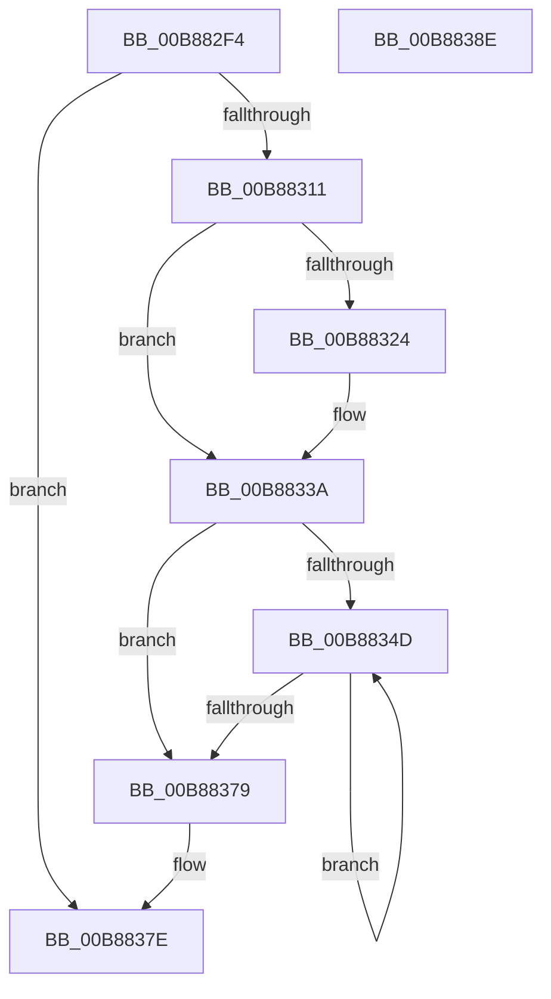

# KdpSearchPhysicalPageRange

- RVA: `0x00B882F4`–`0x00B8838F` (길이 `155` bytes)
- VA: `0x0000000140B882F4`
- 실행 섹션: `PAGEKD`
- PDB 이름 있음: `예`; PDB Function 태그: `아니요`
- unwind 정보 RVA: `0x000794E0`
- 디코드: `38`개 명령, `155/155` bytes 표시
- 미해석 바이트: `0` (있으면 어셈블리에 `.byte`로 보존)

> 이 문서는 커널 이미지의 기계어와 PDB 기호를 분석해 생성했습니다. 4번과 5번은 함수 원형과 자료형을 바이너리 사용 방식에서 추정한 C 해석이며 원본 소스 복구 결과는 아닙니다.

## 1. Dependencies

- 직접 호출 지점: **1**; 고유 호출 대상: **1**
- 직접 호출자로 확인된 함수: **1**
- RIP 상대 이미지 참조: **6**

### Outgoing calls
- `0x00B88365` → [KdpSearchPhysicalPage](KdpSearchPhysicalPage_function_00B880E8.md) (function, `0x00B880E8`)

### Direct callers
- [KdpSysCheckLowMemory](KdpSysCheckLowMemory_function_00B884F0.md) at `0x00B884FE`

### Static image references
- `0x00B88303` → RVA `0x00F51B88` (`.data`; read)
- `0x00B88311` → RVA `0x00F51B80` (`.data`; read)
- `0x00B88318` → RVA `0x00F55BB8` (`.data`; read)
- `0x00B88333` → RVA `0x00F55BB8` (`.data`; write)
- `0x00B8834D` → RVA `0x00F55BA8` (`.data`; read)
- `0x00B88357` → RVA `0x00F55BB0` (`.data`; read)

## 2. Other-region calls and transfers

- 다른 실행 섹션으로 향하는 call: **0**
- 별도 외부 분기/꼬리 이동을 확인하지 못했습니다.

## 3. Assembly (complete function range)

```asm
00B882F4  48 89 5C 24 08                  mov qword ptr [rsp + 8], rbx
00B882F9  48 89 74 24 10                  mov qword ptr [rsp + 0x10], rsi
00B882FE  57                              push rdi
00B882FF  48 83 EC 30                     sub rsp, 0x30
00B88303  8B 05 7F 98 3C 00               mov eax, dword ptr [rip + 0x3c987f]
00B88309  33 FF                           xor edi, edi
00B8830B  8B F1                           mov esi, ecx
00B8830D  85 C0                           test eax, eax
00B8830F  74 6D                           je 0x140b8837e
00B88311  48 8B 0D 68 98 3C 00            mov rcx, qword ptr [rip + 0x3c9868]
00B88318  48 8B 05 99 D8 3C 00            mov rax, qword ptr [rip + 0x3cd899]
00B8831F  48 3B C1                        cmp rax, rcx
00B88322  75 16                           jne 0x140b8833a
00B88324  48 8B 05 8D D8 3C 00            mov rax, qword ptr [rip + 0x3cd88d]
00B8832B  BF 01 00 00 00                  mov edi, 1
00B88330  48 FF C0                        inc rax
00B88333  48 89 05 7E D8 3C 00            mov qword ptr [rip + 0x3cd87e], rax
00B8833A  48 8B 1D 3F 98 3C 00            mov rbx, qword ptr [rip + 0x3c983f]
00B88341  48 8B 05 70 D8 3C 00            mov rax, qword ptr [rip + 0x3cd870]
00B88348  48 3B D8                        cmp rbx, rax
00B8834B  73 2C                           jae 0x140b88379
00B8834D  4C 8B 05 54 D8 3C 00            mov r8, qword ptr [rip + 0x3cd854]
00B88354  44 8B CF                        mov r9d, edi
00B88357  48 8B 15 52 D8 3C 00            mov rdx, qword ptr [rip + 0x3cd852]
00B8835E  48 8B CB                        mov rcx, rbx
00B88361  89 74 24 20                     mov dword ptr [rsp + 0x20], esi
00B88365  E8 7E FD FF FF                  call 0x140b880e8
00B8836A  48 8B 0D 47 D8 3C 00            mov rcx, qword ptr [rip + 0x3cd847]
00B88371  48 FF C3                        inc rbx
00B88374  48 3B D9                        cmp rbx, rcx
00B88377  72 D4                           jb 0x140b8834d
00B88379  B8 01 00 00 00                  mov eax, 1
00B8837E  48 8B 5C 24 40                  mov rbx, qword ptr [rsp + 0x40]
00B88383  48 8B 74 24 48                  mov rsi, qword ptr [rsp + 0x48]
00B88388  48 83 C4 30                     add rsp, 0x30
00B8838C  5F                              pop rdi
00B8838D  C3                              ret
00B8838E  CC                              int3
```

## 4. C-style interpretation (structured pseudocode)

```c
__int64 __fastcall KdpSearchPhysicalPageRange(int a1)
{
    __int64 result;
    __int64 v_rbx;
    __int64 v_rdi;
    __int64 v_rsp;
    unsigned int v_stack_m18;
    unsigned __int64 v_stack_p10;
    unsigned __int64 v_stack_p8;

    v_stack_p8 = v_rbx;
    v_stack_p10 = v_rsi;
    v_rsp = (v_rsp) - (48);
    v_rdi = 0;
    if ((unsigned int)((unsigned int)(*(unsigned int *)(v_rip + 3971199))) == 0) goto loc_00B8837E;
    result = *(unsigned __int64 *)(v_rip + 3987609);
    if ((*(unsigned __int64 *)(v_rip + 3987609)) == (*(unsigned __int64 *)(v_rip + 3971176))) {
        result = *(unsigned __int64 *)(v_rip + 3987597);
        v_rdi = 1;
        result = (result) + 1;
        *(unsigned __int64 *)(v_rip + 3987582) = result;
    }
    if ((*(unsigned __int64 *)(v_rip + 3971135)) >= (*(unsigned __int64 *)(v_rip + 3987568))) goto loc_00B88379;
loc_00B8834D:
    v_stack_m18 = (unsigned int)((unsigned int)(a1));
    result = KdpSearchPhysicalPage(*(unsigned __int64 *)(v_rip + 3971135), *(unsigned __int64 *)(v_rip + 3987538), *(unsigned __int64 *)(v_rip + 3987540), (unsigned int)((unsigned int)(v_rdi)));
    v_rbx = (*(unsigned __int64 *)(v_rip + 3971135)) + 1;
    if (v_rbx < (*(unsigned __int64 *)(v_rip + 3987527))) goto loc_00B8834D;
loc_00B88379:
loc_00B8837E:
    v_rsp = (v_rsp) + (48);
    return 1;
}
```

## 5. (Beta) C Style

```c
int64_t KdpSearchPhysicalPageRange(int32_t Arg1)
{
    int64_t result;
    int64_t local_rbx;
    int64_t local_rdi;
    int64_t local_rsp;
    uint32_t v_stack_m18;
    uint64_t v_stack_p10;
    uint64_t v_stack_p8;

    v_stack_p8 = local_rbx;
    v_stack_p10 = local_rsi;
    local_rsp = (local_rsp) - (48);
    local_rdi = 0;
    if ((uint32_t)((uint32_t)(*(uint32_t *)(v_rip + 0x3C987F))) == 0) goto loc_00B8837E;
    result = *(uint64_t *)(v_rip + 0x3CD899);
    if ((*(uint64_t *)(v_rip + 0x3CD899)) == (*(uint64_t *)(v_rip + 0x3C9868))) {
        result = *(uint64_t *)(v_rip + 0x3CD88D);
        local_rdi = 1;
        result = (result) + 1;
        *(uint64_t *)(v_rip + 0x3CD87E) = result;
    }
    if ((*(uint64_t *)(v_rip + 0x3C983F)) >= (*(uint64_t *)(v_rip + 0x3CD870))) goto loc_00B88379;
loc_00B8834D:
    v_stack_m18 = (uint32_t)((uint32_t)(Arg1));
    result = KdpSearchPhysicalPage(*(uint64_t *)(v_rip + 0x3C983F), *(uint64_t *)(v_rip + 0x3CD852), *(uint64_t *)(v_rip + 0x3CD854), (uint32_t)((uint32_t)(local_rdi)));
    local_rbx = (*(uint64_t *)(v_rip + 0x3C983F)) + 1;
    if (local_rbx < (*(uint64_t *)(v_rip + 0x3CD847))) goto loc_00B8834D;
loc_00B88379:
loc_00B8837E:
    local_rsp = (local_rsp) + (48);
    return 1;
}
```

## 6. Execution-region graph

[열기: 2D/3D 그래프와 함수 탐색 컨트롤 패널](../../../control-panel.html?section=pagekd&rva=0x00B882F4&view=graph)

- 2D 그래프는 위에서 아래로 흐르고, 3D 그래프는 빈 공간을 드래그해 회전합니다. Shift+드래그는 이동, 휠은 확대·축소, 함수 노드 선택은 대상 보고서 이동입니다.

### Static fallback


