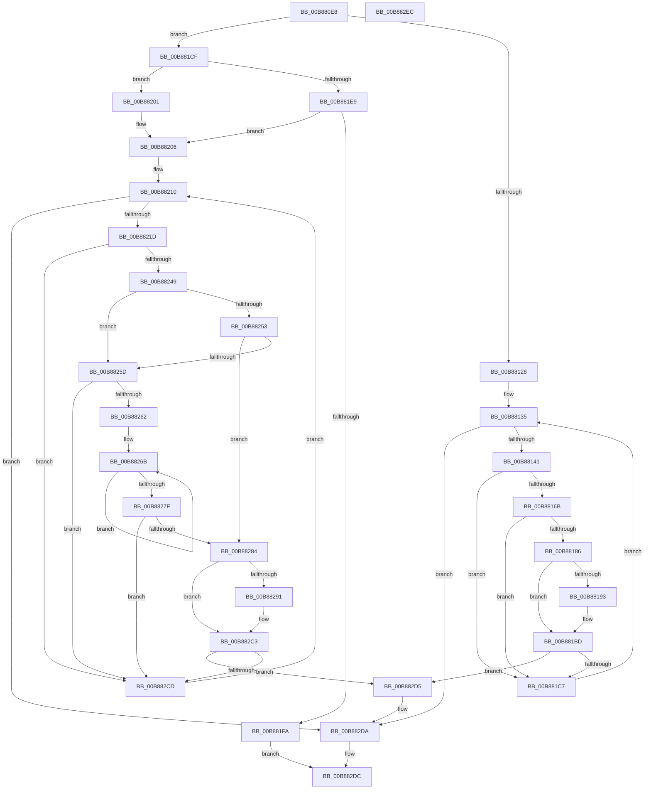

# KdpSearchPhysicalPage

- RVA: `0x00B880E8`–`0x00B882ED` (길이 `517` bytes)
- VA: `0x0000000140B880E8`
- 실행 섹션: `PAGEKD`
- PDB 이름 있음: `예`; PDB Function 태그: `아니요`
- unwind 정보 RVA: `0x000C9910`
- 디코드: `132`개 명령, `517/517` bytes 표시
- 미해석 바이트: `0` (있으면 어셈블리에 `.byte`로 보존)

> 이 문서는 커널 이미지의 기계어와 PDB 기호를 분석해 생성했습니다. 4번과 5번은 함수 원형과 자료형을 바이너리 사용 방식에서 추정한 C 해석이며 원본 소스 복구 결과는 아닙니다.

## 1. Dependencies

- 직접 호출 지점: **2**; 고유 호출 대상: **1**
- 직접 호출자로 확인된 함수: **1**
- RIP 상대 이미지 참조: **5**

### Outgoing calls
- `0x00B88162` → [MmDbgCopyMemory](../../text/68/MmDbgCopyMemory_function_006861E8.md) (function, `0x006861E8`)
- `0x00B8823C` → [MmDbgCopyMemory](../../text/68/MmDbgCopyMemory_function_006861E8.md) (function, `0x006861E8`)

### Direct callers
- [KdpSearchPhysicalPageRange](KdpSearchPhysicalPageRange_function_00B882F4.md) at `0x00B88365`

### Static image references
- `0x00B88106` → RVA `0x00F55BA0` (`.data`; read)
- `0x00B8812C` → RVA `0x00000000` (`image boundary/outside`; read)
- `0x00B88186` → RVA `0x00F51B8C` (`.data`; read)
- `0x00B881B7` → RVA `0x00F51B8C` (`.data`; write)
- `0x00B881CF` → RVA `0x00F51B88` (`.data`; read)

## 2. Other-region calls and transfers

- 다른 실행 섹션으로 향하는 call: **2**
  - `0x00B88162` → [MmDbgCopyMemory](../../text/68/MmDbgCopyMemory_function_006861E8.md) (`PAGEKD` → `.text`)
  - `0x00B8823C` → [MmDbgCopyMemory](../../text/68/MmDbgCopyMemory_function_006861E8.md) (`PAGEKD` → `.text`)
- 별도 외부 분기/꼬리 이동을 확인하지 못했습니다.

## 3. Assembly (complete function range)

```asm
00B880E8  4C 8B DC                        mov r11, rsp
00B880EB  45 89 4B 20                     mov dword ptr [r11 + 0x20], r9d
00B880EF  4D 89 43 18                     mov qword ptr [r11 + 0x18], r8
00B880F3  49 89 4B 08                     mov qword ptr [r11 + 8], rcx
00B880F7  53                              push rbx
00B880F8  56                              push rsi
00B880F9  57                              push rdi
00B880FA  41 54                           push r12
00B880FC  41 55                           push r13
00B880FE  41 56                           push r14
00B88100  41 57                           push r15
00B88102  48 83 EC 40                     sub rsp, 0x40
00B88106  48 8B 05 93 DA 3C 00            mov rax, qword ptr [rip + 0x3cda93]
00B8810D  48 8B D9                        mov rbx, rcx
00B88110  48 C1 E3 0C                     shl rbx, 0xc
00B88114  33 FF                           xor edi, edi
00B88116  45 8B F9                        mov r15d, r9d
00B88119  4C 8B EA                        mov r13, rdx
00B8811C  4C 8B F1                        mov r14, rcx
00B8811F  48 85 C0                        test rax, rax
00B88122  0F 84 A7 00 00 00               je 0x140b881cf
00B88128  49 89 7B B8                     mov qword ptr [r11 - 0x48], rdi
00B8812C  4C 8D 25 CD 7E 47 FF            lea r12, [rip - 0xb88133]
00B88133  8B F7                           mov esi, edi
00B88135  81 FE 00 10 00 00               cmp esi, 0x1000
00B8813B  0F 83 99 01 00 00               jae 0x140b882da
00B88141  8B 84 24 A0 00 00 00            mov eax, dword ptr [rsp + 0xa0]
00B88148  48 8D 54 24 30                  lea rdx, [rsp + 0x30]
00B8814D  41 B9 08 00 00 00               mov r9d, 8
00B88153  8B CE                           mov ecx, esi
00B88155  83 C8 02                        or eax, 2
00B88158  48 03 CB                        add rcx, rbx
00B8815B  45 8B C1                        mov r8d, r9d
00B8815E  89 44 24 20                     mov dword ptr [rsp + 0x20], eax
00B88162  E8 81 E0 AF FF                  call 0x1406861e8
00B88167  85 C0                           test eax, eax
00B88169  78 5C                           js 0x140b881c7
00B8816B  48 8B 44 24 30                  mov rax, qword ptr [rsp + 0x30]
00B88170  48 B9 FF FF FF FF FF 00 00 00   movabs rcx, 0xffffffffff
00B8817A  48 C1 E8 0C                     shr rax, 0xc
00B8817E  48 23 C1                        and rax, rcx
00B88181  49 3B C5                        cmp rax, r13
00B88184  75 41                           jne 0x140b881c7
00B88186  8B 05 00 9A 3C 00               mov eax, dword ptr [rip + 0x3c9a00]
00B8818C  3D 00 10 00 00                  cmp eax, 0x1000
00B88191  73 2A                           jae 0x140b881bd
00B88193  8B 05 F3 99 3C 00               mov eax, dword ptr [rip + 0x3c99f3]
00B88199  4D 89 B4 C4 80 9B F4 00         mov qword ptr [r12 + rax*8 + 0xf49b80], r14
00B881A1  8B 05 E5 99 3C 00               mov eax, dword ptr [rip + 0x3c99e5]
00B881A7  41 89 B4 84 A0 1B F5 00         mov dword ptr [r12 + rax*4 + 0xf51ba0], esi
00B881AF  8B 05 D7 99 3C 00               mov eax, dword ptr [rip + 0x3c99d7]
00B881B5  FF C0                           inc eax
00B881B7  89 05 CF 99 3C 00               mov dword ptr [rip + 0x3c99cf], eax
00B881BD  41 F6 C7 01                     test r15b, 1
00B881C1  0F 84 0E 01 00 00               je 0x140b882d5
00B881C7  83 C6 08                        add esi, 8
00B881CA  E9 66 FF FF FF                  jmp 0x140b88135
00B881CF  44 8B 3D B2 99 3C 00            mov r15d, dword ptr [rip + 0x3c99b2]
00B881D6  8B 05 AC 99 3C 00               mov eax, dword ptr [rip + 0x3c99ac]
00B881DC  41 83 E7 02                     and r15d, 2
00B881E0  48 89 7C 24 38                  mov qword ptr [rsp + 0x38], rdi
00B881E5  A8 3C                           test al, 0x3c
00B881E7  74 18                           je 0x140b88201
00B881E9  8B 35 99 99 3C 00               mov esi, dword ptr [rip + 0x3c9999]
00B881EF  C1 EE 02                        shr esi, 2
00B881F2  83 E6 0F                        and esi, 0xf
00B881F5  83 FE 08                        cmp esi, 8
00B881F8  76 0C                           jbe 0x140b88206
00B881FA  33 C0                           xor eax, eax
00B881FC  E9 DB 00 00 00                  jmp 0x140b882dc
00B88201  BE 08 00 00 00                  mov esi, 8
00B88206  44 8B F7                        mov r14d, edi
00B88209  4C 8D 25 F0 7D 47 FF            lea r12, [rip - 0xb88210]
00B88210  41 81 FE 00 10 00 00            cmp r14d, 0x1000
00B88217  0F 83 BD 00 00 00               jae 0x140b882da
00B8821D  8B 84 24 A0 00 00 00            mov eax, dword ptr [rsp + 0xa0]
00B88224  48 8D 54 24 38                  lea rdx, [rsp + 0x38]
00B88229  83 C8 02                        or eax, 2
00B8822C  41 8B CE                        mov ecx, r14d
00B8822F  48 03 CB                        add rcx, rbx
00B88232  89 44 24 20                     mov dword ptr [rsp + 0x20], eax
00B88236  45 33 C9                        xor r9d, r9d
00B88239  44 8B C6                        mov r8d, esi
00B8823C  E8 A7 DF AF FF                  call 0x1406861e8
00B88241  85 C0                           test eax, eax
00B88243  0F 88 84 00 00 00               js 0x140b882cd
00B88249  48 8B 4C 24 38                  mov rcx, qword ptr [rsp + 0x38]
00B8824E  49 3B CD                        cmp rcx, r13
00B88251  72 0A                           jb 0x140b8825d
00B88253  48 3B 8C 24 90 00 00 00         cmp rcx, qword ptr [rsp + 0x90]
00B8825B  76 27                           jbe 0x140b88284
00B8825D  45 85 FF                        test r15d, r15d
00B88260  75 6B                           jne 0x140b882cd
00B88262  49 33 CD                        xor rcx, r13
00B88265  45 8D 47 40                     lea r8d, [r15 + 0x40]
00B88269  8B D7                           mov edx, edi
00B8826B  F6 C1 01                        test cl, 1
00B8826E  8D 42 01                        lea eax, [rdx + 1]
00B88271  0F 44 C2                        cmove eax, edx
00B88274  48 D1 E9                        shr rcx, 1
00B88277  8B D0                           mov edx, eax
00B88279  49 83 E8 01                     sub r8, 1
00B8827D  75 EC                           jne 0x140b8826b
00B8827F  83 F8 01                        cmp eax, 1
00B88282  75 49                           jne 0x140b882cd
00B88284  8B 05 02 99 3C 00               mov eax, dword ptr [rip + 0x3c9902]
00B8828A  3D 00 10 00 00                  cmp eax, 0x1000
00B8828F  73 32                           jae 0x140b882c3
00B88291  8B 0D F5 98 3C 00               mov ecx, dword ptr [rip + 0x3c98f5]
00B88297  48 8B 84 24 80 00 00 00         mov rax, qword ptr [rsp + 0x80]
00B8829F  49 89 84 CC 80 9B F4 00         mov qword ptr [r12 + rcx*8 + 0xf49b80], rax
00B882A7  8B 05 DF 98 3C 00               mov eax, dword ptr [rip + 0x3c98df]
00B882AD  45 89 B4 84 A0 1B F5 00         mov dword ptr [r12 + rax*4 + 0xf51ba0], r14d
00B882B5  8B 05 D1 98 3C 00               mov eax, dword ptr [rip + 0x3c98d1]
00B882BB  FF C0                           inc eax
00B882BD  89 05 C9 98 3C 00               mov dword ptr [rip + 0x3c98c9], eax
00B882C3  F6 84 24 98 00 00 00 01         test byte ptr [rsp + 0x98], 1
00B882CB  74 08                           je 0x140b882d5
00B882CD  44 03 F6                        add r14d, esi
00B882D0  E9 3B FF FF FF                  jmp 0x140b88210
00B882D5  BF 01 00 00 00                  mov edi, 1
00B882DA  8B C7                           mov eax, edi
00B882DC  48 83 C4 40                     add rsp, 0x40
00B882E0  41 5F                           pop r15
00B882E2  41 5E                           pop r14
00B882E4  41 5D                           pop r13
00B882E6  41 5C                           pop r12
00B882E8  5F                              pop rdi
00B882E9  5E                              pop rsi
00B882EA  5B                              pop rbx
00B882EB  C3                              ret
00B882EC  CC                              int3
```

## 4. C-style interpretation (structured pseudocode)

```c
__int64 __fastcall KdpSearchPhysicalPage(__int64 a1, __int64 a2, __int64 a3, int a4, unsigned int a5)
{
    __int64 result;
    __int64 v_r14;
    __int64 v_r15;
    __int64 v_rbx;
    __int64 v_rdi;
    __int64 v_rsi;
    __int64 v_rsp;
    unsigned __int64 v_stack_m40;
    unsigned __int64 v_stack_m48;
    unsigned int v_stack_m58;
    unsigned __int64 v_stack_p18;
    unsigned __int8 v_stack_p20;
    unsigned __int64 v_stack_p8;

    *(unsigned int *)(v_rsp + 32) = a4;
    *(unsigned __int64 *)(v_rsp + 24) = a3;
    *(unsigned __int64 *)(v_rsp + 8) = a1;
    v_rsp = (v_rsp) - (64);
    v_rbx = (a1) << (12);
    v_rdi = 0;
    if (*(unsigned __int64 *)(v_rip + 3988115) == 0) goto loc_00B881CF;
    *(unsigned __int64 *)(v_rsp - 72) = 0;
loc_00B88135:
    if (0 >= 0x1000ULL) goto loc_00B882DA;
    result = (unsigned int)(((unsigned int)(a5)) | (2));
    a1 = (0) + (v_rbx);
    v_stack_m58 = (unsigned int)(result);
    result = MmDbgCopyMemory(a1, v_stack_m48, 8, 8);
    if (sign_flag) goto loc_00B881C7;
    result = (v_stack_m48) >> (12);
    result = (result) & (a1);
    if (result != a2) goto loc_00B881C7;
    result = (unsigned int)(*(unsigned int *)(v_rip + 3971584));
    if (((unsigned int)((unsigned int)(*(unsigned int *)(v_rip + 3971584)))) < 0x1000ULL) {
        result = *(unsigned int *)(v_rip + 3971571);
        *(unsigned __int64 *)(v_rip - 12091699 + result * 8 + 16030592) = a1;
        result = *(unsigned int *)(v_rip + 3971557);
        *(unsigned int *)(v_rip - 12091699 + result * 4 + 16063392) = 0;
        result = *(unsigned int *)(v_rip + 3971543);
        result = (unsigned int)((result) + 1);
        *(unsigned int *)(v_rip + 3971535) = (unsigned int)(result);
    }
    if ((((unsigned __int8)((unsigned int)(a4))) & (1)) == 0) goto loc_00B882D5;
loc_00B881C7:
    v_rsi = (unsigned int)((0) + (8));
    goto loc_00B88135;
loc_00B881CF:
    v_r15 = (unsigned int)(((unsigned int)(*(unsigned int *)(v_rip + 3971506))) & (2));
    v_stack_m40 = 0;
    if ((((unsigned __int8)((unsigned int)(*(unsigned int *)(v_rip + 3971500)))) & (60)) == 0) goto loc_00B88201;
    v_rsi = (unsigned int)(((unsigned int)(*(unsigned int *)(v_rip + 3971481))) >> (2));
    v_rsi = (unsigned int)((v_rsi) & (15));
    if (((unsigned int)(v_rsi)) <= 8) goto loc_00B88206;
    result = 0;
    goto loc_00B882DC;
loc_00B88201:
loc_00B88206:
loc_00B88210:
    if (0 >= 0x1000ULL) goto loc_00B882DA;
    result = (unsigned int)(((unsigned int)(a5)) | (2));
    a1 = (0) + (v_rbx);
    v_stack_m58 = (unsigned int)(result);
    a4 = 0;
    result = MmDbgCopyMemory(a1, v_stack_m40, 8, a4);
    if (sign_flag) goto loc_00B882CD;
    if (v_stack_m40 < a2) goto loc_00B8825D;
    if (v_stack_m40 <= v_stack_p18) goto loc_00B88284;
loc_00B8825D:
    if ((unsigned int)(v_r15) != 0) goto loc_00B882CD;
    a1 = (v_stack_m40) ^ (a2);
loc_00B8826B:
    result = 0 + 1;
    if ((((unsigned __int8)(a1)) & (1)) == 0) { result = 0; }
    a1 = (a1) >> (1);
    a3 = (v_r15 + 64) - (1);
    if (condition_is_not_equal) goto loc_00B8826B;
    if (((unsigned int)(result)) != 1) goto loc_00B882CD;
loc_00B88284:
    result = (unsigned int)(*(unsigned int *)(v_rip + 3971330));
    if (((unsigned int)((unsigned int)(*(unsigned int *)(v_rip + 3971330)))) < 0x1000ULL) {
        a1 = *(unsigned int *)(v_rip + 3971317);
        result = v_stack_p8;
        *(unsigned __int64 *)(v_rip - 12091920 + a1 * 8 + 16030592) = result;
        result = *(unsigned int *)(v_rip + 3971295);
        *(unsigned int *)(v_rip - 12091920 + result * 4 + 16063392) = 0;
        result = *(unsigned int *)(v_rip + 3971281);
        result = (unsigned int)((result) + 1);
        *(unsigned int *)(v_rip + 3971273) = (unsigned int)(result);
    }
    if (((v_stack_p20) & (1)) == 0) goto loc_00B882D5;
loc_00B882CD:
    v_r14 = (unsigned int)((0) + (8));
    goto loc_00B88210;
loc_00B882D5:
loc_00B882DA:
loc_00B882DC:
    v_rsp = (v_rsp) + (64);
    return 1;
}
```

## 5. (Beta) C Style

```c
int64_t KdpSearchPhysicalPage(int64_t Arg1, int64_t Arg2, int64_t Arg3, int32_t Arg4, uint32_t Arg5)
{
    int64_t result;
    int64_t local_r14;
    int64_t local_r15;
    int64_t local_rbx;
    int64_t local_rdi;
    int64_t local_rsi;
    int64_t local_rsp;
    uint64_t v_stack_m40;
    uint64_t v_stack_m48;
    uint32_t v_stack_m58;
    uint64_t v_stack_p18;
    uint8_t v_stack_p20;
    uint64_t v_stack_p8;

    *(uint32_t *)(local_rsp + 0x20) = Arg4;
    *(uint64_t *)(local_rsp + 0x18) = Arg3;
    *(uint64_t *)(local_rsp + 0x8) = Arg1;
    local_rsp = (local_rsp) - (64);
    local_rbx = (Arg1) << (12);
    local_rdi = 0;
    if (*(uint64_t *)(v_rip + 0x3CDA93) == 0) goto loc_00B881CF;
    *(uint64_t *)(local_rsp - 0x48) = 0;
loc_00B88135:
    if (0 >= 0x1000ULL) goto loc_00B882DA;
    result = (uint32_t)(((uint32_t)(Arg5)) | (2));
    Arg1 = (0) + (local_rbx);
    v_stack_m58 = (uint32_t)(result);
    result = MmDbgCopyMemory(Arg1, v_stack_m48, 8, 8);
    if (sign_flag) goto loc_00B881C7;
    result = (v_stack_m48) >> (12);
    result = (result) & (Arg1);
    if (result != Arg2) goto loc_00B881C7;
    result = (uint32_t)(*(uint32_t *)(v_rip + 0x3C9A00));
    if (((uint32_t)((uint32_t)(*(uint32_t *)(v_rip + 0x3C9A00)))) < 0x1000ULL) {
        result = *(uint32_t *)(v_rip + 0x3C99F3);
        *(uint64_t *)(v_rip - 0xB88133 + result * 8 + 0xF49B80) = Arg1;
        result = *(uint32_t *)(v_rip + 0x3C99E5);
        *(uint32_t *)(v_rip - 0xB88133 + result * 4 + 0xF51BA0) = 0;
        result = *(uint32_t *)(v_rip + 0x3C99D7);
        result = (uint32_t)((result) + 1);
        *(uint32_t *)(v_rip + 0x3C99CF) = (uint32_t)(result);
    }
    if ((((uint8_t)((uint32_t)(Arg4))) & (1)) == 0) goto loc_00B882D5;
loc_00B881C7:
    local_rsi = (uint32_t)((0) + (8));
    goto loc_00B88135;
loc_00B881CF:
    local_r15 = (uint32_t)(((uint32_t)(*(uint32_t *)(v_rip + 0x3C99B2))) & (2));
    v_stack_m40 = 0;
    if ((((uint8_t)((uint32_t)(*(uint32_t *)(v_rip + 0x3C99AC)))) & (60)) == 0) goto loc_00B88201;
    local_rsi = (uint32_t)(((uint32_t)(*(uint32_t *)(v_rip + 0x3C9999))) >> (2));
    local_rsi = (uint32_t)((local_rsi) & (15));
    if (((uint32_t)(local_rsi)) <= 8) goto loc_00B88206;
    result = 0;
    goto loc_00B882DC;
loc_00B88201:
loc_00B88206:
loc_00B88210:
    if (0 >= 0x1000ULL) goto loc_00B882DA;
    result = (uint32_t)(((uint32_t)(Arg5)) | (2));
    Arg1 = (0) + (local_rbx);
    v_stack_m58 = (uint32_t)(result);
    Arg4 = 0;
    result = MmDbgCopyMemory(Arg1, v_stack_m40, 8, Arg4);
    if (sign_flag) goto loc_00B882CD;
    if (v_stack_m40 < Arg2) goto loc_00B8825D;
    if (v_stack_m40 <= v_stack_p18) goto loc_00B88284;
loc_00B8825D:
    if ((uint32_t)(local_r15) != 0) goto loc_00B882CD;
    Arg1 = (v_stack_m40) ^ (Arg2);
loc_00B8826B:
    result = 0 + 1;
    if ((((uint8_t)(Arg1)) & (1)) == 0) { result = 0; }
    Arg1 = (Arg1) >> (1);
    Arg3 = (local_r15 + 64) - (1);
    if (condition_is_not_equal) goto loc_00B8826B;
    if (((uint32_t)(result)) != 1) goto loc_00B882CD;
loc_00B88284:
    result = (uint32_t)(*(uint32_t *)(v_rip + 0x3C9902));
    if (((uint32_t)((uint32_t)(*(uint32_t *)(v_rip + 0x3C9902)))) < 0x1000ULL) {
        Arg1 = *(uint32_t *)(v_rip + 0x3C98F5);
        result = v_stack_p8;
        *(uint64_t *)(v_rip - 0xB88210 + Arg1 * 8 + 0xF49B80) = result;
        result = *(uint32_t *)(v_rip + 0x3C98DF);
        *(uint32_t *)(v_rip - 0xB88210 + result * 4 + 0xF51BA0) = 0;
        result = *(uint32_t *)(v_rip + 0x3C98D1);
        result = (uint32_t)((result) + 1);
        *(uint32_t *)(v_rip + 0x3C98C9) = (uint32_t)(result);
    }
    if (((v_stack_p20) & (1)) == 0) goto loc_00B882D5;
loc_00B882CD:
    local_r14 = (uint32_t)((0) + (8));
    goto loc_00B88210;
loc_00B882D5:
loc_00B882DA:
loc_00B882DC:
    local_rsp = (local_rsp) + (64);
    return 1;
}
```

## 6. Execution-region graph

[열기: 2D/3D 그래프와 함수 탐색 컨트롤 패널](../../../control-panel.html?section=pagekd&rva=0x00B880E8&view=graph)

- 2D 그래프는 위에서 아래로 흐르고, 3D 그래프는 빈 공간을 드래그해 회전합니다. Shift+드래그는 이동, 휠은 확대·축소, 함수 노드 선택은 대상 보고서 이동입니다.

### Static fallback


