# KdpSendWaitContinue

- RVA: `0x00B8A32C`–`0x00B8A7D4` (길이 `1,192` bytes)
- VA: `0x0000000140B8A32C`
- 실행 섹션: `PAGEKD`
- PDB 이름 있음: `예`; PDB Function 태그: `아니요`
- unwind 정보 RVA: `0x000BE408`
- 디코드: `297`개 명령, `1,192/1,192` bytes 표시
- 미해석 바이트: `1` (있으면 어셈블리에 `.byte`로 보존)

> 이 문서는 커널 이미지의 기계어와 PDB 기호를 분석해 생성했습니다. 4번과 5번은 함수 원형과 자료형을 바이너리 사용 방식에서 추정한 C 해석이며 원본 소스 복구 결과는 아닙니다.

## 1. Dependencies

- 직접 호출 지점: **42**; 고유 호출 대상: **40**
- 직접 호출자로 확인된 함수: **3**
- RIP 상대 이미지 참조: **12**

### Outgoing calls
- `0x00B8A3C2` → `kdcom.dll!KdSendPacket` (import, 간접 대상; import `kdcom.dll!KdSendPacket`)
- `0x00B8A3E8` → [KeQueryPerformanceCounter](../../text/37/KeQueryPerformanceCounter_function_0037E7E0.md) (function, `0x0037E7E0`)
- `0x00B8A403` → `kdcom.dll!KdReceivePacket` (import, 간접 대상; import `kdcom.dll!KdReceivePacket`)
- `0x00B8A449` → [KdpReadVirtualMemory](KdpReadVirtualMemory_function_00B879E8.md) (function, `0x00B879E8`)
- `0x00B8A458` → [KdpWriteVirtualMemory](KdpWriteVirtualMemory_function_00B88BA0.md) (function, `0x00B88BA0`)
- `0x00B8A466` → [KdpCheckLowMemory](KdpCheckLowMemory_function_00B870B0.md) (function, `0x00B870B0`)
- `0x00B8A47B` → [KdpReadPhysicalMemory](KdpReadPhysicalMemory_function_00B877D8.md) (function, `0x00B877D8`)
- `0x00B8A48D` → [KdpReadPhysicalMemoryLong](KdpReadPhysicalMemoryLong_function_00B87924.md) (function, `0x00B87924`)
- `0x00B8A49F` → [KdpWritePhysicalMemory](KdpWritePhysicalMemory_function_00B88B00.md) (function, `0x00B88B00`)
- `0x00B8A4B4` → [KdpGetContextOrig](KdpGetContextOrig_function_00B87404.md) (function, `0x00B87404`)
- `0x00B8A4C9` → [KdpSetContext](KdpSetContext_function_00B88424.md) (function, `0x00B88424`)
- `0x00B8A4DE` → [KdpGetContextEx](../../text/5B/KdpGetContextEx_function_005B0C80.md) (function, `0x005B0C80`)
- `0x00B8A4F3` → [KdpSetContextEx](../../text/5B/KdpSetContextEx_function_005B0D64.md) (function, `0x005B0D64`)
- `0x00B8A501` → [KdpWriteBreakpoint](KdpWriteBreakpoint_function_00B88898.md) (function, `0x00B88898`)
- `0x00B8A50F` → [KdpWriteCustomBreakpoint](../../text/5B/KdpWriteCustomBreakpoint_function_005B0E9C.md) (function, `0x005B0E9C`)
- `0x00B8A51D` → [KdpRestoreBreakpoint](KdpRestoreBreakpoint_function_00B87E90.md) (function, `0x00B87E90`)
- `0x00B8A52F` → [KdpReadControlSpace](KdpReadControlSpace_function_00B875AC.md) (function, `0x00B875AC`)
- `0x00B8A541` → [KdpWriteControlSpace](KdpWriteControlSpace_function_00B8890C.md) (function, `0x00B8890C`)
- `0x00B8A54F` → [KdpReadIoSpace](KdpReadIoSpace_function_00B87668.md) (function, `0x00B87668`)
- `0x00B8A55D` → [KdpWriteIoSpace](KdpWriteIoSpace_function_00B88998.md) (function, `0x00B88998`)
- `0x00B8A56B` → [KdpReadIoSpaceExtended](KdpReadIoSpaceExtended_function_00B876E4.md) (function, `0x00B876E4`)
- `0x00B8A579` → [KdpWriteIoSpaceExtended](KdpWriteIoSpaceExtended_function_00B88A14.md) (function, `0x00B88A14`)
- `0x00B8A587` → [KdpReadMachineSpecificRegister](KdpReadMachineSpecificRegister_function_00B87764.md) (function, `0x00B87764`)
- `0x00B8A595` → [KdpWriteMachineSpecificRegister](KdpWriteMachineSpecificRegister_function_00B88A90.md) (function, `0x00B88A90`)
- `0x00B8A5A7` → [KdpGetBusData](KdpGetBusData_function_00B87230.md) (function, `0x00B87230`)
- `0x00B8A5B9` → [KdpSetBusData](KdpSetBusData_function_00B88398.md) (function, `0x00B88398`)
- `0x00B8A5CC` → [KdExitDebugger](KdExitDebugger_function_00B85008.md) (function, `0x00B85008`)
- `0x00B8A5DA` → [guard_dispatch_icall](../../text/6B/guard_dispatch_icall_function_006BAAD0.md) (function, `0x006BAAD0`)
- `0x00B8A5E4` → [HalReturnToFirmware](../../text/54/HalReturnToFirmware_function_00546550.md) (function, `0x00546550`)
- `0x00B8A5F2` → [KdpGetVersion](KdpGetVersion_function_00B87470.md) (function, `0x00B87470`)
- `0x00B8A600` → [KdpNotSupported](KdpNotSupported_function_00B874E4.md) (function, `0x00B874E4`)
- `0x00B8A612` → [KdpWriteBreakPointEx](KdpWriteBreakPointEx_function_00B886D4.md) (function, `0x00B886D4`)
- `0x00B8A62B` → [KdpRestoreBreakPointEx](KdpRestoreBreakPointEx_function_00B87D80.md) (function, `0x00B87D80`)
- `0x00B8A63D` → [KdpSearchMemory](KdpSearchMemory_function_00B87EF4.md) (function, `0x00B87EF4`)
- `0x00B8A64F` → [KdpFillMemory](KdpFillMemory_function_00B87108.md) (function, `0x00B87108`)
- `0x00B8A65D` → [KdpQueryMemory](KdpQueryMemory_function_00B87534.md) (function, `0x00B87534`)
- `0x00B8A683` → `kdcom.dll!KdSendPacket` (import, 간접 대상; import `kdcom.dll!KdSendPacket`)
- `0x00B8A6A6` → [_security_check_cookie](../../text/6A/_security_check_cookie_function_006AC640.md) (function, `0x006AC640`)
- `0x00B8A6D4` → [KdpGetStateChange](KdpGetStateChange_function_00B895E4.md) (function, `0x00B895E4`)
- `0x00B8A6DD` → [KdExitDebugger](KdExitDebugger_function_00B85008.md) (function, `0x00B85008`)
- `0x00B8A6F4` → [KeBugCheckEx](../../text/4F/KeBugCheckEx_function_004FD660.md) (function, `0x004FD660`)
- `0x00B8A6FE` → [KeSwitchFrozenProcessor](../../text/5C/KeSwitchFrozenProcessor_function_005C2F40.md) (function, `0x005C2F40`)

### Direct callers
- [KdpReportCommandStringStateChange](KdpReportCommandStringStateChange_function_00B87AAC.md) at `0x00B87C11`
- [KdpReportLoadSymbolsStateChange](KdpReportLoadSymbolsStateChange_function_00B87C44.md) at `0x00B87D4D`
- [KdpReportExceptionStateChange](KdpReportExceptionStateChange_function_00B8A1E0.md) at `0x00B8A2EB`

### Static image references
- `0x00B8A344` → RVA `0x00E0A740` (`.data`; read)
- `0x00B8A355` → RVA `0x00F475E0` (`.data`; read)
- `0x00B8A371` → RVA `0x00F475D0` (`.data`; write)
- `0x00B8A39D` → RVA `0x00E12710` (`.data`; read)
- `0x00B8A3C2` → RVA `0x001516C0` (`kdcom.dll!KdSendPacket (IAT)`; read)
- `0x00B8A3CE` → RVA `0x00F475DC` (`.data`; read)
- `0x00B8A3DB` → RVA `0x00FC6A80` (`ALMOSTRO`; read)
- `0x00B8A403` → RVA `0x001516B0` (`kdcom.dll!KdReceivePacket (IAT)`; read)
- `0x00B8A42A` → RVA `0x00000000` (`image boundary/outside`; read)
- `0x00B8A5C5` → RVA `0x00E66890` (`.data`; write)
- `0x00B8A5D1` → RVA `0x00E00B08` (`.data`; read)
- `0x00B8A79F` → RVA `0x-60469FB5` (`image boundary/outside`; read/write)

## 2. Other-region calls and transfers

- 다른 실행 섹션으로 향하는 call: **9**
  - `0x00B8A3E8` → [KeQueryPerformanceCounter](../../text/37/KeQueryPerformanceCounter_function_0037E7E0.md) (`PAGEKD` → `.text`)
  - `0x00B8A4DE` → [KdpGetContextEx](../../text/5B/KdpGetContextEx_function_005B0C80.md) (`PAGEKD` → `.text`)
  - `0x00B8A4F3` → [KdpSetContextEx](../../text/5B/KdpSetContextEx_function_005B0D64.md) (`PAGEKD` → `.text`)
  - `0x00B8A50F` → [KdpWriteCustomBreakpoint](../../text/5B/KdpWriteCustomBreakpoint_function_005B0E9C.md) (`PAGEKD` → `.text`)
  - `0x00B8A5DA` → [guard_dispatch_icall](../../text/6B/guard_dispatch_icall_function_006BAAD0.md) (`PAGEKD` → `.text`)
  - `0x00B8A5E4` → [HalReturnToFirmware](../../text/54/HalReturnToFirmware_function_00546550.md) (`PAGEKD` → `.text`)
  - `0x00B8A6A6` → [_security_check_cookie](../../text/6A/_security_check_cookie_function_006AC640.md) (`PAGEKD` → `.text`)
  - `0x00B8A6F4` → [KeBugCheckEx](../../text/4F/KeBugCheckEx_function_004FD660.md) (`PAGEKD` → `.text`)
  - `0x00B8A6FE` → [KeSwitchFrozenProcessor](../../text/5C/KeSwitchFrozenProcessor_function_005C2F40.md) (`PAGEKD` → `.text`)
- 별도 외부 분기/꼬리 이동을 확인하지 못했습니다.

## 3. Assembly (complete function range)

```asm
00B8A32C  48 89 5C 24 08                  mov qword ptr [rsp + 8], rbx
00B8A331  55                              push rbp
00B8A332  56                              push rsi
00B8A333  57                              push rdi
00B8A334  41 54                           push r12
00B8A336  41 56                           push r14
00B8A338  48 8D 6C 24 C9                  lea rbp, [rsp - 0x37]
00B8A33D  48 81 EC A0 00 00 00            sub rsp, 0xa0
00B8A344  48 8B 05 F5 03 28 00            mov rax, qword ptr [rip + 0x2803f5]
00B8A34B  48 33 C4                        xor rax, rsp
00B8A34E  48 89 45 27                     mov qword ptr [rbp + 0x27], rax
00B8A352  45 33 F6                        xor r14d, r14d
00B8A355  4C 8D 25 84 D2 3B 00            lea r12, [rip + 0x3bd284]
00B8A35C  33 C0                           xor eax, eax
00B8A35E  44 89 75 D7                     mov dword ptr [rbp - 0x29], r14d
00B8A362  48 89 45 1F                     mov qword ptr [rbp + 0x1f], rax
00B8A366  0F 57 C0                        xorps xmm0, xmm0
00B8A369  0F 11 45 C7                     movups xmmword ptr [rbp - 0x39], xmm0
00B8A36D  41 8D 46 38                     lea eax, [r14 + 0x38]
00B8A371  44 88 35 58 D2 3B 00            mov byte ptr [rip + 0x3bd258], r14b
00B8A378  0F 57 C9                        xorps xmm1, xmm1
00B8A37B  49 8B D9                        mov rbx, r9
00B8A37E  0F 11 4D DF                     movups xmmword ptr [rbp - 0x21], xmm1
00B8A382  66 89 45 E1                     mov word ptr [rbp - 0x1f], ax
00B8A386  49 8B F0                        mov rsi, r8
00B8A389  48 8D 45 EF                     lea rax, [rbp - 0x11]
00B8A38D  48 8B FA                        mov rdi, rdx
00B8A390  48 89 45 E7                     mov qword ptr [rbp - 0x19], rax
00B8A394  B8 00 30 00 00                  mov eax, 0x3000
00B8A399  66 89 45 C9                     mov word ptr [rbp - 0x37], ax
00B8A39D  48 8D 05 6C 83 28 00            lea rax, [rip + 0x28836c]
00B8A3A4  48 89 45 CF                     mov qword ptr [rbp - 0x31], rax
00B8A3A8  0F 11 45 EF                     movups xmmword ptr [rbp - 0x11], xmm0
00B8A3AC  0F 11 45 FF                     movups xmmword ptr [rbp - 1], xmm0
00B8A3B0  0F 11 45 0F                     movups xmmword ptr [rbp + 0xf], xmm0
00B8A3B4  4D 8B CC                        mov r9, r12
00B8A3B7  4C 8B C6                        mov r8, rsi
00B8A3BA  48 8B D7                        mov rdx, rdi
00B8A3BD  B9 07 00 00 00                  mov ecx, 7
00B8A3C2  48 FF 15 F7 72 5C FF            call qword ptr [rip - 0xa38d09]
00B8A3C9  0F 1F 44 00 00                  nop dword ptr [rax + rax]
00B8A3CE  44 38 35 07 D2 3B 00            cmp byte ptr [rip + 0x3bd207], r14b
00B8A3D5  0F 85 BF 02 00 00               jne 0x140b8a69a
00B8A3DB  8B 05 9F C6 43 00               mov eax, dword ptr [rip + 0x43c69f]
00B8A3E1  83 F8 01                        cmp eax, 1
00B8A3E4  75 07                           jne 0x140b8a3ed
00B8A3E6  33 C9                           xor ecx, ecx
00B8A3E8  E8 F3 43 7F FF                  call 0x14037e7e0
00B8A3ED  4C 8D 4D D7                     lea r9, [rbp - 0x29]
00B8A3F1  4C 89 64 24 20                  mov qword ptr [rsp + 0x20], r12
00B8A3F6  4C 8D 45 C7                     lea r8, [rbp - 0x39]
00B8A3FA  B9 02 00 00 00                  mov ecx, 2
00B8A3FF  48 8D 55 DF                     lea rdx, [rbp - 0x21]
00B8A403  48 FF 15 A6 72 5C FF            call qword ptr [rip - 0xa38d5a]
00B8A40A  0F 1F 44 00 00                  nop dword ptr [rax + rax]
00B8A40F  83 F8 02                        cmp eax, 2
00B8A412  74 A0                           je 0x140b8a3b4
00B8A414  83 F8 01                        cmp eax, 1
00B8A417  74 C2                           je 0x140b8a3db
00B8A419  8B 45 EF                        mov eax, dword ptr [rbp - 0x11]
00B8A41C  05 D0 CE FF FF                  add eax, 0xffffced0
00B8A421  83 F8 32                        cmp eax, 0x32
00B8A424  0F 87 3D 02 00 00               ja 0x140b8a667
00B8A42A  48 8D 15 CF 5B 47 FF            lea rdx, [rip - 0xb8a431]
00B8A431  8B 8C 82 08 A7 B8 00            mov ecx, dword ptr [rdx + rax*4 + 0xb8a708]
00B8A438  48 03 CA                        add rcx, rdx
00B8A43B  FF E1                           jmp rcx
00B8A43D  CC                              int3
00B8A43E  CC                              int3
00B8A43F  CC                              int3
00B8A440  CC                              int3
00B8A441  48 8D 55 C7                     lea rdx, [rbp - 0x39]
00B8A445  48 8D 4D EF                     lea rcx, [rbp - 0x11]
00B8A449  E8 9A D5 FF FF                  call 0x140b879e8
00B8A44E  EB 8B                           jmp 0x140b8a3db
00B8A450  48 8D 55 C7                     lea rdx, [rbp - 0x39]
00B8A454  48 8D 4D EF                     lea rcx, [rbp - 0x11]
00B8A458  E8 43 E7 FF FF                  call 0x140b88ba0
00B8A45D  E9 79 FF FF FF                  jmp 0x140b8a3db
00B8A462  48 8D 4D EF                     lea rcx, [rbp - 0x11]
00B8A466  E8 45 CC FF FF                  call 0x140b870b0
00B8A46B  E9 6B FF FF FF                  jmp 0x140b8a3db
00B8A470  4D 8B CC                        mov r9, r12
00B8A473  48 8D 55 C7                     lea rdx, [rbp - 0x39]
00B8A477  48 8D 4D EF                     lea rcx, [rbp - 0x11]
00B8A47B  E8 58 D3 FF FF                  call 0x140b877d8
00B8A480  E9 56 FF FF FF                  jmp 0x140b8a3db
00B8A485  48 8D 55 C7                     lea rdx, [rbp - 0x39]
00B8A489  48 8D 4D EF                     lea rcx, [rbp - 0x11]
00B8A48D  E8 92 D4 FF FF                  call 0x140b87924
00B8A492  E9 44 FF FF FF                  jmp 0x140b8a3db
00B8A497  48 8D 55 C7                     lea rdx, [rbp - 0x39]
00B8A49B  48 8D 4D EF                     lea rcx, [rbp - 0x11]
00B8A49F  E8 5C E6 FF FF                  call 0x140b88b00
00B8A4A4  E9 32 FF FF FF                  jmp 0x140b8a3db
00B8A4A9  4C 8B C3                        mov r8, rbx
00B8A4AC  48 8D 55 C7                     lea rdx, [rbp - 0x39]
00B8A4B0  48 8D 4D EF                     lea rcx, [rbp - 0x11]
00B8A4B4  E8 4B CF FF FF                  call 0x140b87404
00B8A4B9  E9 1D FF FF FF                  jmp 0x140b8a3db
00B8A4BE  4C 8B C3                        mov r8, rbx
00B8A4C1  48 8D 55 C7                     lea rdx, [rbp - 0x39]
00B8A4C5  48 8D 4D EF                     lea rcx, [rbp - 0x11]
00B8A4C9  E8 56 DF FF FF                  call 0x140b88424
00B8A4CE  E9 08 FF FF FF                  jmp 0x140b8a3db
00B8A4D3  4C 8B C3                        mov r8, rbx
00B8A4D6  48 8D 55 C7                     lea rdx, [rbp - 0x39]
00B8A4DA  48 8D 4D EF                     lea rcx, [rbp - 0x11]
00B8A4DE  E8 9D 67 A2 FF                  call 0x1405b0c80
00B8A4E3  E9 F3 FE FF FF                  jmp 0x140b8a3db
00B8A4E8  4C 8B C3                        mov r8, rbx
00B8A4EB  48 8D 55 C7                     lea rdx, [rbp - 0x39]
00B8A4EF  48 8D 4D EF                     lea rcx, [rbp - 0x11]
00B8A4F3  E8 6C 68 A2 FF                  call 0x1405b0d64
00B8A4F8  E9 DE FE FF FF                  jmp 0x140b8a3db
00B8A4FD  48 8D 4D EF                     lea rcx, [rbp - 0x11]
00B8A501  E8 92 E3 FF FF                  call 0x140b88898
00B8A506  E9 D0 FE FF FF                  jmp 0x140b8a3db
00B8A50B  48 8D 4D EF                     lea rcx, [rbp - 0x11]
00B8A50F  E8 88 69 A2 FF                  call 0x1405b0e9c
00B8A514  E9 C2 FE FF FF                  jmp 0x140b8a3db
00B8A519  48 8D 4D EF                     lea rcx, [rbp - 0x11]
00B8A51D  E8 6E D9 FF FF                  call 0x140b87e90
00B8A522  E9 B4 FE FF FF                  jmp 0x140b8a3db
00B8A527  48 8D 55 C7                     lea rdx, [rbp - 0x39]
00B8A52B  48 8D 4D EF                     lea rcx, [rbp - 0x11]
00B8A52F  E8 78 D0 FF FF                  call 0x140b875ac
00B8A534  E9 A2 FE FF FF                  jmp 0x140b8a3db
00B8A539  48 8D 55 C7                     lea rdx, [rbp - 0x39]
00B8A53D  48 8D 4D EF                     lea rcx, [rbp - 0x11]
00B8A541  E8 C6 E3 FF FF                  call 0x140b8890c
00B8A546  E9 90 FE FF FF                  jmp 0x140b8a3db
00B8A54B  48 8D 4D EF                     lea rcx, [rbp - 0x11]
00B8A54F  E8 14 D1 FF FF                  call 0x140b87668
00B8A554  E9 82 FE FF FF                  jmp 0x140b8a3db
00B8A559  48 8D 4D EF                     lea rcx, [rbp - 0x11]
00B8A55D  E8 36 E4 FF FF                  call 0x140b88998
00B8A562  E9 74 FE FF FF                  jmp 0x140b8a3db
00B8A567  48 8D 4D EF                     lea rcx, [rbp - 0x11]
00B8A56B  E8 74 D1 FF FF                  call 0x140b876e4
00B8A570  E9 66 FE FF FF                  jmp 0x140b8a3db
00B8A575  48 8D 4D EF                     lea rcx, [rbp - 0x11]
00B8A579  E8 96 E4 FF FF                  call 0x140b88a14
00B8A57E  E9 58 FE FF FF                  jmp 0x140b8a3db
00B8A583  48 8D 4D EF                     lea rcx, [rbp - 0x11]
00B8A587  E8 D8 D1 FF FF                  call 0x140b87764
00B8A58C  E9 4A FE FF FF                  jmp 0x140b8a3db
00B8A591  48 8D 4D EF                     lea rcx, [rbp - 0x11]
00B8A595  E8 F6 E4 FF FF                  call 0x140b88a90
00B8A59A  E9 3C FE FF FF                  jmp 0x140b8a3db
00B8A59F  48 8D 55 C7                     lea rdx, [rbp - 0x39]
00B8A5A3  48 8D 4D EF                     lea rcx, [rbp - 0x11]
00B8A5A7  E8 84 CC FF FF                  call 0x140b87230
00B8A5AC  E9 2A FE FF FF                  jmp 0x140b8a3db
00B8A5B1  48 8D 55 C7                     lea rdx, [rbp - 0x39]
00B8A5B5  48 8D 4D EF                     lea rcx, [rbp - 0x11]
00B8A5B9  E8 DA DD FF FF                  call 0x140b88398
00B8A5BE  E9 18 FE FF FF                  jmp 0x140b8a3db
00B8A5C3  33 C9                           xor ecx, ecx
00B8A5C5  C6 05 C4 C2 2D 00 01            mov byte ptr [rip + 0x2dc2c4], 1
00B8A5CC  E8 37 AA FF FF                  call 0x140b85008
00B8A5D1  48 8B 05 30 65 27 00            mov rax, qword ptr [rip + 0x276530]
00B8A5D8  33 C9                           xor ecx, ecx
00B8A5DA  E8 F1 04 B3 FF                  call 0x1406baad0
00B8A5DF  B9 03 00 00 00                  mov ecx, 3
00B8A5E4  E8 67 BF 9B FF                  call 0x140546550
00B8A5E9  E9 ED FD FF FF                  jmp 0x140b8a3db
00B8A5EE  48 8D 4D EF                     lea rcx, [rbp - 0x11]
00B8A5F2  E8 79 CE FF FF                  call 0x140b87470
00B8A5F7  E9 DF FD FF FF                  jmp 0x140b8a3db
00B8A5FC  48 8D 4D EF                     lea rcx, [rbp - 0x11]
00B8A600  E8 DF CE FF FF                  call 0x140b874e4
00B8A605  E9 D1 FD FF FF                  jmp 0x140b8a3db
00B8A60A  48 8D 55 C7                     lea rdx, [rbp - 0x39]
00B8A60E  48 8D 4D EF                     lea rcx, [rbp - 0x11]
00B8A612  E8 BD E0 FF FF                  call 0x140b886d4
00B8A617  85 C0                           test eax, eax
00B8A619  0F 84 BC FD FF FF               je 0x140b8a3db
00B8A61F  33 C0                           xor eax, eax
00B8A621  EB 7C                           jmp 0x140b8a69f
00B8A623  48 8D 55 C7                     lea rdx, [rbp - 0x39]
00B8A627  48 8D 4D EF                     lea rcx, [rbp - 0x11]
00B8A62B  E8 50 D7 FF FF                  call 0x140b87d80
00B8A630  E9 A6 FD FF FF                  jmp 0x140b8a3db
00B8A635  48 8D 55 C7                     lea rdx, [rbp - 0x39]
00B8A639  48 8D 4D EF                     lea rcx, [rbp - 0x11]
00B8A63D  E8 B2 D8 FF FF                  call 0x140b87ef4
00B8A642  E9 94 FD FF FF                  jmp 0x140b8a3db
00B8A647  48 8D 55 C7                     lea rdx, [rbp - 0x39]
00B8A64B  48 8D 4D EF                     lea rcx, [rbp - 0x11]
00B8A64F  E8 B4 CA FF FF                  call 0x140b87108
00B8A654  E9 82 FD FF FF                  jmp 0x140b8a3db
00B8A659  48 8D 4D EF                     lea rcx, [rbp - 0x11]
00B8A65D  E8 D2 CE FF FF                  call 0x140b87534
00B8A662  E9 74 FD FF FF                  jmp 0x140b8a3db
00B8A667  4D 8B CC                        mov r9, r12
00B8A66A  66 44 89 75 C7                  mov word ptr [rbp - 0x39], r14w
00B8A66F  4C 8D 45 C7                     lea r8, [rbp - 0x39]
00B8A673  C7 45 F7 01 00 00 C0            mov dword ptr [rbp - 9], 0xc0000001
00B8A67A  48 8D 55 DF                     lea rdx, [rbp - 0x21]
00B8A67E  B9 02 00 00 00                  mov ecx, 2
00B8A683  48 FF 15 36 70 5C FF            call qword ptr [rip - 0xa38fca]
00B8A68A  0F 1F 44 00 00                  nop dword ptr [rax + rax]
00B8A68F  E9 47 FD FF FF                  jmp 0x140b8a3db
00B8A694  44 39 75 FF                     cmp dword ptr [rbp - 1], r14d
00B8A698  7C 85                           jl 0x140b8a61f
00B8A69A  B8 01 00 00 00                  mov eax, 1
00B8A69F  48 8B 4D 27                     mov rcx, qword ptr [rbp + 0x27]
00B8A6A3  48 33 CC                        xor rcx, rsp
00B8A6A6  E8 95 1F B2 FF                  call 0x1406ac640
00B8A6AB  48 8B 9C 24 D0 00 00 00         mov rbx, qword ptr [rsp + 0xd0]
00B8A6B3  48 81 C4 A0 00 00 00            add rsp, 0xa0
00B8A6BA  41 5E                           pop r14
00B8A6BC  41 5C                           pop r12
00B8A6BE  5F                              pop rdi
00B8A6BF  5E                              pop rsi
00B8A6C0  5D                              pop rbp
00B8A6C1  C3                              ret
00B8A6C2  CC                              int3
00B8A6C3  44 39 75 FF                     cmp dword ptr [rbp - 1], r14d
00B8A6C7  0F 8C 52 FF FF FF               jl 0x140b8a61f
00B8A6CD  48 8B D3                        mov rdx, rbx
00B8A6D0  48 8D 4D EF                     lea rcx, [rbp - 0x11]
00B8A6D4  E8 0B EF FF FF                  call 0x140b895e4
00B8A6D9  EB BF                           jmp 0x140b8a69a
00B8A6DB  33 C9                           xor ecx, ecx
00B8A6DD  E8 26 A9 FF FF                  call 0x140b85008
00B8A6E2  45 33 C9                        xor r9d, r9d
00B8A6E5  4C 89 74 24 20                  mov qword ptr [rsp + 0x20], r14
00B8A6EA  45 33 C0                        xor r8d, r8d
00B8A6ED  33 D2                           xor edx, edx
00B8A6EF  B9 E2 00 00 00                  mov ecx, 0xe2
00B8A6F4  E8 67 2F 97 FF                  call 0x1404fd660
00B8A6F9  CC                              int3
00B8A6FA  0F B7 4D F5                     movzx ecx, word ptr [rbp - 0xb]
00B8A6FE  E8 3D 88 A3 FF                  call 0x1405c2f40
00B8A703  EB 9A                           jmp 0x140b8a69f
00B8A705  0F 1F 00                        nop dword ptr [rax]
00B8A708  41 A4                           movsb byte ptr [rdi], byte ptr [rsi]
00B8A70A  B8 00 50 A4 B8                  mov eax, 0xb8a45000
00B8A70F  00 A9 A4 B8 00 BE               add byte ptr [rcx - 0x41ff475c], ch
00B8A715  A4                              movsb byte ptr [rdi], byte ptr [rsi]
00B8A716  B8 00 FD A4 B8                  mov eax, 0xb8a4fd00
00B8A71B  00 19                           add byte ptr [rcx], bl
00B8A71D  A5                              movsd dword ptr [rdi], dword ptr [rsi]
00B8A71E  B8 00 94 A6 B8                  mov eax, 0xb8a69400
00B8A723  00 27                           add byte ptr [rdi], ah
00B8A725  A5                              movsd dword ptr [rdi], dword ptr [rsi]
00B8A726  B8 00 39 A5 B8                  mov eax, 0xb8a53900
00B8A72B  00 4B A5                        add byte ptr [rbx - 0x5b], cl
00B8A72E  B8 00 59 A5 B8                  mov eax, 0xb8a55900
00B8A733  00 C3                           add bl, al
00B8A735  A5                              movsd dword ptr [rdi], dword ptr [rsi]
00B8A736  B8 00 C3 A6 B8                  mov eax, 0xb8a6c300
00B8A73B  00 70 A4                        add byte ptr [rax - 0x5c], dh
00B8A73E  B8 00 97 A4 B8                  mov eax, 0xb8a49700
00B8A743  00 67 A6                        add byte ptr [rdi - 0x5a], ah
00B8A746  B8 00 DB A3 B8                  mov eax, 0xb8a3db00
00B8A74B  00 DB                           add bl, bl
00B8A74D  A3 B8 00 DB A3 B8 00 67 A6      movabs dword ptr [0xa66700b8a3db00b8], eax
00B8A756  B8 00 67 A5 B8                  mov eax, 0xb8a56700
00B8A75B  00 75 A5                        add byte ptr [rbp - 0x5b], dh
00B8A75E  B8 00 EE A5 B8                  mov eax, 0xb8a5ee00
00B8A763  00 0A                           add byte ptr [rdx], cl
00B8A765  A6                              cmpsb byte ptr [rsi], byte ptr [rdi]
00B8A766  B8 00 23 A6 B8                  mov eax, 0xb8a62300
00B8A76B  00 DB                           add bl, bl
00B8A76D  A6                              cmpsb byte ptr [rsi], byte ptr [rdi]
00B8A76E  B8 00 67 A6 B8                  mov eax, 0xb8a66700
00B8A773  00 67 A6                        add byte ptr [rdi - 0x5a], ah
00B8A776  B8 00 67 A6 B8                  mov eax, 0xb8a66700
00B8A77B  00 67 A6                        add byte ptr [rdi - 0x5a], ah
00B8A77E  B8 00 67 A6 B8                  mov eax, 0xb8a66700
00B8A783  00 67 A6                        add byte ptr [rdi - 0x5a], ah
00B8A786  B8 00 FA A6 B8                  mov eax, 0xb8a6fa00
00B8A78B  00 FC                           add ah, bh
00B8A78D  A5                              movsd dword ptr [rdi], dword ptr [rsi]
00B8A78E  B8 00 83 A5 B8                  mov eax, 0xb8a58300
00B8A793  00 91 A5 B8 00 67               add byte ptr [rcx + 0x6700b8a5], dl
00B8A799  A6                              cmpsb byte ptr [rsi], byte ptr [rdi]
00B8A79A  B8 00 67 A6 B8                  mov eax, 0xb8a66700
00B8A79F  00 35 A6 B8 00 9F               add byte ptr [rip - 0x60ff475a], dh
00B8A7A5  A5                              movsd dword ptr [rdi], dword ptr [rsi]
00B8A7A6  B8 00 B1 A5 B8                  mov eax, 0xb8a5b100
00B8A7AB  00 62 A4                        add byte ptr [rdx - 0x5c], ah
00B8A7AE  B8 00 DB A3 B8                  mov eax, 0xb8a3db00
00B8A7B3  00 47 A6                        add byte ptr [rdi - 0x5a], al
00B8A7B6  B8 00 59 A6 B8                  mov eax, 0xb8a65900
00B8A7BB  00 67 A6                        add byte ptr [rdi - 0x5a], ah
00B8A7BE  B8 00 67 A6 B8                  mov eax, 0xb8a66700
00B8A7C3  00 D3                           add bl, dl
00B8A7C5  A4                              movsb byte ptr [rdi], byte ptr [rsi]
00B8A7C6  B8 00 E8 A4 B8                  mov eax, 0xb8a4e800
00B8A7CB  00 0B                           add byte ptr [rbx], cl
00B8A7CD  A5                              movsd dword ptr [rdi], dword ptr [rsi]
00B8A7CE  B8 00 85 A4 B8                  mov eax, 0xb8a48500
00B8A7D3  00                              .byte 0x00
```

## 4. C-style interpretation (structured pseudocode)

```c
__int64 __fastcall KdpSendWaitContinue(__int64 a1, __int64 a2, __int64 a3, __int64 a4)
{
    __int64 result;
    __int64 v_r14;
    __int64 v_rsp;
    unsigned __int64 v_stack_m38;
    unsigned __int64 v_stack_m40;
    unsigned __int64 v_stack_m50;
    unsigned __int64 v_stack_m5F;
    unsigned __int64 v_stack_m60;
    unsigned int v_stack_m68;
    unsigned __int16 v_stack_m6A;
    unsigned __int64 v_stack_m70;
    unsigned __int64 v_stack_m78;
    unsigned __int16 v_stack_m7E;
    unsigned __int64 v_stack_m80;
    unsigned int v_stack_m88;
    unsigned __int64 v_stack_m90;
    unsigned __int16 v_stack_m96;
    unsigned __int64 v_stack_m98;
    unsigned __int64 v_stack_mA8;
    unsigned __int8 v_stack_mBA;
    unsigned __int64 v_stack_p20;
    unsigned __int64 v_stack_p8;

    v_stack_p8 = v_rbx;
    v_rsp = (v_rsp) - (160);
    result = (*(unsigned __int64 *)(v_rip + 2622453)) ^ (v_rsp);
    v_stack_m38 = result;
    v_r14 = 0;
    result = 0;
    v_stack_m88 = 0;
    v_stack_m40 = 0;
    v_stack_m98 = v_xmm0;
    *(unsigned __int8 *)(v_rip + 3920472) = 0;
    v_stack_m80 = v_xmm1;
    v_stack_m7E = (unsigned __int16)(v_r14 + 56);
    v_stack_m78 = v_stack_m70;
    v_stack_m96 = (unsigned __int16)((unsigned int)(0x3000ULL));
    v_stack_m90 = v_rip + 2655084;
    v_stack_m70 = v_xmm0;
    v_stack_m60 = v_xmm0;
    v_stack_m50 = v_xmm0;
loc_00B8A3B4:
    result = kdcom_dll_KdSendPacket(7, a2, a3, v_rip + 3920516);
    if ((*(unsigned __int8 *)(v_rip + 3920391)) != 0) goto loc_00B8A69A;
loc_00B8A3DB:
    result = (unsigned int)(*(unsigned int *)(v_rip + 4441759));
    if (((unsigned int)((unsigned int)(*(unsigned int *)(v_rip + 4441759)))) == 1) {
        a1 = 0;
        result = KeQueryPerformanceCounter(a1, a2, a3, v_rip + 3920516);
    }
    v_stack_mA8 = v_rip + 3920516;
    result = kdcom_dll_KdReceivePacket(2, v_stack_m80, v_stack_m98, v_stack_m88);
    if (((unsigned int)(result)) == 2) goto loc_00B8A3B4;
    if (((unsigned int)(result)) == 1) goto loc_00B8A3DB;
    result = (unsigned int)(((unsigned int)(v_stack_m70)) + (0xFFFFCED0ULL));
    if (((unsigned int)(result)) > 50) goto loc_00B8A667;
    a1 = ((unsigned int)(*(unsigned int *)(v_rip - 12100657 + result * 4 + 12101384))) + (v_rip - 12100657);
loc_00B8A667:
    v_stack_m98 = 0;
    v_stack_m68 = 0xC0000001ULL;
    result = kdcom_dll_KdSendPacket(2, v_stack_m80, v_stack_m98, v_rip + 3920516);
    goto loc_00B8A3DB;
loc_00B8A69A:
loc_00B8A69F:
    a1 = (v_stack_m38) ^ (v_rsp);
    result = _security_check_cookie(a1, v_stack_m80, v_stack_m98, v_rip + 3920516);
    v_rsp = (v_rsp) + (160);
    return result;
}
```

## 5. (Beta) C Style

```c
int64_t KdpSendWaitContinue(int64_t Arg1, int64_t Arg2, int64_t Arg3, int64_t Arg4)
{
    int64_t result;
    int64_t local_r14;
    int64_t local_rsp;
    uint64_t v_stack_m38;
    uint64_t v_stack_m40;
    uint64_t v_stack_m50;
    uint64_t v_stack_m5F;
    uint64_t v_stack_m60;
    uint32_t v_stack_m68;
    uint16_t v_stack_m6A;
    uint64_t v_stack_m70;
    uint64_t v_stack_m78;
    uint16_t v_stack_m7E;
    uint64_t v_stack_m80;
    uint32_t v_stack_m88;
    uint64_t v_stack_m90;
    uint16_t v_stack_m96;
    uint64_t v_stack_m98;
    uint64_t v_stack_mA8;
    uint8_t v_stack_mBA;
    uint64_t v_stack_p20;
    uint64_t v_stack_p8;

    v_stack_p8 = local_rbx;
    local_rsp = (local_rsp) - (160);
    result = (*(uint64_t *)(v_rip + 0x2803F5)) ^ (local_rsp);
    v_stack_m38 = result;
    local_r14 = 0;
    result = 0;
    v_stack_m88 = 0;
    v_stack_m40 = 0;
    v_stack_m98 = v_xmm0;
    *(uint8_t *)(v_rip + 0x3BD258) = 0;
    v_stack_m80 = v_xmm1;
    v_stack_m7E = (uint16_t)(local_r14 + 56);
    v_stack_m78 = v_stack_m70;
    v_stack_m96 = (uint16_t)((uint32_t)(0x3000ULL));
    v_stack_m90 = v_rip + 2655084;
    v_stack_m70 = v_xmm0;
    v_stack_m60 = v_xmm0;
    v_stack_m50 = v_xmm0;
loc_00B8A3B4:
    result = kernel_indirect_call(7, Arg2, Arg3, v_rip + 3920516);
    if ((*(uint8_t *)(v_rip + 0x3BD207)) != 0) goto loc_00B8A69A;
loc_00B8A3DB:
    result = (uint32_t)(*(uint32_t *)(v_rip + 0x43C69F));
    if (((uint32_t)((uint32_t)(*(uint32_t *)(v_rip + 0x43C69F)))) == 1) {
        Arg1 = 0;
        result = KeQueryPerformanceCounter(Arg1, Arg2, Arg3, v_rip + 3920516);
    }
    v_stack_mA8 = v_rip + 3920516;
    result = kernel_indirect_call(2, v_stack_m80, v_stack_m98, v_stack_m88);
    if (((uint32_t)(result)) == 2) goto loc_00B8A3B4;
    if (((uint32_t)(result)) == 1) goto loc_00B8A3DB;
    result = (uint32_t)(((uint32_t)(v_stack_m70)) + (0xFFFFCED0ULL));
    if (((uint32_t)(result)) > 50) goto loc_00B8A667;
    Arg1 = ((uint32_t)(*(uint32_t *)(v_rip - 0xB8A431 + result * 4 + 0xB8A708))) + (v_rip - 12100657);
loc_00B8A667:
    v_stack_m98 = 0;
    v_stack_m68 = 0xC0000001ULL;
    result = kernel_indirect_call(2, v_stack_m80, v_stack_m98, v_rip + 3920516);
    goto loc_00B8A3DB;
loc_00B8A69A:
loc_00B8A69F:
    Arg1 = (v_stack_m38) ^ (local_rsp);
    result = _security_check_cookie(Arg1, v_stack_m80, v_stack_m98, v_rip + 3920516);
    local_rsp = (local_rsp) + (160);
    return result;
}
```

## 6. Execution-region graph

[열기: 2D/3D 그래프와 함수 탐색 컨트롤 패널](../../../control-panel.html?section=pagekd&rva=0x00B8A32C&view=graph)

- 2D 그래프는 위에서 아래로 흐르고, 3D 그래프는 빈 공간을 드래그해 회전합니다. Shift+드래그는 이동, 휠은 확대·축소, 함수 노드 선택은 대상 보고서 이동입니다.

### Static fallback

```mermaid
flowchart TD
  bb_00B8A32C[BB_00B8A32C]
  bb_00B8A3B4[BB_00B8A3B4]
  bb_00B8A3DB[BB_00B8A3DB]
  bb_00B8A3E6[BB_00B8A3E6]
  bb_00B8A3ED[BB_00B8A3ED]
  bb_00B8A414[BB_00B8A414]
  bb_00B8A419[BB_00B8A419]
  bb_00B8A42A[BB_00B8A42A]
  bb_00B8A43D[BB_00B8A43D]
  bb_00B8A450[BB_00B8A450]
  bb_00B8A462[BB_00B8A462]
  bb_00B8A470[BB_00B8A470]
  bb_00B8A485[BB_00B8A485]
  bb_00B8A497[BB_00B8A497]
  bb_00B8A4A9[BB_00B8A4A9]
  bb_00B8A4BE[BB_00B8A4BE]
  bb_00B8A4D3[BB_00B8A4D3]
  bb_00B8A4E8[BB_00B8A4E8]
  bb_00B8A4FD[BB_00B8A4FD]
  bb_00B8A50B[BB_00B8A50B]
  bb_00B8A519[BB_00B8A519]
  bb_00B8A527[BB_00B8A527]
  bb_00B8A539[BB_00B8A539]
  bb_00B8A54B[BB_00B8A54B]
  bb_00B8A559[BB_00B8A559]
  bb_00B8A567[BB_00B8A567]
  bb_00B8A575[BB_00B8A575]
  bb_00B8A583[BB_00B8A583]
  bb_00B8A591[BB_00B8A591]
  bb_00B8A59F[BB_00B8A59F]
  bb_00B8A5B1[BB_00B8A5B1]
  bb_00B8A5C3[BB_00B8A5C3]
  bb_00B8A5EE[BB_00B8A5EE]
  bb_00B8A5FC[BB_00B8A5FC]
  bb_00B8A60A[BB_00B8A60A]
  bb_00B8A61F[BB_00B8A61F]
  bb_00B8A623[BB_00B8A623]
  bb_00B8A635[BB_00B8A635]
  bb_00B8A647[BB_00B8A647]
  bb_00B8A659[BB_00B8A659]
  bb_00B8A667[BB_00B8A667]
  bb_00B8A694[BB_00B8A694]
  bb_00B8A69A[BB_00B8A69A]
  bb_00B8A69F[BB_00B8A69F]
  bb_00B8A6C2[BB_00B8A6C2]
  bb_00B8A6CD[BB_00B8A6CD]
  bb_00B8A6DB[BB_00B8A6DB]
  bb_00B8A705[BB_00B8A705]
  bb_00B8A32C -->|flow| bb_00B8A3B4
  bb_00B8A3B4 -->|branch| bb_00B8A69A
  bb_00B8A3B4 -->|fallthrough| bb_00B8A3DB
  bb_00B8A3DB -->|branch| bb_00B8A3ED
  bb_00B8A3DB -->|fallthrough| bb_00B8A3E6
  bb_00B8A3E6 -->|flow| bb_00B8A3ED
  bb_00B8A3ED -->|branch| bb_00B8A3B4
  bb_00B8A3ED -->|fallthrough| bb_00B8A414
  bb_00B8A414 -->|branch| bb_00B8A3DB
  bb_00B8A414 -->|fallthrough| bb_00B8A419
  bb_00B8A419 -->|branch| bb_00B8A667
  bb_00B8A419 -->|fallthrough| bb_00B8A42A
  bb_00B8A43D -->|branch| bb_00B8A3DB
  bb_00B8A450 -->|branch| bb_00B8A3DB
  bb_00B8A462 -->|branch| bb_00B8A3DB
  bb_00B8A470 -->|branch| bb_00B8A3DB
  bb_00B8A485 -->|branch| bb_00B8A3DB
  bb_00B8A497 -->|branch| bb_00B8A3DB
  bb_00B8A4A9 -->|branch| bb_00B8A3DB
  bb_00B8A4BE -->|branch| bb_00B8A3DB
  bb_00B8A4D3 -->|branch| bb_00B8A3DB
  bb_00B8A4E8 -->|branch| bb_00B8A3DB
  bb_00B8A4FD -->|branch| bb_00B8A3DB
  bb_00B8A50B -->|branch| bb_00B8A3DB
  bb_00B8A519 -->|branch| bb_00B8A3DB
  bb_00B8A527 -->|branch| bb_00B8A3DB
  bb_00B8A539 -->|branch| bb_00B8A3DB
  bb_00B8A54B -->|branch| bb_00B8A3DB
  bb_00B8A559 -->|branch| bb_00B8A3DB
  bb_00B8A567 -->|branch| bb_00B8A3DB
  bb_00B8A575 -->|branch| bb_00B8A3DB
  bb_00B8A583 -->|branch| bb_00B8A3DB
  bb_00B8A591 -->|branch| bb_00B8A3DB
  bb_00B8A59F -->|branch| bb_00B8A3DB
  bb_00B8A5B1 -->|branch| bb_00B8A3DB
  bb_00B8A5C3 -->|branch| bb_00B8A3DB
  bb_00B8A5EE -->|branch| bb_00B8A3DB
  bb_00B8A5FC -->|branch| bb_00B8A3DB
  bb_00B8A60A -->|branch| bb_00B8A3DB
  bb_00B8A60A -->|fallthrough| bb_00B8A61F
  bb_00B8A61F -->|branch| bb_00B8A69F
  bb_00B8A623 -->|branch| bb_00B8A3DB
  bb_00B8A635 -->|branch| bb_00B8A3DB
  bb_00B8A647 -->|branch| bb_00B8A3DB
  bb_00B8A659 -->|branch| bb_00B8A3DB
  bb_00B8A667 -->|branch| bb_00B8A3DB
  bb_00B8A694 -->|branch| bb_00B8A61F
  bb_00B8A694 -->|fallthrough| bb_00B8A69A
  bb_00B8A69A -->|flow| bb_00B8A69F
  bb_00B8A6C2 -->|branch| bb_00B8A61F
  bb_00B8A6C2 -->|fallthrough| bb_00B8A6CD
  bb_00B8A6CD -->|branch| bb_00B8A69A
  bb_00B8A6DB -->|branch| bb_00B8A69F
```


