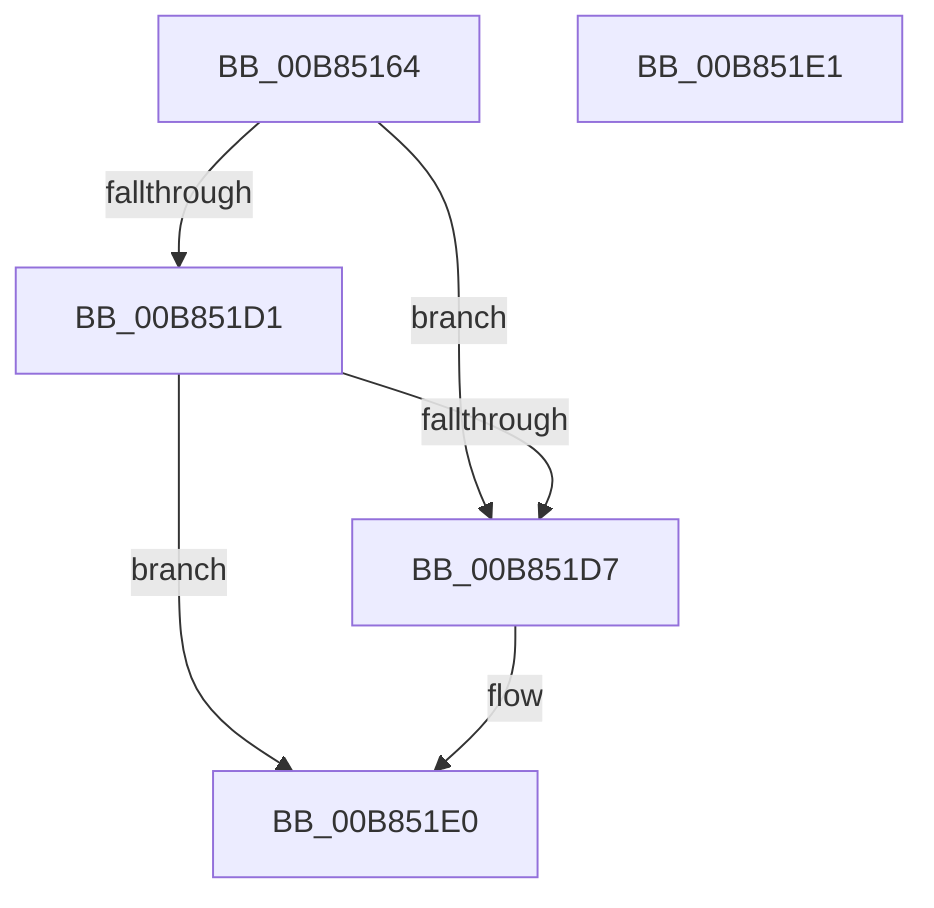

# KdpSetContextState

- RVA: `0x00B85164`–`0x00B851E2` (길이 `126` bytes)
- VA: `0x0000000140B85164`
- 실행 섹션: `PAGEKD`
- PDB 이름 있음: `예`; PDB Function 태그: `아니요`
- unwind 정보 RVA: `0x000DB714`
- 디코드: `24`개 명령, `126/126` bytes 표시
- 미해석 바이트: `0` (있으면 어셈블리에 `.byte`로 보존)

> 이 문서는 커널 이미지의 기계어와 PDB 기호를 분석해 생성했습니다. 4번과 5번은 함수 원형과 자료형을 바이너리 사용 방식에서 추정한 C 해석이며 원본 소스 복구 결과는 아닙니다.

## 1. Dependencies

- 직접 호출 지점: **0**; 고유 호출 대상: **0**
- 직접 호출자로 확인된 함수: **3**
- RIP 상대 이미지 참조: **0**

### Outgoing calls
- 직접 디코드된 call 명령이 없습니다.

### Direct callers
- [KdpReportCommandStringStateChange](KdpReportCommandStringStateChange_function_00B87AAC.md) at `0x00B87B29`
- [KdpReportLoadSymbolsStateChange](KdpReportLoadSymbolsStateChange_function_00B87C44.md) at `0x00B87CBB`
- [KdpReportExceptionStateChange](KdpReportExceptionStateChange_function_00B8A1E0.md) at `0x00B8A2C3`

### Static image references
- 디코드된 RIP-relative 메모리 참조가 없습니다.

## 2. Other-region calls and transfers

- 다른 실행 섹션으로 향하는 call: **0**
- 별도 외부 분기/꼬리 이동을 확인하지 못했습니다.

## 3. Assembly (complete function range)

```asm
00B85164  65 4C 8B 04 25 20 00 00 00      mov r8, qword ptr gs:[0x20]
00B8516D  49 8B 80 40 01 00 00            mov rax, qword ptr [r8 + 0x140]
00B85174  48 89 81 C0 00 00 00            mov qword ptr [rcx + 0xc0], rax
00B8517B  49 8B 80 48 01 00 00            mov rax, qword ptr [r8 + 0x148]
00B85182  48 89 81 C8 00 00 00            mov qword ptr [rcx + 0xc8], rax
00B85189  0F B7 42 38                     movzx eax, word ptr [rdx + 0x38]
00B8518D  66 89 81 E8 00 00 00            mov word ptr [rcx + 0xe8], ax
00B85194  0F B7 42 3A                     movzx eax, word ptr [rdx + 0x3a]
00B85198  66 89 81 EA 00 00 00            mov word ptr [rcx + 0xea], ax
00B8519F  0F B7 42 3C                     movzx eax, word ptr [rdx + 0x3c]
00B851A3  66 89 81 EC 00 00 00            mov word ptr [rcx + 0xec], ax
00B851AA  0F B7 42 3E                     movzx eax, word ptr [rdx + 0x3e]
00B851AE  66 89 81 EE 00 00 00            mov word ptr [rcx + 0xee], ax
00B851B5  8B 42 44                        mov eax, dword ptr [rdx + 0x44]
00B851B8  89 81 D0 00 00 00               mov dword ptr [rcx + 0xd0], eax
00B851BE  66 C7 81 D6 00 00 00 01 00      mov word ptr [rcx + 0xd6], 1
00B851C7  0F B7 42 38                     movzx eax, word ptr [rdx + 0x38]
00B851CB  66 83 F8 10                     cmp ax, 0x10
00B851CF  74 06                           je 0x140b851d7
00B851D1  66 83 F8 33                     cmp ax, 0x33
00B851D5  75 09                           jne 0x140b851e0
00B851D7  66 C7 81 D6 00 00 00 03 00      mov word ptr [rcx + 0xd6], 3
00B851E0  C3                              ret
00B851E1  CC                              int3
```

## 4. C-style interpretation (structured pseudocode)

```c
__int64 __fastcall KdpSetContextState(__int64 a1, __int64 a2)
{
    *(unsigned __int64 *)(a1 + 192) = *(unsigned __int64 *)(*(unsigned __int64 *)(gs_base + (0 + 32)) + 320);
    *(unsigned __int64 *)(a1 + 200) = *(unsigned __int64 *)(*(unsigned __int64 *)(gs_base + (0 + 32)) + 328);
    *(unsigned __int16 *)(a1 + 232) = (unsigned __int16)(*(unsigned __int16 *)(a2 + 56));
    *(unsigned __int16 *)(a1 + 234) = (unsigned __int16)(*(unsigned __int16 *)(a2 + 58));
    *(unsigned __int16 *)(a1 + 236) = (unsigned __int16)(*(unsigned __int16 *)(a2 + 60));
    *(unsigned __int16 *)(a1 + 238) = (unsigned __int16)(*(unsigned __int16 *)(a2 + 62));
    *(unsigned int *)(a1 + 208) = (unsigned int)((unsigned int)(*(unsigned int *)(a2 + 68)));
    *(unsigned __int16 *)(a1 + 214) = 1;
    if (((unsigned __int16)(*(unsigned __int16 *)(a2 + 56))) == 16) goto loc_00B851D7;
    if (((unsigned __int16)(*(unsigned __int16 *)(a2 + 56))) == 51) {
        *(unsigned __int16 *)(a1 + 214) = 3;
    }
    return *(unsigned __int16 *)(a2 + 56);
}
```

## 5. (Beta) C Style

```c
int64_t KdpSetContextState(void *Arg1, void *Arg2)
{
    uint8_t *arg1 = (uint8_t *)Arg1;
    uint8_t *arg2 = (uint8_t *)Arg2;

    *(uint64_t *)(arg1 + 0xC0) = *(uint64_t *)(*(uint64_t *)(gs_base + (0 + 0x20)) + 0x140);
    *(uint64_t *)(arg1 + 0xC8) = *(uint64_t *)(*(uint64_t *)(gs_base + (0 + 0x20)) + 0x148);
    *(uint16_t *)(arg1 + 0xE8) = (uint16_t)(*(uint16_t *)(arg2 + 0x38));
    *(uint16_t *)(arg1 + 0xEA) = (uint16_t)(*(uint16_t *)(arg2 + 0x3A));
    *(uint16_t *)(arg1 + 0xEC) = (uint16_t)(*(uint16_t *)(arg2 + 0x3C));
    *(uint16_t *)(arg1 + 0xEE) = (uint16_t)(*(uint16_t *)(arg2 + 0x3E));
    *(uint32_t *)(arg1 + 0xD0) = (uint32_t)((uint32_t)(*(uint32_t *)(arg2 + 0x44)));
    *(uint16_t *)(arg1 + 0xD6) = 1;
    if (((uint16_t)(*(uint16_t *)(arg2 + 0x38))) == 16) goto loc_00B851D7;
    if (((uint16_t)(*(uint16_t *)(arg2 + 0x38))) == 51) {
        *(uint16_t *)(arg1 + 0xD6) = 3;
    }
    return *(uint16_t *)(arg2 + 0x38);
}
```

### 관측된 메모리 오프셋

구조체 형식이 확인되지 않은 접근은 인자 기준의 오프셋으로만 기록했습니다.

| 기준 인자 | 오프셋 표현 | 폭 (bit) | 접근 |
|---|---:|---:|---|
| `Arg1` | `+ 0xC0` | `64` | `W` |
| `Arg1` | `+ 0xC8` | `64` | `W` |
| `Arg1` | `+ 0xD0` | `32` | `W` |
| `Arg1` | `+ 0xD6` | `16` | `W` |
| `Arg1` | `+ 0xE8` | `16` | `W` |
| `Arg1` | `+ 0xEA` | `16` | `W` |
| `Arg1` | `+ 0xEC` | `16` | `W` |
| `Arg1` | `+ 0xEE` | `16` | `W` |
| `Arg2` | `+ 0x38` | `16` | `R` |
| `Arg2` | `+ 0x3A` | `16` | `R` |
| `Arg2` | `+ 0x3C` | `16` | `R` |
| `Arg2` | `+ 0x3E` | `16` | `R` |
| `Arg2` | `+ 0x44` | `32` | `R` |

## 6. Execution-region graph

[열기: 2D/3D 그래프와 함수 탐색 컨트롤 패널](../../../control-panel.html?section=pagekd&rva=0x00B85164&view=graph)

- 2D 그래프는 위에서 아래로 흐르고, 3D 그래프는 빈 공간을 드래그해 회전합니다. Shift+드래그는 이동, 휠은 확대·축소, 함수 노드 선택은 대상 보고서 이동입니다.

### Static fallback


