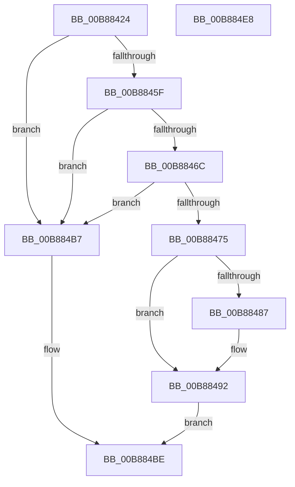

# KdpSetContext

- RVA: `0x00B88424`–`0x00B884E9` (길이 `197` bytes)
- VA: `0x0000000140B88424`
- 실행 섹션: `PAGEKD`
- PDB 이름 있음: `예`; PDB Function 태그: `아니요`
- unwind 정보 RVA: `0x0008A658`
- 디코드: `48`개 명령, `197/197` bytes 표시
- 미해석 바이트: `0` (있으면 어셈블리에 `.byte`로 보존)

> 이 문서는 커널 이미지의 기계어와 PDB 기호를 분석해 생성했습니다. 4번과 5번은 함수 원형과 자료형을 바이너리 사용 방식에서 추정한 C 해석이며 원본 소스 복구 결과는 아닙니다.

## 1. Dependencies

- 직접 호출 지점: **3**; 고유 호출 대상: **3**
- 직접 호출자로 확인된 함수: **1**
- RIP 상대 이미지 참조: **4**

### Outgoing calls
- `0x00B884A1` → [KdpSanitizeContextFlags](KdpSanitizeContextFlags_function_00B89498.md) (function, `0x00B89498`)
- `0x00B884B0` → [KdpCopyContext](KdpCopyContext_function_00B851E8.md) (function, `0x00B851E8`)
- `0x00B884D1` → `kdcom.dll!KdSendPacket` (import, 간접 대상; import `kdcom.dll!KdSendPacket`)

### Direct callers
- [KdpSendWaitContinue](KdpSendWaitContinue_function_00B8A32C.md) at `0x00B8A4C9`

### Static image references
- `0x00B8845F` → RVA `0x00FC8C40` (`ALMOSTRO`; read)
- `0x00B8846C` → RVA `0x00F475D0` (`.data`; read)
- `0x00B884C1` → RVA `0x00F475E0` (`.data`; read)
- `0x00B884D1` → RVA `0x001516C0` (`kdcom.dll!KdSendPacket (IAT)`; read)

## 2. Other-region calls and transfers

- 다른 실행 섹션으로 향하는 call: **0**
- 별도 외부 분기/꼬리 이동을 확인하지 못했습니다.

## 3. Assembly (complete function range)

```asm
00B88424  48 89 5C 24 10                  mov qword ptr [rsp + 0x10], rbx
00B88429  57                              push rdi
00B8842A  48 83 EC 30                     sub rsp, 0x30
00B8842E  45 33 D2                        xor r10d, r10d
00B88431  0F 57 C0                        xorps xmm0, xmm0
00B88434  0F 11 44 24 20                  movups xmmword ptr [rsp + 0x20], xmm0
00B88439  49 8B F8                        mov rdi, r8
00B8843C  44 89 54 24 40                  mov dword ptr [rsp + 0x40], r10d
00B88441  44 0F B7 41 06                  movzx r8d, word ptr [rcx + 6]
00B88446  41 8D 42 38                     lea eax, [r10 + 0x38]
00B8844A  48 89 4C 24 28                  mov qword ptr [rsp + 0x28], rcx
00B8844F  66 89 44 24 20                  mov word ptr [rsp + 0x20], ax
00B88454  B8 00 08 00 00                  mov eax, 0x800
00B88459  66 44 3B C0                     cmp r8w, ax
00B8845D  73 58                           jae 0x140b884b7
00B8845F  4C 8D 1D DA 07 44 00            lea r11, [rip + 0x4407da]
00B88466  4F 39 14 C3                     cmp qword ptr [r11 + r8*8], r10
00B8846A  74 4B                           je 0x140b884b7
00B8846C  44 38 15 5D F1 3B 00            cmp byte ptr [rip + 0x3bf15d], r10b
00B88473  74 42                           je 0x140b884b7
00B88475  44 89 51 08                     mov dword ptr [rcx + 8], r10d
00B88479  65 8B 04 25 A4 01 00 00         mov eax, dword ptr gs:[0x1a4]
00B88481  66 44 3B C0                     cmp r8w, ax
00B88485  74 0B                           je 0x140b88492
00B88487  4B 8B 04 C3                     mov rax, qword ptr [r11 + r8*8]
00B8848B  48 8B B8 C0 8F 00 00            mov rdi, qword ptr [rax + 0x8fc0]
00B88492  48 8B 5A 08                     mov rbx, qword ptr [rdx + 8]
00B88496  4C 8D 44 24 40                  lea r8, [rsp + 0x40]
00B8849B  0F B7 12                        movzx edx, word ptr [rdx]
00B8849E  48 8B CB                        mov rcx, rbx
00B884A1  E8 F2 0F 00 00                  call 0x140b89498
00B884A6  8B 54 24 40                     mov edx, dword ptr [rsp + 0x40]
00B884AA  48 8B CF                        mov rcx, rdi
00B884AD  4C 8B C3                        mov r8, rbx
00B884B0  E8 33 CD FF FF                  call 0x140b851e8
00B884B5  EB 07                           jmp 0x140b884be
00B884B7  C7 41 08 01 00 00 C0            mov dword ptr [rcx + 8], 0xc0000001
00B884BE  45 33 C0                        xor r8d, r8d
00B884C1  4C 8D 0D 18 F1 3B 00            lea r9, [rip + 0x3bf118]
00B884C8  48 8D 54 24 20                  lea rdx, [rsp + 0x20]
00B884CD  41 8D 48 02                     lea ecx, [r8 + 2]
00B884D1  48 FF 15 E8 91 5C FF            call qword ptr [rip - 0xa36e18]
00B884D8  0F 1F 44 00 00                  nop dword ptr [rax + rax]
00B884DD  48 8B 5C 24 48                  mov rbx, qword ptr [rsp + 0x48]
00B884E2  48 83 C4 30                     add rsp, 0x30
00B884E6  5F                              pop rdi
00B884E7  C3                              ret
00B884E8  CC                              int3
```

## 4. C-style interpretation (structured pseudocode)

```c
__int64 __fastcall KdpSetContext(__int64 a1, __int64 a2, __int64 a3)
{
    __int64 result;
    __int64 v_r10;
    __int64 v_rdi;
    __int64 v_rsp;
    unsigned __int64 v_stack_m10;
    unsigned __int64 v_stack_m18;
    unsigned __int64 v_stack_p10;
    unsigned int v_stack_p8;

    v_stack_p10 = v_rbx;
    v_rsp = (v_rsp) - (48);
    v_r10 = 0;
    v_stack_m18 = v_xmm0;
    v_stack_p8 = 0;
    v_stack_m10 = a1;
    v_stack_m18 = (unsigned __int16)(v_r10 + 56);
    if (((unsigned __int16)(*(unsigned __int16 *)(a1 + 6))) >= ((unsigned __int16)((unsigned int)(0x800ULL)))) goto loc_00B884B7;
    if ((*(unsigned __int64 *)(v_rip + 4458458 + *(unsigned __int16 *)(a1 + 6) * 8)) == 0) goto loc_00B884B7;
    if ((*(unsigned __int8 *)(v_rip + 3928413)) == 0) goto loc_00B884B7;
    *(unsigned int *)(a1 + 8) = 0;
    result = (unsigned int)(*(unsigned int *)(gs_base + (0 + 420)));
    v_rdi = a3;
    if (((unsigned __int16)(*(unsigned __int16 *)(a1 + 6))) != ((unsigned __int16)((unsigned int)(*(unsigned int *)(gs_base + (0 + 420)))))) {
        result = *(unsigned __int64 *)(v_rip + 4458458 + *(unsigned __int16 *)(a1 + 6) * 8);
        v_rdi = *(unsigned __int64 *)(result + 36800);
    }
    result = KdpSanitizeContextFlags(*(unsigned __int64 *)(a2 + 8), *(unsigned __int16 *)(a2), v_stack_p8, a4);
    result = KdpCopyContext(v_rdi, (unsigned int)(v_stack_p8), *(unsigned __int64 *)(a2 + 8), a4);
    goto loc_00B884BE;
loc_00B884B7:
    *(unsigned int *)(v_rdi + 8) = 0xC0000001ULL;
loc_00B884BE:
    a3 = 0;
    result = kdcom_dll_KdSendPacket(a3 + 2, v_stack_m18, a3, v_rip + 3928344);
    v_rsp = (v_rsp) + (48);
    return result;
}
```

## 5. (Beta) C Style

```c
int64_t KdpSetContext(void *Arg1, void *Arg2, int64_t Arg3)
{
    uint8_t *arg1 = (uint8_t *)Arg1;
    uint8_t *arg2 = (uint8_t *)Arg2;

    int64_t result;
    int64_t local_r10;
    int64_t local_rdi;
    int64_t local_rsp;
    uint64_t v_stack_m10;
    uint64_t v_stack_m18;
    uint64_t v_stack_p10;
    uint32_t v_stack_p8;

    v_stack_p10 = local_rbx;
    local_rsp = (local_rsp) - (48);
    local_r10 = 0;
    v_stack_m18 = v_xmm0;
    v_stack_p8 = 0;
    v_stack_m10 = Arg1;
    v_stack_m18 = (uint16_t)(local_r10 + 56);
    if (((uint16_t)(*(uint16_t *)(arg1 + 0x6))) >= ((uint16_t)((uint32_t)(0x800ULL)))) goto loc_00B884B7;
    if ((*(uint64_t *)(v_rip + 0x4407DA + *(uint16_t *)(arg1 + 0x6) * 8)) == 0) goto loc_00B884B7;
    if ((*(uint8_t *)(v_rip + 0x3BF15D)) == 0) goto loc_00B884B7;
    *(uint32_t *)(arg1 + 0x8) = 0;
    result = (uint32_t)(*(uint32_t *)(gs_base + (0 + 0x1A4)));
    local_rdi = Arg3;
    if (((uint16_t)(*(uint16_t *)(arg1 + 0x6))) != ((uint16_t)((uint32_t)(*(uint32_t *)(gs_base + (0 + 0x1A4)))))) {
        result = *(uint64_t *)(v_rip + 0x4407DA + *(uint16_t *)(arg1 + 0x6) * 8);
        local_rdi = *(uint64_t *)(result + 0x8FC0);
    }
    result = KdpSanitizeContextFlags(*(uint64_t *)(arg2 + 0x8), *(uint16_t *)(arg2), v_stack_p8, a4);
    result = KdpCopyContext(local_rdi, (uint32_t)(v_stack_p8), *(uint64_t *)(arg2 + 0x8), a4);
    goto loc_00B884BE;
loc_00B884B7:
    *(uint32_t *)(local_rdi + 0x8) = 0xC0000001ULL;
loc_00B884BE:
    Arg3 = 0;
    result = kernel_indirect_call(Arg3 + 2, v_stack_m18, Arg3, v_rip + 3928344);
    local_rsp = (local_rsp) + (48);
    return result;
}
```

### 관측된 메모리 오프셋

구조체 형식이 확인되지 않은 접근은 인자 기준의 오프셋으로만 기록했습니다.

| 기준 인자 | 오프셋 표현 | 폭 (bit) | 접근 |
|---|---:|---:|---|
| `Arg1` | `+ 0x6` | `16` | `R` |
| `Arg1` | `+ 0x8` | `32` | `W` |
| `Arg2` | `+ 0x0` | `16` | `R` |
| `Arg2` | `+ 0x8` | `64` | `R` |

## 6. Execution-region graph

[열기: 2D/3D 그래프와 함수 탐색 컨트롤 패널](../../../control-panel.html?section=pagekd&rva=0x00B88424&view=graph)

- 2D 그래프는 위에서 아래로 흐르고, 3D 그래프는 빈 공간을 드래그해 회전합니다. Shift+드래그는 이동, 휠은 확대·축소, 함수 노드 선택은 대상 보고서 이동입니다.

### Static fallback


