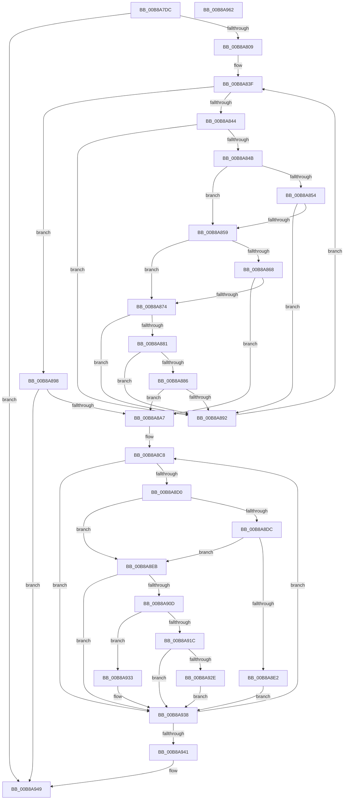

# KdpSetOwedBreakpoints

- RVA: `0x00B8A7DC`–`0x00B8A963` (길이 `391` bytes)
- VA: `0x0000000140B8A7DC`
- 실행 섹션: `PAGEKD`
- PDB 이름 있음: `예`; PDB Function 태그: `아니요`
- unwind 정보 RVA: `0x000BE884`
- 디코드: `105`개 명령, `391/391` bytes 표시
- 미해석 바이트: `0` (있으면 어셈블리에 `.byte`로 보존)

> 이 문서는 커널 이미지의 기계어와 PDB 기호를 분석해 생성했습니다. 4번과 5번은 함수 원형과 자료형을 바이너리 사용 방식에서 추정한 C 해석이며 원본 소스 복구 결과는 아닙니다.

## 1. Dependencies

- 직접 호출 지점: **5**; 고유 호출 대상: **5**
- 직접 호출자로 확인된 함수: **1**
- RIP 상대 이미지 참조: **7**

### Outgoing calls
- `0x00B8A8AB` → [KdEnterDebugger](KdEnterDebugger_function_00B8A96C.md) (function, `0x00B8A96C`)
- `0x00B8A904` → [KdpCopyCodeStream](KdpCopyCodeStream_function_00B8930C.md) (function, `0x00B8930C`)
- `0x00B8A925` → [KdpInsertBreakpoint](KdpInsertBreakpoint_function_00B899F0.md) (function, `0x00B899F0`)
- `0x00B8A933` → [KdpRemoveBreakpoint](KdpRemoveBreakpoint_function_00B89BDC.md) (function, `0x00B89BDC`)
- `0x00B8A944` → [KdExitDebugger](KdExitDebugger_function_00B85008.md) (function, `0x00B85008`)

### Direct callers
- [MiAllocateWsle](../../text/33/MiAllocateWsle_function_003332C0.md) at `0x00333BD9`

### Static image references
- `0x00B8A7FC` → RVA `0x00F55BC0` (`.data`; read)
- `0x00B8A809` → RVA `0x00F49620` (`.data`; read)
- `0x00B8A810` → RVA `0x00F49648` (`.data`; read)
- `0x00B8A820` → RVA `0x00F49B48` (`.data`; read)
- `0x00B8A8B3` → RVA `0x00F55BC0` (`.data`; write)
- `0x00B8A8BA` → RVA `0x00F49665` (`.data`; read)
- `0x00B8A8C1` → RVA `0x00F49B65` (`.data`; read)

## 2. Other-region calls and transfers

- 다른 실행 섹션으로 향하는 call: **0**
- 별도 외부 분기/꼬리 이동을 확인하지 못했습니다.

## 3. Assembly (complete function range)

```asm
00B8A7DC  48 8B C4                        mov rax, rsp
00B8A7DF  48 89 58 08                     mov qword ptr [rax + 8], rbx
00B8A7E3  48 89 68 18                     mov qword ptr [rax + 0x18], rbp
00B8A7E7  48 89 70 20                     mov qword ptr [rax + 0x20], rsi
00B8A7EB  57                              push rdi
00B8A7EC  41 54                           push r12
00B8A7EE  41 57                           push r15
00B8A7F0  48 83 EC 20                     sub rsp, 0x20
00B8A7F4  48 83 60 10 00                  and qword ptr [rax + 0x10], 0
00B8A7F9  4C 8B C1                        mov r8, rcx
00B8A7FC  80 3D BD B3 3C 00 00            cmp byte ptr [rip + 0x3cb3bd], 0
00B8A803  0F 84 40 01 00 00               je 0x140b8a949
00B8A809  44 8B 15 10 EE 3B 00            mov r10d, dword ptr [rip + 0x3bee10]
00B8A810  48 8D 15 31 EE 3B 00            lea rdx, [rip + 0x3bee31]
00B8A817  65 48 8B 04 25 88 01 00 00      mov rax, qword ptr gs:[0x188]
00B8A820  4C 8D 1D 21 F3 3B 00            lea r11, [rip + 0x3bf321]
00B8A827  49 81 E0 00 F0 FF FF            and r8, 0xfffffffffffff000
00B8A82E  49 BC 00 00 00 00 00 80 FF FF   movabs r12, 0xffff800000000000
00B8A838  48 8B A8 B8 00 00 00            mov rbp, qword ptr [rax + 0xb8]
00B8A83F  49 3B D3                        cmp rdx, r11
00B8A842  7D 54                           jge 0x140b8a898
00B8A844  8B 42 18                        mov eax, dword ptr [rdx + 0x18]
00B8A847  A8 0A                           test al, 0xa
00B8A849  74 47                           je 0x140b8a892
00B8A84B  48 8B 42 F8                     mov rax, qword ptr [rdx - 8]
00B8A84F  49 3B C4                        cmp rax, r12
00B8A852  73 05                           jae 0x140b8a859
00B8A854  48 39 2A                        cmp qword ptr [rdx], rbp
00B8A857  75 39                           jne 0x140b8a892
00B8A859  0F B6 4A 1D                     movzx ecx, byte ptr [rdx + 0x1d]
00B8A85D  48 F7 D1                        not rcx
00B8A860  48 23 C8                        and rcx, rax
00B8A863  49 3B C8                        cmp rcx, r8
00B8A866  72 0C                           jb 0x140b8a874
00B8A868  49 8D 80 00 10 00 00            lea rax, [r8 + 0x1000]
00B8A86F  48 3B C8                        cmp rcx, rax
00B8A872  72 33                           jb 0x140b8a8a7
00B8A874  44 0F B6 4A 1C                  movzx r9d, byte ptr [rdx + 0x1c]
00B8A879  4C 03 C9                        add r9, rcx
00B8A87C  4C 3B C9                        cmp r9, rcx
00B8A87F  72 11                           jb 0x140b8a892
00B8A881  4D 3B C8                        cmp r9, r8
00B8A884  76 0C                           jbe 0x140b8a892
00B8A886  49 8D 80 00 10 00 00            lea rax, [r8 + 0x1000]
00B8A88D  4C 3B C8                        cmp r9, rax
00B8A890  76 15                           jbe 0x140b8a8a7
00B8A892  48 83 C2 28                     add rdx, 0x28
00B8A896  EB A7                           jmp 0x140b8a83f
00B8A898  8B 05 82 ED 3B 00               mov eax, dword ptr [rip + 0x3bed82]
00B8A89E  44 3B D0                        cmp r10d, eax
00B8A8A1  0F 84 A2 00 00 00               je 0x140b8a949
00B8A8A7  33 D2                           xor edx, edx
00B8A8A9  33 C9                           xor ecx, ecx
00B8A8AB  E8 BC 00 00 00                  call 0x140b8a96c
00B8A8B0  40 8A F0                        mov sil, al
00B8A8B3  C6 05 06 B3 3C 00 00            mov byte ptr [rip + 0x3cb306], 0
00B8A8BA  48 8D 1D A4 ED 3B 00            lea rbx, [rip + 0x3beda4]
00B8A8C1  4C 8D 3D 9D F2 3B 00            lea r15, [rip + 0x3bf29d]
00B8A8C8  8B 4B FB                        mov ecx, dword ptr [rbx - 5]
00B8A8CB  F6 C1 0A                        test cl, 0xa
00B8A8CE  74 68                           je 0x140b8a938
00B8A8D0  48 8D 7B DB                     lea rdi, [rbx - 0x25]
00B8A8D4  48 8B 07                        mov rax, qword ptr [rdi]
00B8A8D7  49 3B C4                        cmp rax, r12
00B8A8DA  73 0F                           jae 0x140b8a8eb
00B8A8DC  48 39 6B E3                     cmp qword ptr [rbx - 0x1d], rbp
00B8A8E0  74 09                           je 0x140b8a8eb
00B8A8E2  C6 05 D7 B2 3C 00 01            mov byte ptr [rip + 0x3cb2d7], 1
00B8A8E9  EB 4D                           jmp 0x140b8a938
00B8A8EB  0F B6 0B                        movzx ecx, byte ptr [rbx]
00B8A8EE  48 8D 54 24 48                  lea rdx, [rsp + 0x48]
00B8A8F3  44 0F B6 43 FF                  movzx r8d, byte ptr [rbx - 1]
00B8A8F8  48 F7 D1                        not rcx
00B8A8FB  48 23 C8                        and rcx, rax
00B8A8FE  41 B9 04 00 00 00               mov r9d, 4
00B8A904  E8 03 EA FF FF                  call 0x140b8930c
00B8A909  85 C0                           test eax, eax
00B8A90B  78 2B                           js 0x140b8a938
00B8A90D  8B 43 FB                        mov eax, dword ptr [rbx - 5]
00B8A910  48 8D 54 24 48                  lea rdx, [rsp + 0x48]
00B8A915  48 8B CF                        mov rcx, rdi
00B8A918  A8 02                           test al, 2
00B8A91A  74 17                           je 0x140b8a933
00B8A91C  48 8B 44 24 48                  mov rax, qword ptr [rsp + 0x48]
00B8A921  48 89 43 F3                     mov qword ptr [rbx - 0xd], rax
00B8A925  E8 C6 F0 FF FF                  call 0x140b899f0
00B8A92A  85 C0                           test eax, eax
00B8A92C  74 0A                           je 0x140b8a938
00B8A92E  89 43 FB                        mov dword ptr [rbx - 5], eax
00B8A931  EB 05                           jmp 0x140b8a938
00B8A933  E8 A4 F2 FF FF                  call 0x140b89bdc
00B8A938  48 83 C3 28                     add rbx, 0x28
00B8A93C  49 3B DF                        cmp rbx, r15
00B8A93F  7C 87                           jl 0x140b8a8c8
00B8A941  40 8A CE                        mov cl, sil
00B8A944  E8 BF A6 FF FF                  call 0x140b85008
00B8A949  48 8B 5C 24 40                  mov rbx, qword ptr [rsp + 0x40]
00B8A94E  48 8B 6C 24 50                  mov rbp, qword ptr [rsp + 0x50]
00B8A953  48 8B 74 24 58                  mov rsi, qword ptr [rsp + 0x58]
00B8A958  48 83 C4 20                     add rsp, 0x20
00B8A95C  41 5F                           pop r15
00B8A95E  41 5C                           pop r12
00B8A960  5F                              pop rdi
00B8A961  C3                              ret
00B8A962  CC                              int3
```

## 4. C-style interpretation (structured pseudocode)

```c
__int64 __fastcall KdpSetOwedBreakpoints(__int64 a1)
{
    __int64 result;
    __int64 v_rbx;
    __int64 v_rsp;
    unsigned __int64 v_stack_p10;
    unsigned __int64 v_stack_p18;
    unsigned __int64 v_stack_p20;
    unsigned __int64 v_stack_p8;

    *(unsigned __int64 *)(v_rsp + 8) = v_rbx;
    *(unsigned __int64 *)(v_rsp + 24) = v_rbp;
    *(unsigned __int64 *)(v_rsp + 32) = v_rsi;
    v_rsp = (v_rsp) - (32);
    if ((*(unsigned __int8 *)(v_rip + 3978173)) == 0) goto loc_00B8A949;
    a3 = (a1) & (0xFFFFFFFFFFFFF000ULL);
loc_00B8A83F:
    if ((v_rip + 3927601) >= (v_rip + 3928865)) goto loc_00B8A898;
    if ((((unsigned __int8)((unsigned int)(*(unsigned int *)(v_rip + 3927601 + 24)))) & (10)) == 0) goto loc_00B8A892;
    if ((*(unsigned __int64 *)(v_rip + 3927601 - 8)) >= v_r12) goto loc_00B8A859;
    if ((*(unsigned __int64 *)(v_rip + 3927601)) != (*(unsigned __int64 *)(*(unsigned __int64 *)(gs_base + (0 + 392)) + 184))) goto loc_00B8A892;
loc_00B8A859:
    a1 = ~(*(unsigned __int8 *)(v_rip + 3927601 + 29));
    a1 = (a1) & (*(unsigned __int64 *)(v_rip + 3927601 - 8));
    if (a1 < a3) goto loc_00B8A874;
    if (a1 < (a3 + 4096)) goto loc_00B8A8A7;
loc_00B8A874:
    a4 = (*(unsigned __int8 *)(v_rip + 3927601 + 28)) + (a1);
    if (a4 < a1) goto loc_00B8A892;
    if (a4 <= a3) goto loc_00B8A892;
    if (a4 <= (a3 + 4096)) goto loc_00B8A8A7;
loc_00B8A892:
    a2 = (v_rip + 3927601) + (40);
    goto loc_00B8A83F;
loc_00B8A898:
    if (((unsigned int)((unsigned int)(*(unsigned int *)(v_rip + 3927568)))) == ((unsigned int)((unsigned int)(*(unsigned int *)(v_rip + 3927426))))) goto loc_00B8A949;
loc_00B8A8A7:
    a2 = 0;
    a1 = 0;
    result = KdEnterDebugger(a1, a2, a3, a4);
    *(unsigned __int8 *)(v_rip + 3977990) = 0;
loc_00B8A8C8:
    if ((((unsigned __int8)((unsigned int)(*(unsigned int *)(v_rip + 3927460 - 5)))) & (10)) == 0) goto loc_00B8A938;
    if ((*(unsigned __int64 *)(v_rip + 3927460 - 37)) >= v_r12) goto loc_00B8A8EB;
    if ((*(unsigned __int64 *)(v_rip + 3927460 - 29)) == (*(unsigned __int64 *)(*(unsigned __int64 *)(gs_base + (0 + 392)) + 184))) goto loc_00B8A8EB;
    *(unsigned __int8 *)(v_rip + 3977943) = 1;
    goto loc_00B8A938;
loc_00B8A8EB:
    a1 = ~(*(unsigned __int8 *)(v_rip + 3927460));
    a1 = (a1) & (*(unsigned __int64 *)(v_rip + 3927460 - 37));
    result = KdpCopyCodeStream(a1, v_stack_p10, *(unsigned __int8 *)(v_rip + 3927460 - 1), 4);
    if (sign_flag) goto loc_00B8A938;
    if ((((unsigned __int8)((unsigned int)(*(unsigned int *)(v_rip + 3927460 - 5)))) & (2)) == 0) goto loc_00B8A933;
    *(unsigned __int64 *)(v_rip + 3927460 - 13) = v_stack_p10;
    result = KdpInsertBreakpoint(v_rip + 3927460 - 37, v_stack_p10, *(unsigned __int8 *)(v_rip + 3927460 - 1), 4);
    if ((unsigned int)(result) == 0) goto loc_00B8A938;
    *(unsigned int *)(v_rip + 3927460 - 5) = (unsigned int)(result);
    goto loc_00B8A938;
loc_00B8A933:
    result = KdpRemoveBreakpoint(v_rip + 3927460 - 37, v_stack_p10, *(unsigned __int8 *)(v_rip + 3927460 - 1), 4);
loc_00B8A938:
    v_rbx = (v_rip + 3927460) + (40);
    if (v_rbx < (v_rip + 3928733)) goto loc_00B8A8C8;
    result = KdExitDebugger((unsigned __int8)((unsigned __int8)(result)), v_stack_p10, *(unsigned __int8 *)(v_rip + 3927460 - 1), 4);
loc_00B8A949:
    v_rsp = (v_rsp) + (32);
    return result;
}
```

## 5. (Beta) C Style

```c
int64_t KdpSetOwedBreakpoints(void *Arg1)
{
    uint8_t *arg1 = (uint8_t *)Arg1;

    int64_t result;
    int64_t local_rbx;
    int64_t local_rsp;
    uint64_t v_stack_p10;
    uint64_t v_stack_p18;
    uint64_t v_stack_p20;
    uint64_t v_stack_p8;

    *(uint64_t *)(local_rsp + 0x8) = local_rbx;
    *(uint64_t *)(local_rsp + 0x18) = local_rbp;
    *(uint64_t *)(local_rsp + 0x20) = local_rsi;
    local_rsp = (local_rsp) - (32);
    if ((*(uint8_t *)(v_rip + 0x3CB3BD)) == 0) goto loc_00B8A949;
    a3 = (Arg1) & (0xFFFFFFFFFFFFF000ULL);
loc_00B8A83F:
    if ((v_rip + 3927601) >= (v_rip + 3928865)) goto loc_00B8A898;
    if ((((uint8_t)((uint32_t)(*(uint32_t *)(v_rip + 0x3BEE31 + 0x18)))) & (10)) == 0) goto loc_00B8A892;
    if ((*(uint64_t *)(v_rip + 0x3BEE31 - 0x8)) >= local_r12) goto loc_00B8A859;
    if ((*(uint64_t *)(v_rip + 0x3BEE31)) != (*(uint64_t *)(*(uint64_t *)(gs_base + (0 + 0x188)) + 0xB8))) goto loc_00B8A892;
loc_00B8A859:
    Arg1 = ~(*(uint8_t *)(v_rip + 0x3BEE31 + 0x1D));
    Arg1 = (Arg1) & (*(uint64_t *)(v_rip + 0x3BEE31 - 0x8));
    if (Arg1 < a3) goto loc_00B8A874;
    if (Arg1 < (a3 + 4096)) goto loc_00B8A8A7;
loc_00B8A874:
    a4 = (*(uint8_t *)(v_rip + 0x3BEE31 + 0x1C)) + (Arg1);
    if (a4 < Arg1) goto loc_00B8A892;
    if (a4 <= a3) goto loc_00B8A892;
    if (a4 <= (a3 + 4096)) goto loc_00B8A8A7;
loc_00B8A892:
    a2 = (v_rip + 3927601) + (40);
    goto loc_00B8A83F;
loc_00B8A898:
    if (((uint32_t)((uint32_t)(*(uint32_t *)(v_rip + 0x3BEE10)))) == ((uint32_t)((uint32_t)(*(uint32_t *)(v_rip + 0x3BED82))))) goto loc_00B8A949;
loc_00B8A8A7:
    a2 = 0;
    Arg1 = 0;
    result = KdEnterDebugger(Arg1, a2, a3, a4);
    *(uint8_t *)(v_rip + 0x3CB306) = 0;
loc_00B8A8C8:
    if ((((uint8_t)((uint32_t)(*(uint32_t *)(v_rip + 0x3BEDA4 - 0x5)))) & (10)) == 0) goto loc_00B8A938;
    if ((*(uint64_t *)(v_rip + 0x3BEDA4 - 0x25)) >= local_r12) goto loc_00B8A8EB;
    if ((*(uint64_t *)(v_rip + 0x3BEDA4 - 0x1D)) == (*(uint64_t *)(*(uint64_t *)(gs_base + (0 + 0x188)) + 0xB8))) goto loc_00B8A8EB;
    *(uint8_t *)(v_rip + 0x3CB2D7) = 1;
    goto loc_00B8A938;
loc_00B8A8EB:
    Arg1 = ~(*(uint8_t *)(v_rip + 0x3BEDA4));
    Arg1 = (Arg1) & (*(uint64_t *)(v_rip + 0x3BEDA4 - 0x25));
    result = KdpCopyCodeStream(Arg1, v_stack_p10, *(uint8_t *)(v_rip + 0x3BEDA4 - 0x1), 4);
    if (sign_flag) goto loc_00B8A938;
    if ((((uint8_t)((uint32_t)(*(uint32_t *)(v_rip + 0x3BEDA4 - 0x5)))) & (2)) == 0) goto loc_00B8A933;
    *(uint64_t *)(v_rip + 0x3BEDA4 - 0xD) = v_stack_p10;
    result = KdpInsertBreakpoint(v_rip + 3927460 - 37, v_stack_p10, *(uint8_t *)(v_rip + 0x3BEDA4 - 0x1), 4);
    if ((uint32_t)(result) == 0) goto loc_00B8A938;
    *(uint32_t *)(v_rip + 0x3BEDA4 - 0x5) = (uint32_t)(result);
    goto loc_00B8A938;
loc_00B8A933:
    result = KdpRemoveBreakpoint(v_rip + 3927460 - 37, v_stack_p10, *(uint8_t *)(v_rip + 0x3BEDA4 - 0x1), 4);
loc_00B8A938:
    local_rbx = (v_rip + 3927460) + (40);
    if (local_rbx < (v_rip + 3928733)) goto loc_00B8A8C8;
    result = KdExitDebugger((uint8_t)((uint8_t)(result)), v_stack_p10, *(uint8_t *)(v_rip + 0x3BEDA4 - 0x1), 4);
loc_00B8A949:
    local_rsp = (local_rsp) + (32);
    return result;
}
```

### 관측된 메모리 오프셋

구조체 형식이 확인되지 않은 접근은 인자 기준의 오프셋으로만 기록했습니다.

| 기준 인자 | 오프셋 표현 | 폭 (bit) | 접근 |
|---|---:|---:|---|
| `Arg1` | `+ 0x1000` | `64` | `R` |

## 6. Execution-region graph

[열기: 2D/3D 그래프와 함수 탐색 컨트롤 패널](../../../control-panel.html?section=pagekd&rva=0x00B8A7DC&view=graph)

- 2D 그래프는 위에서 아래로 흐르고, 3D 그래프는 빈 공간을 드래그해 회전합니다. Shift+드래그는 이동, 휠은 확대·축소, 함수 노드 선택은 대상 보고서 이동입니다.

### Static fallback


