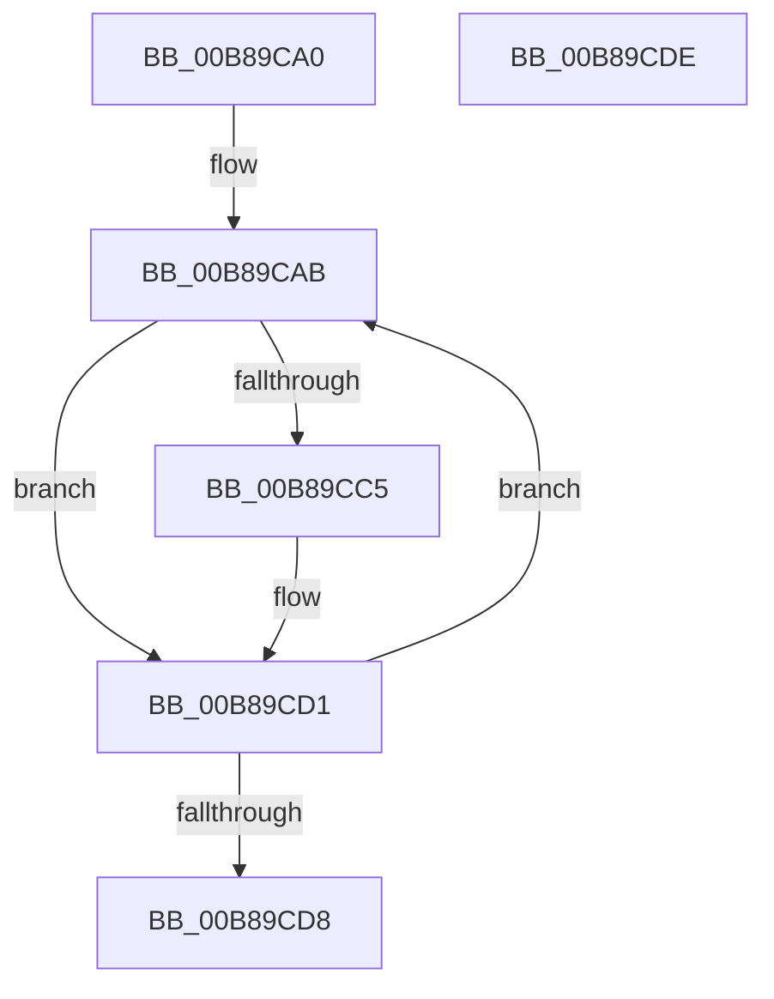

# KdpSuspendAllBreakpoints

- RVA: `0x00B89CA0`–`0x00B89CDF` (길이 `63` bytes)
- VA: `0x0000000140B89CA0`
- 실행 섹션: `PAGEKD`
- PDB 이름 있음: `예`; PDB Function 태그: `아니요`
- unwind 정보 RVA: `0x0005CF00`
- 디코드: `21`개 명령, `63/63` bytes 표시
- 미해석 바이트: `0` (있으면 어셈블리에 `.byte`로 보존)

> 이 문서는 커널 이미지의 기계어와 PDB 기호를 분석해 생성했습니다. 4번과 5번은 함수 원형과 자료형을 바이너리 사용 방식에서 추정한 C 해석이며 원본 소스 복구 결과는 아닙니다.

## 1. Dependencies

- 직접 호출 지점: **1**; 고유 호출 대상: **1**
- 직접 호출자로 확인된 함수: **1**
- RIP 상대 이미지 참조: **1**

### Outgoing calls
- `0x00B89CCC` → [KdpLowWriteContent](KdpLowWriteContent_function_00B89B0C.md) (function, `0x00B89B0C`)

### Direct callers
- [KdDisableDebuggerWithLock](../../text/5B/KdDisableDebuggerWithLock_function_005B0918.md) at `0x005B09C0`

### Static image references
- `0x00B89CB2` → RVA `0x00F49660` (`.data`; read)

## 2. Other-region calls and transfers

- 다른 실행 섹션으로 향하는 call: **0**
- 별도 외부 분기/꼬리 이동을 확인하지 못했습니다.

## 3. Assembly (complete function range)

```asm
00B89CA0  40 53                           push rbx
00B89CA2  48 83 EC 20                     sub rsp, 0x20
00B89CA6  BB 01 00 00 00                  mov ebx, 1
00B89CAB  8D 4B FF                        lea ecx, [rbx - 1]
00B89CAE  4C 8D 04 89                     lea r8, [rcx + rcx*4]
00B89CB2  4C 8D 0D A7 F9 3B 00            lea r9, [rip + 0x3bf9a7]
00B89CB9  43 8B 14 C1                     mov edx, dword ptr [r9 + r8*8]
00B89CBD  8B C2                           mov eax, edx
00B89CBF  24 05                           and al, 5
00B89CC1  3C 01                           cmp al, 1
00B89CC3  75 0C                           jne 0x140b89cd1
00B89CC5  83 CA 04                        or edx, 4
00B89CC8  43 89 14 C1                     mov dword ptr [r9 + r8*8], edx
00B89CCC  E8 3B FE FF FF                  call 0x140b89b0c
00B89CD1  FF C3                           inc ebx
00B89CD3  83 FB 20                        cmp ebx, 0x20
00B89CD6  76 D3                           jbe 0x140b89cab
00B89CD8  48 83 C4 20                     add rsp, 0x20
00B89CDC  5B                              pop rbx
00B89CDD  C3                              ret
00B89CDE  CC                              int3
```

## 4. C-style interpretation (structured pseudocode)

```c
__int64 __fastcall KdpSuspendAllBreakpoints(void)
{
    __int64 result;
    __int64 v_rbx;
    __int64 v_rsp;

    v_rsp = (v_rsp) - (32);
loc_00B89CAB:
    result = (unsigned __int8)(((unsigned int)((unsigned int)((unsigned int)(*(unsigned int *)(v_rip + 3930535 + 1 - 1 + 1 - 1 * 4 * 8))))) & (5));
    if (((unsigned __int8)(result)) == 1) {
        a2 = (unsigned int)(((unsigned int)(*(unsigned int *)(v_rip + 3930535 + 1 - 1 + 1 - 1 * 4 * 8))) | (4));
        *(unsigned int *)(v_rip + 3930535 + 1 - 1 + 1 - 1 * 4 * 8) = (unsigned int)(a2);
        result = KdpLowWriteContent(1 - 1, a2, 1 - 1 + 1 - 1 * 4, v_rip + 3930535);
    }
    v_rbx = (unsigned int)((1) + 1);
    if (((unsigned int)(v_rbx)) <= 32) goto loc_00B89CAB;
    v_rsp = (v_rsp) + (32);
    return result;
}
```

## 5. (Beta) C Style

```c
void KdpSuspendAllBreakpoints(void)
{
    int64_t result;
    int64_t local_rbx;
    int64_t local_rsp;

    local_rsp = (local_rsp) - (32);
loc_00B89CAB:
    result = (uint8_t)(((uint32_t)((uint32_t)((uint32_t)(*(uint32_t *)(v_rip + 0x3BF9A7 + 0x1 - 0x1 + 0x1 - 0x1 * 4 * 8))))) & (5));
    if (((uint8_t)(result)) == 1) {
        a2 = (uint32_t)(((uint32_t)(*(uint32_t *)(v_rip + 0x3BF9A7 + 0x1 - 0x1 + 0x1 - 0x1 * 4 * 8))) | (4));
        *(uint32_t *)(v_rip + 0x3BF9A7 + 0x1 - 0x1 + 0x1 - 0x1 * 4 * 8) = (uint32_t)(a2);
        result = KdpLowWriteContent(1 - 1, a2, 1 - 1 + 1 - 1 * 4, v_rip + 3930535);
    }
    local_rbx = (uint32_t)((1) + 1);
    if (((uint32_t)(local_rbx)) <= 32) goto loc_00B89CAB;
    local_rsp = (local_rsp) + (32);
    return result;
}
```

## 6. Execution-region graph

[열기: 2D/3D 그래프와 함수 탐색 컨트롤 패널](../../../control-panel.html?section=pagekd&rva=0x00B89CA0&view=graph)

- 2D 그래프는 위에서 아래로 흐르고, 3D 그래프는 빈 공간을 드래그해 회전합니다. Shift+드래그는 이동, 휠은 확대·축소, 함수 노드 선택은 대상 보고서 이동입니다.

### Static fallback


