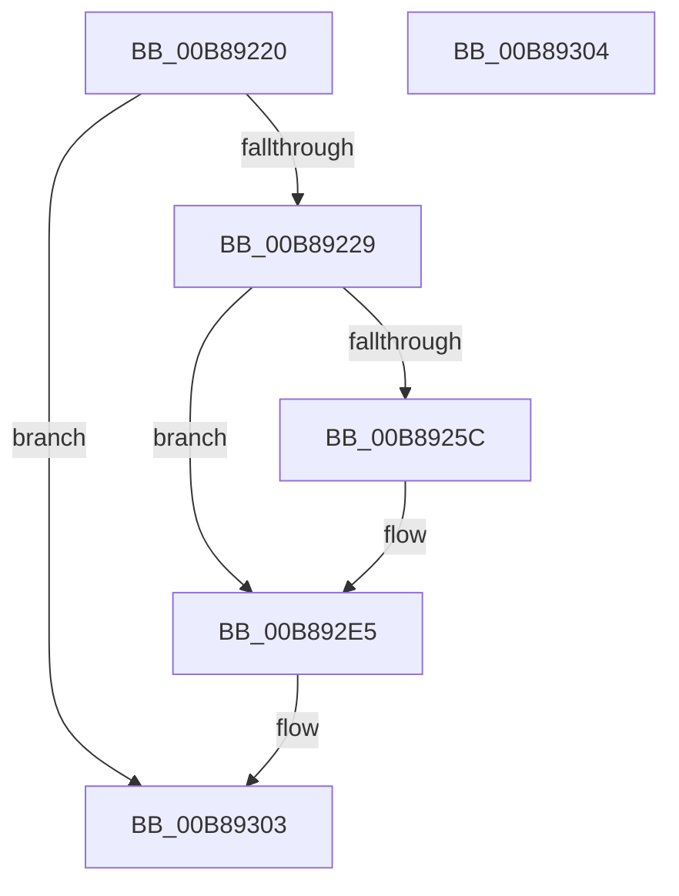

# KdpSymbol

- RVA: `0x00B89220`–`0x00B89305` (길이 `229` bytes)
- VA: `0x0000000140B89220`
- 실행 섹션: `PAGEKD`
- PDB 이름 있음: `예`; PDB Function 태그: `아니요`
- unwind 정보 RVA: `0x000C9A24`
- 디코드: `56`개 명령, `229/229` bytes 표시
- 미해석 바이트: `0` (있으면 어셈블리에 `.byte`로 보존)

> 이 문서는 커널 이미지의 기계어와 PDB 기호를 분석해 생성했습니다. 4번과 5번은 함수 원형과 자료형을 바이너리 사용 방식에서 추정한 C 해석이며 원본 소스 복구 결과는 아닙니다.

## 1. Dependencies

- 직접 호출 지점: **7**; 고유 호출 대상: **6**
- 직접 호출자로 확인된 함수: **1**
- RIP 상대 이미지 참조: **1**

### Outgoing calls
- `0x00B89266` → [KdEnterDebugger](KdEnterDebugger_function_00B8A96C.md) (function, `0x00B8A96C`)
- `0x00B89281` → [KiSaveProcessorControlState](../../text/6B/KiSaveProcessorControlState_function_006B0EF0.md) (function, `0x006B0EF0`)
- `0x00B8929E` → [KdpCopyContext](KdpCopyContext_function_00B851E8.md) (function, `0x00B851E8`)
- `0x00B892B3` → [KdpReportLoadSymbolsStateChange](KdpReportLoadSymbolsStateChange_function_00B87C44.md) (function, `0x00B87C44`)
- `0x00B892CD` → [KdpCopyContext](KdpCopyContext_function_00B851E8.md) (function, `0x00B851E8`)
- `0x00B892D8` → [KiRestoreProcessorControlState](../../text/6B/KiRestoreProcessorControlState_function_006B0E20.md) (function, `0x006B0E20`)
- `0x00B892E0` → [KdExitDebugger](KdExitDebugger_function_00B85008.md) (function, `0x00B85008`)

### Direct callers
- [KdpTrap](KdpTrap_function_00B852B8.md) at `0x00B8538C`

### Static image references
- `0x00B89246` → RVA `0x00F475DC` (`.data`; read)

## 2. Other-region calls and transfers

- 다른 실행 섹션으로 향하는 call: **2**
  - `0x00B89281` → [KiSaveProcessorControlState](../../text/6B/KiSaveProcessorControlState_function_006B0EF0.md) (`PAGEKD` → `.text`)
  - `0x00B892D8` → [KiRestoreProcessorControlState](../../text/6B/KiRestoreProcessorControlState_function_006B0E20.md) (`PAGEKD` → `.text`)
- 별도 외부 분기/꼬리 이동을 확인하지 못했습니다.

## 3. Assembly (complete function range)

```asm
00B89220  45 84 C9                        test r9b, r9b
00B89223  0F 85 DA 00 00 00               jne 0x140b89303
00B89229  48 8B C4                        mov rax, rsp
00B8922C  48 89 58 08                     mov qword ptr [rax + 8], rbx
00B89230  48 89 68 10                     mov qword ptr [rax + 0x10], rbp
00B89234  48 89 70 18                     mov qword ptr [rax + 0x18], rsi
00B89238  48 89 78 20                     mov qword ptr [rax + 0x20], rdi
00B8923C  41 54                           push r12
00B8923E  41 56                           push r14
00B89240  41 57                           push r15
00B89242  48 83 EC 20                     sub rsp, 0x20
00B89246  44 38 0D 8F E3 3B 00            cmp byte ptr [rip + 0x3be38f], r9b
00B8924D  41 8A D8                        mov bl, r8b
00B89250  4C 8B FA                        mov r15, rdx
00B89253  4C 8B E1                        mov r12, rcx
00B89256  0F 85 89 00 00 00               jne 0x140b892e5
00B8925C  48 8B 54 24 70                  mov rdx, qword ptr [rsp + 0x70]
00B89261  48 8B 4C 24 68                  mov rcx, qword ptr [rsp + 0x68]
00B89266  E8 01 17 00 00                  call 0x140b8a96c
00B8926B  65 48 8B 34 25 20 00 00 00      mov rsi, qword ptr gs:[0x20]
00B89274  44 8A F0                        mov r14b, al
00B89277  48 8D AE 00 01 00 00            lea rbp, [rsi + 0x100]
00B8927E  48 8B CD                        mov rcx, rbp
00B89281  E8 6A 7C B2 FF                  call 0x1406b0ef0
00B89286  48 8B 7C 24 60                  mov rdi, qword ptr [rsp + 0x60]
00B8928B  48 8B 8E C0 8F 00 00            mov rcx, qword ptr [rsi + 0x8fc0]
00B89292  4C 8B C7                        mov r8, rdi
00B89295  8B 57 30                        mov edx, dword ptr [rdi + 0x30]
00B89298  23 96 C8 8F 00 00               and edx, dword ptr [rsi + 0x8fc8]
00B8929E  E8 45 BF FF FF                  call 0x140b851e8
00B892A3  4C 8B 8E C0 8F 00 00            mov r9, qword ptr [rsi + 0x8fc0]
00B892AA  44 8A C3                        mov r8b, bl
00B892AD  49 8B D7                        mov rdx, r15
00B892B0  49 8B CC                        mov rcx, r12
00B892B3  E8 8C E9 FF FF                  call 0x140b87c44
00B892B8  8B 5F 30                        mov ebx, dword ptr [rdi + 0x30]
00B892BB  48 8B CF                        mov rcx, rdi
00B892BE  4C 8B 86 C0 8F 00 00            mov r8, qword ptr [rsi + 0x8fc0]
00B892C5  8B D3                           mov edx, ebx
00B892C7  23 96 C8 8F 00 00               and edx, dword ptr [rsi + 0x8fc8]
00B892CD  E8 16 BF FF FF                  call 0x140b851e8
00B892D2  48 8B CD                        mov rcx, rbp
00B892D5  89 5F 30                        mov dword ptr [rdi + 0x30], ebx
00B892D8  E8 43 7B B2 FF                  call 0x1406b0e20
00B892DD  41 8A CE                        mov cl, r14b
00B892E0  E8 23 BD FF FF                  call 0x140b85008
00B892E5  48 8B 5C 24 40                  mov rbx, qword ptr [rsp + 0x40]
00B892EA  48 8B 6C 24 48                  mov rbp, qword ptr [rsp + 0x48]
00B892EF  48 8B 74 24 50                  mov rsi, qword ptr [rsp + 0x50]
00B892F4  48 8B 7C 24 58                  mov rdi, qword ptr [rsp + 0x58]
00B892F9  48 83 C4 20                     add rsp, 0x20
00B892FD  41 5F                           pop r15
00B892FF  41 5E                           pop r14
00B89301  41 5C                           pop r12
00B89303  C3                              ret
00B89304  CC                              int3
```

## 4. C-style interpretation (structured pseudocode)

```c
__int64 __fastcall KdpSymbol(__int64 a1, __int64 a2, unsigned __int8 a3, unsigned __int8 a4, __int64 a5, __int64 a6, __int64 a7)
{
    __int64 result;
    __int64 v_r14;
    __int64 v_rbp;
    __int64 v_rbx;
    __int64 v_rdi;
    __int64 v_rsi;
    __int64 v_rsp;
    unsigned __int64 v_stack_p10;
    unsigned __int64 v_stack_p18;
    unsigned __int64 v_stack_p20;
    unsigned __int64 v_stack_p8;

    if (a4 != 0) goto loc_00B89303;
    *(unsigned __int64 *)(v_rsp + 8) = v_rbx;
    *(unsigned __int64 *)(v_rsp + 16) = v_rbp;
    *(unsigned __int64 *)(v_rsp + 24) = v_rsi;
    *(unsigned __int64 *)(v_rsp + 32) = v_rdi;
    v_rsp = (v_rsp) - (32);
    result = v_rsp;
    v_rbx = a3;
    if ((*(unsigned __int8 *)(v_rip + 3924879)) == a4) {
        a2 = a7;
        a1 = a6;
        result = KdEnterDebugger(a1, a2, a3, a4);
        v_rsi = *(unsigned __int64 *)(gs_base + (0 + 32));
        v_r14 = (unsigned __int8)(result);
        v_rbp = v_rsi + 256;
        a1 = v_rbp;
        result = KiSaveProcessorControlState(a1, a2, a3, a4);
        v_rdi = a5;
        a1 = *(unsigned __int64 *)(v_rsi + 36800);
        a3 = v_rdi;
        a2 = *(unsigned int *)(v_rdi + 48);
        a2 = (unsigned int)((a2) & (*(unsigned int *)(v_rsi + 36808)));
        result = KdpCopyContext(a1, a2, a3, a4);
        a4 = *(unsigned __int64 *)(v_rsi + 36800);
        a3 = a3;
        a2 = a2;
        a1 = a1;
        result = KdpReportLoadSymbolsStateChange(a1, a2, a3, a4);
        v_rbx = *(unsigned int *)(v_rdi + 48);
        a1 = v_rdi;
        a3 = *(unsigned __int64 *)(v_rsi + 36800);
        a2 = (unsigned int)(v_rbx);
        a2 = (unsigned int)((a2) & (*(unsigned int *)(v_rsi + 36808)));
        result = KdpCopyContext(a1, a2, a3, a4);
        a1 = v_rbp;
        *(unsigned int *)(v_rdi + 48) = (unsigned int)(v_rbx);
        result = KiRestoreProcessorControlState(a1, a2, a3, a4);
        a1 = (unsigned __int8)(v_r14);
        result = KdExitDebugger(a1, a2, a3, a4);
    }
    v_rsp = (v_rsp) + (32);
loc_00B89303:
    return result;
}
```

## 5. (Beta) C Style

```c
int64_t KdpSymbol(int64_t Arg1, int64_t Arg2, uint8_t Arg3, uint8_t Arg4, void *Arg5, int64_t Arg6, int64_t Arg7)
{
    uint8_t *arg5 = (uint8_t *)Arg5;

    int64_t result;
    int64_t local_r14;
    int64_t local_rbp;
    int64_t local_rbx;
    int64_t local_rdi;
    int64_t local_rsi;
    int64_t local_rsp;
    uint64_t v_stack_p10;
    uint64_t v_stack_p18;
    uint64_t v_stack_p20;
    uint64_t v_stack_p8;

    if (Arg4 != 0) goto loc_00B89303;
    *(uint64_t *)(local_rsp + 0x8) = local_rbx;
    *(uint64_t *)(local_rsp + 0x10) = local_rbp;
    *(uint64_t *)(local_rsp + 0x18) = local_rsi;
    *(uint64_t *)(local_rsp + 0x20) = local_rdi;
    local_rsp = (local_rsp) - (32);
    result = local_rsp;
    local_rbx = Arg3;
    if ((*(uint8_t *)(v_rip + 0x3BE38F)) == Arg4) {
        Arg2 = Arg7;
        Arg1 = Arg6;
        result = KdEnterDebugger(Arg1, Arg2, Arg3, Arg4);
        local_rsi = *(uint64_t *)(gs_base + (0 + 0x20));
        local_r14 = (uint8_t)(result);
        local_rbp = local_rsi + 256;
        Arg1 = local_rbp;
        result = KiSaveProcessorControlState(Arg1, Arg2, Arg3, Arg4);
        local_rdi = Arg5;
        Arg1 = *(uint64_t *)(local_rsi + 0x8FC0);
        Arg3 = local_rdi;
        Arg2 = *(uint32_t *)(local_rdi + 0x30);
        Arg2 = (uint32_t)((Arg2) & (*(uint32_t *)(local_rsi + 0x8FC8)));
        result = KdpCopyContext(Arg1, Arg2, Arg3, Arg4);
        Arg4 = *(uint64_t *)(local_rsi + 0x8FC0);
        Arg3 = Arg3;
        Arg2 = Arg2;
        Arg1 = Arg1;
        result = KdpReportLoadSymbolsStateChange(Arg1, Arg2, Arg3, Arg4);
        local_rbx = *(uint32_t *)(local_rdi + 0x30);
        Arg1 = local_rdi;
        Arg3 = *(uint64_t *)(local_rsi + 0x8FC0);
        Arg2 = (uint32_t)(local_rbx);
        Arg2 = (uint32_t)((Arg2) & (*(uint32_t *)(local_rsi + 0x8FC8)));
        result = KdpCopyContext(Arg1, Arg2, Arg3, Arg4);
        Arg1 = local_rbp;
        *(uint32_t *)(local_rdi + 0x30) = (uint32_t)(local_rbx);
        result = KiRestoreProcessorControlState(Arg1, Arg2, Arg3, Arg4);
        Arg1 = (uint8_t)(local_r14);
        result = KdExitDebugger(Arg1, Arg2, Arg3, Arg4);
    }
    local_rsp = (local_rsp) + (32);
loc_00B89303:
    return result;
}
```

### 관측된 메모리 오프셋

구조체 형식이 확인되지 않은 접근은 인자 기준의 오프셋으로만 기록했습니다.

| 기준 인자 | 오프셋 표현 | 폭 (bit) | 접근 |
|---|---:|---:|---|
| `Arg5` | `+ 0x30` | `32` | `R` |
| `Arg5` | `+ 0x30` | `32` | `W` |

## 6. Execution-region graph

[열기: 2D/3D 그래프와 함수 탐색 컨트롤 패널](../../../control-panel.html?section=pagekd&rva=0x00B89220&view=graph)

- 2D 그래프는 위에서 아래로 흐르고, 3D 그래프는 빈 공간을 드래그해 회전합니다. Shift+드래그는 이동, 휠은 확대·축소, 함수 노드 선택은 대상 보고서 이동입니다.

### Static fallback


