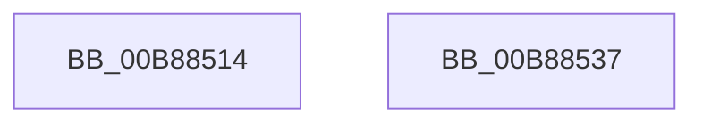

# KdpSysGetVersion

- RVA: `0x00B88514`–`0x00B88538` (길이 `36` bytes)
- VA: `0x0000000140B88514`
- 실행 섹션: `PAGEKD`
- PDB 이름 있음: `예`; PDB Function 태그: `아니요`
- unwind 정보 RVA: `0x000DB714`
- 디코드: `8`개 명령, `36/36` bytes 표시
- 미해석 바이트: `0` (있으면 어셈블리에 `.byte`로 보존)

> 이 문서는 커널 이미지의 기계어와 PDB 기호를 분석해 생성했습니다. 4번과 5번은 함수 원형과 자료형을 바이너리 사용 방식에서 추정한 C 해석이며 원본 소스 복구 결과는 아닙니다.

## 1. Dependencies

- 직접 호출 지점: **0**; 고유 호출 대상: **0**
- 직접 호출자로 확인된 함수: **1**
- RIP 상대 이미지 참조: **3**

### Outgoing calls
- 직접 디코드된 call 명령이 없습니다.

### Direct callers
- [KdSystemDebugControl](../../page/74/KdSystemDebugControl_function_00744700.md) at `0x00744B3F`

### Static image references
- `0x00B88514` → RVA `0x00E0AA20` (`.data`; read)
- `0x00B8851B` → RVA `0x00E0AA30` (`.data`; read)
- `0x00B88525` → RVA `0x00E0AA40` (`.data`; read)

## 2. Other-region calls and transfers

- 다른 실행 섹션으로 향하는 call: **0**
- 별도 외부 분기/꼬리 이동을 확인하지 못했습니다.

## 3. Assembly (complete function range)

```asm
00B88514  0F 10 05 05 25 28 00            movups xmm0, xmmword ptr [rip + 0x282505]
00B8851B  0F 10 0D 0E 25 28 00            movups xmm1, xmmword ptr [rip + 0x28250e]
00B88522  0F 11 01                        movups xmmword ptr [rcx], xmm0
00B88525  F2 0F 10 05 13 25 28 00         movsd xmm0, qword ptr [rip + 0x282513]
00B8852D  0F 11 49 10                     movups xmmword ptr [rcx + 0x10], xmm1
00B88531  F2 0F 11 41 20                  movsd qword ptr [rcx + 0x20], xmm0
00B88536  C3                              ret
00B88537  CC                              int3
```

## 4. C-style interpretation (structured pseudocode)

```c
void __fastcall KdpSysGetVersion(__int64 a1)
{
    *(unsigned __int64 *)(a1) = v_xmm0;
    *(unsigned __int64 *)(a1 + 16) = v_xmm1;
    *(unsigned __int64 *)(a1 + 32) = v_xmm0;
    return;
}
```

## 5. (Beta) C Style

```c
void KdpSysGetVersion(void *Arg1)
{
    uint8_t *arg1 = (uint8_t *)Arg1;

    *(uint64_t *)(arg1) = v_xmm0;
    *(uint64_t *)(arg1 + 0x10) = v_xmm1;
    *(uint64_t *)(arg1 + 0x20) = v_xmm0;
    return;
}
```

### 관측된 메모리 오프셋

구조체 형식이 확인되지 않은 접근은 인자 기준의 오프셋으로만 기록했습니다.

| 기준 인자 | 오프셋 표현 | 폭 (bit) | 접근 |
|---|---:|---:|---|
| `Arg1` | `+ 0x0` | `128` | `R` |
| `Arg1` | `+ 0x10` | `128` | `R` |
| `Arg1` | `+ 0x20` | `64` | `W` |

## 6. Execution-region graph

[열기: 2D/3D 그래프와 함수 탐색 컨트롤 패널](../../../control-panel.html?section=pagekd&rva=0x00B88514&view=graph)

- 2D 그래프는 위에서 아래로 흐르고, 3D 그래프는 빈 공간을 드래그해 회전합니다. Shift+드래그는 이동, 휠은 확대·축소, 함수 노드 선택은 대상 보고서 이동입니다.

### Static fallback


