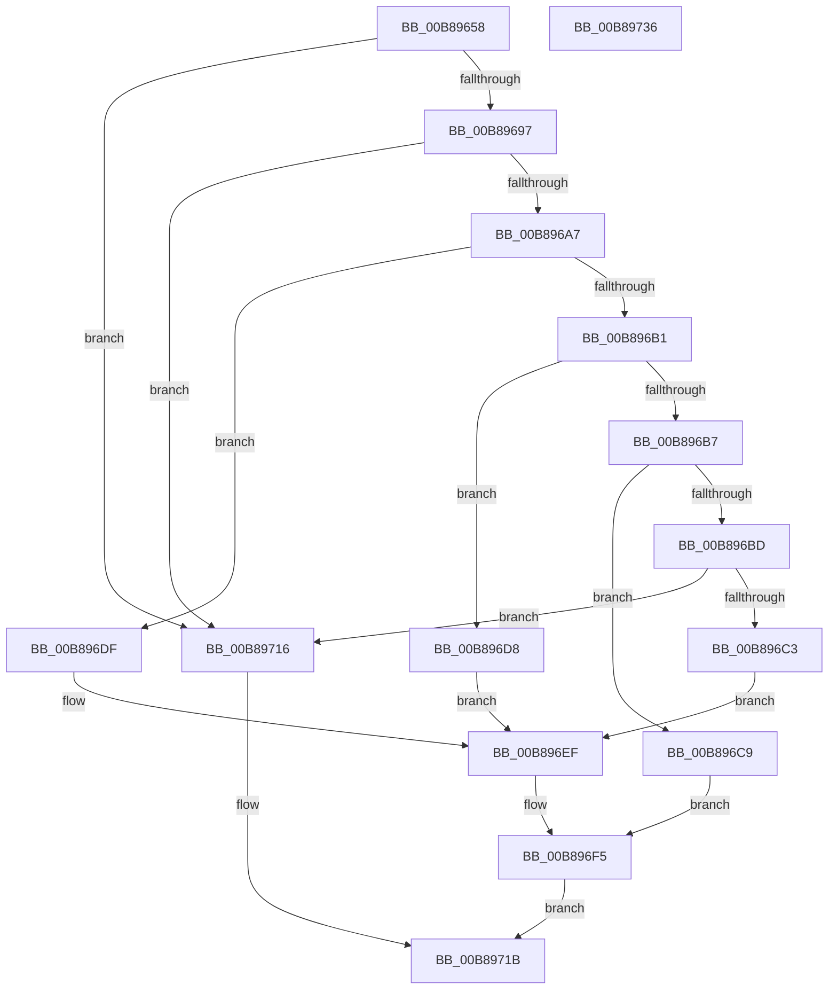

# KdpSysReadControlSpace

- RVA: `0x00B89658`–`0x00B89737` (길이 `223` bytes)
- VA: `0x0000000140B89658`
- 실행 섹션: `PAGEKD`
- PDB 이름 있음: `예`; PDB Function 태그: `아니요`
- unwind 정보 RVA: `0x00060130`
- 디코드: `59`개 명령, `223/223` bytes 표시
- 미해석 바이트: `0` (있으면 어셈블리에 `.byte`로 보존)

> 이 문서는 커널 이미지의 기계어와 PDB 기호를 분석해 생성했습니다. 4번과 5번은 함수 원형과 자료형을 바이너리 사용 방식에서 추정한 C 해석이며 원본 소스 복구 결과는 아닙니다.

## 1. Dependencies

- 직접 호출 지점: **2**; 고유 호출 대상: **2**
- 직접 호출자로 확인된 함수: **2**
- RIP 상대 이미지 참조: **1**

### Outgoing calls
- `0x00B8968E` → [KeQueryActiveProcessorCountEx](../../text/24/KeQueryActiveProcessorCountEx_function_00249EF0.md) (function, `0x00249EF0`)
- `0x00B8970F` → [KdpCopyMemoryChunks](KdpCopyMemoryChunks_function_00B8AACC.md) (function, `0x00B8AACC`)

### Direct callers
- [KdSystemDebugControl](../../page/74/KdSystemDebugControl_function_00744700.md) at `0x007448B9`
- [KdpReadControlSpace](KdpReadControlSpace_function_00B875AC.md) at `0x00B8761A`

### Static image references
- `0x00B89697` → RVA `0x00FC8C40` (`ALMOSTRO`; read)

## 2. Other-region calls and transfers

- 다른 실행 섹션으로 향하는 call: **1**
  - `0x00B8968E` → [KeQueryActiveProcessorCountEx](../../text/24/KeQueryActiveProcessorCountEx_function_00249EF0.md) (`PAGEKD` → `.text`)
- 별도 외부 분기/꼬리 이동을 확인하지 못했습니다.

## 3. Assembly (complete function range)

```asm
00B89658  48 8B C4                        mov rax, rsp
00B8965B  48 89 58 08                     mov qword ptr [rax + 8], rbx
00B8965F  48 89 68 10                     mov qword ptr [rax + 0x10], rbp
00B89663  48 89 70 18                     mov qword ptr [rax + 0x18], rsi
00B89667  48 89 78 20                     mov qword ptr [rax + 0x20], rdi
00B8966B  41 56                           push r14
00B8966D  48 83 EC 40                     sub rsp, 0x40
00B89671  48 8B 74 24 70                  mov rsi, qword ptr [rsp + 0x70]
00B89676  41 8B E9                        mov ebp, r9d
00B89679  48 83 60 E8 00                  and qword ptr [rax - 0x18], 0
00B8967E  4D 8B F0                        mov r14, r8
00B89681  8B F9                           mov edi, ecx
00B89683  48 8B DA                        mov rbx, rdx
00B89686  B9 FF FF 00 00                  mov ecx, 0xffff
00B8968B  83 26 00                        and dword ptr [rsi], 0
00B8968E  E8 5D 08 6C FF                  call 0x140249ef0
00B89693  3B F8                           cmp edi, eax
00B89695  73 7F                           jae 0x140b89716
00B89697  48 8D 0D A2 F5 43 00            lea rcx, [rip + 0x43f5a2]
00B8969E  48 8B 04 F9                     mov rax, qword ptr [rcx + rdi*8]
00B896A2  48 85 C0                        test rax, rax
00B896A5  74 6F                           je 0x140b89716
00B896A7  48 89 44 24 70                  mov qword ptr [rsp + 0x70], rax
00B896AC  48 85 DB                        test rbx, rbx
00B896AF  74 2E                           je 0x140b896df
00B896B1  48 83 EB 01                     sub rbx, 1
00B896B5  74 21                           je 0x140b896d8
00B896B7  48 83 EB 01                     sub rbx, 1
00B896BB  74 0C                           je 0x140b896c9
00B896BD  48 83 FB 01                     cmp rbx, 1
00B896C1  75 53                           jne 0x140b89716
00B896C3  48 8D 50 08                     lea rdx, [rax + 8]
00B896C7  EB 26                           jmp 0x140b896ef
00B896C9  48 8D 90 00 01 00 00            lea rdx, [rax + 0x100]
00B896D0  41 B8 F0 00 00 00               mov r8d, 0xf0
00B896D6  EB 1D                           jmp 0x140b896f5
00B896D8  48 8D 54 24 70                  lea rdx, [rsp + 0x70]
00B896DD  EB 10                           jmp 0x140b896ef
00B896DF  48 05 80 FE FF FF               add rax, -0x180
00B896E5  48 8D 54 24 30                  lea rdx, [rsp + 0x30]
00B896EA  48 89 44 24 30                  mov qword ptr [rsp + 0x30], rax
00B896EF  41 B8 08 00 00 00               mov r8d, 8
00B896F5  44 3B C5                        cmp r8d, ebp
00B896F8  48 89 74 24 28                  mov qword ptr [rsp + 0x28], rsi
00B896FD  49 8B CE                        mov rcx, r14
00B89700  C7 44 24 20 05 00 00 00         mov dword ptr [rsp + 0x20], 5
00B89708  44 0F 47 C5                     cmova r8d, ebp
00B8970C  45 33 C9                        xor r9d, r9d
00B8970F  E8 B8 13 00 00                  call 0x140b8aacc
00B89714  EB 05                           jmp 0x140b8971b
00B89716  B8 01 00 00 C0                  mov eax, 0xc0000001
00B8971B  48 8B 5C 24 50                  mov rbx, qword ptr [rsp + 0x50]
00B89720  48 8B 6C 24 58                  mov rbp, qword ptr [rsp + 0x58]
00B89725  48 8B 74 24 60                  mov rsi, qword ptr [rsp + 0x60]
00B8972A  48 8B 7C 24 68                  mov rdi, qword ptr [rsp + 0x68]
00B8972F  48 83 C4 40                     add rsp, 0x40
00B89733  41 5E                           pop r14
00B89735  C3                              ret
00B89736  CC                              int3
```

## 4. C-style interpretation (structured pseudocode)

```c
__int64 __fastcall KdpSysReadControlSpace(int a1, __int64 a2, __int64 a3, int a4, __int64 a5)
{
    __int64 result;
    __int64 v_rbx;
    __int64 v_rsp;
    unsigned __int64 v_stack_m18;
    unsigned __int64 v_stack_m20;
    unsigned int v_stack_m28;
    unsigned __int64 v_stack_p10;
    unsigned __int64 v_stack_p18;
    unsigned __int64 v_stack_p20;
    unsigned __int64 v_stack_p28;
    unsigned __int64 v_stack_p8;

    *(unsigned __int64 *)(v_rsp + 8) = v_rbx;
    *(unsigned __int64 *)(v_rsp + 16) = v_rbp;
    *(unsigned __int64 *)(v_rsp + 24) = v_rsi;
    *(unsigned __int64 *)(v_rsp + 32) = v_rdi;
    v_rsp = (v_rsp) - (64);
    result = KeQueryActiveProcessorCountEx((unsigned int)(0xFFFFULL), a2, a3, a4);
    if (((unsigned int)((unsigned int)(a1))) >= ((unsigned int)(result))) goto loc_00B89716;
    if (*(unsigned __int64 *)(v_rip + 4453794 + (unsigned int)(a1) * 8) == 0) goto loc_00B89716;
    v_stack_p28 = *(unsigned __int64 *)(v_rip + 4453794 + (unsigned int)(a1) * 8);
    if (a2 == 0) goto loc_00B896DF;
    v_rbx = (a2) - (1);
    if (condition_is_equal) goto loc_00B896D8;
    v_rbx = (v_rbx) - (1);
    if (condition_is_equal) goto loc_00B896C9;
    if (v_rbx != 1) goto loc_00B89716;
    goto loc_00B896EF;
loc_00B896C9:
    goto loc_00B896F5;
loc_00B896D8:
    goto loc_00B896EF;
loc_00B896DF:
    result = (*(unsigned __int64 *)(v_rip + 4453794 + (unsigned int)(a1) * 8)) + (-384);
    v_stack_m18 = result;
loc_00B896EF:
loc_00B896F5:
    v_stack_m20 = a5;
    v_stack_m28 = 5;
    a3 = 8;
    if (8 > ((unsigned int)((unsigned int)(a4)))) { a3 = (unsigned int)((unsigned int)(a4)); }
    a4 = 0;
    result = KdpCopyMemoryChunks(a3, v_stack_m18, a3, a4);
    goto loc_00B8971B;
loc_00B89716:
loc_00B8971B:
    v_rsp = (v_rsp) + (64);
    return (unsigned int)(0xC0000001ULL);
}
```

## 5. (Beta) C Style

```c
int64_t KdpSysReadControlSpace(int32_t Arg1, int64_t Arg2, int64_t Arg3, int32_t Arg4, void *Arg5)
{
    uint8_t *arg5 = (uint8_t *)Arg5;

    int64_t result;
    int64_t local_rbx;
    int64_t local_rsp;
    uint64_t v_stack_m18;
    uint64_t v_stack_m20;
    uint32_t v_stack_m28;
    uint64_t v_stack_p10;
    uint64_t v_stack_p18;
    uint64_t v_stack_p20;
    uint64_t v_stack_p28;
    uint64_t v_stack_p8;

    *(uint64_t *)(local_rsp + 0x8) = local_rbx;
    *(uint64_t *)(local_rsp + 0x10) = local_rbp;
    *(uint64_t *)(local_rsp + 0x18) = local_rsi;
    *(uint64_t *)(local_rsp + 0x20) = local_rdi;
    local_rsp = (local_rsp) - (64);
    result = KeQueryActiveProcessorCountEx((uint32_t)(0xFFFFULL), Arg2, Arg3, Arg4);
    if (((uint32_t)((uint32_t)(Arg1))) >= ((uint32_t)(result))) goto loc_00B89716;
    if (*(uint64_t *)(v_rip + 0x43F5A2 + (uint32_t)(Arg1) * 8) == 0) goto loc_00B89716;
    v_stack_p28 = *(uint64_t *)(v_rip + 0x43F5A2 + (uint32_t)(Arg1) * 8);
    if (Arg2 == 0) goto loc_00B896DF;
    local_rbx = (Arg2) - (1);
    if (condition_is_equal) goto loc_00B896D8;
    local_rbx = (local_rbx) - (1);
    if (condition_is_equal) goto loc_00B896C9;
    if (local_rbx != 1) goto loc_00B89716;
    goto loc_00B896EF;
loc_00B896C9:
    goto loc_00B896F5;
loc_00B896D8:
    goto loc_00B896EF;
loc_00B896DF:
    result = (*(uint64_t *)(v_rip + 0x43F5A2 + (uint32_t)(Arg1) * 8)) + (-384);
    v_stack_m18 = result;
loc_00B896EF:
loc_00B896F5:
    v_stack_m20 = Arg5;
    v_stack_m28 = 5;
    Arg3 = 8;
    if (8 > ((uint32_t)((uint32_t)(Arg4)))) { Arg3 = (uint32_t)((uint32_t)(Arg4)); }
    Arg4 = 0;
    result = KdpCopyMemoryChunks(Arg3, v_stack_m18, Arg3, Arg4);
    goto loc_00B8971B;
loc_00B89716:
loc_00B8971B:
    local_rsp = (local_rsp) + (64);
    return (uint32_t)(0xC0000001ULL);
}
```

### 관측된 메모리 오프셋

구조체 형식이 확인되지 않은 접근은 인자 기준의 오프셋으로만 기록했습니다.

| 기준 인자 | 오프셋 표현 | 폭 (bit) | 접근 |
|---|---:|---:|---|
| `Arg5` | `+ 0x0` | `32` | `R/W` |

## 6. Execution-region graph

[열기: 2D/3D 그래프와 함수 탐색 컨트롤 패널](../../../control-panel.html?section=pagekd&rva=0x00B89658&view=graph)

- 2D 그래프는 위에서 아래로 흐르고, 3D 그래프는 빈 공간을 드래그해 회전합니다. Shift+드래그는 이동, 휠은 확대·축소, 함수 노드 선택은 대상 보고서 이동입니다.

### Static fallback


